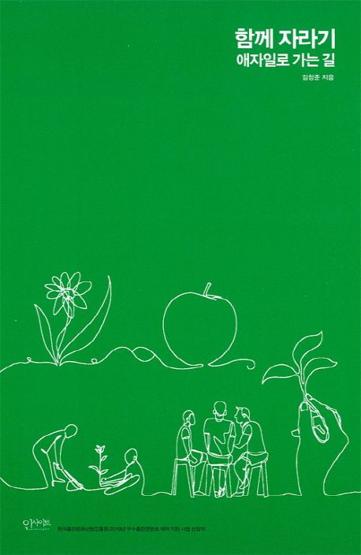

[🔗 함께 자라기 ‘함께’는 협력을 말하고, ‘자라기’는 학습을 말합니다. 무엇이건 실제 바깥세상(야생)에 임팩트를 남기려면 혼자 힘으로만 되는 게 없습니다. 함께 해야 합니다. 주변 사람들과 함께. 매일 부대끼는 동료들과 함께. 스스로 변하고 싶지만 계속 실패하는 사람, 조직을 개선하기 위한 시도를 하다가 오히려 데어본 사람, 불확실한 상황에서 합리적인 판단을 해야 하는 사람, 한 분야에서 전문성을 키워야 하는 사람에게 전문성을 키울 수 있는 제대로 된 방법을 알려줍니다. 어떤 분야에서 일하든 어느 위치에 있든 상관 없습니다. 이 책에서는 일하는 방법의 핵심과 통찰을 다룹니다. 개인의 힘으로는 극복할 수 없는 한계를 깨뜨리려면 모두가 같이 발전해야 합니다. 나 그리고 더 나아가 남을 변화시키는 삶에 대해 얘기합니다. - 직원을 뽑을 때 무엇이 그 사람의 실력을 가장 잘 예측할까 - 수십 년 같은 일을 해도 전문가가 안 되는 이유와 제자리걸음에서 벗어나는 방법 - 커뮤니케이션과 협력을 잘하는 방안 - 리더의 역할과, 멘토링, 코칭 능력을 향상시키려면? - 빠른 학습 능력을 보이는 탁월한 팀의 비밀 - 조직을 효과적으로 변화시키려면? 저자 김창준 출판 인사이트 출판일 2018.11.30](https://search.daum.net/search?w=bookpage&bookId=4833808&tab=introduction&DA=YZR&q=%ED%95%A8%EA%BB%98+%EC%9E%90%EB%9D%BC%EA%B8%B0)

작년에 ebook으로 구매한 책이다. 지난 8월 1일 이후로 나의 경력은 3년차가 되었고, 성장에 대한 마음가짐도 신입 때 보다 무거워졌음을 느끼고 있다. 그리고 ebook에 먼지만 쌓여있던 『함께 자라기』 책이 생각 났다.

---

> ※  아래 내용은 책을 읽고 인상깊은 부분을 정리한 글입니다.

> "내가 정말 잘할 수 있을까? 우리가 정말 자랄 수 있을까?"
> 실제 바깥세상에서는 한 번의 판가름으로 나의 미래가, 우리의 미래가 갈리는 경우보다는 수백, 수천 번의 누적 위에 서서히 정해지는 경우가 더 많습니다. 하지만 우리는 왜 자라는 것을 훈련할 기회가 별로 없을까요.
> 그리고 무엇보다 이런 '함께', 그리고 '자라기'를 매일매일 해야 한다는 생각을 별로 하지 못하는 것 같습니다.

> - 내가 정말 자랄 수 있을까?
> - 우리가 정말 함께 자랄 수 있을까?
> - 우리가 정말 매일매일 함께 자랄 수 있을까?

#### 1부, 자라기

#### "당신은 몇 년 차?" (1)

> 오히려 현실에서는 충돌하는 것이 정상이라구요. 모든 화살표가 같은 곳을 가리키는 경우가 더 예외적이지요. 그래서 처음부터 이런 상반된 의견과 정보 속에서 스스로 생각하는 훈련을 해나가야 한다고 말했습니다.

> 그러면 어떤 경우에 이 (야생) 학습이 중요할까요? 일반적으로 불확실성이 높은 경우일수록 학습이 중요합니다. 간단한 비유를 해보죠. 내가 ㄱ에서 ㄴ 지점으로 이동하는데, 목표 지점인 ㄴ의 위치가 계속 바뀌거나 한다면 나는 가는 중에 고개를 들어서 주변을 살피고 ㄴ의 위치를 추정하고 경로 조정을 빈번히 해야 할 것입니다. 그렇게 안 하고 애초에 세웠던 계획대로 간다면 ㄴ에 도달하는 것은 점점 멀어지기 쉽겠지요.

> 수파리 (守破離) 이야기, 교육적 폭력
> 1. 숨겨진 곳에
> 2. 도인이 존재하며
> 3. 몇 년간 고립된 곳에서 별생각 없이 그가 시키는 대로 해야 하며
> 4. 그것이 지금은 납득되지 않지만 결국에는 나에게 좋을 것이라는 무조건적 믿음을 갖고 따르다 보면
> 5. 종국에는 비급을 사사받고 득도해서
> 6. 마지막에 하산한다는 것
> 이를 대체할 만한 새로운 교육 메타포를 찾자

> **당신은 몇 년 차?**
> **경력, 그 견딜 수 없는 무거움**
> **"강한 놈이 오래 가는오래가는 게 아니라, 오래가는 놈이 강한 거더라." _장필호(이범수 분), 《짝패》에서**

> 이 연구 결과 경력 연차는 직무 성과와 얼마나 많은 상관성을 갖고 있었을까요? 또 학력과의 상관성은 얼마나 됐을까요? 경력 연차의 상관성은 0.18, 학력의 상관성은 0.10입니다. 상관성이 0.20 이하이면 사회 과학에서도 꽤나 약한 상관성이라고 말합니다. 관심사(interests, 취미활동 등)조차도 직무 성과와 상관성이 0.10이 되는 수준입니다. 즉, 학교에서 받은 교육 연수로 사람을 뽑으면, 채용 후 직무 성과 면에서 봤을 때에 관심사를 보고 뽑는 것과 별반 다를 바가 없다는 이야기입니다.

> 그렇다면 어떤 것들이 상관성이 높았을까요? 작업 샘플 테스트(work sample test, 실제로 채용 후 해야 할 작업의 일부를 해보는 테스트)가 0.54, 아이큐 같은 지능 테스트가 0.51, 구조화된 인터뷰(예컨대 모든 후보에게 직무 분석을 토대로 한, 같은 순서의 동일 질문을 하는 인터뷰)가 0.51이었습니다. 성실성이나 꼼꼼함 같은 성격 테스트도 0.41이나 0.31 정도의 상관성이 있었습니다. 레퍼런스 체크(예전 직장의 상사 등에게 확인)도 0.26으로 앞서의 '연차'들의 상관성보다 높았습니다. 특히 작업 샘플 테스트, 지능 테스트, 구조화된 인터뷰, 성격 등을 결합하면 직무 성과에 대한 예측력이 좀 더 높아졌습니다.

> 그렇다고 연차가 완전히 의미가 없는 것은 아니었습니다. 경력이 얼마 되지 않았을 때 몇 년간은 연차의 상관성이 꽤 높은 편입니다. 하지만 연차가 조금이라도 높아지면 그 상관성은 곤두박질칩니다.
>
> 예를 들어, 대학교를 갓 졸업한 사람과 2년 차 프로그래머 중에서 후자의 실력이 높을 확률이 큽니다. 하지만 5년 차와 10년 차의 연차 차이는 실력을 판단하는 데 있어 큰 의미가 없습니다.

> 전문가와 비/준전문가의 차이
> 경험 많은 사람(경험이 부족한 사람과 비교해)을 전문가로 본 연구에서는 그들이 **문제를 이해하는 데 더 많은 시간과 노력을 기울이는 것**으로 밝혀졌습니다.

> 최소한도의 경험치만 넘어가면 경력 연수와 실제 직무 성과의 성관성이 생가보다 낮다
>
> 경력이란 경력 연차를 말하는 게 아닙니다. 개발자의 경험이 얼마나 폭넓고 다양했는지가 실제 직무성과와 관련이 있었습니다. 경력의 양적인 면이 아니라 질적인 면의 중요성을 발견한 겁니다.
>
> 경력이 성과와 별 상관이 없다는 것을 넘어서서 오히려 경력이 편향을 주는 잘못된 지표가 될 수 있다고 봅니다. 최소한도의 경력 수준만 넘겼으면 오히려 몇 년 일했는지는 모르는 것이 더 낫다고 생각하고요.

> 대안은?
>
> 구조화된 인터뷰(특별히 구조화된 행동중심적 인터뷰)와, 실제 작업을 해보도록 하는 작업 샘플 테스트, 그리고 가능하다면 실제 업무를 주고 시험적으로 짧은 기간 동안 일을 해보게 하는 것 등을 권합니다. 전체 구인 과정에서 실제로 함께 일할 사람들이 인터뷰에 참여하도록 하는 것을 권합니다.

> 이미 뽑은 사람을 어떻게 할 것인가?
>
> 업무 중에 자신의 능력을 향상하기 위해 시간을 얼마나 쓰는가(의도적 수련)와 직무 성과를 비교한 연구가 있습니다. 이 연구에서는 최근 일주일 동안 업무 능력 향상을 위해 얼마나 시간을 쓰는지 물었는데, 이 시간의 양과 직무 성과 간에 통계적으로 유의미한 양의 상관성이 있었습니다. (경력 연차가 비슷한 사람, 하루 중에 다루는 업무량이 비슷한 사람끼리 비교를 해도 그렇습니다.) 그들이 자주 하는 수련으로는 '머릿속에서 시뮬레이션하기', '피드백 요청하기' 등이 있었습니다. 달리 말하면 **내가 요즘에 얼마나 공부하고 수련하느냐**로 **내 직무 성과**가 결정된다는 이야기가 됩니다.

> 조직은 개인이 자신의 전문성을 좀 더 발전시키고 관리할 수 있게 최대한 지원을 해야 합니다.
> 그것이 윈윈 하는 길입니다.

> 시스템의 중요성
> 뽑고 나서 잘 교육하고 성장하게 도와주는 것 이상으로 중요한 것이 또 있습니다. 바로 시스템입니다.
> 아무리 훌륭한 사람을 뽑아도 조직의 시스템과 문화에 문제가 있으면 그런 사람은 묻혀버리기 쉽고, 반대로 실력이 평범한 사람일지라도 좋은 시스템 속에서 뛰어난 성과를 낼 수도 있습니다.

#### "당신은 몇 년 차?" (2)

> 1만 시간의 함정
> 자신이 즐기는 걸 한다고 해서 더 뛰어나게 될 것이라고 믿는 것은 미신입니다.
> 1만 시간은 **'자신의 기량을 향상시킬 목적으로 반복적으로 하는 수련'**을 한 시간을 일컫습니다.
> 그런 수련을 **의도적 수련(deliberate practice)**이라고 합니다. 그냥 경험이 아니고 매우 특수한 형태의 수련 방법입니다.
>
> **정말 기량 향상을 목적으로 자신의 약점을 개선하려고 애쓰는 수련**, 그것만이 **의도적 수련**입니다.

> 업무 중 실천할 수 있는 ****의도적 수련 -******"피드백을 짧은 주기로 얻는 것", "실수를 교정할 기회가 있는 것"**
>
> **애자일 철학**을 활용합니다. 애자일은 학습을 소프트웨어 개발의 가장 큰 병목 중 하나로 봅니다. 일반적인 프로젝트에서는 모든 피드백의 주기가 느립니다. 내가 설계 단계에서 했던 결정의 피드백을 몇 달 후 테스트 단계에서 받습니다. 그때쯤 되면 왜 내가 그런 결정을 했는지조차 가물거립니다.
> 설령 기억이 난다 해도, "아, 그런 거였군" 하고 아무렇지 않게 지나치기 쉽습니다. 내가 과거에 잘못한 실수는 한참 전에 지나가 버렸고 이제 와서 이걸 교정할 기회가 없기 때문입니다.
> 하지만 애자일 프로젝트에서는 지금 내가 한 행동의 피드백을 10분 후, 한 시간 후, 하루 후, 일주일 후 등 여러 주기를 통해 지속적으로 얻을 수 있습니다. 그리고 그때 저지른 실수는 바로 다음 주기에서 교정할 수 있습니다.

> 피드백과 그 주기
>
> 1. 실수를 교정할 기회가 있는 것
> - 내가 잘했나 못 했나 알지 못하면 행동을 조정할 수가 없다. 그래서 학습에서는 피드백이 중요하다.
>
> 2. 피드백을 짧은 주기로 얻는 것
> - 피드백 주기가 길어지면 학습이 잘 안 된다.
> - 피드백 주기가 길어진다는 것은 골프 퍼팅 연습을 하는데 결과를 1년 후에 알게 되는 것과 같다.
>
> 사례. 진단전문의 A
> 그는 상당한 시간을 자기 환자를 확인하는 데에 보내면서, 진단 시에 자신이 무얼 생각하는지 많은 기록을 하고, 자신이 얼마나 정확한지 나중에 확인을 한다.
> 자신이 만든 이 부차적 단계가 그를 차별화시키는 중요한 지점이다.
> 그는 자신이 언제, 어떻게 나아지고 있는지 잘 알 수 있다. 일반적으로 최고 수준의 퍼포먼스를 내는 사람들은 특별한 테크닉을 활용하는데, 그것은 널리 알려지지도 않고 많은 사람들이 실제로 행하지 않는 것이다.

---

**[ Reference ]**

[함께 자라기 - 애자일로 가는 길 | 김창준](https://product.kyobobook.co.kr/detail/S000001033071)

