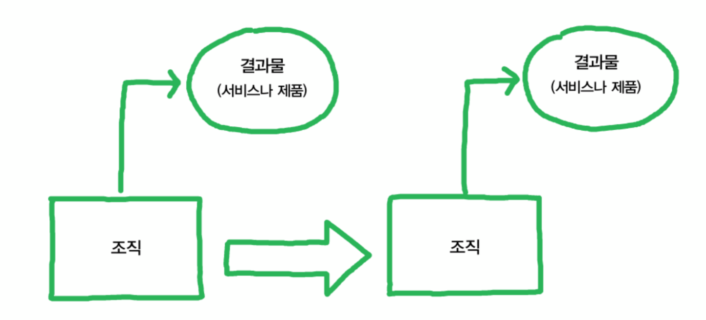
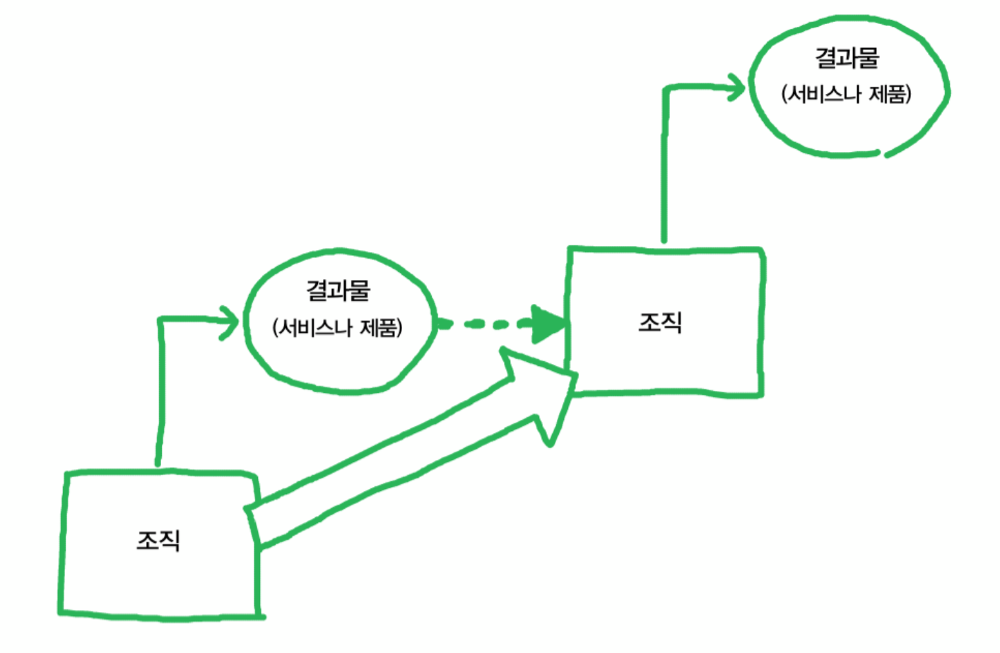
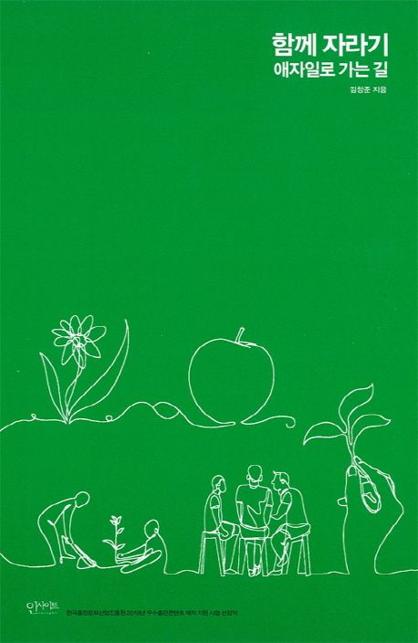

[🔗 함께 자라기 ‘함께’는 협력을 말하고, ‘자라기’는 학습을 말합니다. 무엇이건 실제 바깥세상(야생)에 임팩트를 남기려면 혼자 힘으로만 되는 게 없습니다. 함께 해야 합니다. 주변 사람들과 함께. 매일 부대끼는 동료들과 함께. 스스로 변하고 싶지만 계속 실패하는 사람, 조직을 개선하기 위한 시도를 하다가 오히려 데어본 사람, 불확실한 상황에서 합리적인 판단을 해야 하는 사람, 한 분야에서 전문성을 키워야 하는 사람에게 전문성을 키울 수 있는 제대로 된 방법을 알려줍니다. 어떤 분야에서 일하든 어느 위치에 있든 상관 없습니다. 이 책에서는 일하는 방법의 핵심과 통찰을 다룹니다. 개인의 힘으로는 극복할 수 없는 한계를 깨뜨리려면 모두가 같이 발전해야 합니다. 나 그리고 더 나아가 남을 변화시키는 삶에 대해 얘기합니다. - 직원을 뽑을 때 무엇이 그 사람의 실력을 가장 잘 예측할까 - 수십 년 같은 일을 해도 전문가가 안 되는 이유와 제자리걸음에서 벗어나는 방법 - 커뮤니케이션과 협력을 잘하는 방안 - 리더의 역할과, 멘토링, 코칭 능력을 향상시키려면? - 빠른 학습 능력을 보이는 탁월한 팀의 비밀 - 조직을 효과적으로 변화시키려면? 저자 김창준 출판 인사이트 출판일 2018.11.30](https://search.daum.net/search?w=bookpage&bookId=4833808&tab=introduction&DA=YZR&q=%ED%95%A8%EA%BB%98+%EC%9E%90%EB%9D%BC%EA%B8%B0)

작년에 ebook으로 구매한 책이다. 지난 8월 1일 이후로 나의 경력은 3년차가 되었고, 성장에 대한 마음가짐도 신입 때 보다 무거워졌음을 느끼고 있다. 그리고 ebook에 먼지만 쌓여있던 『함께 자라기』 책이 생각 났다.

### 목차

**▼ 더보기**

- 머리말
- 차례
- 1부 자라기
	- 당신은 몇 년 차?
	- 자기계발은 복리로 돌아온다
	- 학습 프레임과 실행 프레임
	- 가장 학습하기 힘든 직업이 살아남는다
	- 달인이 되는 비결
	- 수십 년 동안 전문가가 안 되는 비결
	- 당신이 제자리 걸음인 이유
	- 의도적 수련의 일상적 예시
	- 프로그래밍 언어 배우기의 달인
	- 실수는 예방하는 것이 아니라 관리하는 것이다.
	- 뛰어난 선생에 대한 미신
	- 나홀로 전문가에 대한 미신
- 2부 함께
	- 소프트웨어 관리자의 개선 우선순위
	- 협력을 통한 추상화
	- 신뢰를 꺾는 공유인가 신뢰를 쌓는 공유인가
	- 객관성의 주관성
	- 이것도 모르세요?
	- 하향식 접근의 함정
	- 전문가팀이 실패하는 이유
	- 구글이 밝힌 탁월한 팀의 비밀
	- 쾌속 학습팀
	- 프로젝트 활용론
- 3부 애자일
	- 애자일의 씨앗
	- 애자일 도입 성공 요인 분석
	- 당신의 조직에 새 방법론이 먹히지 않는 이유
	- 애자일을 애자일스럽게 도입하기
- 감사의 글
- 참고자료

---

> ※  아래 내용은 책을 읽고 인상깊은 부분을 정리한 글입니다.

#### 1부, 자라기

#### "자기계발은 복리로 돌아온다"

> 회고
> 저는 뭔가 일이 끝나면 항상 **회고** 라는 활동을 합니다.
> 저 혼자 하기보다 주변의 지인들과 함께 합니다. 서로 자극을 많이 받게 되거든요.
>
> 연말
> - 한 해를 되돌아보고 반성하는 일년 회고.
> - 내가 올해에 어떤 것을 했고, 어떤 것을 느꼈고, 어떤 교훈을 배웠는지 짚어봅니다.
> - **항상 되짚어 보는 것** 중 하나는 **나 자신에게 얼마나 투자**를 했냐? **자기계발** 영역

> **자기계발 통계**
>
> 잡코리아 비즈몬의 직장인 자기계발 통계를 봐도 알 수 있듯이
>
> 하루 평균 1시간도 투자하지 않는 사람은 자기계발이란 면에서 직장인의 하위 1/3에 속하는 셈
> **자기계발이 축적 되면 엄청난 차이를 만들 것**이란 점이 무서운 사실입니다.
> **자기가 습득한 지식이나 능력**은 **복리**로 이자가 붙기 때문입니다.
>
> 올해 읽은 책도 몇 권 없고, 새로 얻은 통찰도 없다는 지금 당장은 별 문제없는 것 같지만(예를 들면 올해 내 연봉은 만족스러우나) 내년이나 내후년에는 분명 추락을 경험할 것입니다.

> **자기계발, 복리의 비밀**
>
> **복리**는 '**기하급수**'의 구조입니다.
> 기하급수는 더하기가 아니고 **곱하기**로 진행되는 급수입니다. 여기서 중요한 부분은 **곱하기를** 해야 한다는 것. 그리고 **꾸준하게 곱해 나가야** **한다**는 점입니다.
>
> 빠르게 자라고 싶다면 다음을 고민해야 합니다.
> 1) 어떻게 **이율**을 높일 것인가
> 2) **지속적으로 현명한 투자**를 하려면 어떻게 할 것인가

> **세 가지 수준의 작업,**
>
> A 작업
> - 원래 그 조직이 하기로 되어 있는 일을 하는 것
> - 자동차 공장에서 자동차를 만드는 작업
>
> B 작업
> - A 작업을 개선하는 것
> - 제품을 만드는 사이클에서 시간과 품질을 개선하는 것
> - 제품을 만드는 시스템을 잘 설계하는 것
>
> C 작업
> - B 작업을 개선하는 것
> - 개선 사이클 자체의 시간과 품질을 개선하는 것
> - 개선하는 인프라를 설계하는 것
> - 개선하는 능력을 개선하는 것

> **"우리가 더 잘하는 것을 더 잘하게 될수록 우리는 더 잘하는 걸 더 잘 그리고 더 빨리 하게 될 것이다." -더글러스 앵겔바트**
> **The better we get at getting better, the better and faster we'll get better**
>
> A 작업
> =&gt; 겉으로 가장 잘 드러나는 수준. 한 회사의 제품과 서비스의 개발, 생산, 판매와 관련이 있다. 그 회사의 사람과 자원의 대부분은 이 수준에 초점이 맞춰져 있다.
> =&gt; 하지만 다음 수준인 B 작업 없이는 효과적인 A 작업은 불가능
>
> B 작업
> =&gt; 회사가 자신의 제품과 서비스를 개발, 생산, 판매하는 걸 가능하게 해주는 시스템과 프로세스를 설계하는 것과 관련이 있다.
>
> C 작업
> =&gt; 하지만 가장 미묘하고 또 잠재적으로 가장 영향력이 큰 것은 C 작업으로, 이는 우리의 사고방식과 상호 작용 방식을 개선한다.
> 궁극적으로는 C 작업의 품질이 우리가 설계하는 시스템과 프로세스의 품질을 결정짓고, 나아가 우리가 제공하는 제품의 서비스의 품질을 결정짓는다.

*(좌) 일반적 조직이 일하는 구조 (우) 복리 조직이 일하는 구조*

> 복리 조직이 일하는 구조
> 복리 조직은 첫 주기에 만들어낸 결과물을 계단 삼아서,
> 다음 주기는 조금 더 높은(더 똑똑한) 위치에서 다음 결과물을 만들어냅니다.
> 내가 만든 결과물을 나의 일부로 만들어서 =&gt; 다음 단계에 보탬이 되도록 이용해 먹는 것
> 결과물 = 다음 단계의 도구가 되는 것
> 마치 "성장"과도 같다. 마치 사람이 나이가 들면서 자아가 확장되고 내 안에 다양성을 소용하게 되는 것처럼.

> 부트스트래핑 (bootstrapping) = 지수적 증가, 기하급수적 증가, 자기 자신을 곱해나가는 팀
> "직전 단계의 결과물을 통해 내가 더 성장하게 되는 것"
> "자기가 신은 신발에 달린 끈을 들어 올려 자신의 몸을 공중에 띄운다."
> 외력의 도움 없이 스스로 상황을 개선하는 것,
> 매일 내가 더 나은 내가 되어 갑니다. 복리의 효과로 성장하게 됩니다.

> 곱하는 조직 (지수적 팀) &lt;-&gt; 더하는 조직 (작업 그룹)
> 경영학에서는 더하는 조직을 작업 그룹이라고 하고, 곱하는 조직을 팀이라고 구분합니다.
> 작업 그룹은 주어진 일을 사람 숫자에 맞게 나누어주고 각자 정해진 일을 하는 형태를 말합니다 서로 교류할 필요가 없습니다.
>
> 반면에 팀은 일을 상호 협력적으로 진행합니다. 거기에서 소위 시너지 효과라는 게 나오지요.
> 부분의 합보다 전체가 더 크다는 말은 이걸 두고 하는 말입니다. 그렇다면 어떻게 해야 우리가 더하기보다 곱하기를 더 많이 할 수 있을까요?
>
> 더하기적 사고
> - 가용 시간을 늘리고
> - 쓸데없이 낭비되는 시간을 줄이고
> - 잠자는 시간을 줄이는 것
> - 그냥 일하는 시간을 늘리는 것 = 작업량만 늘리는 것
>
> 곱하기적 사고
> - 집단의 지능을 높이는 것
> - 집단의 지능이 높아지면 모든 지적 활동의 효율이 좋아지기 때문에 전반적인 개선이 일어나고(B 작업), 개선 작업(C 작업)을 더 잘하게 됨.
> - 지금보다 속도가 더 날 수 있음.
> - 그냥 일하는 시간을 늘리는 것은 작업량을 늘리는 것에 지나지 않는다.

> 동료 코칭 (peer coaching)
> 팀 연구의 최고 권위자였던 리처드 해크먼에 따르면,
> 작업 그룹보다 팀이 더 효과성이 높다고 함.
> 조직의 효과성을 가장 잘 예측하는 변수는 동료 코칭(peer coaching)으로, 서로 업무적으로 도움을 주고받는 걸 말한다.
> 동료 코칭과 퍼포먼스 간의 상관계수를 %로 치환하면 67 %나 될 정도로, 팀이 일반적으로 더 효과적인 이유는 동료 코칭에서 온다고 볼 수 있다.

> 스스로에게 물어보아야 할 질문
> **자신이 평소 투자하는 비용은?**
> **A 작업 / B 작업 / C 작업 의 비율은?**

> **나의 A 작업을 개선하려면?**
> Q1. 어떻게 하면 더하기보다 곱하기를 할 수 있을 것인가
> Q2. 어떻게 해야 곱하는 비율(이자율)을 높일 수 있는가 or 이자 적용 주기(1년에 한 번 대신, 1달에 한 번)을 짧게 할 수 있는가

위 질문에 대한 힌트

> A1. 자신이 이미 갖고 있는 것들을 잘 활용하라.
> - 새로운 것을 유입시키는 것보다 이미 가지고 있는 지식을 얼마나 어떻게 활용하고 있는지 반성하라
> - 이미 갖고 있는 것들을 하이퍼링크로 서로 촘촘히 연결하라. (마치 박문호 박사가 말한 옷걸이 방법처럼)
> 노드 간 이동속도가 빨라질 수 있도록 고속도로를 놔라.
> - 이미 습득한 지식, 기술, 경험 등을 서로 연결 지어서 시너지 효과가 나게 하고 하나의 영역에서 다른 영역으로 왔다갔다하는 것을 자주해서 다른 영역 간을 넘나들기가 수월해지도록 하라.
> - 새로운 것이 들어오면 이미 갖고 있는 것들과 충돌을 시도하라.
> **- 현재 내가 하는 일이 하루에 밑거름이 될 수 있도록 하라.**

> A2. 외부 물질을 체화하라
> - 주기적인 외부 자극을 받자.
> - 외부 자극을 받으면 재빨리 자기화 해야 한다. 소화해서 자신의 일부로 체화할 것.
> - 외부 물질 유입 이후의 내부 갈등을 해결하는 데에 노력해라. 무시하고 덮어두지 말라. 내가 가진 것들의 상생적 관계를 끌어내도록 하라.

> A3. 자신을 개선하는 프로세스에 대해 생각하라
> - 나의 A 작업을 되돌아보는 회고/반성 활동을 주기적으로 하는 프로세스를 만들어라. (C 작업)
> - 나를 개선하는 과정 (B 작업)을 어떻게 하면 개선할 수 있을지 고민하라.

> A4. 피드백을 자주 받아라
> - 사이클 타임을 줄일 것.
> 새로운 정보를 얻었다면 1년 후에 크고 완벽한 실험을 하려고 준비하기 보다, 1달, 1주 후에 작게라도 실험해보는 것이 좋다.
> "순환율"을 높여라
> - 일찍, 그리고 자주 실패하라! 실패에서 학습하라.

> A5. 자신의 능력을 높여주는 도구와 환경을 점진적으로 만들어라
> - 완벽한 도구와 환경을 갖추는 데에 집착해선 안 된다. 그런식으로는 무엇도 영원히 얻을 수 없다.
> "방이 조용해지고 배도 안 고프고 온도도 적절해지기만 하면 공부를 시작해야지"라고 생각하는 사람들 중에 1등은 없다.
> 실제로 그런 환경이 되어도 몸에 베어든 습관 때문에 결국 공부하지 못한다.

---

**[ Reference ]**

[함께 자라기 - 애자일로 가는 길 | 김창준](https://product.kyobobook.co.kr/detail/S000001033071)

