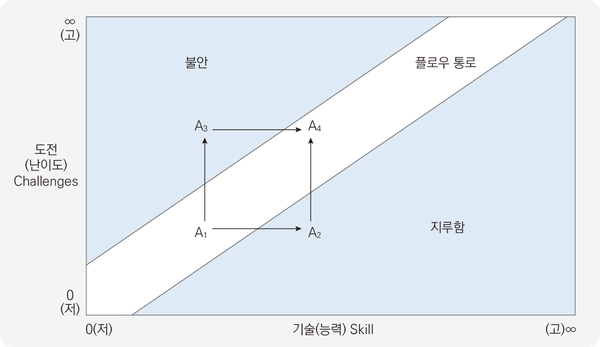
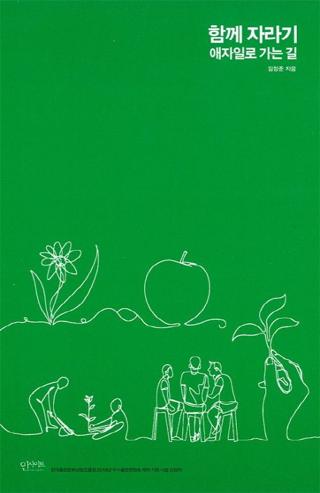

[🔗 함께 자라기](https://search.daum.net/search?w=bookpage&bookId=4833808&tab=introduction&DA=YZR&q=%ED%95%A8%EA%BB%98+%EC%9E%90%EB%9D%BC%EA%B8%B0)

작년에 ebook으로 구매한 책이다. 지난 8월 1일 이후로 나의 경력은 3년차가 되었고, 성장에 대한 마음가짐도 신입 때 보다 무거워졌음을 느끼고 있다. 그리고 ebook에 먼지만 쌓여있던 『함께 자라기』 책이 생각 났다.

---

> ※  아래 내용은 책을 읽고 인상깊은 부분을 정리한 글입니다.

### 1부, 자라기

#### 학습 프레임과 실행 프레임

> **학습 프레임 (learning frame) = 자라기**

"내가 안 그려 보았던 방식들을 실험해 보는 시간이에요. 여러 가지 방식으로 실험해 보세요."

현재 주어진 과업이 내가 얼마나 배우느냐로 여기게 되는 틀

> **실행 프레임 (execution frame) = 잘하기**

"여러분이 얼마나 그림을 잘 그리는지 보고자 하는 겁니다. 여러분의 창의성을 측정 해 보려고 합니다. 점수를 매길거에요. 각자 그림을 하나씩 그려서 내야 합니다."

현재 주어진 과업이 뭔가 좋은 성과를 내는 것으로 생각하는 틀

업무와 관련지으면?
- 내가 인정을 받아 다음 단계로 올라가냐, 아니냐에 집중하며 다음 단계로 가지 못하고 떨어지면 자신이 속한 곳에서의 학습 기회를 보기보다 다른 경쟁체제와 다른 타이틀, 다른 자리에 관심을 둘 것이다.
- **실행 프레임은 우리의 목표가 학습을 통한 성장이라면 불리한 선택**

> 누군가는 이렇게 말한다. "현재 상황 자체가 어렵지 않냐. 업무하면서 학습이 중요하다는 생각을 갖기가 어렵지 않냐."

동일한 자극/조건이 주어졌을 때 **어떤 사람은 더 많은 학습과 성장의 기회를 찾고 오히려 그 조건을 자신에게 유리한 조건**으로 생각하기도 한다.
지금 자신의 상황 때문에 학습 프레임을 갖는 것이 힘들다는 생각이 든다면, 이 우주 어딘가의 누구는 **비슷한 상황 덕분에 학습 프레임을 가질 수 있었다**고 생각할 것이다.

> 뛰어난 개발 전문가들의 특징

**사회 자본 (social capital), 인맥이 훌륭하다.**
"업무적으로 꼭 해야 하는 건 아니지만, **당신이 도와주는 사람이 누구이고, 또 당신이 도움을 요청하는 사람은 누구입니까?**"

업무 성과가 뛰어난 개발자들은 이 질문에 답을 더 잘할 수 있다.

"아직 1년도 되지 않아서 책 보고 코드 보고 업무를 배워가는 중입니다. 그래서 누구에게 딱히 물어보지 않고 또 업무 파악이 안 된지라 누굴 도와주거나 할 입장도 아닙니다."

"**아직 1년도 되지 않아서 많이 물어보며 배우고 있습니다**. A 선임, B 책임.. 그리고 제가 공부하고 싶은 내용을 주제로 팀 내 스터디를 운영하고 있습니다. 같이 공부해 가는 거지요.
**아직 1년도 안 되어서 시간이 있으니 적극적으로 다른 분들 일을 도와드리려고 나서고 있습니다.** A 선임, B 책임..."

---

#### 가장 학습하기 힘든 직업이 살아남는다

> **배우기 힘든 것에 집중하라**

AI 시대에 대비하려면 배우기 힘든 것에 집중해야 합니다.

> **AI 시스템에 유리한 조건**

1. 목표(Goal)가 분명하고 객관적으로 정해져 있으며 정적이다.
2. 매 순간 선택할 수 있는 행동/선택의 종류(Move)가 유한하게 정해져 있다.
3. 매 순간 자신이 목표에 얼마나 근접했는지를 알 수 있다. (내가 한 선택의 피드백이 빨리 주어진다.)
4. 주로 닫힌 시스템 (즉, 예상 못 한 외부 요소가 갑자기 들어오지 않는) 속에서 일한다.
5. 과거의 선택과 결과에 대한 구조화된 기록이 많다.

이 다섯 개의 조건은 사실 인간이 **학습하기 좋은 환경**의 조건이기도 합니다.
이 조건이 많이 갖춰질수록 효과적으로 빨리 학습할 수 있습니다.
피드백이 주어지고 작업이 반복되며 객관적 분석이 가능한 경우에 해당 직업에서 전문성이 잘 드러납니다.
학습이 잘 일어나는 조건이죠. =&gt; **AI는 인간을 우습게 뛰어넘어 버립니다.**

> 딜레마, **우리의 일자리가 인공지능으로 대체되지 않으려면?**

실제로 이런 영역에는 어떤 역량이 중요할까? **= 컴퓨터로 대체되기 힘든 일**

- **독창성**(Originality) : 주어진 주제나 상황에 대해 특이하거나 독창적인 생각을 해내기, 혹은 문제를 해결하는 창의적인 방법들을 만들어내기
- **사회적 민감성**(Social Perceptiveness) : 타인의 반응을 알아차리고 그 사람들이 왜 그렇게 반응하는지 이해하기
- **협상**(Negotiation) : 사람들을 화해시키고 서로 간의 차이를 조정하려고 노력하기
- **설득**(Persuasion) : 다른 사람들이 마음이나 행동을 바꾸게 설득하기
- **타인을 돕고 돌보기**(Assisting and Caring for Others) : 개인적 도움, 치료, 감정적 지지, 혹은 동료, 고객, 환자 같은 타인들에 대한 기타의 개인적 도움을 제공하는 것

> **소프트웨어 개발자 vs 컴퓨터 프로그래머**

소프트웨어 개발자는 사용자의 요구사항을 분석하고 그에 대한 솔루션을 설계하는 사람
컴퓨터 프로그래머는 스펙대로 코드를 만드는 사람

| 등수 | 컴퓨터화 가능 확률 | 직업 구분자 | 직업명 |
| --- | --- | --- | --- |
| 130 | 0.042 | 15-1132 | Software Developers, Applications |
| 293 | 0.48 | 15-1131 | Computer Programmers |

> **컴퓨터 프로그래머**는 대체될 확률이 높은 '중위험군' 직업 군입니다.

다른 사람이 준 스펙대로 개발하는 것을 주 업무로 하며, 그 과정에서 협상, 설득이 크게 필요하지 않습니다.
반면에 **소프트웨어 개발자**는 무슨 소프트웨어를 만들지 고**민하고 설계하는 부분**이 포함되며, 그 과정에서 **타인과 상호작용**하는 업무가 많습니다.

앞서 이야기한 **독창성, 협상, 설득** 등에서 차이가 나는 것이죠.
협상을 예로 들면 컴퓨터 프로그래머는 요구되는 수준이 30점인데 반해, 소프트웨어 개발자는 요구수준이 43점으로 13점이나 더 높습니다.

개발자는 더 높은 수준의 협상 능력이 필요하다는 뜻이지요.

> **무엇에 집중할 것인가, 내가 실제로 매일 하는 일이 어떤 성격의 일인가**

자신이 주로 하는 일이 **남이 시킨 대로 혼자 프로그램을 만드는 것**이라면 그런 스킬과 경력만 계속 쌓일 것입니다.
**창의적으로, 사회적으로 (다른 사람의 생각과 마음에 관심을 갖고, 그들을 설득하고 협상하는 것)** 일하지 않는 기간이 계속된다면 결국 자신의 커리어에 막대한 손해가 될 수 있다는 점입니다.

**혼자서 딱 정해진 일만 할 수 있는 환경이 축복이 아니라 저주가 될 수 있다.**

> 미래에는 **암묵지와 직관을 잘 학습하는 사람들이 높은 경쟁력**을 가질 것입니다.

**지금부터라도 암묵지와 직관을 배우고 수련하는 방법을 배우면 됩니다.**
관련 연구
- 자연주의 의사결정론 (naturalistic decision making) 학파(56쪽 참고)와 적응적 전문성(adaptive expertise/flexibility)의 연구

AI와 경쟁하기보다는 협력하는 방법을 배웁니다.
AI를 사용하는 데에 필요한 **암묵지, 직관, 독창성, 다른 사람과 협력을 잘하는 것**이 AI를 얼마나 잘 쓰냐를 결정하는 핵심이 될 것

#### 달인이 되는 비결

> 양치질을 10년 넘게 한다고 달인이 되지 않는다.

자신이 10년 넘게 해온 것 중에 전문성이 실제로 높아진 역량이 무엇이고, 거의 변화가 없는 것은 무엇인가?
이 둘을 가르는 차이가 무엇인가?

**이유 1. 동기가 부족하다.**
더 잘 하고자 하는 의지가 부족하다.

**이유 2. 피드백을 제때 받지 못한다.**
매번 이를 닦은 직후에 내가 이를 어떻게 닦았는가에 대한 정확하고 꼼꼼한 피드백을 받지 못합니다.
그래서 내가 뭘 잘했는지 못했는지 알지 못하고 실력도 늘지 않습니다.

꾸준한 반복으로 달인이 되려면 적어도

**1. 실력을 개선하려는 동기**가 있어야 함

**2. 구체적인 피드백을 적절한 시기**에 받아야 함

**특정 영역에서 개인이 성취할 수 있는 최고 수준의 퍼포먼스는 경험을 오래한다고 해서 자동으로 얻을 수 있는 것은 아닙니다.**

---

#### 수십 년 동안 전문가가 안 되는 비결

> **타당성과 피드백이 부족한 환경**

- 복잡한 상황에서 뒤죽박죽으로 일하거나

- 오늘 실수한 것을 몇 달 뒤에 알거나 혹은 영영 모르거나

> 타당성

직관이 적용되는 영역에 어느 정도 인과관계와 규칙성이 존재해야 한다는 것

예측가능성이라고도 말할 수 있다.

> 피드백

자신이 내린 직관적 판단에 대해 빨리 피드백을 받고 이를 통해 학습할 기회가 주어지는 환경이 갖춰져야 한다는 것

> 타당성과 피드백을 높이기

일하는 방식, 개발하는 방식을 바꾸면 타당성과 피드백을 높일 수 있다.

**1. 타당성**

**변수를 제한하고 실험**을 하면서 **규칙성**과 **인과관계**를 찾으려는 노력을 한다.

**2. 피드백**

**동료나 상사, 고객**, 혹은 **내가 개발하는 프로그램**에서 **직접 피드백**을 적극적으로 구한다.

자신이 10년 넘게 해온 것 중에 전문성이 실제로 높아진 역량이 무엇이고, 거의 변화가 없는 것은 무엇인가?
이 둘을 가르는 차이가 무엇인가?

---

#### 당신이 제자리걸음인 이유

> 의도적 수련의 필수 조건, 적절한 난이도

의도적 수련이 되기 위해서는 나의 실력과 작업 난이도가 비슷해야 한다.

*출처:  Csikszentmihalyi (1990) ,  몰입, 미치도록 행복한 나를 만나다(최인수 역, 2018) p.144  그림 인용*

가로축 = 작업에 대해 자신이 느끼는 자기 실력

세로축 = 작업에 대해 자신이 느끼는 난이도

> 지루함 영역

**실력이 작업 난이도를 초과하는 지역,**

지금 당장은 잘 됐다 싶긴 해도, **지루함**을 느끼게 된다.

> 불안 영역

**실력보다 높은 난이도의 일을 하는 영역,**

**불안함**이나 **두려음**을 느끼게 된다.

> 플로우 통로 = 몰입 영역

**난이도와 실력이 엇비슷하게 맞는 부분,**

**인간이 몰입을 경험하는 부분**으로 **최고 수준의 집중력**을 보이고, **퍼포먼스와 학습 능력이 최대치가 될 수 있다**고 한다.

그리고 **최고 수준의 행복감**을 경험한다.

> 인지 부하 이론 (Congnitive Load Theory)

학습 시 **불필요하게 인지적인 부담을 주면 어떤 것도 제대로 학습하기 어렵다.**

**핵심은 적절한 난이도**이다.

> 지루함 영역, 불안 영역

지루함 영역이나 불안 영역에 있다면 **의도적 수련이 되지 않고 실력 향상에 별 도움이 되지 않는다.**

**자신이 업무 시간 중에 불안함이나 지루함을 느끼는 때**가 대부분이라면,

**실력이 도무지 늘지 않는 환경**에 있는 것이다.

더 무서운 것은 점차 이런 환경에 익숙해지고 행동이 습관화된다는 점이다.

그때는 자기 인식도 잘 되지 않는다.

피겨 스케이팅 선수들에 대해 연구를 진행한 결과,

**더 뛰어난 스케이터가 엉덩방아를 더 자주 찧을 수 있다**는 것을 발견했다.

뛰어난 선수는 그렇지 않은 선수에 비해 몇 배 더 많은 트리플 악셀을 연습했다.

그렇지 않은 선수는 이미 익숙하고 자신 있는 '예술적 표현' 등의 연습에 시간을 더 썼다.

**뛰어난 선수는 자기 기량보다 어려운 기술을 연마하지만,**

**그렇지 못한 선수는 이미 잘하는 걸 더 연습한다**는 두 그룹의 차이를 볼 수 있다.

나는 '지루함 영역' 이라는 안전지대 안에 머무르고 있지 않은가?

지루함 속에서 자기 실력에 대해 안심하고, 그 상태에 익숙해진 것은 아닌가?

> 제자리걸음에서 벗어나기

그럼 어떻게 해야 할까? 팀장이 내 실력에 맞는, 혹은 그보다 약간 어려운 일들만 주면 좋겠지만 그렇지 않다면?

**현재 내 직무 자체가 단순 반복 작업이라면?**

> 네 가지 전략

**나의 하루가 불안하거나, 지루한 때가 대부분이라면** 이 전략들을 사용해야 한다.

*출처:  Csikszentmihalyi (1990) ,  몰입, 미치도록 행복한 나를 만나다(최인수 역, 2018) p.144  그림 인용*

> 지루함을 느끼는 경우 - 실력 낮추기

작업 난이도는 그대로 두고 실력을 낮추는 전략

프로그래머의 예를 들자면?

1. 평상시 즐겨 쓰던 보조 도구를 일부러 안 쓴다. (마우스를 안 쓰고 키보드로만 개발한다던가, 디버거를 안 쓴다거나)

2. 컴파일을 30초마다 한 번씩 했다면 5분에 한 번씩으로 주기를 늘려 본다.

실력이 떨어진 느낌이 들어서, 좀 더 집중해야 하고 머릿속에서 좀 더 많은 연산을 해야 한다.

난이도와 실력이 잘 맞아 들어가면서 의도적 수련이 될 수 있고,

지루하던 작업이 몰입하는 작업이 되고 실력이 늘 수 있다.

> 지루함을 느끼는 경우 - 난이도 높이기

실력은 그대로 두고 난이도를 높이는 전략

프로그래머의 예를 들자면?

**첫 번째, 흔한 방법의 예시**

1. 요구되는 수준을 더 높게 여긴다. 하루 만에 개발하라고 주어진 업무를 한 시간 만에 할 수 있도록 방법을 고안한다.

2. 100 rps (초당 응답수)면 되는 시스템을 1,000 rps 기준으로 만들기

(필요 수준 이상으로 좋게, 혹은 복잡하게 만드는 오버엔지니어링의 부작용이 있을 수 있음)

3. 평소 코드를 검토할 때 버그를 시간당 하나 찾았다면 오늘은 두 개 찾기

4. 익숙한 작업을 새로운 언어로 진행해 보기

**두 번째,  공식적으로 안 해도 되는 업무를 자신의 의지로 추가하는 방법 = 자신의 업무를 개선하는 일의 예시**

**이렇게 안 해도 되는 일을 더 하는 것**을 학술적으로 **잡 크래프팅(Job Crafting)** 혹은 자**기주도성(Personal Intiative)**의 일종으로 볼 수 있고, **이걸 많이 하는 직원**은 **업무 성과**와 **직무 만족**이 높으며, **직무 탈진을 적게 경험**한다는 연구가 많다.

1. 리팩토링

2. 자동화 테스트

**3. 자신만의 도구를 개발하거나 하는 것들**

인지심리학에서 상대의 전문성을 빠른 시간 내에 간파하는 기법 중에,

남들보다 일을 **좀 더 효율적/효과적으로 하기 위해 내가 직접 만들어 쓰는 나만의 도구,방법**을 묻는 방법이 있다.

저자의 예시로 임베디드 장비의 데드락 문제를 도와줬던 사례가 있다.

이 경우 데드락을 자신만의 도구로 찾았는데,

해당 C 파일에 자동으로 특정 로그를 삽입해서, 스레드나 프로세스가 어떻게 동작하는지 쉽게 분석해주는 도구 (일종의 Code Instrumentation)을 직접 만들어 쓰고 있었다고 함.

이런 도구를 만들기 위해서는 **자주 일어나는 반복 패턴을 파악하고 분석**해야 하며,

부족한 시간에도 **짬을 내어 도구를 고안하고 작성**해야 한다. **= 일의 난이도가 올라간다**.

> **불안함을 느끼는 경우 - 실력 높이기**

**1. 사회적 접근**

- 나보다 뛰어난 전문가의 도움을 얻는다.

- 잘하는 사람에게 가서 짝 프로그래밍을 해달라고 부탁한다.

-  인터넷에서 전문가의 도움을 얻는다.

-  괜찮은 튜토리얼 문서가 있다면 그 문서를 따라간다.

**2. 도구적 접근**

-  다른 도구의 도움을 받는다.

-  괜찮은 디버거, 자동 통합 도구, 코드 분석툴, REPL 환경 (Read-Eval-Print Loop, 프로그래머가 한 줄 입력할 때 읽어서 평가하고 결과를 출력하는 것을 반복하는 구조) 이용하기

- 오픈소스 라이브러리 빌려 쓰기

**3. 내관적 접근**

- 비슷한 일을 했던 경험을 머릿속에서 되살려보기

- 그 때 그 일을 어떻게 했는지 떠올려 보면서, 비유적으로 문제를 해결하기

- 자기 효용감이 올라가며 스스로 인식하는 자기 실력이 향상되고, 결과적으로 몰입 영역으로 들어가기 좋음

> **불안함을 느끼는 경우 - 난이도 낮추기**

자신이 맡은 일의 **가장 간단**하면서 **핵심적인 결과물 = 0.0.1 버전(아기 버전)**을 첫 번째 목표로 삼는다.

애자일에서 말하는 WTSTTCPW (**What's The Simplest Thing That Could Possibly Work?**, 작업을 시작할 때 동작할 수도 있는 가장 간단한 건 뭘까? 하고 서로 묻는 것을 말함. **Simplest와 Possibly의 조합**이 핵심이다.)

**이 때 주의할 것은 자료구조나 회전 알고리즘을 먼저 완성하는 것이 아니라는 점**이다.

**살아있으면서도 간단한, 아기 버전**의 결과물을 만드는 것이다.

> **사례**

대학 시절 알고리즘 수업에서 사용한 전략이 있다.

과제는 C언어로 작성했어야 했는데, 남들이 C언어로 시작할 때

P 프로그래머의 경우 **1) 파이썬으로 한 번 2) C언어로 한 번, 총 두 개의 프로그램**을 만들었다.

파이썬은 스크립트 언어라 로우 레벨에 신경 쓰지 않고 알고리즘 자체에만 신경을 쓸 수 있다.

P 프로그래머는 상**대적으로 쉬운 언어를 쓰면서 과제의 난이도를 일시적으로 낮추어 몰입을 경험**했다.

같은 프로그램을 두 번 만들며 학습 효과가 생겨 실력도 높아지니 C언어로 작업할 때 복리 효과도 얻었다.

**쉬운 문제를 먼저 풀고 어려운 문제를 풀 경우 결함 수가 낮아진다.**

**학습 효과, 동기 강화, 스트레스 감소, 자기 효능감 증가 같은 효과**가 생긴다.

이와 마찬가지로,

유지보수 작업에서 어려운 작업을 먼저 시작하냐, 쉬운 작업을 먼저 시작하냐에 따른 수행 시간과 정확도를 비교한 연구에서

수행 시간은 차이가 없으나 **쉬운 작업을 먼저 시작할 경우 정확도가 높아졌다.**

> **메타인지 전략**

**지속적으로 자신의 감정 상태를 살피면서 지금 지루한지 불안한지**를 알아채고, 만약 지루함이나 불안함을 느낀다면 앞의 네 가지 전략을 적절히 사용해야 한다.

자기가 어떤 상태인지 살피는 **'알아차림 (mindfulness)'**이 꼭 필요하다. 모든 분야의 전문성에 있어서도 이런 **메타인지**는 핵심적인 요소이다.

작업이 너무 어렵게 느껴져서 난이도를 낮추고, 그랬더니 할 만해서 좋긴 한데 의외로 지루하다면, 난이도를 다시 높이거나 실력을 낮춰야한다. 그러던 중 내 실력이 붙으면 난이도를 다시 높이는 식으로, 현재 자신의 업무 처리 속도가 문제가 되지 않는 범위 내에서 적절하게 난이도와 실력을 조정해나가야 한다.

> **팀장의 역할**

팀원들이 현재 어떤 상태를 주로 경험하고 있는지 파악하고 적절한 전략을 구사할 수 있도록 도와줄 수 있다.

하지만 정반대의 팀장이 더 많다. 몰입 영역 밖으로 팀원들을 몰아내는 행동이다.

- 실력보다 낮은 난이도의 일을 해서 지루함을 느끼는 직원에게 동기 고취 차원에서 스터디를 시키거나 콘퍼런스에 보내서 실력을 더 높이게 하는 것

- 혹은 실력보다 높은 난이도의 일을 해서 불안함을 느끼는 직원에게 핀잔을 줘서 인지하는 실력(자기효능감)을 더 떨어뜨리 것

- 진행 안 되는 일들의 문제를 분석해서 보고서를 제출하라는 추가 업무로 난이도를 더 높이는 것

팀장들에게는 팀원의 상태를 파악하고 그들이 몰입으로 가게 도와주는 것 자체가 고도의 의도적 수련이 될 수 있다.

> 우리는 어떤 하루를 살고 있나?
> 지루하거나 불안하지는 않는가?

**이긴, 그러나 진 싸움**으로 나의 훈련 방법 전반을 재검토 한다.

---

#### Reference

함께 자라기 - 애자일로 가는 길 | 김창준

