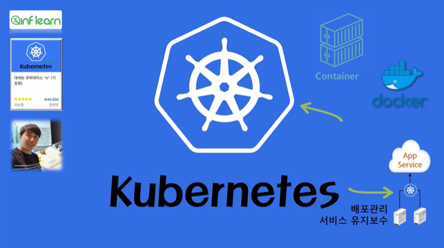

### 섹션 1. 강의소개

해당 강의에서는 사용자 기능에 대한 설명 중심으로 설명하며 아래 색상이 칠해져 있는 양만큼 배울 예정이다.

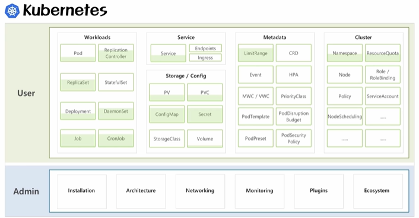

**앞으로 아래 내용에 대해 다룰 예정이다.**
1) 왜 쿠버네티스를 사용해야 하는가 - 기존 시스템 운영 방식을 토대로 쿠버네티스를 사용했을 때 좋은 점들

2) VM과 컨테이너 차이 비교 - 컨테이너에 대한 이해

3) 쿠버네티스 환경에서 앱이 구동되기까지 과정

4) 쿠버네티스 오브젝트

5-6) 쿠버네티스 주요 오브젝트, 컨트롤러 - 개념 설명, 이론 및 실습

**섹션 2. [기초편] 기초 다지기**

#### 1) 왜 쿠버네티스를 사용해야 하는가 - 기존 시스템 운영 방식을 토대로 쿠버네티스를 사용했을 때 좋은 점들

왜 쿠버네티스인가? 쿠버네티스는 어떤 자동화 기능을 제공하는가?

**문제 상황) 신규 게임 출시 시 접속량이 몰려 원활한 서비스가 되지 않음**

어떤 서비스든 원활히 유지되기 위해서는 충분한 서버 자원들이 뒷받침되어야 한다.

기업 입장에서는 미리 트래픽량을 예측하기 어렵고, 매우 많은 자원을 준비해놓기에도 비용 측면에서 쉽지 않다.

여러 서비스를 운영하는 경우 어려움이 더 많아질 수 있다.

**해결) 쿠버네티스는 이런 문제를 어떻게 해결해주는가?**

아래 예제 시나리오를 통해 알아보자.

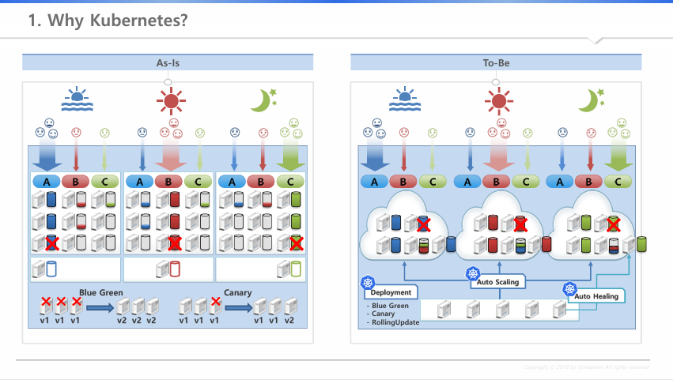

**AS-IS) 한 회사에서 아래와 같이 3개의 서비스를 오픈하고 있다.**

서비스의 접속량을 받쳐주기 위해서는 각 서비스마다 3대의 서버에 해당하는 자원이 필요하다.

아침에는 A 서비스, 점심에는 B 서비스, 저녁에는 C 서비스 접속량이 많아진다.

시간대 별로 접속량이 모두 다르지만, 각 서비스마다 무조건 3대의 서버가 할당되어 있고

이 시나리오에서는 총 9대의 서버가 필요하다.

심지어 서버 장애 상황에 대비해 1대의 여분 서버가 필요하다고 하자.

각 서비스 별로 백업 서버를 두어 서버가 죽었을 때 즉각적인 대응을 해야 한다고 할 때,

기존 9대보다 필요 자원이 더 늘어나는 것이다.

**이 상황에서 쿠버네티스의 가상화 기술을 사용하면 어떻게 될까?**

**TO-BE)**

하루동안 ABC 서비스의 평균 트래픽을 계산해보면 4대 분의 자원이 필요하고,

'오토 스케일링' 기능을 통해 아침/점심/저녁 마다 달라지는 트래픽 양에 따라 '알아서 서비스의 자원량을 변경' 시켜준다.

장애 상황 대비는 어떻게 할까? '오토힐링' 기능을 사용한다.

장애가 난 서버 위에 있는 서버들이 자동으로 다른 서버로 옮겨주는 오토힐링 기능을 통해,

한 서버에 장애가 나더라도 여분의 서버 한 대만 있으면 알아서 서비스를 유지시켜 준다.

**업데이트 상황도 알아보자.**

**AS-IS)**

서비스 중단이 허용되는 경우, 모든 서버를 내렸다가 업데이트 작업 후 다시 올린다.

무중단 서비스를 해야 하는 경우, 한 서버씩 내렸다가 업데이트 작업 후 서비스를 올린다.

**TO-BE) 'Deployment' 오브젝트를 통해 업데이트가 자동 처리되도록 지원한다.**

**결론**

이처럼 여러 기능에 대해 운영 자동화를 지원하고 있으며,

서비스 효율로 인해 사용 서버가 적어지면 그만큼 유지 보수 비용이 줄어든다.

#### 2) VM과 컨테이너 차이 비교 - 컨테이너에 대한 이해

VM과 컨테이너 둘다 어떤 운영체제가 됐건 호스트 OS가 올라간다.

**VM**

호스트 OS위에 VM을 가상화 시켜주기 위한 여러 하이퍼바이저가 존재한다.

( 하이퍼바이저 - Virtual Box, Xen, KVM, VMware ... )

하이퍼바이저를 사용해 원하는 OS로 게스트 OS를 올려 여러 개의 VM을 만들 수 있다.

게스트 OS는 호스트 OS와 같이 하나의 OS를 독립적으로 가지고 있는 것처럼 사용할 수 있다.

내부에는 여러 어플리케이션 설치하거나, 각 서비스를 만들 수 있다.

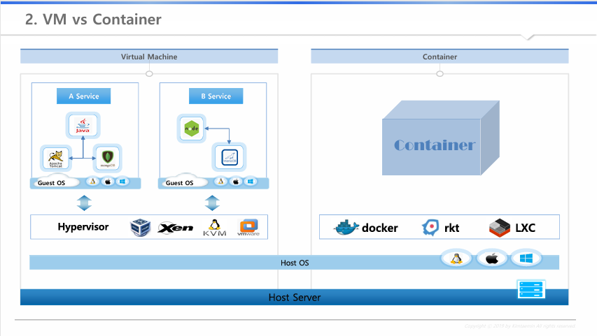

**컨테이너**

컨테이너도 호스트 OS 설치까지는 동일하다.

컨테이너 가상화를 시켜주는 여러 SW가 있다. 이중 Docker를 가장 많이 사용한다.

( 컨테이너 가상화 SW - Docker, rkt, LXC ... )

리눅스마다 버전이 있고, 버전에 따라 기본적으로 설치되는 라이브러리가 다르다.

**문제 상황) 리눅스 6 버전 -&gt; 해당 버전에 설치되어 있는 OpenJDK 라이브러리 사용하고 있고,**

리눅스 7 버전에서 서비스 하려고 할 때 버전 차이에 따른 문제가 발생한다.

**해결) Docker 사용 - '컨테이너 이미지'**

Docker를 설치하고 이를 통해 '컨테이너 이미지'를 만들 수 있다. 이 이미지에는 한 서비스, 그리고 서비스 동작에 필요한 라이브러리가 같이 있다.

리눅스 7 버전에 다른 라이브러리가 있더라도, Docker만 설치되어 있으면 이 컨테이너 이미지를 가져와 사용하면 된다.

'컨테이너 이미지'를 가져와서 사용하게 되면 A 서비스는 자신의 이미지 안에 있는 OpenStack 라이브러리를 사용하기 때문에 안정적으로 시스템을 구동할 수 있다. Docker가 그렇게 작동하도록 보장하는 것이다.

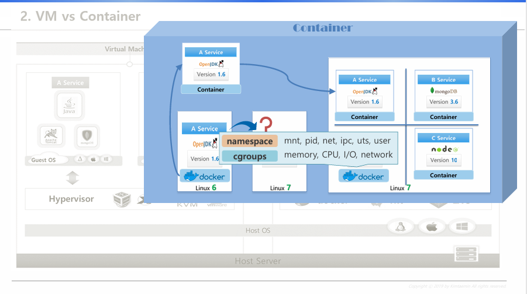

**Docker의 'namespace'와 'cgroups'를 통한 여러 컨테이너 간 호스트 자원 분리**

'namespace' - 커널에 관련된 영역 분리

'cgroups' - 자원에 대한 영역 분리

Docker같은 컨테이너 가상화 솔루션들은,

OS에서 제공하는 자원 격리 기술을 이용해 컨테이너 단위로 서비스를 분리할 수 있게 만들어준다.

이를 통해 컨테이너 가상화가 깔려있는 OS에서는 개발환경에 대한 걱정 없이 배포가 가능해진다.

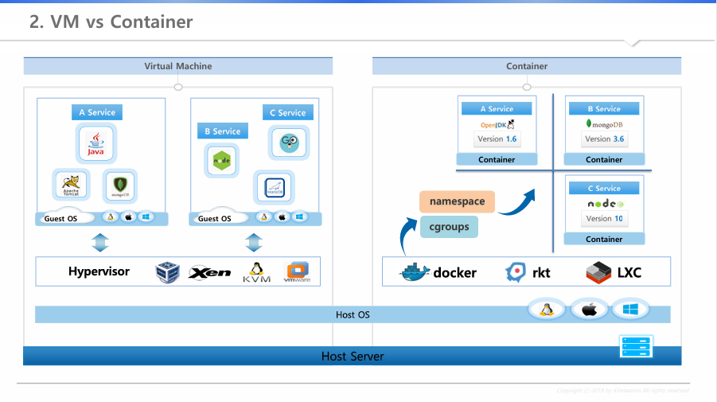

**속도 측면**

컨테이너는 하나의 OS를 공유하고, VM은 각각의 OS를 띄워야 하는 구조므로 컨테이너가 훨씬 빠를 수 밖에 없다.

**그러나 호스트OS 호환 및 보안 측면에서 단점도 존재하는데,**

**VM)**

호스트 OS가 윈도우라고 하더라도 게스트 OS로 리눅스를 설치할 수 있다.

보안 측면에서도 호스트 OS와 게스트 OS가 분리되어 있어서 각각 VM끼리 피해가 발생하지 않는다.

**컨테이너)**

리눅스 OS에서 윈도우 컨테이너를 사용할 수 없다.

보안 측면에서는 하나의컨테이너가 뚫려서 OS 영역에 접근하게 되면 다른 컨테이너들도 위험해질 수 있다.

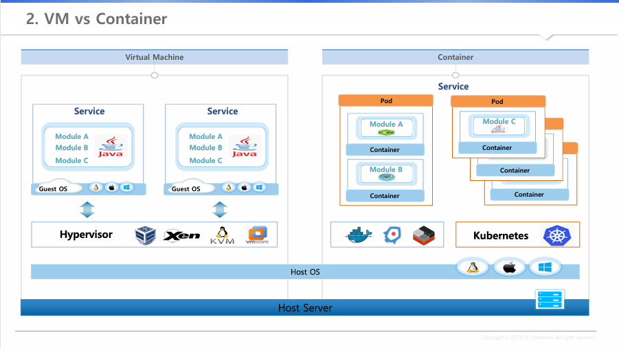

**가장 큰 차이점은 시스템 개발 부분에 있다.**

일반적으로 한 서비스를 만들 때 한 가지 언어를 사용해서, 여러 모듈이 한 서비스로 같이 돌아간다.

**만약 A, B 모듈은 정상 상태인 반면 C 모듈에 부하가 많이 가는 상황이라고 할 때,**

**VM)**

하나의 VM을 더 생성한다.

자원 사용, 성능 입장에서 게스트 OS가 2개 올라간다.

이 경우 A, B는 확장할 필요가 없으나 한 패키지기 때문에 그대로 따라 올라간다.

**컨테이너) '마이크로 서비스'**

모듈별로 쪼개서 각각의 컨테이너에 담는 걸 권한다.

모듈에 맞는 최적화된 개발 언어를 사용할 수 있다.

**여기서 '쿠버네티스'는 'Pod' 개념을 사용한다.**

여러 컨테이너를 한 'Pod'라는 개념으로 묶을 수 있고 하나의 컨테이너만 한 Pod에 담을 수도 있다.

이 Pod가 하나의 배포 단위이다.

Pod 개념을 이용하면, VM이 하나의 모듈을 위해 모든 패키지를 같이 생성하는 방식과 달리

내가 필요한 '모듈' = 'Pod'만을 확장할 수 있다.

#### 실습 - Getting Started 및 Kubernetes Overview

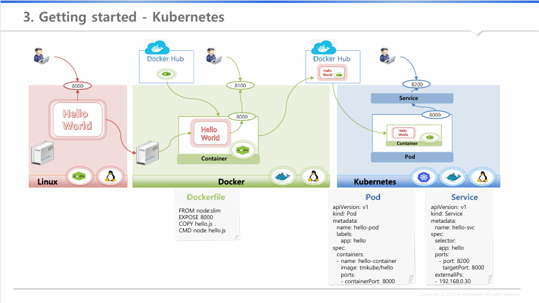

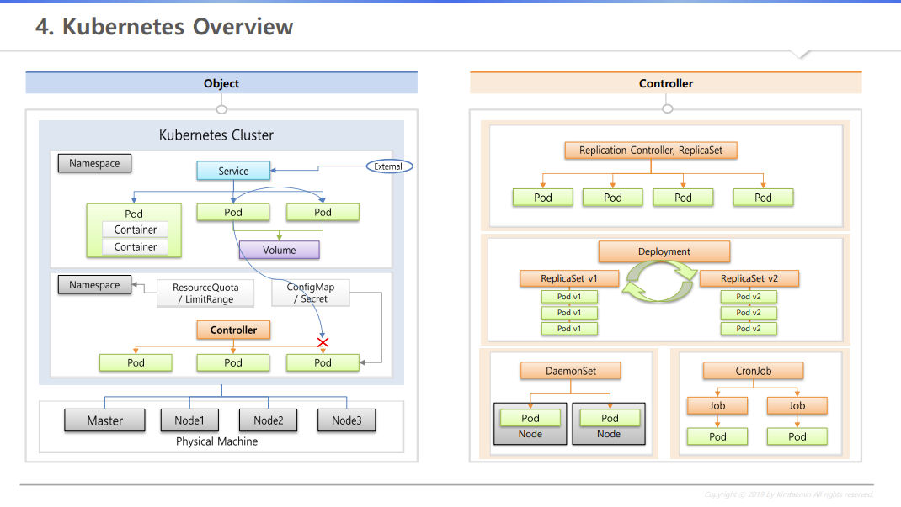

**하나의 Kubernetes Cluster**

쿠버네티스는 위 사진처럼 서버 한 대는 마스터로 쓰고, 다른 서버는 노드로 해서 한 마스터 - 여러 노드 연결이 된다.

이 '마스터 노드-여러 노드' 구성을 Cluster 개념이라고 한다.

**왼쪽 그림의 Object**

- **마스터** : 쿠버네티스의 전반적인 기능들을 컨트롤 하는 역할

- **노드** : 자원을 제공하는 역할로, Cluster 전체 자원을 늘리고 싶다면 노드를 추가

- **네임스페이스** : 쿠버네티스 오브젝트들을 독립된 공간으로 분리되게 만들어준다. 이 네임스페이스에는 쿠버네티스 최소 배포 단위인 Pod들이 있고, 이 Pod들에게 외부로부터 연결이 가능하도록 IP를 할당해주는 서비스가 있어서 연결이 가능하다.

( 단, 서로 다른 네임스페이스에 있는 Pod들에게는 연결 불가 )

- **컨테이너** : Pod 안에는 여러 컨테이너가 있다. 컨테이너 하나당 하나의 앱이 동작하므로 결국 Pod에는 여러 앱들이 돌아갈 수 있다. 그런데 Pod에 문제가 생겨 재생성이 되면 그 안에 있는 데이터가 날아간다. 이를 볼륨 개념을 이용해 해결한다.

- **ResourceQuata / LimitRange** : 한 네임스페이스에서 사용할 자원의 양을 한정시킬 수 있다. ( Pod 개수 제한, CPU 및 메모리 제한 )

- **ConfigMap / Secret** : Pod 생성 시 컨테이너 안의 환경 변수 값 추가 및 파일 마운트

**오른쪽 그림의 Controller**

- **Controller**: Pod들을 관리. 여러 종류가 있다. 아래는 Controller의 종류다.

- **Replication Controller / ReplicaSet**: Pod가 죽으면 감지해서 다시 살려주기, Pod 개수 증가/감소하는 스케일 인/아웃

- **Deployment**: 배포 후에 Pod들을 새 버전으로 업그레이드하고, 문제가 생겼을 때 롤백을 쉽게 하도록 도와준다.

- **DaemonSet**: Pod가 하나씩만 유지 되도록 한다.

- **CronJob**: Pod가  특정 작업만 하고 종료 시켜야 하는 일을 하도록 한다.

### 섹션 3. [기초편] 쿠버네티스 설치

**설치 가이드 :** [[설치] Kubernetes Cluster 설치 - Windows : 네이버 카페](https://cafe.naver.com/f-e/cafes/30725715/articles/495?boardtype=L&menuid=43&referrerAllArticles=false&page=2) 참고

- XShell / Virtual Box / Vagrant 설치

**네트워크 구성**

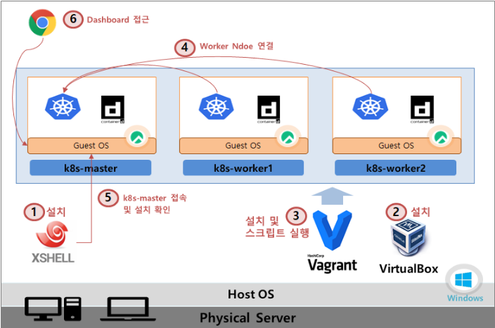

**1) Xshell 세팅**

- 설치 후 k8s-master(192.168.56.30:22), k8s-worker1(192.168.56.31:22), k8s-worker2(192.168.56.32:22) IP 등록

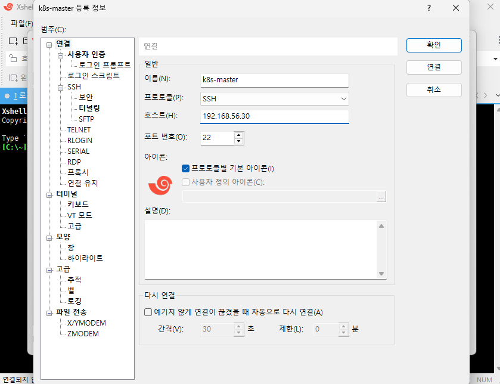

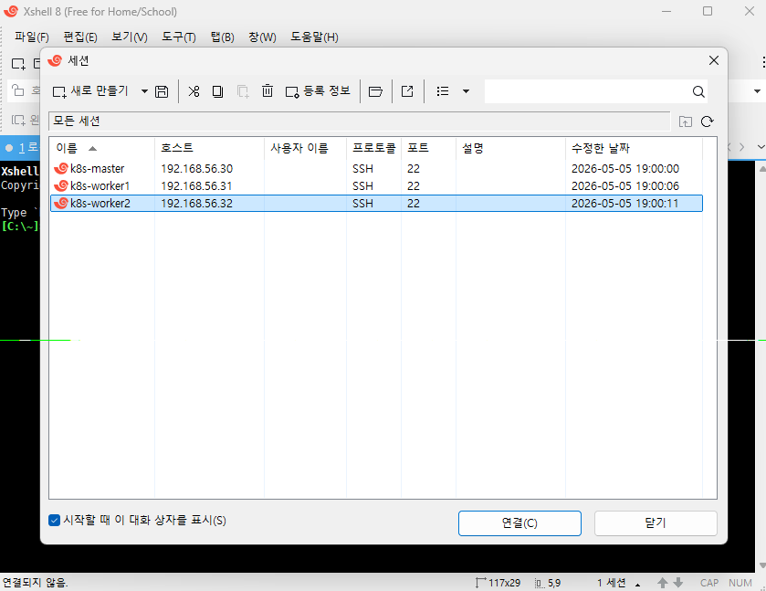

**2) Vagrant 명령 실행을 통한 k8s 설치 스크립트 실행**

// Vagrant 스크립트 다운로드

curl -O <https://raw.githubusercontent.com/k8s-1pro/install/main/under-thesea/k8s-cluster-1.27/vagrant-2.4.3/Vagrantfile>

// Rocky Linux Repo 세팅

curl -O <https://raw.githubusercontent.com/k8s-1pro/install/main/under-thesea/k8s-cluster-1.27/vagrant-2.4.3/rockylinux-repo.json>

vagrant box add rockylinux-repo.json

// Vagrant Disk 설정 Plugin 설치

vagrant plugin install vagrant-vbguest vagrant-disksize

( 네트워크 상황에 따라 githubusercontent URL에 접속되지 않는 경우가 있음. 그런 경우 다른 네트워크 이용할 것 )

vagrant up

**vagrant 명령어 참고**

**- vagrant up :** VM 생성 및 스크립트 설치

(최초 VM생성 할때만 사용 합니다. 생성 이후 부터 VM 기동/중지는 Virtualbox UI를 사용하는걸 권해 드려요.)

**- vagrant destroy :** 가상머신 삭제

(vagrant up으로 VM 생성 중 에러가 났을 때 이 명령으로 삭제 합니다.)

**4) Worker Node 연결**

참고 문서 과정을 따라한다.

### 섹션 4. [기초편] 기본 오브젝트

추가 필요

앞으로는 아래 내용을 다룰 예정이다.

섹션 5. [기초편] 컨트롤러

섹션 6. [중급편] Pod 상세

섹션 7. [중급편] 기본 오브젝트

섹션 8. [중급편] 컨트롤러

섹션 9. [이론편] 아키텍쳐

---

**[Reference]**

대세는 쿠버네티스(초급~중급편)
