> **※ 저작권 및 이용 조건 안내**
> ● 저작권자: 일프로
> ● 제작 목적: [대세는 쿠버네티스] 수강생의 학습을 지원하기 위해 제작된 유료 보조 자료입니다.
> ● 사용 허용 범위: 구매자 본인에 한하여 학습(블로그) 및 개인 참고 용도로만 사용 가능
>
> ● 금지 사항:
> - 본 자료(또는 일부 내용·이미지 포함)를 타인에게 공유, 재판매, 재배포하는 행위
> - 유튜브·블로그·SNS 등 공개 플랫폼에 원본 그대로의 파일을 업로드하는 행위
> - 본 자료를 교육, 강의, 기업 교육 등 상업적 목적으로 활용하는 행위
> - 본 자료의 내용을 자신의 강의 또는 저작물처럼 표시하는 행위
>
> ● 출처 표기 방법: 아래 두가지 방법 중 하나 선택
> - 이미지 마다 하단에 "인프런_대세는 쿠버네티스" 텍스트 추가
> - 블로그 하단에 한번만 홍보 링크 추가: <https://inf.run/cdTiC>
>
> ● 책임 제한:
> -  본 자료의 무단 사용 또는 부적절한 재배포로 발생하는 법적 문제에 대해 제작자는 책임을 지지 않습니다.

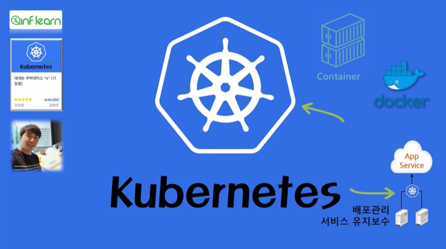

### 섹션 7. [중급편] 기본 오브젝트

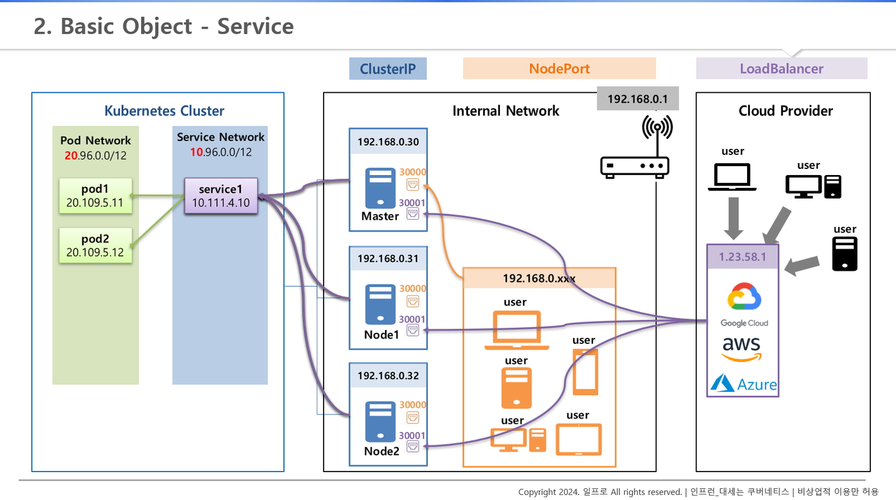

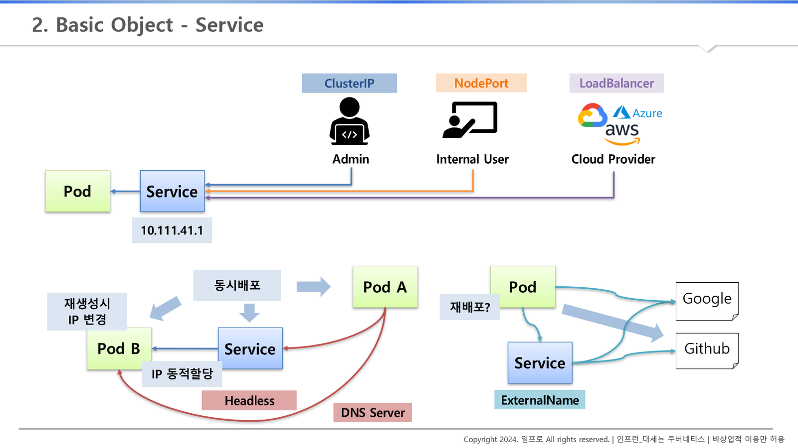

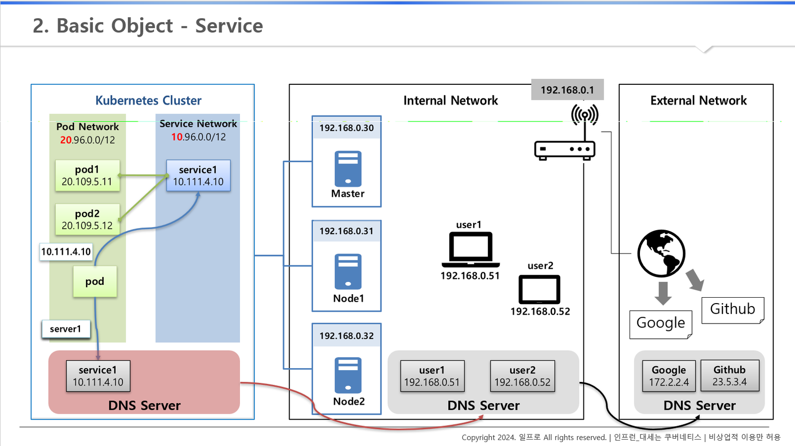

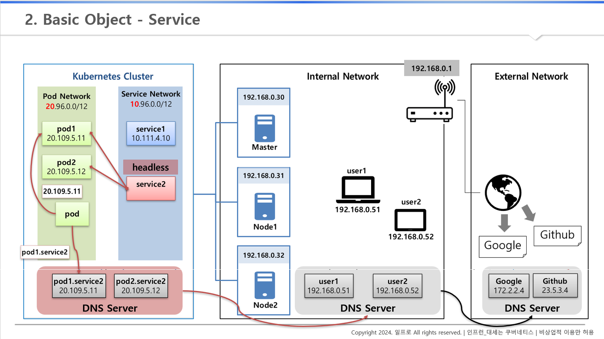

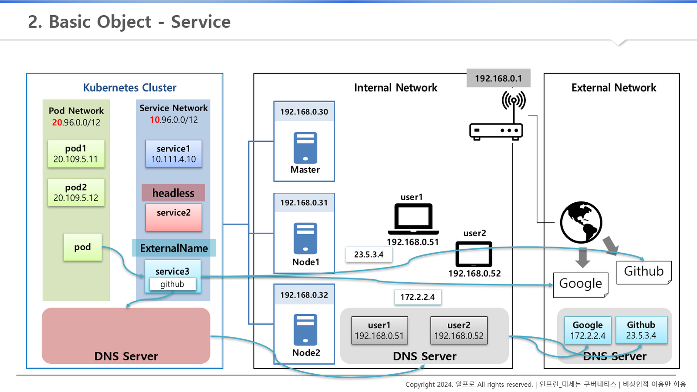

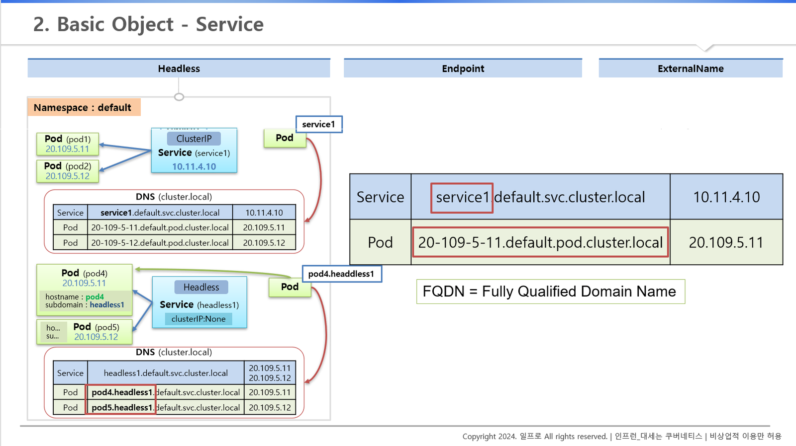

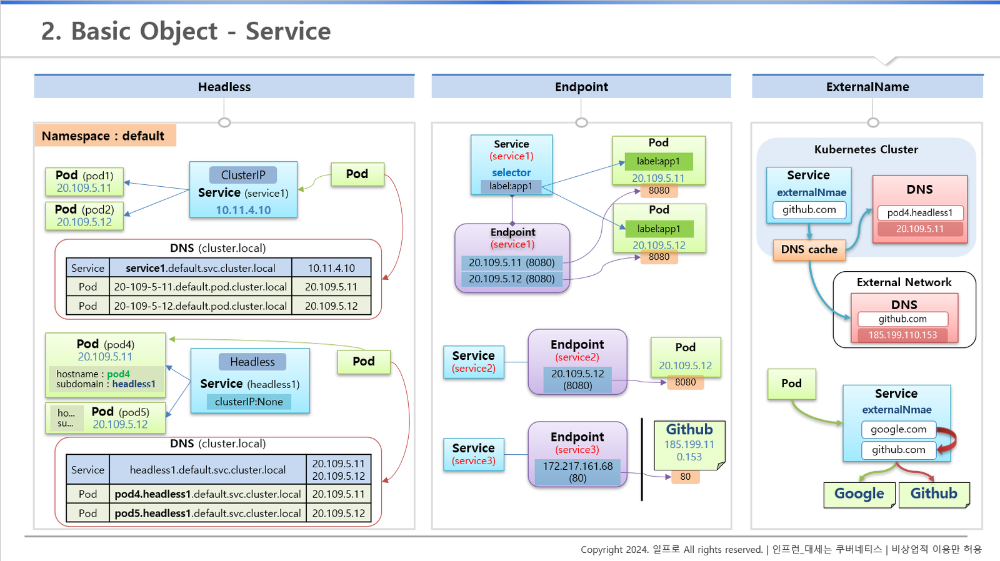

#### 1) Service

**기존에 배운 서비스 개념 복습**

**"사용자 관점에서 서비스(궁극적으로는 서비스에 연결되어 있는 Pod)에 접근하기 위해 클러스터 IP / NodePort / LoadBalancer 타입의 서비스를 만들었음"**

1. 공유기를 통해 192.168 대역의 내부망 형성

2. 3대 서버를 이용해 마스터, 노드로 클러스터 생성

3. 클러스터 안에는 pod를 위한 IP 대역 / service를 위한 ip 대역이 있음

( 그림을 보면 pod IP는 20번대 대역 / service IP는 10번대 대역 )

4. service 1에 pod1 &  pod 2 연결되어 있음

**문제 상황 1) 내부망 다른 기기에서 service 1에 접근하지 못함**

해당 서비스가 클러스터 IP로 만든 서비스라면 쿠버네티스를 구성하고 있는 이 마스터와 노드들에서만 호출할 수 있고,

내부망 내의 여러 기기에서는 직접 서비스 IP를 호출할 수 없다.

**해결 1) NodePort 이용**

NodePort 서비스를 만들어 각 마스터, 노드들에 30000번대 포트를 생성하고, 이 포트는 service 1과 연결이 된다.

내부망에 있는 사람들에게 서버 중 IP & port 를 알려주어 해당 서비스에 연결할 수 있다.

**문제 상황 2) 외부망 클라우드 프로바이더 (구글 클라우드, AWS, Azure) 를 사용해서 쿠버네티스 클러스터 구축**

**해결 2) LoadBalancer 타입의 서버를 만들었을 때 NodePort 생성**

이 때 NodePort가 각 쿠버네티스 서버에 생성이 되면서 해당 포트에 로드 밸런서가 연결됨

외부망에 있는 사람들이 이 IP를 통해 서비스에 접근 가능

**중급편에서는**

**"Pod의 입장에서 원하는 서비스 혹은 Pod로 직접 연결하는 방법 / 외부 서비스에 안정적으로 연결하는 방법"을 다룬다.**

**문제 상황 3-1) Pod IP가 동적 할당되어 계속 바뀌는 특성**

서비스의 경우, 서비스 만들어진 후 -&gt; IP 확인 -&gt; 해당 IP로 접근이 가능하다. 그러나 Pod의 경우는 다르다.

Pod - Pod 간 연결이 필요한 경우, 자원들이 동시 배포 -&gt; 만약 Pod A가 Pod B에 연결이 필요한 상황이라고 가정 -&gt; Pod IP는 동적으로 생성되므로 미리 IP를 알 수 없으며, 만약 알더라도 Pod중 하나가 문제가 생겨 재생성되면 기존 IP가 변경되므로, Pod A가 미리 Pod B의 IP를 알고 있더라도 해당 IP를 계속 사용할 수 없음

**해결 3-1) DNS & Headless 서비스 이용**

쿠버네티스 클러스터 내부에는 DNS 서버가 별도로 존재

**DNS 서버 내부**

- 서비스 도메인 이름 & IP 저장

- Pod가 Server 1에 대한 도메인 이름 질의 -&gt; 해당 IP 알려줌

**내부망 DNS 서버**

- 내부 서버가 생겼을 때 해당 이름들이 DNS 서버에 등록

- Pod가 user1을 찾았을 때 쿠버네티스 DNS에 없다면 DNS 메커니즘 상 상위 DNS를 찾게 되고, 해당 IP를 알 수 있게 됨

**외부망 DNS 서버**

- 도메인 이름이 외부 DNS 서버에 등록

- google 또는 github 도메인을 통해 해당 IP에 접근

**Headless 서비스 연결**

- DNS 서버에 Pod의 이름과 서비스의 이름이 'pod1.service2'와 같이 붙게 되어 도메인 이름으로 등록됨

- Pod 입장에서는 Pod1에 접근하기 위한 IP 주소가 필요없고 이 도메인 이름으로만 접근 가능

**문제 상황 3-2) Pod - 외부 서비스 간 연결이 필요한 경우**

Pod가 외부 특정 사이트에 접근하여 데이터를 가져오는 상황에서, 접근 주소를 변경해야 하는 상황 -&gt; 경로를 변경해주기 위해서 Pod를 수정하고 재배포해야 하는 문제

**해결 3-2) ExternalName 이용**

외부 연결을 Pod 수정 없이 변경할 수 있도록 한다.

- service3과 같이 특정 외부 도메인 주소를 넣을 수 있음 ( 사진 예시 - google.com )

- DNS를 타고 타서 google IP를 가져올 수 있음

- 만약 google -&gt; github에서 가져오도록 수정하고 싶다면?

Pod가 이 service3을 통해서 데이터를 가져오도록 해놓으면 추후 데이터를 github에서 가져오도록 변경했을 때 Pod 수정 없이 이서비스의 ExternalName만 수정해주면 된다.

#### 1-1) Headless 서비스

1. default Namespace에 Pod 2개 & 클러스터 IP로 만든 Service 연결되어 있음 ( 이름 정해졌으며 IP는 동적 할당됨 )

2. 쿠버네티스 DNS ( 이름은 cluster.local ) 에는 Pod 건 Service 건 생성하게 되면 긴 도메인 이름 & IP가 저장됨

DNS에는 서비스 & Pod에서 다음과 같은 규칙으로 만들어짐 ( Fully Qualified Domain Name, FQDN )

- 서비스의 경우
'service1.default.svc.cluster.local' 과 같이 서비스 이름/Namespace/서비스 약어(svc)/DNS 이름 순으로 만들어짐

앞자리는 짧게 써도 허용

- Pod의 경우

'20-109-5-11.default.pod.cluster.local'과 같이  해당 IP/Namespace/pod/DNS 이름 순으로 만들어짐

앞자리까지 전부 입력 필요

3. 따라서 Pod의 입장에서 서비스의 도메인 이름만 알면 DNS 질의를 통해 IP를 가져올 수 있게 되고,

결국 해당 서비스에 접근 가능

- 단순히 서비스에만 연결하는 데는 클러스터 IP로 서비스를 만들어도 문제는 없다.

**문제 상황 4) 만약 Pod가 다른 Pod (pod4) 에 직접 연결을 하고 싶다면?**

**해결 4) Headless 서비스를 만들어서 Pod의 이름을 미리 정해놓고 DNS를 통해 원하는 Pod로 통신할 수 있도록 한다.**

- 클러스터 IP 속성에 none이라고만 넣으면 된다. ( 서비스의 IP를 만들지 않겠다는 뜻 )

- Pod의 hostname 속성에 도메인 이름 넣어야 함 / subdomain 속성에 서비스 이름 만들어주어야 함

이렇게 될 경우 DNS 등록은 다음과 같이 된다.

- 서비스의 경우

'headless1.deafult.svc.cluster.local' 과 같이 기존 방식과 똑같지만, 다른 점은 해당 서비스 이름을 호출하게 되었을 때 연결되어 있는 모든 Pod의 IP를 준다는 점

- Pod의 경우

'pod4.headless1...' 과 같이 hostname / 뒤부터 서비스 이름과 동일한 방식으로 만들어짐

#### 1-2) Endpoint Object (를 알면 ExternalName을 쉽게 이해할 수 있다.)

1. 서비스 - Pod 연결할 때 label을 통해 연결한다.

2. 그러나 이것은 사용자 측면에서 둘의 연결을 위한 도구일 뿐이지, 쿠버네티스는 매칭이 되었을 때 Endpoint를 만들어 줘서 실제 연결고리를 관리한다.

3. 쿠버네티스는 어떻게 Endpoint를 만드는가?

- 서비스와 동일한 이름으로 Endpoint 이름을 설정

- Endpoint 안에는 Pod 접속 정보를 넣어줌

- 해당 규칙을 알면 label, selector를 만들지 않아도 직접 연결할 수 있음

4. 예를 들어, Pod를 만들 때 selector와 label을 넣지 않으면 직접 연결이 되지 않는데, 이 상태에서 Endpoint를 직접 만들어 서비스의 이름, Pod의 IP 정보를 넣어서 직접 연결을 가능하도록 한다. ( 서비스의 연결 대상을 사용자가 직접 지정한 것 )

5. service1, service2, service3을 보면 IP와 포트가 내부 포트를 가리킬 수도 있고 외부 IP를 주소를 안다면 외부도 가리킬 수 있음

**문제 상황 5) 그러나 Endpoint에 IP를 정의했을 때, 해당 IP가 변경될 수 있다.**

특히 외부 도메인 ( github 등 ) IP 주소가 변경될 수 있어 도메인 이름을 지정하는 방법이 필요하다.

**해결 5) ExternalName을 사용해서 IP 주소 변경에 대비해 도메인 이름을 지정한다.**

#### 1-3) ExternalName

1. 서비스 안에 externalName 속성을 만들어 안에 도메인 이름을 넣는다.

2. 이렇게 속성을 넣으면 DNS 캐시가 내부, 외부 DNS를 찾아 IP를 알아낸다.

3. 결국 Pod는 서비스를 가리키고만 있으면 서비스에서 필요할 때마다 해당 도메인 주소를 변경할 수 있고, 접속할 곳이 변경되더라도 Pod를 수정하거나 재배포하지 않아도 된다.

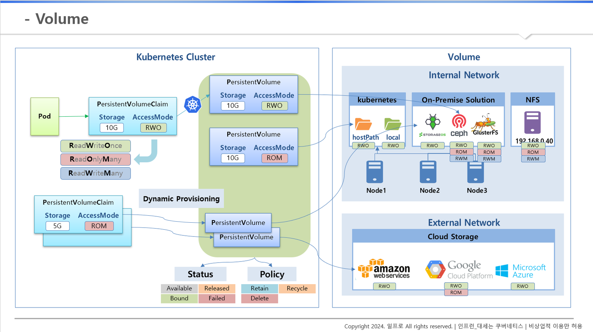

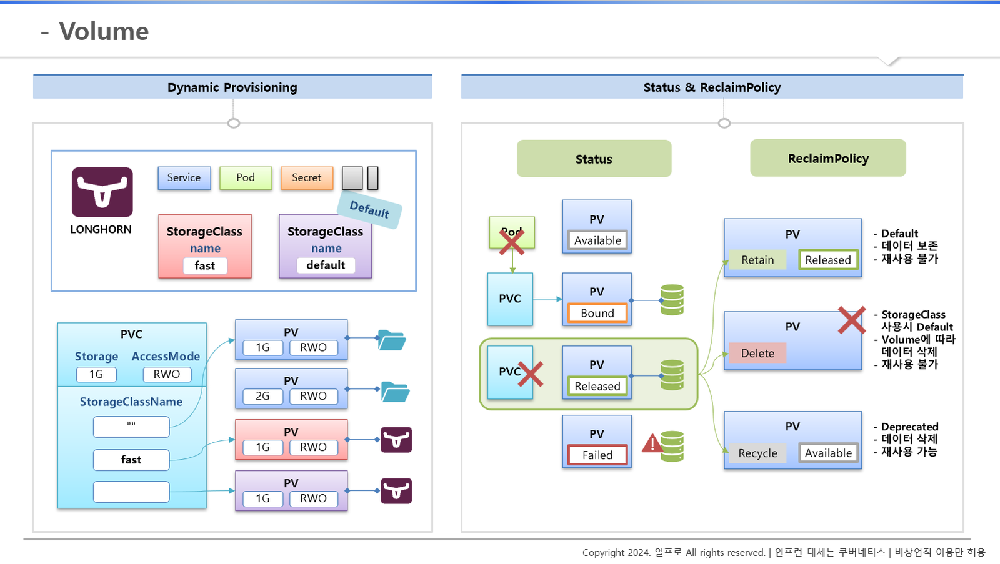

#### 2) Volume - Dynamic Provisioning, StorageClass, Status, ReclaimPolicy

**Volume이란?**

- 데이터를 안정적으로 유지하기 위해 사용

- 쿠버네티스 클러스터와 분리되어 관리됨

- 내부망 관리 / 외부망 관리 두 경우로 나눌 수 있음

#### 2-1) Kubernetes Cluster 밖의 여러 실제 Volume들의 종류

**Internal Network의 Volume ( 내부망 )**

1. kubernetes

- 쿠버네티스를 구성하는 Node 1, 2, 3이 있고, 쿠버네티스에서 이 노드들의 실제 물리적인 공간의 데이터를 만들 수 있는 hostPath나 local Volume이 있음

2. On-Premise Solution

- STORAGEOS, ceph, GlusterFS 등 솔루션이 알아서 노드 자원을 이용해 Volume 관리

3. NFS

- 다른 서버를 Volume 자원으로 사용

4. 이 밖에도 많은 종류의 Volume 서비스가 있음

**External Network의 Volume ( 외부망 )**

1. Cloud Storage

- AWS, 구글 클라우드 서비스, MS Azure ) 여기에 쿠버네티스 클러스터와 연결해 사용할 수 있음

#### 2-2) Kubernetes Cluster 내부에서 관리자가 하는 일

1. 관리자는 PV ( Persistent Volume )을 만들고 Storage( 저장 용량 )과 AccessMode를 정해서 Volume 선택 및 연결

2. 만약 사용자가 PVC ( PersistentVolumeClaim )을 만들어 원하는 Storage와 Accessmode를 정하면 쿠버네티스가 알아서 적절한 PV와 연결을 해주고, 이 PVC를 Pod에서 사용

- 참고로 AccessMode는 한 노드에서 읽기, 쓰기, 또는 여러 노드에서 읽기만 허용, 또는 읽기 쓰기 모두 되는 세가지 중류가 있음

3. 그러나 쿠버네티스에서 이렇게 지원한다고 해서 실제 Volume들이 해당 AccessMode를 모두 지원하는 것은 아니다.

- 위에서 알아본 종류마다 지원하는 AccessMode가 모두 다르다.

**문제 상황 1) 위와 같은 방식으로 Volume을 사용하게 되면 Volume이 필요할 때마다 PV를 만들어주어야 함. 또한 원하는 PV와 연결하기 위해 Storage와 AccessMode를 확인해서 맞춰야함 -&gt; 매우 복잡함**

**해결 1) DynamicProvisioning**

사용자가 PVC를 만들면 알아서 PV를 만들고, 알아서 실제 Volume과 연결해주는 기능이 있음

#### 2-3) DynamicProvisioning & StorageClass 오브젝트

1. DynamicProvisioning을 지원하는 Storage Solution 설치가 필요함 ( 강의에서는 STORAGEOS 솔루션 이용 )

2. 설치 시 Service, Pod, Secret 오브젝트가 생성되고 이 중 가장 중요한 것은 StorageClass 오브젝트

- StorageClass 오브젝트는 동적으로 PV를 만들 수 있도록 한다.

3. PVC를 만들 때 StorageClassName 를 넣을 수 있다.

- 사진과 같이 "fast"라는 키워드(STORAGEOS에 있는 StorageClass 오브젝트의 이름)를 넣으면, 자동으로 STORAGEOS Volume을 가진 PV가 만들어진다.

4. StorageClass는 추가로 만들 수 있다. (사진에서 default 이름을 가진 오브젝트)

- 이렇게 만들어놓으면 PVC에 StorageClass 이름을 생략했을 때 이 default 이름의 StorageClass가 적용되어 PV가 만들어진다.

#### 2-2) Status & ReclaimPolicy

1. 모든 PV에는 각각의 상태가 존재하는데 이 상태를 통해 지금 PV가 PVC에 연결되어 있는지, 아니면 끊겼는지, 에러가 발생했는지 여부를 알 수 있음

- PV가 최초 만들어졌을 때 Available 상태

- PV가 PVC와 연결이 되면 Bound 상태로 변하게 됨

- 그런데 이렇게 PV를 직접 만드는 경우 Volume의 실제 데이터가 만들어진 상태는 아니고, Pod가 PVC를 사용해 구동이 될 때 실제 Volume이 만들어짐

- Pod가 삭제되더라도 PVC / PV에는 아무런 변화가 없어서 데이터에는 문제가 없음

- PVC를 삭제해야만 PV와 연결이 끊어지며 PV의 상태는 Released로 변하게 됨

- 중간에 만약 PV와 실제 데이터 간 연결에 문제가 생기면 Failed 상태로 변함

2. ReclaimPolicy

- 만약 1번의 경우 중, PVC가 삭제된 상황에 대해서 PV에 설정해놓은 ReclaimPolicy에 따라 PV에 대한 상태가 달라진다.

- RelcaimPolicy에는 3가지 ( Retain / Delete / Recycle ) 가 있다.

2-1) Retain

- PVC 삭제가 되면 PV 상태 Released

- PV를 만들 때 ReclaimPolicy를 별도로 설정하지 않았을 경우 기본 정책

- 이 상태일 때 실제 볼륨의 데이터는 유지되지만 이 PV를 다른 PVC에 다시 연결할 수 없음

- PV를 수동으로 만든 것처럼 삭제도 수동으로 해주어야 함

2-2) Delete

- PVC를 지우면 PV도 같이 지워진다.

- StorageClass를 사용해 자동으로 PV가 만들어진 경우의 기본 정책

- Volume 종류에 따라 실제 데이터가 삭제되기도 하고 안 되기도 한다.

2-3) Recycle ( Deprecated 된 정책 )

- PV의 상태가 Available 되면서 PVC에 다시 연결할 수 있는 상태가 된다.

- 실제 데이터가 삭제 되며 PV를 재사용 할 수 있음

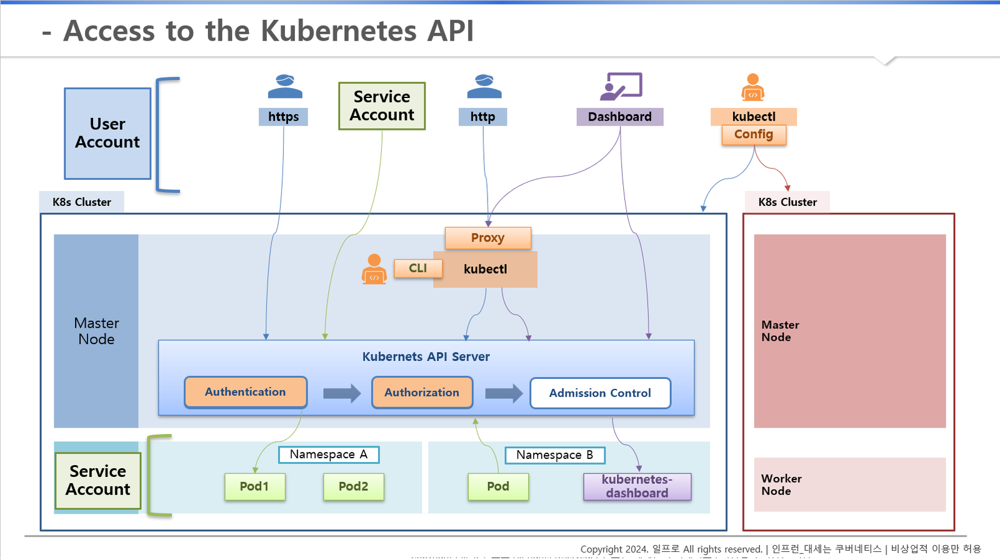

**3) Accessing API - Overview**

#### 3-1) Authenication

**유저 입장에서 User Account**

1. 먼저 Master Node에 Kubernetes API Server가 있음

- 이 서버를 통해서만 Kubernetes 자원을 만들거나 조회할 수 있음

- 실습 때 kubectl로 자원 조회하는 것도 이 API 서버에 접근해서 정보 가져오는 것

- 내부에서는 바로 접근이 가능하지만 외부에서는 인증서 가지고 있어야만 HTTPS로 보안 접근 가능

- 만약 내부 관리자가 kubectl 명령으로 proxy를 열어줬다면 인증서 필요 없음

2. kubectl은 Master Node 내부에만 설치할 수 있는 것은 아니고 외부 PC에서도 설치할 수 있음

- Config 기능 활용

- 여러 대의 Kubernetes Cluster가 있을 때 간편하게 명령을 통해 접근 가능한 클러스터의 연결 상태 유지할 수 있음

- 연결된 상태에서 kubectl get 명령으로 해당 클러스터에 있는 하드 정보를 가져올 수 있음

**Pod 입장에서는? Service Account**

1. Pod도 유저처럼 마음껏 API 서버에 접근할 수 있게 된다면, Pod를 만들기만 해도 접근이 가능해지기 때문에 보안상 문제가 발생

2. Service Account라고 해서 쿠버네티스에는 Pod가 API 서버에 접근할 수 있도록 하는 방법이 있다.

#### 3-2) Service Account - Authorizaion

1. 만약 Namespace A와 B로 Pod가 분리되어 있는 상태에서 Namespace A에 있는 Por가 API 서버에 접근 권한이 있다고 할 때

2. API 서버에서 Namespace A의 Pod를 조회해도 될까?

3. 권한 여부에 따라 가능/불가능 여부가 나뉜다. -&gt; Authorizaion

#### 3-3) Service Account - Admission Control

1. 권한까지 문제가 없을 때 마지막으로 Admission Control

2. 만약 PV를 만들 때 관리자가 용량을 1GB 이상 만들지 못하도록 설정을 해놓았다면 Pod 생성에 대한 API 요청이 들어왔을 때 쿠버네티스는 설정된 크기를 넘지 못하도록 체크를 해야한다.

3. 이 내용은 다루지 않는다.

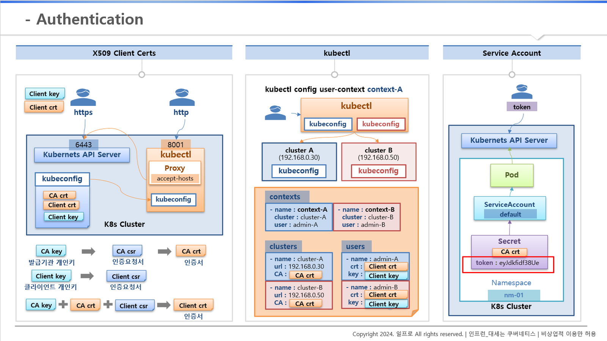

#### 4) Accessing API - X509 Certs, kubectl, ServiceAccount

1. 먼저 클러스터에 6443 포트로 API 서버가 열려있다.

2. 사용자가 여기로 HTTPS 접근을 하려면 쿠버네티스 설치 시 kubeconfig ( 클러스터에 접근할 수 있는 정보들이 들어있는 파일 )이 필요하다.

3. 이 kubeconfig에는 'CA crt, Client crt, Client key' 같은 인증서 내용이 있다.

4. 이 Client key / 인증서를 복사해서 가지고 오면 된다.

#### 4-1) X509 Client Certs

**CA key, Client key**

1. CA key ( 발급기관 개인키 ) 와 Client key ( 클라이언트 개인키 )를 최초에 만든다.

2. 개인키를 가지고 인증서를 만들기위한 각각의 인증요청서라는 CSR 파일을 만든다.

3. CA의 경우 인증요청서를 가지고 바로 인증서를 만드는데 바로 이 것이 kubeconfig에 있는 CA crt

4. 그런데 Client crt (클라이언트 인증서) 의 경우 발급기관 개인키 & 인증서 & 클라이언트 요청서를 모두 합쳐서 만든다.

5. 이렇게 만들어진 Client crt (클라이언트 인증서) 가 kubeconfig 파일에 Client crt 파일로 들어있다.

**kubectl 설치 후 설정 중 kubeconfig 파일을 통채로 kubectl에 사용하도록 복사**

1. 위 과정을 통해 kubectl로 kubernetes API에 인증이 되어 리소스를 조회할 수 있음

2. 내부 Proxy -&gt; accept-hosts 옵션을 통해 8001번 포트로 proxy를 열어두면 외부에서도 http로 접근할 수 있게 됨

3. kubectl은 인증서를 가지고 있어서 사용자는 아무런 인증서 없이 접근할 수 있음

#### 4-2) kubectl

1. 외부 서버에 kubectl 설치해서 멀티 클러스터에 접근하는 경우

2. 사전에 각 클러스터에 있는 kubeconfig 파일이 내 kubectl에도 있어야 함

3. 사용자는 원하는 클러스터에 접근해서 자원 조회 및 생성이 가능함

4. kubeconfig 내용

- clusters 항목 : 클러스터 항목 등록, 이름 / 연결정보 / CA 인증서 있음

- users 항목 : 사용자 등록, 유저 이름 / 유저에 대한 개인키, 인증서 있음

- contexts 항목 : 위 clusters 항목과 users 항목이 있다면 contexts 항목을 통해 둘을 연결할 수 있음 ( clusters, user 정의 되어 있음 )

- 각각 context-A와 context-B와 같이 클러스터 A, B에 대해서 등록할 수 있음

5. 이로써 사용자가 cluster A에 연결하고자 할 때 'kubectl config user-context context-A'와 같이 사용하고 싶은 컨텍스트 지정

- 클러스터 A에 대한 노드 정보들이 조회 된다.

#### 4-3) ServiceAccount

1. 쿠버네티스 Cluster와 API 서버가 있음

2. Namespace를 만들게 되면 기본적으로 default라는 이름의 ServiceAccount가 자동으로 만들어짐

3. 이 ServiceAccount에는 Secret이 하나 달려있음

- CA crt 정보와 token 값이 들어있음

4. Pod를 만들면 이 ServiceAccount와 연결이 되고, Pod는 token값을 통해 API 서버에 연결할 수 있음
5. 결국 token값만 알면 사용자도 이 값을 가지고 APi 서버에 접근할 수 있음

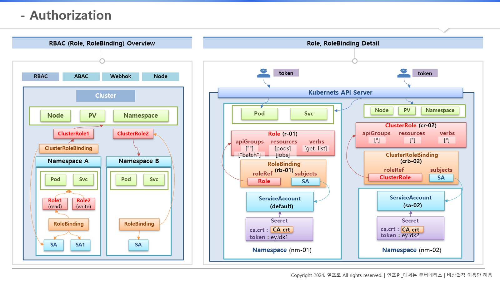

#### 5) Authorization - RBAC, Role, RoleBinding

#### 5-1) RBAC ( Role, RoleBinding ) Overview

**쿠버네티스가 자원에 대한 권한을 지원하는 방법 중 하나로, 역할 기반으로 권한 부여하는 방법**

1. 클러스터 단위로 관리되는 자원 : Node, PV, Namespace

2. Namespace 단위로 관리되는 자원 : Pod, Service

**이 중 먼저 Namespcae 단위로 어떻게 관리하는지 살펴보자**

2-1)

- Namespace를 만들면 자동적으로 SA라고 하는 ServiceAccount가 자동적으로 만들어지기도 하고 SA1처럼 추가적으로 만들 수 있음

- ServiceAccount의 Role과 RoleBinding을 어떻게 설정하느냐에 따라 해당 ServiceAccount가 Namespace 내에 있는 자원만 접근할 것이냐? 아니면 클러스터에 있는 자원까지 접근할 것이냐? 를 정할 수 있음

2-2). Role은 여러 개 만들 수 있음

- 각 Role에는 Namespace 내에 있는 자원에 대해서 조회만 가능 / 생성만 가능하도록 권한 줄 수 있음

- 여러 가지 케이스로 Role을 만들 수 있음

2-3). RoleBinding은 Role과 ServiceAccount를 연결해주는 역할

- Role은 하나만 지정할 수 있음

- ServiceAccount는 여러 개 지정할 수 있음

2-4). 그림과 같이 설정이 되어 있으면 SA, SA1은 Role1에 지정되어 있는 권한으로만 API 서버에 접근할 수 있음

2-5). 이렇게 한 Namespace 내에 권한을 보유할 때는 Role, RoleBinding을 여러 개 만들어서 관리

**다음은 클러스터 단위**

1-1) ClusterRole과 ClusterRoleBinding이 만들어져 있어야 함

1-2) ClusterRole : 클러스터 단위의 오브젝트들을 지정할 수 있음. ( 기능은 Role과 똑같음 )

- ClusterRoleBinding에 이 ServiceAccount를 추가하게 되면 Namespace A에 있는 SA에서도 클러스터 자원에 접근할 수 있는 권한을 얻게 됨

1-3) Namespace B와 같이 RoleBinding이 ClusterRole2를 지정할 수 있음

- 이렇게 하면 SA는 Cluster 자원에는 접근하지 못하고 자신의 Namespace 내에 있는 자원만 사용할 수 있음

- 그럼 결국 Role을 만들어 사용하는 것과 같은데 왜 ClusterRole2를 굳이 지정하냐?

- Role1, 2 처럼 일일이 Role을 만들게 되면 Role 변경이 필요할 때 모든 Role을 변경해야 해서 관리가 어렵고 누락 가능성이 있음

- 그래서 ClusterRole 하나만 만들고 모든 Namespace에 있는 RoleBinding이 이 ClusterRole을 바라보도록 하면 권한에 대해 변경사항이 있을 때 하나만 수정하면 됨

( 모든 Namespace에 같원 권한을 만들어 관리를 해야할 때 유용 )

#### 5-2) Role, RoleBinding Detail

**케이스 1)**

1. 그림과 같이 한 Namespace 안에 Pod, Service가 있음 (nm-01)

2. Namespace를 만들면 SA와 token가 담겨져 있는 Secret이 있음

3. Role 생성

- apiGroups ( resources가 pods일 경우 ""로만 넣어도 됨 / 그러나 jobs일 경우 "batch"와 같이 해당 API 그룹을 넣어줘야 함 )

- resources

- verbs : [get, list] 처럼 조회만 가능하도록 하는 설정

4. RoleBinding 만들기

- roleRef : Role 연결

- subjects : SA ( ServiceAccount ) 연결

5. 이렇게 연결되어 있으면 secret의 token 값을 가지고 API 서버에 접근 가능

- token 권한에 따라 Namespace 안에 있는 Pod만 조회할 수 있음

**케이스 2)**

1. 새로운 Namespace (nm-02)

2. Admin 권한처럼 모든 클러스터 자원에 접근할 수 있도록 하기

- ClusterRole 모든 속성에 [*] 로 넣기

- ClusterRoleBinding을 만들어 SA를 연결

3. token으로 API 서버에 접근하면 다른 Namespace 자원 및 클러스터 단위의 자원에도 조회 / 생성 가능해짐

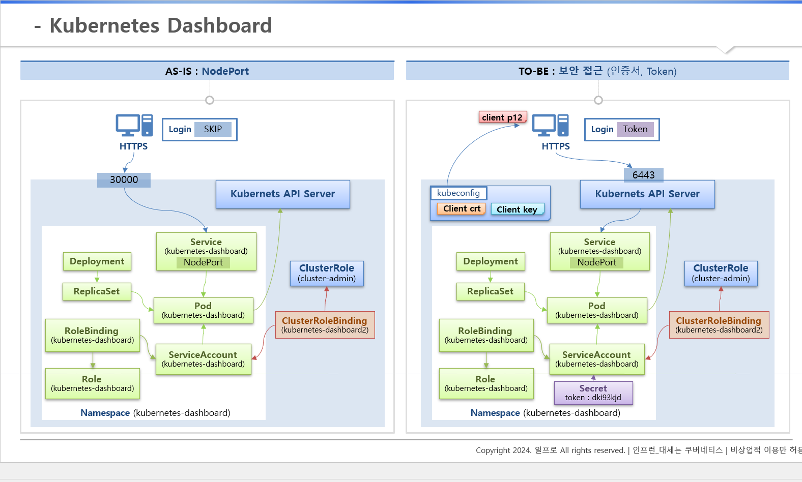

#### 6) Kubernetes Dashboard

1. 현재 상태 : 사용자는 보안 없이 HTTP API로 대시 보드 접근 가능

2. 대시보드 Pod가 API 서버에 접근했을 때 클러스터 자원에 대한 권한 가지고 있음

 - Pod는 SA가 연결 되어 있음

- SA는 RoleBinding을 통해 Role 연결되어 있음

- Role에 대한 권한은 Namespace 내에서만 사용할 수 있음 ( Pod가 모든 자원에 접근할 수 없음 )

- 쿠버네티스를 설치하면 기본적으로 만들어지는 ClusterRole 중 cluster-admin 이 있음. 이 Role을 통해 현재 대시보드를 통해 모든 자원에 접근할 수 있었던 것

3. 이를 보완하기 (TO-BE)

- kubectl 파일에 client key, crt 모두 필요 ( 두 파일을 합쳐 client p12 파일 만들고 내 PC에 인증서 등록)

- 사용자는 HTTPS로 API 서버를 통해 대시보드에 접근

- 대시보드는 사용자가 필요한 자원 조회/생성 때마다 API 서버로 요청하게 됨

- SA에 연결된 Secret의 token 값으로 대시보드 token 로그인이 가능

4. 따라서 다음이 모두 필요해짐

- 쿠버네티스 인증서

- 대시보드에 접근해서 로그인할 수 있는 token

---

**[Reference]**

대세는 쿠버네티스(초급~중급편) ([https://inf.run/cdTiC)](https://inf.run/cdTiC)

[🔗 대세는 쿠버네티스 (초급~중급편)| 일프로 - 인프런 강의](https://inf.run/cdTiC)
