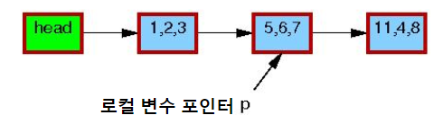
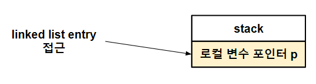
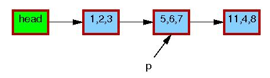
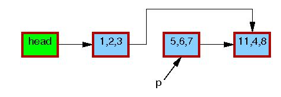
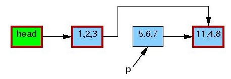

> ※  아래 내용은 스스로 공부한 내용을 정리한 글입니다.
> ※  때로 정확하지 않을 수 있으며, 참고만 부탁드립니다.
> ※  잘못된 내용이 있을시 댓글로 알려주시면 감사하겠습니다.

시작에 앞서, RCU를 이해하기 위해 linked list가 상당히 중요함을 강조하겠다. 모든 알고리즘의 구성은 대체로 linked list를 활용한다. tree도 linked list로 연결을 하고, hash도 bucket 당 linked list로 매달아 놓는 특징이 있다. 그러다 보니 병렬 처리 시에 공유자원으로 linked list를 처리하는 게 매우 중요하다는 것을 인지하고 RCU에 대한 이해를 시작하자.

RCU (Read-Copy Update) 개념은 바로 등장한 것은 아니다. 십여 년에 걸쳐 deferred destruction(파괴 지연)개념이 여기저기서 사용되면서 생긴 개념이다. RCU가 없던 시절, linked list traversal(순회)와 insert(삽입)까지는 공유 자원임에도 lock 없이 안정적으로 돌게끔 할 수 있었다. 그런데, 병렬화를 진행하면서 worker들이 병렬로 돌게 되니 문제가 발생했다. 한 worker가 linked list traversal 중일 때 다른 worker가 linked list delete(삭제)를 통해 노드를 지워버리니 traversal 중이던 녀석이 값을 읽지 못하고 죽어버리는 것이다.

그 이유는, linked list의 traveral operation을 생각해보면 알 수 있다. linked list traveral opration이 발생하면, 주소를 로컬 스택 변수에 잠시 저장하고, 그 포인터를 기반으로 해서 linked list entry에 접근한다. 이 로컬 변수에 주소가 일단 할당되고 나면 다른 worker가 linked list entry를 삭제해도 알 수가 없다.

*로컬 스택 변수에 잠시 저장*

*linked list traveral opration*

*delete, free 후 linked list traveral opration 일어날 때*

즉, 내가 로컬 변수 포인터로 지금 접근하려고 하는 node 또는 entry가 어떻게 하면 안정적일 수 있는가? 에 대한 해법이 바로 RCU 개념이다. RCU는 Read-Copy-Update란 의미로, reader는 linked list traversal이고, writer는 linked list insert, linked list delete임을 알고 가자.

다시 위에서 linked list delete 하는 시점으로 돌아가자. 만약 노드가 delete되는 상황에서 free를 하지 않는다면 어떻게 될까? 수많은 노드가 delete되면서 linked list가 끊어지지만, 로컬 변수 포인터에 주소가 기억되어 접근을 하더라도, free는 되지 않았으므로 죽지 않게 되는 것이다. 이를 destruction avoidance(파괴 방지)라고 한다.

그리고 RCU는 이 free를 얼마나 지연시켜야 안정적일까에 대해 고민을 거듭하다가 나온 개념이다.  Paul McKenney 교수가 내놓은 해법은 이와 같다. 여러 reader들이 1번 이상의 quiescent state(정지 상태)를 지나고, 모든 reader들이 1회 이상의 quiescent state가 지난 것을 garce period(유예 기간)라고 한다. 한 번의 grace period가 목격이 되면 해당 version에 달려 있던 defered(지연)된 free 요구를 처리한다.

쉽게 말해서, reader들이 모두 읽을 때까지 free를 일단 미루고 모두 읽으면 그때 free를 한다는 것이다.

그림을 보자

*초기 상태*

*원소를 리스트 상에서 지운다. (list_del_rcu()를 이용)*

이 과정이 어딘가 writer에서 일어나도 있다. 5, 6, 7로 가는 길을 끊어 버린 뒤, 모든 worker thread가 1회 이상 quiescent state(정지 상태)를 지나고 나서, grace period(유예 기간)이 되면 그 뒤는 절대 5, 6, 7로 갈 수가 없으므로 로컬 변수 포인터 p에 5, 6, 7의 주소를 담을 수 없다.

*모든 reader가 읽기를 종료해서 grace period가 끝났다. 이제 reclaim(교정)할 수 있다. (synchronize_rcu() 이후)*

*reclamation 이후*

만약 linked list delete를 하는 순간 free를 해버렸다면, 일부가 로컬 변수 포인터 p에 5, 6, 7을 획득했다고 가정하고 일부는 획득을 하지 못했다고 할 때 변수 포인터 p를 얻었던 worker들은 죽어버릴 것이다. 이를 막기 위해 RCU에서 call_rcu()를 통해 지우고, 이 때 알아서 grace period까지 free를 미뤄주는 것이다.

이번 글에서는 RCU가 왜 필요한가, 그 배경에 대해 간단히 설명해보았다. 더 깊은 이야기는 추후에 다루도록 하겠다.

---

**함께 보면 좋은 글**

<https://hyeyoo.com/135>

<https://lwn.net/Articles/262464/>
