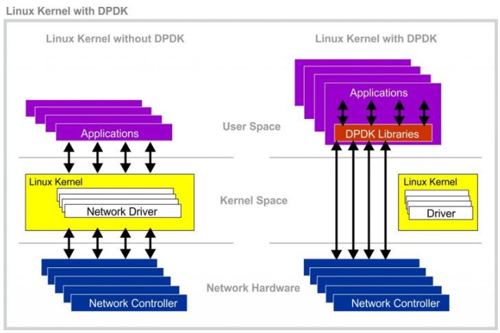
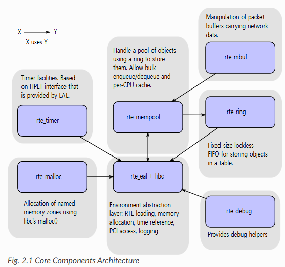

> ※  아래 내용은 업무 중 공부한 내용을 정리한 글입니다.
> ※  때로 정확하지 않을 수 있으며, 참고만 부탁드립니다.
> ※  잘못된 내용이 있을시 댓글로 알려주시면 감사하겠습니다.

## DPDK (Data Plane Development Kit)의 큰 그림

*출처 - https://www.accton.com/Technology-Brief/intel-dpdk-performance-on-the-sau5081i-server/*

위 그림에서 [DPDK](https://ko.wikipedia.org/wiki/DPDK "DPDK Document")가 생기게 된 배경에 대한 많은 것들을 설명해주고 있다.

왼쪽 그림은 DPDK 없이 커널 단에서 네트워크를 처리하는 모습이다. DPDK가 없던 시절, 네트워크 컨트롤러와 애플리케이션 간의 패킷 처리를 위해서는 무조건 리눅스 커널 단의 네트워크 드라이버를 통해야만 했다. 따라서 고속 패킷 처리 같은 성능 개선을 위해서는 리눅스 커널 단의 네트워크 드라이버 개발이 불가피했다. 직접 리눅스 커널을 개발하는 것 말고는 다른 방법이 없었던 것이다. 따라서 방화벽 패킷 처리 모듈, IPS 초창기 모듈, IPSEC 모듈 등 고속 패킷 처리 기능이 필요할 때 모두 커널 단에서 개발을 해야만 했다.

### "커널 단에서 개발해야만 한다"는 어떤 의미를 가질까?

운영체제는 특정한 애플리케이션 만을 위해 있는 것이 아니라 매우 일반화되어 있다. 따라서 커널에 진입하는데 매우 큰 비용이 소모된다. 운영 체제 진입은 본질적으로 비효율을 전제하고 있지만, DPDK가 없던 시절에는 다른 메커니즘이 없었기 때문에 커널 개발을 통해 그나마 효율을 제고할 수 있었다. 하지만 이조차도 커널 진입 비용 자체를 아낄 수는 없었던 것이다.

그래서 오른쪽 그림처럼, "무거운 커널을 우회해서 직접 처리한다"라는 아이디어가 등장한 것이다. 그러다가 DPDK가 Intel에서 오픈소스로 내놓으니 여러 벤더와 개발자들이 기여하기 시작하면서 DPDK는 걷잡을 수 없이 큰 프레임워크가 되었다.

### DPDK가 바꾼 네트워크 보안 제품

DPDK가 등장한 이후 가장 변화가 컸던 제품은 **IPS**다. IPS는 라우팅 모드가 아닌 브릿지 모드로 동작이 가능하다. 그래서 커널의 라우팅 레이어를 안 지나쳐도 됐었다. 이후 DPDK를 통해 바로 패킷을 수신하고 IPS 처리를 하면 성능이 좋아지겠다는 판단을 하게 되면서 DPDK 기반의 IPS 전용 장비가 많이 등장했다.

하지만 **방화벽**은 다른 차원의 일이었다. 라우팅을 포함한 온갖 네트워크 표준을 지켜야 했기 때문에 이를 DPDK 위에서 구현하려면 네트워크 스택 전체를 User Space에 구현해야 하는 부담이 있어서, 방화벽은 여전히 커널에 구현되어 있는 경우가 많다.

## DPDK의 핵심 요소들

*출처 - https://doc.dpdk.org/guides-23.07/prog_guide/overview.html*

위 그림은 DPDK의 핵심 요소들이다.

중앙에 있는 **rte_eal의** 의미를 알아보자.

**rte**는 **Run Time Environment의** 약자다. "런타임 실행 환경"을 뜻한다.

**eal**은 **Environment Abstraction Layer를** 말한다. "환경 추상화 레이어"를 뜻한다.

쉽게 표현하자면, User Space에서 네트워크 드라이버를 구동시키기 위해 필요한 **매우 최소화된** 커널의 필수 요소라고 보면 된다. 여기에 timer 관련 라이브러리, 메모리 할당 관련 라이브러리, ring, mempool 등 최소화된 세트만 가지고 있는 그림이다. 당시 초창기의 DPDK를 가지고 개발했던 선배의 말로는 이 핵심 요소들이 신선했는데, 그 이유는 **"매우 하드웨어 최적화"**가 되어 있기 때문이다.

프로그래밍을 할 때 성능을 개선하는 방법이 2가지가 있는데, 한 가지는 알고리즘 면에서 방법을 개선하는 것이 있고, 또 한 가지는 해당 소프트웨어가 돌아갈 CPU 구조, Cache 구조, Memory 구조 등을 이해하고 그것에 최적화된 형태로 코딩을 해서 성능을 올리는 방법이 있다. 최선의 방법으로는 첫 번째 방법인 알고리즘 개선 방법은 당연히 사용하고 여기에 두 번째 방법을 얹는 것이다. DPDK는 CPU를 만드는 인텔이라는 하드웨어 강자에서 출발했기 때문에 하드웨어에 대한 이해가 가장 뛰어나다. 이 때문에 DPDK의 소프트웨어 형태가 "매우 하드웨어 최적화에 뛰어나다"는 특징을 가질 수 있는 것이다.

다시 돌아와서 위 그림은 **가장 최소화된 DPDK의 원형**이고, 만약 DPDK를 사용한다면 위 라이브러리들은 무조건 함께 사용해야 한다.

---

**[ Reference ]**

[Accton - Intel® DPDK Performance on the SAU5081I Server](https://www.accton.com/Technology-Brief/intel-dpdk-performance-on-the-sau5081i-server/ "accton Intel® DPDK Performance on the SAU5081I Server")

[DPDK Programmer's Guide](https://doc.dpdk.org/guides-23.07/prog_guide/overview.html "dpdk programmers guide")
