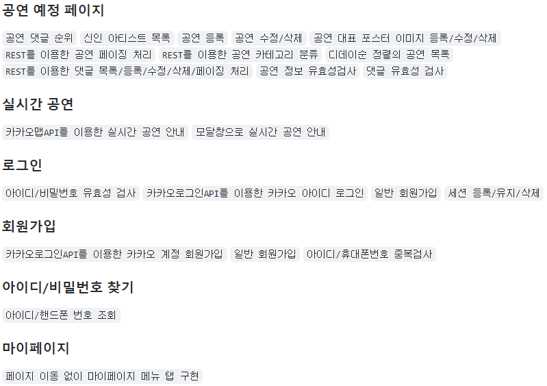

## 🍊왕고냐가 구현한 기능

### 링크 🔍

[👉프론트 작업 레파지토리](https://github.com/wanggoNya/Buskers-front)
[👉백엔드 작업 레파지토리](https://github.com/wanggoNya/Buskers-backend)

---

## 🍊왕고냐가 버스커즈 프로젝트로 느낀 점

### 에러 정리는 아주 중요하다.

어제 본 에러가 오늘도 보이고, 방금 해결한 에러로 팀원도 고생할 확률이 높다. 에러 메세지와 해결원인, 해결법을 기록해두면 공부도 되거니와 프로젝트 진행률을 높이는데 기여할 수 있었다.👍

- 에러 정리 참고
[왕고냐의 기술 블로그](https://wanggonya.tistory.com/)

### 프로젝트를 진행하는데 있어, 팀원간의 코드리뷰와 서비스 흐름에 대한 토론은 필요하다.

AJAX를 이용하여 페이지 이동 없는 화면을 구현할 때 팀원과 나의 DOM을 넣는 방식에 차이가 있었다. "이걸 이렇게도 할 수 있구나" 라는 생각은 더 나은, 더 효율적인 방법을 고안하게 만들었다. 생각하지 못했던 색다른 방법을 보면 사고의 확장이 일어나고 이 또한 학습의 원동력이 되었다.

### 데드라인을 지키기 위해서 개발 일지, 스케쥴러 작성은 아주 효과적이다.

지난 프로젝트에서 기능 미구현이 있어 아쉬웠기 때문에, 이번 프로젝트에서는 모든 업무를 시작하기 전에 나에게 주어진 업무를 잘게 쪼개서 기록한 후 날짜별로 할당했다. 그리고 그 날마다 진행 상황을 파악하여 계획을 수정했고 프로젝트 마감까지 업무를 모두 끝마칠 수 있었다. 팀 프로젝트지만 개인의 할당량은 어느 누가 개입해서 도와주기 어렵기 때문에 각자가 일정을 잘 관리해야 한다. 난 이것을 슬랙(Slack)에 Todo List를 만들어 팀원에게 공유하고, 업무를 잘게 쪼개어 날짜마다 할당한 후 깃허브 리드미에 진행 현황을 올리는 방식을 통해 성공적으로 업무를 마칠 수 있었다.

- 리드미 참고
[프론트 작업 레파지토리](https://github.com/wanggoNya/Buskers-front)
[백엔드 작업 레파지토리](https://github.com/wanggoNya/Buskers-backend)

### 팀 프로젝트의 핵심은 협업이다.

혼자서 진행하는 것이 아니라 팀원과 '협업'을 통해 이뤄내야하는 결과물이기에, 내가 좋은 팀원이 되어 좋은 성과물이 나올 수 있도록 팀에 기여하는 것이 중요했다. 기술적인 측면, 관계적인 측면에서 바라보면 깨달은 점은 이러하다.

- **기술적인 측면**
프로젝트를 진행하다 보면 예상치 못한 난관은 꼭 존재한다. 내일까지 완료해야하는 기능에 에러가 있어 몇 시간동안 진전이 없다거나 하는 경우이다. 일정 시간 투자했을 때도 해결이 안 되면 팀원과 에러에 대한 의견을 공유하고, 여러 사람에게 해결방법을 묻고, 함께 해결해나가야 한다.

내가 묻는 것도 중요했지만 반대로 누가 나에게 질문했을 때 '함께' 해결하는 것이 중요했다. 팀원이 질문했을 때 누구도 도와주지 않으면, 어느 한 부분의 완성이 지체되고 연쇄효과로 다른 부분까지 밀려났다. 이를 통해 배운 것은, 내 업무가 바쁘다고 팀원의 어려움을 무시하는 순간 팀 프로젝트가 아니게 된다는 것이다. 결국 함께 해결하고 함께 나아가야 했다. 이를 느낀 후에는 팀원이 어려움을 느낄 때 최대한 적극적으로 도와주려고 노력했고, 이로인해 프로젝트의 완성도를 높일 수 있었다.

두 번째는, 다음 작업자를 위한 모듈화이다. 마이페이지 프론트 작업을 내가 진행하고 백엔드 작업은 다른 팀원이 맡았기 때문에 프론트에서부터 백엔드 연결이 쉽도록 깔끔한 HTML 코드를 작성해야 했다. 하지만 이를 간과하고 페이지 이동 없는 마이페이지 구현에만 몰두해서 약 2000줄의 HTML 코드를 작성했고, 다음 업무를 맡은 팀원이 굉장히 어려움을 겪었다. 타임리프 include 기능을 통해 모듈화를 했다면 백엔드 작업이 조금 더 수월하지 않았을까 하고 반성했다. 그러기 위해서는 팀원과의 코드 리뷰를 진행했어야 했는데 그러지 못해 많이 아쉬운 부분이었다.
- **관계적인 측면**
각기 다른 7명의 사람이 모여 동일한 목표를 바라보기 때문에 의견 충돌과 갈등은 필히 존재할 수 밖에 없었다. 이를 해결하는 방법은 여러 가지가 있겠지만, 버스커즈 프로젝트를 하며 깨달은 것은 "갈등 상황에 대해 생각을 나누기" 이었다. 한 사람의 불만으로 프로젝트 진행에 어려움이 있을 뻔 했지만, 불만을 서로에게 솔직하게 공유했고 이를 다같이 피드백으로 받아들이는 노력을 했다. 갈등에도 항상 반성할 점과 배울 점이 있었고 이를 이용하면 더 나은 팀원, 더 나은 프로젝트 결과물이 나올 수 있다는 것을 알게 됐다.
