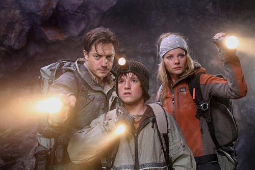
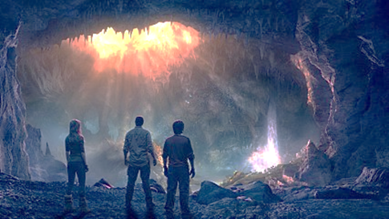
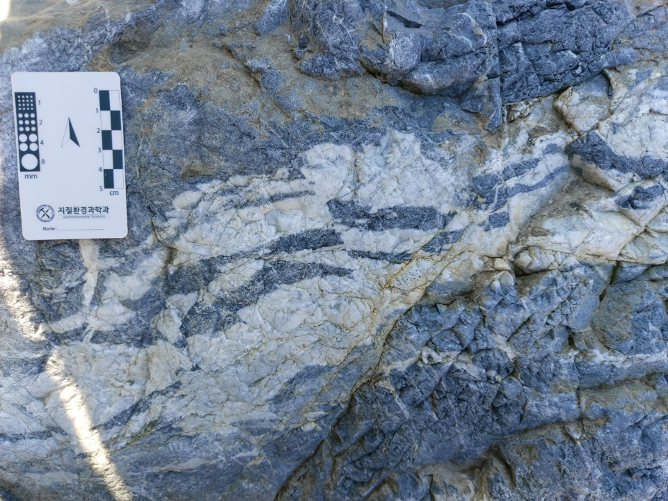
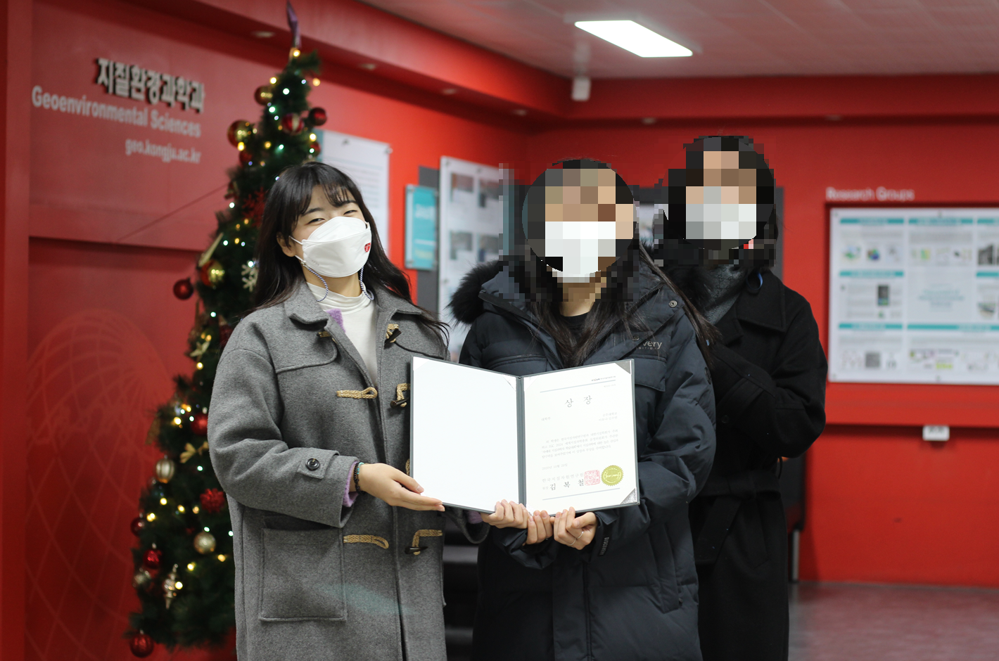

> ※  아래 글은 글또 10기에 지원하며 정리한 제 개인의 이야기 입니다.

#### '잃어버린 세계를 찾아서' 그리고 지질학자

어린 시절 나의 꿈은 영화 '[잃어버린 세계를 찾아서](https://ko.wikipedia.org/wiki/%EC%9E%83%EC%96%B4%EB%B2%84%EB%A6%B0_%EC%84%B8%EA%B3%84%EB%A5%BC_%EC%B0%BE%EC%95%84%EC%84%9C_(2008%EB%85%84_%EC%98%81%ED%99%94))'의 트레버 앤더슨 같은 지질학자가 되는 것이었다. 고등학생 때에는 지구과학에 대한 애정이 남달라서 학교 정규수업 때 가르치지도 않았던 지구과학을 혼자 공부하고, 모의고사에서 혼자 전교 1등도 하며 지질학에 대한 사랑을 키워 나갔다. 하지만 석유도 나지 않는 대한민국에서 SF영화에 나오는 지질학자가 되겠다고 말하는 것은 부모님과 선생님에게 허무맹랑한 소리에 불과했다. 대학 진학을 앞둔 나는, '지질학자'를 조금 더 현실적인 직업으로 탈바꿈시켜 어른들에게 "나의 꿈은 '기상청 지진연구센터 연구원'"이라 공표했다. 부모님은 당시 공무원이 최고라며 나의 꿈을 지지하셨다. 그리고 결국 국내에 몇 없는 지질학, 대기과학이 존재하는 국립 대학교 진학에 성공한다.

*잃어버린 세계를 찾아서(2008) 中*

#### 나의 전공은 지질학입니다.

대학교 1학년 때 나의 인생을 완성형으로 계획했다. 기상청에 들어가기 위해 공무원 시험을 봐야 했기에, 이에 필요한 자격증이 무엇이고 필요한 자본을 어떻게 준비할 것인지에 대해 말이다. 기상청 시험 과목에 대기과학 전공 수업이 유리했기에 대기과학과 복수 전공에 대한 열망이 컸다. 주전공인 지질학과에서는 응용지질기사를 취득할 수 있었고 복수전공인 대기과학과에서는 기상기사를 취득할 수 있었기에 이 두 가지 기사 자격증으로 기상청 공무원 시험에서 가산점을 얻을 계획을 했다. 그리고 공무원 준비 자금을 모으기 위해 학사 ROTC도 준비했다. 졸업 후 2년간 장교로 근무하며 공무원 수험 기간을 확보하고 자금을 모으기 위함이었다.

그러나 대학교를 다니며 나의 완벽했던 인생 계획이 하나씩 어긋나기 시작했다. ROTC 모집설명회를 듣고 체력 시험을 준비하며 ROTC를 포기하게 되었고, 대기과학과에서 몇십 학점이나 전공 수업을 들으면서, 지질학/대기과학을 공부하는 것과 기상청 공무원을 준비하는 것은 천지차이라는 것을 깨닫고 공무원 시험에 대해 한 번 더 고민하게 되었다. 그렇게 나의 인생 계획이 틀어지기 시작했던 3학년 중반, 좋은 기회를 얻어 광물학랩 인턴 생활을 시작했다.

인생 계획이 흔들렸다 해도 지질학에 대한 애정이 없었던 것은 아니다. 장래희망이라 함은 응당 직업이라는 '명사'로 표현해야 한다고 생각했기에 '기상청 공무원'이라 표현했던 것뿐, 이 분야에서 공부할 의지는 3학년 당시만 해도 넘쳐났다. 다만 지질학을 하기 위해서는 석사와 박사 학위를 취득해야 했으며 취업 자리도 바늘구멍만 한 지질 관련 연구소 연구원이었을 뿐이다. 3학년 때 랩 인턴을 하며 지질학 분야에 대해 처음으로 '현실적으로', '밥 벌어먹고 살' 방법을 고민하게 됐다. 랩 인턴 결과는 매우 좋았다. 운 좋 게 지질학회에서 학부생들에게 주는 한국지질자원연구원 상을 수상했으니까. 하지만 다음 질문이 나를 덮쳤다.

*좌 - 야외지질학 실습 사진 / 우 - 한국지자연상 수상 기념 촬영*

#### 내가 이 분야를 잘할 수 있을까?

당시 랩 인턴 생활을 길게 설명할 순 없지만, 당시 한국지질자원연구원 상장을 받았을 때 '내가 잘해서' 받은 상이라곤 생각하지 않았다. 단지 '운'이 좋았을 뿐이었다. 그리고 더 나아가 이 분야, 지질학이라는 분야에서 잘할 수 있느냐는 질문이 내면에 들어왔다. 그리고 나는 자신 있게 답할 수 없었기에 결국 다른 진로를 찾아야겠다고 결심했다. 그때가 4학년이 시작했을 무렵이다. 나는 랩 인턴을 그만두고, 지적직 공무원이나 작은 규모의 지질 회사를 알아보고 있었다. 수요도 많이 없었지만 지질학과 졸업생이란 공급 또한 적었기 때문에 취업 자리는 있다고 얼핏 들었던 것 같다. 그렇게 어떤 직업을, 어떤 삶을 살아가야 하는지 모르는 와중 졸업 요건으로 필요했던 졸업 논문 포스터를 만들기 시작했다. 그리고 이 포스터는 나의 현재를 만들어주었다.

당시 나는 대학 동기들과 함께 셰일가스 저류층의 취성 중 가스포화도에 의한 취성도를 분석하는 졸업 포스터를 준비했다. 이 과정에서 실험 데이터를 그래프로 만들기 위해 매트랩을 사용했어야 했는데, 나는 동기들의 짐을 덜어주고자 자진하여 그래프 담당을 맡았다. 이유도 매우 단순했다. "친한 친구가 매트랩을 사용할 줄 아니, 친구에게 배워서 내가 그려오겠다"는 이유에서였다. 그리고 친구에게 배워 매트랩을 사용하면서 처음으로 '구글링'과 '트러블슈팅', 그리고 '코드와 결과물'을 경험했다. 프로그래밍의 매력을 처음 알게 된 순간이었다.

#### 저는 보안 소프트웨어 개발자입니다.

글을 읽다 보니 몇 가지 질문이 생길 것 같다.

- 지질학(지구과학)에 대한 애정은 이제 없나요?

- 현재 분야에서는 잘할 수 있을 거란 자신이 있었나요?

- 매트랩에서 갑자기 개발로 어떻게 점프했나요?

- 비전공자가 어떻게 보안 소프트웨어 개발을 할 수 있나요?

등등..

매트랩을 처음 사용했던 때부터 3년이 지난 지금, 나는 비전공자 개발자 지망생을 거쳐 보안 소프트웨어 개발자가 되었다. 처음에는 파이썬의 def 키워드조차 너무 어려워서 몇 날 며칠을 머리 싸매며 고민했었는데, 이제는 C언어로 쓰인 보안 SW제품의 복잡한 구조도 나름 잘 그릴 수 있게 되었다. 그러나 나는 여전히 주니어이며, 때문에 어떻게 하면 실력 있는 시니어가 될 수 있을지 늘 고민하는 인생을 살고 있다.

시스템 분야와 성장에 관심이 많은 평범한 직장인으로서 앞으로 더 가파르게 성장해 나갈 나를 기록하기 위해 글또10기에 도전하려고 한다. 글또10기에 합격하면 다음 이야기를 적어보도록 하겠다. 뽑히길 간절히 바라본다^^
