## 들어가며

티스토리 블로그는 노션, Velog와 달리 TOC(목차) 기능을 제공하지 않는다.

하지만 [Tocbot API](https://tscanlin.github.io/tocbot/)를 이용하면 티스토리 블로그에도 TOC(목차)가 자동으로 생성되도록 할 수 있다.

블로그 관리자 페이지에서 스킨 편집을 통해 Tocbot을 적용해 보자.

---

> ※  적용 기준은 티스토리에서 기본으로 제공하는 Book Club 템플릿을 기준으로 합니다.

## 1. 블로그 관리&gt; 꾸미기 탭 &gt; 스킨 편집 &gt; html 편집 이동

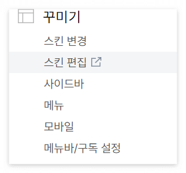

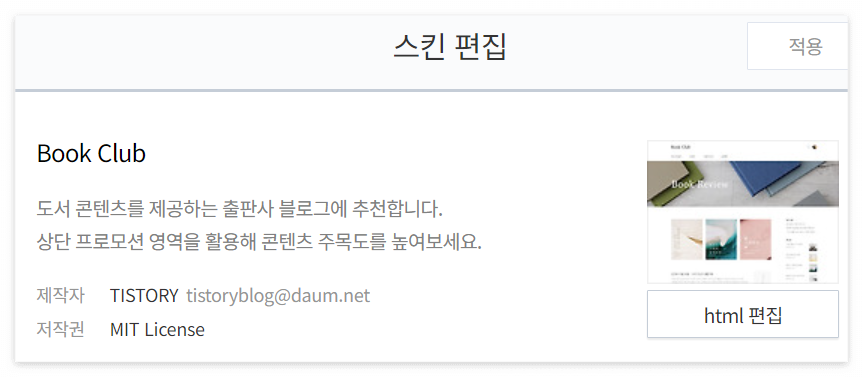

## 2. CDN 추가

### 2-1. &lt;head&gt; 부분

html의 &lt;head&gt; 부분에 다음의 TOC 관련 코드를 추가한다.

```bash
<head>
    ...
    
	<!-- TOC -->
	<script src="https://cdnjs.cloudflare.com/ajax/libs/tocbot/4.11.1/tocbot.min.js">	</script>
	<link rel="stylesheet" href="https://cdnjs.cloudflare.com/ajax/libs/tocbot/4.11.1/tocbot.css">
	
    ...
</head>
```

적용 예시

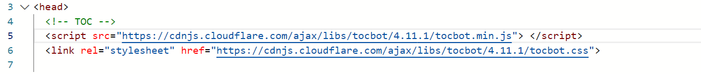

### 2-2. &lt;/body&gt; 부분

&lt;/body&gt;로 끝나는 바로 위 부분에 다음의 script 코드를 추가한다.

```bash
	<!-- TOC -->
	<script>
		var content = document.querySelector('.entry-content')
		var headings = content.querySelectorAll('h1, h2, h3, h4, h5, h6, h7')
		var headingMap = {}

		Array.prototype.forEach.call(headings, function (heading) {
				var id = heading.id ? heading.id : heading.textContent.trim().toLowerCase()
									 .split(' ').join('-').replace(/[\!\@\#\$\%\^\&\*\(\):]/ig, '')
				headingMap[id] = !isNaN(headingMap[id]) ? ++headingMap[id] : 0
				if (headingMap[id]) {
					heading.id = id + '-' + headingMap[id]
				} else {
					heading.id = id
				}
			})

		tocbot.init({
                    tocSelector: '.toc',
                    contentSelector: '.entry-content',
                    headingSelector: 'h1, h2, h3, h4',
                    hasInnerContainers: false,
                    ignoreSelector: '.another_category_color_gray h4',
                    collapseDepth: 4
		});

		$(document).ready(function(){
			$('.toc').addClass('toc-absolute');

			var toc_top = $('.toc').offset().top - 165;
			$(window).scroll(function() {
				if ($(this).scrollTop() >= toc_top) {
					$('.toc').addClass('toc-fixed');
					$('.toc').removeClass('toc-absolute');
				} else {
					$('.toc').addClass('toc-absolute');
					$('.toc').removeClass('toc-fixed');
				}
			});
		});
	</script>
```

#### 2-2-1. 상세설정 - content

- 해당 content와 contentSelector: 에는 자신의 글 본문이 작성되는 class명을 적용해야 한다.
- 나의 경우에는 티스토리 기본 템플릿 중 Book Club 템플릿을 사용 중이기 때문에 다음과 같이 설정했다.
	- var content = document.querySelector('**.entry-content**')
	- contentSelector: '**.entry-conten**t'
- 자신의 class 명을 찾기 어렵다면, 블로그 글을 하나 띄우고 F12 또는 Ctrl+Shift+c 키를 눌러 글 본문에 해당하는 div class를 찾는다.
- 아래 사진을 보면 Book Club 템플릿의 경우 글 본문을 감싸고 있는 &lt;div&gt;의 class가 entry-class임을 확인할 수 있다.

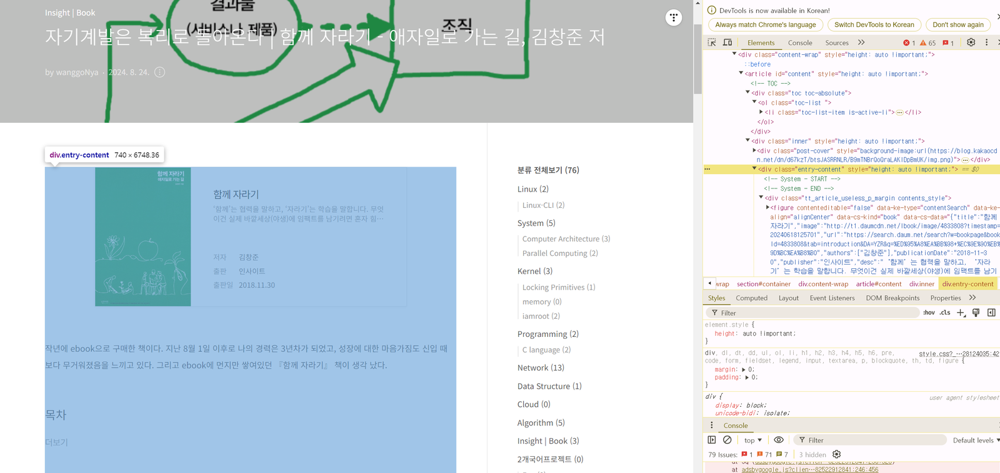

*개발자도구를 활용하여 본문 class 명을 찾는다.*

#### 2-2-1. 상세설정 - tocbot.init

[Tocbot API](https://tscanlin.github.io/tocbot/)을 보면 [Options 탭](https://tscanlin.github.io/tocbot/#options)에서 여러 init 옵션들을 확인할 수 있다.

내가 수정한 주요 필드는 다음과 같다.

1. **headingSelector**
	- contentSelector 요소 내부에서 가져올 제목이다.
	- 티스토리의 경우에는 **제목3**이 **h4**로 지정된다.
	- 나의 경우에는 'h1, h2, h3, h4'로 설정하여 **h4까지 TOC(목차)로 만들어지도록** 하였다.
2. **hasInnerContainers**
	- **헤딩 요소들이 컨테이너 요소 안에 있는지 여부**를 설정하는 옵션이다.
	- 이 옵션을 통해, 헤딩 요소가 HTML 내에서 **추가적인 래퍼(div, section 등)** 안에 감싸져 있을 경우에도 tocbot이 이를 인식하고 TOC(목차)를 생성할 수 있게 한다.
	- 나의 경우에는 false로 설정했다.
3. **ignoreSelector**
	- TOC(목차)에서 **생략할 class 이름**을 설정한다.
	- 나의 경우에는 **'.another_category_color_gray h4'** 로 설정했다.
	- 위에서 headingSelector에 h4까지 포함시키게 되면 다음과 같이 글 마지막에 나오는 **"카테고리의 다른 글"까지** TOC(목차)에 포함되기 때문이다.
	- 아래 사진 - 불필요한 영역까지 나오는 모습
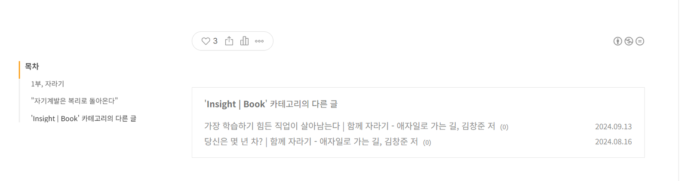

*불필요한 영역까지 나타내고 있음*

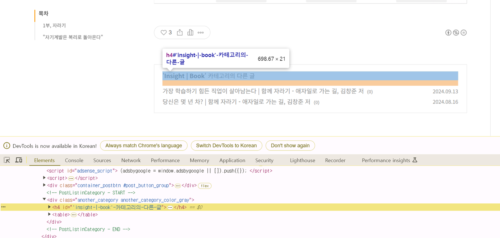

*개발자도구를 활용하여 무시할 영역의 이름을 찾는다.*
4. **collapseDepth**
	- **TOC(목차)에서 특정 레벨 이하의 헤딩을 기본적으로 접어두는 역할**을 한다.
	- 이를 통해 목차가 너무 길어지는 것을 방지하고, 사용자가 필요할 때 세부 항목을 확장하여 볼 수 있도록 도와준다.
	- 만약 3으로 설정하면, **h1, h2, h3** 항목은 열려 있고, 그보다 작은 항목(예: h4, h5)은 접힌 상태로 표시된다.

		- 최솟값 0 - **모든 TOC 항목이 접힌 상태**로 표시
		- 최댓값 6 - **모든** **TOC 항목이 열린 상태**로 표시
	- **접힌 상태**로 시작한 TOC 항목은 사용자가 페이지를 스크롤할 때 **자동으로 확장**되고, 해당 헤딩이 화면에서 벗어나면 **자동으로 다시 접히게** 표시된다.
	- 설정 예시
		- **▼ 더보기**

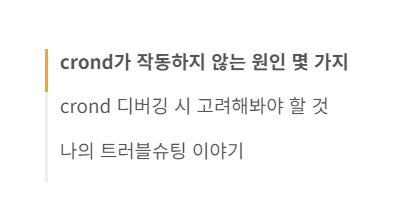

*collapseDepth: 0*

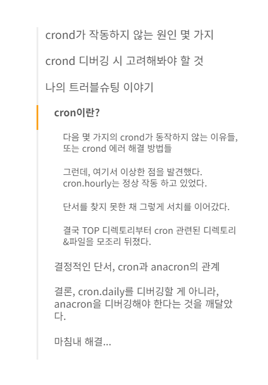

*스크롤시 자동으로 펼쳐짐*

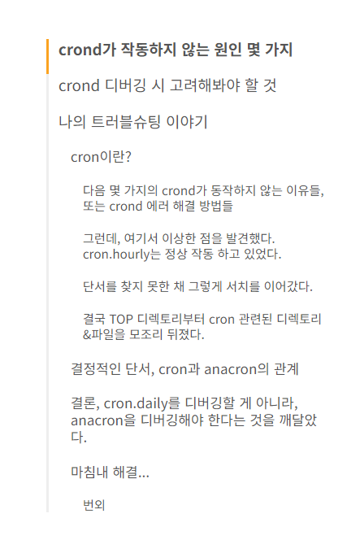

*collapseDepth: 6*

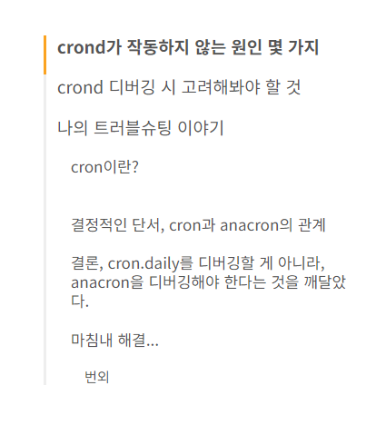

*collapseDepth: 4*

## 3. TOC를 표시할 div 추가

티스토리 기본 템플릿 중 Book Club 템플릿을 기준으로 &lt;article id="content"&gt; 하위에 넣어주었다.

다른 템플릿의 경우에는 각자 적절한 위치를 찾아서 넣어주면 될 듯하다.

```html
<article id="content">
    ...
        <!-- TOC -->
        <div class='toc'></div>
    ...
```

적용 예시

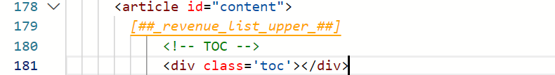

## 4. CSS 탭 수정

CSS탭에서 맨 아랫 줄에 다음 코드를 붙여 넣기 한다.

```css
/* TOC */
.toc-absolute {
  position: absolute;
  margin-top: 24px;
}
.toc-fixed {
  position: fixed;
  top: 165px;
}

.toc {
  left: calc((100% - 1165px) / 2 - 250px);
  width: 250px;
  padding: 10px;
  box-sizing: border-box;
	font-size: 14px;
}

.toc-list {
  margin-top: 14px !important;
  font-size: 0.9em;
}

.toc > .toc-list li {
  margin-bottom: 14px;
}

.toc > .toc-list li:last-child {
  margin-bottom: 0;
}

.toc > .toc-list li a {
  text-decoration: none;
}

.is-active-link::before {
	background-color: #fba321 !important;
}
```

1. **.toc 필드**
	- 나의 경우에는 해당 값에서 px을 1165px 값으로 수정해 주었다. 왼/오른쪽 위치가 달라진다.
	- 각자 선호하는 위치로 설정하면 될듯하다.
2. **.is-active-link::before 필드**
	- 현재 목차 위치의 색상을 내가 원하는 색상으로 설정하기 위해 추가한 필드이다.
	- 다음 사진과 같이 현재 위치에 해당하는 TOC(목차)에 원하는 색상이 표현되도록 설정할 수 있다.

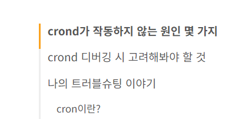

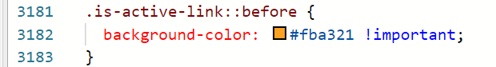

## 5. 적용 결과

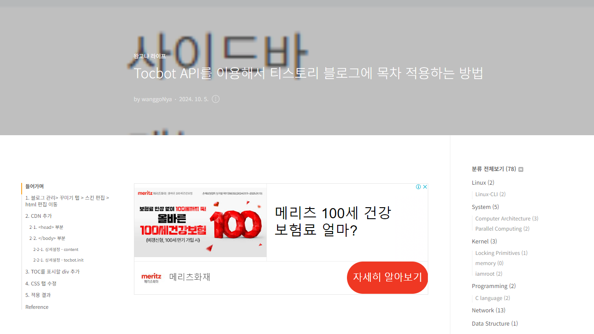

*왼쪽 사이드에 보이는 목차*

이렇게 티스토리 블로그 목차를 만들어보았다. 다만 아쉬운 것은 데스크톱에서 전체 창으로 봐야만 목차가 보인다는 점이다. 나중에는 글 본문에 목차가 자동으로 생기도록 만들어볼 예정이다!

---

## Reference

[Tocbot API](https://tscanlin.github.io/tocbot/ "Tocbot API 공식 문서")

[🔗 Tocbot](https://tscanlin.github.io/tocbot/)

[티스토리 사이드 목차 TOC(Table of Contents) 추가하기](https://5-ssssseung.tistory.com/59 "티스토리 사이드 목차 TOC(Table of Contents) 추가하기")

[🔗 티스토리 사이드 목차 TOC(Table of Contents) 추가하기 (오디세이 스킨, 자동 목차 생성)](https://5-ssssseung.tistory.com/59#2.-cdn-%EC%B6%94%EA%B0%80)
