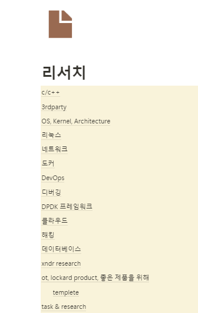
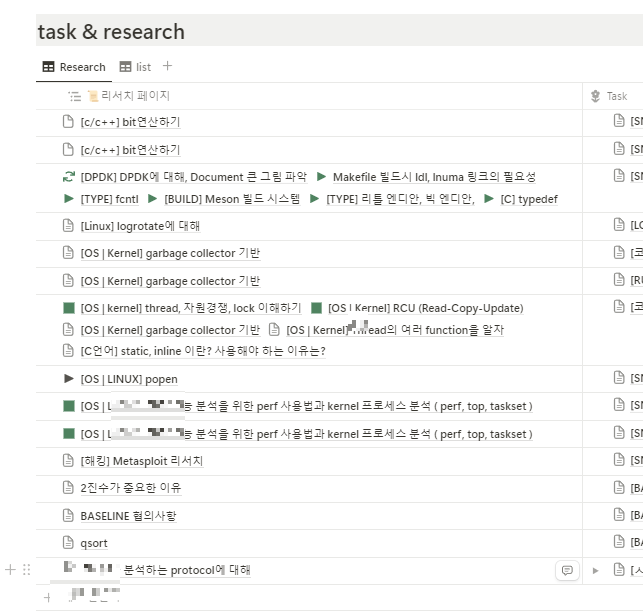
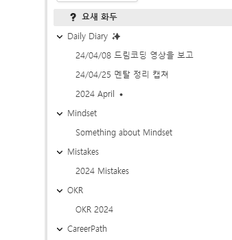
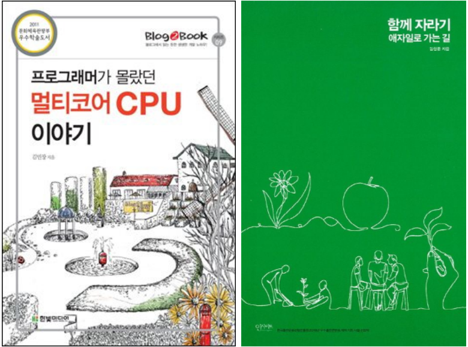
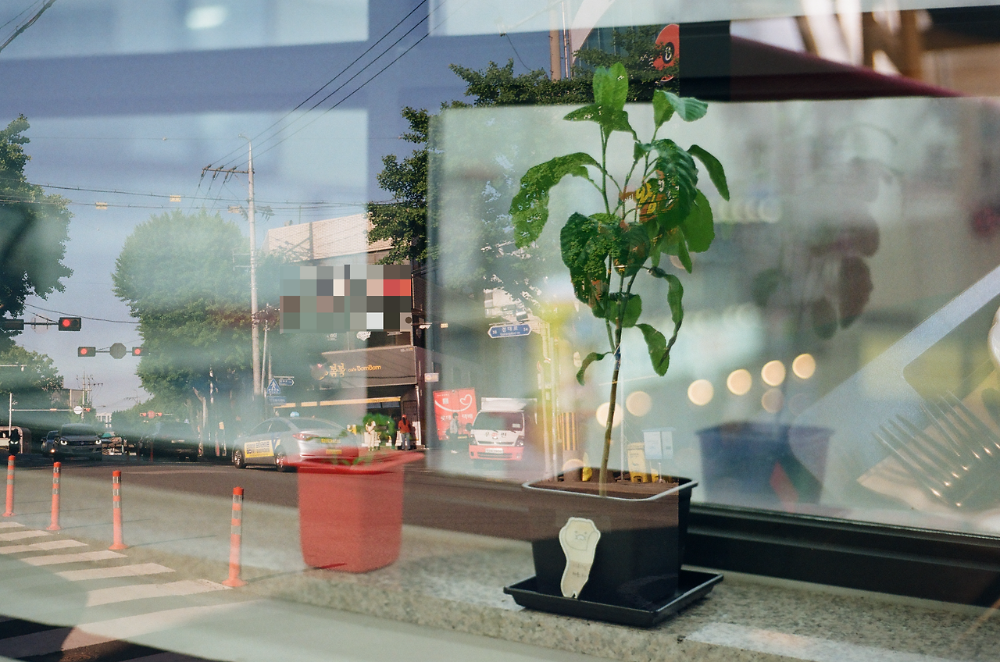

10월부터 [글또](https://geultto.github.io/blog/geultto-summary/ "글또(개발자 글쓰기 모임) 소개") 10기에 합류했고 글또 활동의 핵심은 **"글쓰기"**다. 2주마다 1,000자 이상의 글을 적어 공유해야 하고 6개월간 지속된다. 그리고 이 글은 첫 시작을 알리는 나의 다짐 글이다. 글또는 글쓰기만 하는 모임은 아니다. **함께 자라기**를 지향하는 사람들이 모여 슬랙을 중심으로 서로의 일상과 글, 인풋/아웃풋을 공유하며 함께 성장한다.

첫 글에는 글또를 통해 얻고자 하는 것들을 적어볼까 한다. 글또 활동을 하며 주로 쓰게 될 글, 기대되는 것들을 중심으로 정리해 보겠다.

---

### 주로 쓰게 될 글

#### 1. 기술적인 글

*좌 - 개인 노션의 리서치 페이지 목차 / 우 - 리서치 페이지와 업무 페이지를 연결해놓은 노션 데이터 베이스*

왼쪽 사진은 노션에 개인적으로 정리하고 있는 리서치 페이지의 목차 사진이다. 그리고 오른쪽 사진은 리서치 페이지와 업무 페이지가 연결된 데이터 베이스 사진이다. 나는 평소에 일을 하면서 깊은 공부가 필요한 영역에 대해서는 업무와 리서치(기술) 내용을 연결해서 정리해 놓는 편이다. 하지만 노션에는 이렇게 많은 양의 정보가 날 것의 상태로 담겨있고, 또 누구에게 보여주기 위해 적어놓은 것들이 아니다 보니 어느 순간부터는 "자료 조사"만 하고 있는 페이지가 되어버렸다.

공부한 것들이 내 것이 되기 위해서는 누군가에게 일목요연하게 설명하는 과정이 필수적이다. **글또에서 활동하는 동안**은 **일을 하며 배우는 것들을 내 것으로 만드는 과정에 집중**하려고 한다. 그러기 위해서는 사람들이 읽기 좋은 글을 적어야 한다. 기존에 글또 활동을 하고 계시던 분들 중 상당수가 "독자를 고려한 글"을 적기 위해 많은 고민을 하고 계셨다. 나로선 꽤 충격이었던 게, 현재 나의 블로그에는 몇 십 개의 글이 정리되어 있지만 대다수의 글이 나를 위해 쓰여졌기 때문이다.

글또를 통해 생산해 낼 **글의 주목적은** **"사람들에게 내가 공부한 것들을 잘 전달하기"**이며, 이것이 잘 이루어졌을 때 주니어에서 시니어로 성장할 것이란 생각이 든다. 그리고 마침 업무에서 어려운 것들을 제법 맡아가는 것 같다. 기회가 주어졌을 때 열심히 노를 젓는 내가 되어 보자!

#### 2. 회고하는 글

기술적인 글 외에 생산하고 싶은 글은 "회고"에 대한 글이다. 오른쪽 사진은 OneNote에 개인적으로 정리하고 있는 다이어리 페이지를 캡처한 사진이다. 나는 회사를 다니고 일을 하며 겪는 많은 것들, 느끼는 것들, 여러 희로애락을 이렇게 기록하고 있다. 하지만 이것 또한 리서치 페이지와 마찬가지로 여러 군데에 산발적으로 존재하고 있다. 사진을 보면 알다시피 Daily Diary에는 하루하루를 보내며 겪는 사소한 것들이나 멘탈 정리에 대한 내용이 담겨있고, Mindset에는 각종 피드백을 들으며 마음을 다잡는 마인드셋에 대한 내용이 담겨있다. Mistakes에는 회사 생활을 하며 크고 작게 실수할 때마다 그 내용과 개선점을 적는 실수 다이어리가 담겨있다. **작은 규모의 회고는 자주 하고 있지만 그 내용이 여러 곳에 분포하고 있다 보니 하나의 글로 정리하는 데에는 시간과 노력이 든다.**

이참에 이것을 하나의 글로 **제발** 적으려고 한다. "시작-과정-결과"의 단계에서, 나는 **시작-과정**까지 이뤄내는 데에는 **강점**이 있지만 **결과가** **미약**하다는 **약점**이 있다. 글또를 통해 약점을 극복해보려고 한다.

#### 3. 책을 정리하는 글

그 밖에는 책 내용을 정리하는 글을 써보려고 한다. 쉬는 날이면 취미 삼아 읽은 책의 하이라이트를 블로그에 정리하곤 한다. 시간이 매우 오래 걸리는 게 문제긴 하지만 말이다. 현재 정리하고 있는 책은 김창준 저자의 [함께 자라기](https://product.kyobobook.co.kr/detail/S000001033071 "김창준 저자의 함께 자라기")와 김민장 저자의 [멀티코어 CPU](https://www.yes24.com/Product/Goods/3858484 "프로그래머가 몰랐던 멀티코어 CPU 이야기")에 대한 책이다. 적어도 이 두 권은 글또 활동이 끝나기 전에 정리를 마쳐보려고 한다.

*정리하고 있던 책들, 멀티코어 CPU 책과 함께 자라기.*

### 교류

글또를 통해 얻을 수 있는 것은 "글쓰기"능력도 있지만 사람들과의 커뮤니티이다. 글또에는 다양한 **소모임**이 있다. 요리, 악기연주, 운동, 모각글/모각코, 감사회고, 미라클모닝, 독서, 영어 등등 아주 다양하다. 비슷한 취미 또는 생활패턴의 사람들이 모여 서로의 삶을 들여다보고 응원하고 조언을 구하고 얻을 수 있다. 소모임 외에도 **커피챗**, **대나무 숲** 시스템을 통해 비슷한 직군끼리 대화를 나누며 인사이트를 넓힐 수 있는 기회를 제공하고 있다.

#### 1. 소모임

여러 개의 소모임이 존재하지만 내가 굵직하게 참여하고 있는 것은 아래와 같다.

- 영어해또
- 둥근해미친거또떴또 (미라클모임)
- 달리또/오늘운동해또
- 감사회고해또
- 책읽어또

평소 하루를 쪼개어 영어공부/운동/독서를 하는 편인데 이런 생활을 공유할 수 있는 사람들이 생겨 기쁘고, 무엇보다 **꾸준히 함께** 할 수 있어서 좋다. 하루에 이것들을 모두 해내기는 보통이 아니면 불가능하다는 것을 많은 사람들이 알 것이다. 그러나 **함께 하는 사람들**이 있으니 **단 10분, 단 5분**이라도 하겠다는 의지가 생긴다는 점이 글또라는 커뮤니티가 주는 선한 영향력이 아닐까 싶다.

#### 2. 커피챗

최근 나를 사로잡고 있는 화두 중 하나는 **"내가 속한 환경은 어느 정도의 다양성을 갖고 있는가?"**이다. 유호현 작가가 브런치에 남긴 [다양성에 대한 글](https://brunch.co.kr/@svillustrated/177 "유호현 브런치, 다양성은 불편하다")을 읽고 든 생각이다. 나는 비교적 작은 규모의 회사에서 커리어를 시작했고 게다가 전공자가 아니었기 때문에 비슷한 직군에 일하는 사람들을 만나볼 기회가 매우 적었다.

게다가 글또에서 함께하는 분들의 대부분이 프론트/백엔드, AI, 데이터 분야 직군에서 일하고 계신다. 하지만 나는 **네트워크 보안** 분야에서 일을 하고 있으니, 여러 사람과의 커피챗을 통해 다른 분야의 사람들이 **어떤 식으로 일하고 어떤 공부를 하는지** **간접 경험**을 할 수 있는 소중한 기회를 얻을 것이라 확신한다.

따라서 커피챗을 통해 기대하는 바는,

- 내가 속한 세상이 전부가 아님을 깨닫는 것
- 다양성을 경험하는 것. 나와 다른 사람들, 제법 특별해 보이는 사람들, 개개인마다 배울 점들을 찾는 것

많은 사람들 중에서 네트워크 보안 분야는 나 한 명이라서 커피챗 요청 횟수는 적을 거라 예상되지만 내가 호기심을 가지면 되겠지, 란 희망을 가지고 글을 마무리하겠다.

---

### 자몽이만큼만 자라기

아래 사진은 회사에서 키우고 있는 나의 레몬 나무(이름 김자몽)의 사진이다. **하루가 다르게 자라고 있다.** 나도 자몽이, 레몬 나무처럼 하루가 다르게 자라기를 바라면서, 글또 10기 첫 글인 나의 다짐 글을 마무리한다.

*내가 키우는 김자몽 (레몬나무)*
