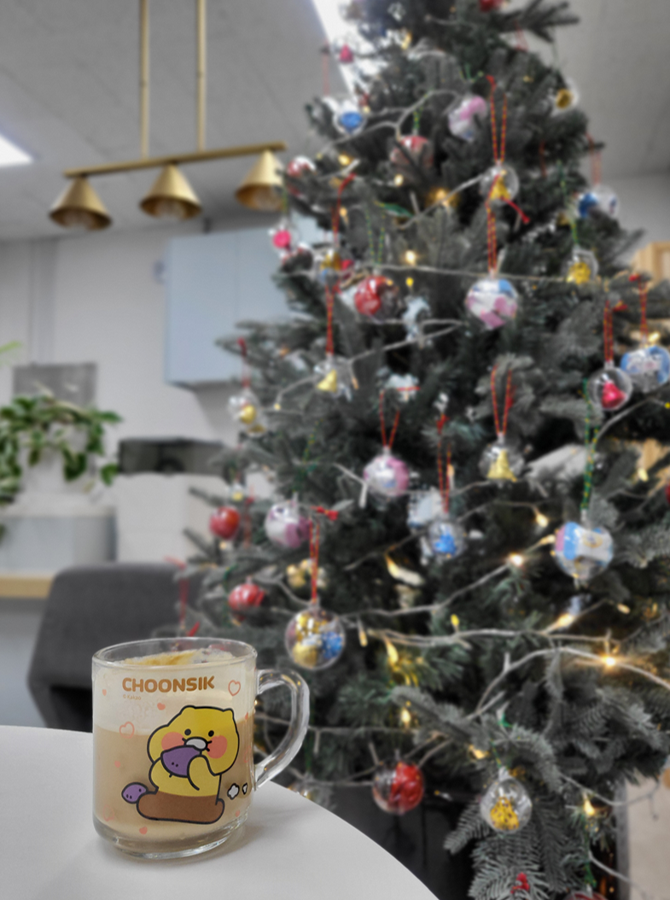

> ※  아래 글은 2024년을 마무리하며 정리하는 개인적인 회고록 입니다.
> ※  현재 1차 작성본으로, 팀 연말 성과 평가서를 함께 작성하며 Action Item을 추가해 나갈 것 같습니다.

*연말 분위기 연출*

2024년을 하나의 키워드로 정의해 보자면, 바로 **"장르불문"**이다. 올해에는 회사 안팎으로 많은 변화를 겪었다. 변화 속에서 다양한 장르의 경험을 했고 이 경험들로 인해 어른의 나를 완성해 나가고 있다.

## 월별 Task와 큼지막한 이벤트

월별 Task와 큼지막한 이벤트와 그 속에서 배우고 느낀 것들을 정리해 보자.

### 1~3월

국가과제 준비

- 자사 어플라이언스 보안 제품인 DLP를 클라우드화 하는 국가과제를 준비했다.
- 테스트 항목 12개에 대해 오퍼레이터로서 진행을 해야 했다.

NDR 업무

- 2023년 중순에 NDR이라는 신제품이 나온 이후 첫 고객사가 생기며 유지보수 기간을 가졌다.

### 4~5월

국가과제 종료

- 얻은 것들
	- 준비하는 과정에서 자사 제품을 이해하는데 도움이 많이 됐다. 나는 NDR 파트여서 자사 주력 제품인 DLP의 구조에 대해 개념 정도만 알고 있었는데, 국가과제 오퍼레이터를 맡은 이후 약 4달의 준비 기간 동안 DLP에 대해 빠삭하게 이해할 수 있었다.
	- 클라우드화 된 DLP가 전반적으로 안정적인 운영이 되어야 했기에 트러블슈팅을 굉장히 많이 했다. 패킷 수집을 하는 DPDK부터 파드 내에서 분석 처리를 하는 기능까지 모두 AWS 환경에서 운영해야 했고, 운영과 트러블슈팅을 위해서는 DLP의 동작 방식을 잘 알고 있어야 했기 때문에 이때 공부를 정말 많이 했다.
	- 국가과제 시연이 무사히 통과된 후에는 사수 선배에게 피드백을 요청했고 긍정 평가를 많이 받았다. 평가 내용은 다음과 같다. 노력을 많이 한다는 것과 흡수를 잘한다는 것, 이해력이 좋고 자기 것으로 잘 만든다는 것, 하고자 하는 의지가 강하다는 점들이었다.
- 아쉬운 것들
	- 클라우드화 된 제품이 시장에서도 많이 팔렸으면 좋았을 텐데 아쉽다. 이건 내가 어찌할 수 없는 영역이긴 하지만 말이다. 시장에서 반응이 좋았다면 클라우드상 대용량 트래픽 처리, 로드밸런싱 같은 것들을 많이 접하지 않았을까 한다.

박람회 준비&참여

- 우리 회사가 R&D팀 채용을 목표로 취업 박람회에 참여했다. 나와 사수 선배가 기업 부스와 기업 홍보 발표를 주도적으로 맡아 진행했다.
- 기업 홍보 발표는 3부로 나눠서 진행을 했는데, 1부는 회사 소개, 2부는 R&D 기술 스택에 대해 전반적으로 설명하는 내용이라 사수 선배가 맡아서 진행했고 3부는 회사 복지를 설명하는 내용으로 비교적 간단했기에 내가 맡아 진행했다.
- 얻은 것들
	- 사수 선배와 내가 기업 홍보 발표의 파트는 나눠서 했지만 자료 준비와 내용 구성은 함께 진행했는데, 이때 기대 외로 인사이트가 넓어졌다.
	- 1부와 2부 발표 자료를 함께 준비하면서 사수 선배가 우리 회사에서 기술적으로 어떻게 성장했는지 그 과정을 세세하게 알 수 있었고 내 커리어의 가이드라인을 잡는 데 도움이 많이 됐다.
	- 또 다른 사람에게 설명해야 할 자료를 만들면서 자연스럽게 회사와 제품에 대한 이해도가 높아졌고 애정이 많이 생겼다.
- 아쉬운 것들
	- 급박하게 준비한 터라 밤샘과 야근을 많이 했다. 나와 사수 선배가 자발적으로 하겠다고 했기 때문에 힘들어도 힘든 티를 못 냈고, 실무에서도 빠진 게 아니라서 체력적으로 버거웠다. 그땐 무리할 수밖에 없었지만 지금 돌아보면 건강 챙기면서 열심히 할 걸, 이런 생각이 조금 든다.

### 6~9월

NDR & DLP 유지보수 파트 병합

IDS 첫 기능추가 & IDS 재처리 & IDS 장애대응

- 이 장애를 계기로 파트 운영에 대한 Action Item을 만들기 시작한다.

DLP 개발 적응기간

7월 - 신규입사자 OJT 진행

- 7월에는 우리 팀에 신입 3명이 새로 입사를 했고, OJT를 주도적으로 맡아 진행했다.
- 얻은 것들
	- 처음에는 실력 좋은 신입이 들어온다는 점에서 자극이 많이 됐다. 대신 불안함과 긴장감을 많이 느꼈다.
	- 이 불안과 긴장은 결코 부정적인 것들이 아니었다. 이것들은 내가 CPU 멀티코어 책을 공부하도록 만들었고, 함께 자라기 책을 완독 하게 만들었고, 블로그 업데이트를 하게 만들었다. 어떻게 하면 더 공부하고 더 발전할 수 있을지 고민하게 만든 것이다.
	- 나름 바로 위 연차로서 OJT 진행을 주도했는데, 한 번도 경험하지 못한 것들을 경험했다. 전에는 같이 일하던 동료가 2-30년 차 시니어 개발자 선배였어서 항상 배우고 겸손한 마음으로 일했던 반면, OJT를 진행하는 동안에는 '또래'끼리의 긴장감을 많이 느꼈다. 불안과 긴장을 계속 느끼는 것은 힘든 일이다. 처음에는 굉장히 Stressful 해서 나름 극복하고자 메타인지를 많이 하려고 했다.
	- 그 결과 내 결핍이나 내가 예민해하는 부분, 민감하게 받아들이는 부분들에 대해 새롭게 알게 된 것들이 정말 많았고, 이런 내적 갈등들을 저연차에 충분히 경험해야 발전한다는 결론에 도달했다.
	- '질문은 기회다.' 1년 차 때 나의 주된 신념이었다. OJT 진행을 하면서 이 신념을 잊고 살았음을 느꼈다. 신입에게 내가 알고 있는 영역을 설명해 줄 때면 종종 질문을 받곤 했는데, 질문들은 그동안 한 번도 궁금해하지 않았던 것이거나, 대강 알고 넘어간 것들이 대부분이었다.
	- 질문을 기회로 한번 더 찾아보고, 더 알려주려고 하고, 더 깊게 공부하려고 하는 식으로 자극을 많이 받았다.
	- 결론, 여러모로 후배가 생긴다는 것은 긴장감/불안/스트레스도 있지만 결국 성장통에 지나지 않는 것 같고, 결론적으로는 나의 성장에 큰 도움이 되는 것 같다.
	- 나보다 더 뛰어난 신입이 있거나 따라 잡히는 것에 두려움을 느낀다면, 내가 찾은 방법은 이렇다. 그 신입을 충분히 인정하고, 칭찬하고, 그 신입에게서 내가 배울 점을 찾는다. 오히려 내가 이 사람에게 배운다는 마인드를 가진다. 실제로 이런 말들을 했을 때 신입을 더 열정적으로 만드는 데 일조를 하겠지만 나에게도 겸손함, 인정하는 태도 같은 긍정적인 마인드를 갖추게 하더라.
- 아쉬운 것들
	- 아쉬운 점이 있다면 3개월의 OJT 이후에는 모두 다른 파트가 됐다는 점이다. 내가 밀접하게 진행하는 실무에서도 신입에게 많이 가르쳐줄 수 있었다면 나 또한 더 많이 성장했을 것 같다.
	- 성장통이 있어야 배움도 있는 것이겠지만 OJT 기간 초반에 Stressful 한 상황을 겪어야만 했던 것이 아쉽다.

팀 워크숍 준비

영어 공부에 진심

미라클모닝

### 10~11월

DLP 유지보수 중 프로토콜 분석 파트의 본격적인 업무를 맡기 시작

기타 DLP 유지보수 이슈 해결하기

POC 준비

- DLP 중 프로토콜 분석과 세션 분류 기능 점검, 코드 분석

글또 10기에 들어가다.

백엔드 반상회 & 로우레벨 개발자 커피챗

슬럼프의 시작

### 12월 마무리

POC 준비

- DLP 중 Protocol Anaylzer, Flow Classifier의 기능 점검, 코드 분석

DLP 유지보수 이슈 해결하기

슬럼프 기간과 모티베이션, 선배와의 등산챗

- 얻은 것들
	- 내가 왜 일하는지 많이 돌아봤다.
	- 사실 이 부분에 대해서는 요즘 지속적으로 하고 있는 고민이고, 개인적으로도 머릿속이 복잡하기에 정리가 안 되어 있다.

2024년은 변화 속에서 흔들리기도 했지만, 그만큼 많이 배우고 단단해진 시간이었다.

불안과 긴장, 스트레스도 결국 나를 앞으로 나아가게 만드는 원동력이었다는 것을 알게 되었고,

아직 방향에 대한 고민은 남아 있지만 현재 멈추지 않고 있다는 확신은 있기에 괜찮은 것 같다.

2025년에는 지금까지 쌓아온 것들을 기반으로, 더 깊이 있고 의미 있는 성장을 만들어가고 싶다.
