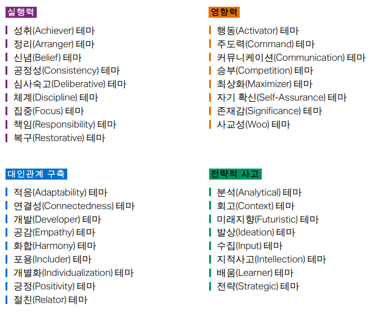
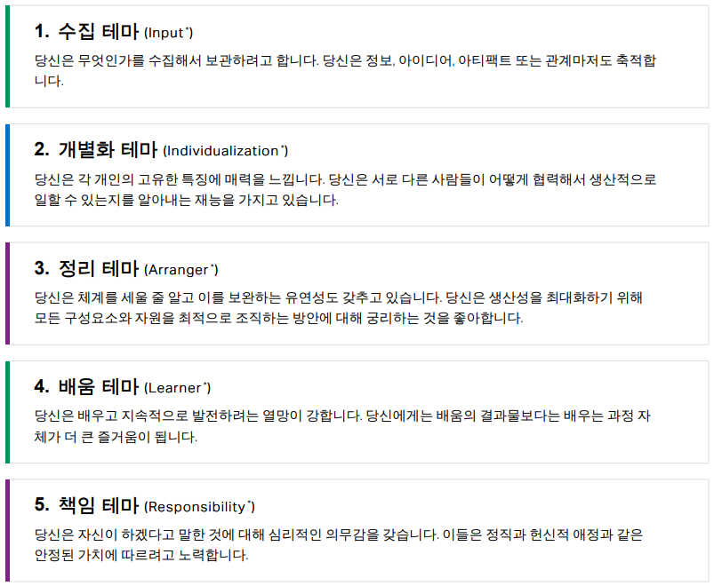
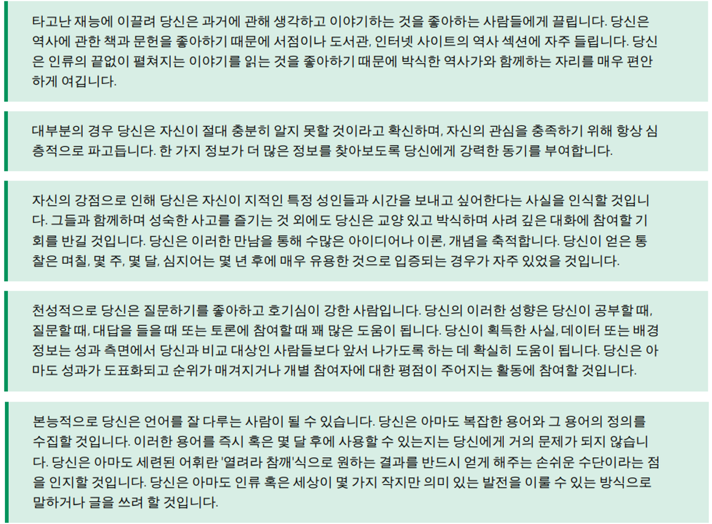
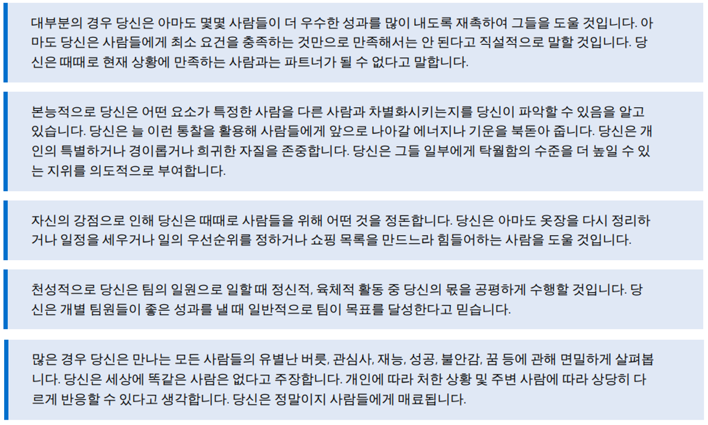
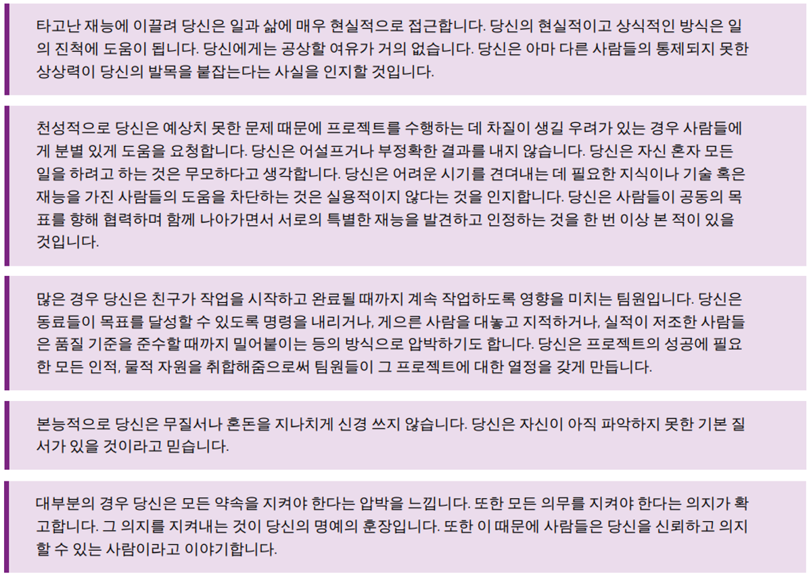
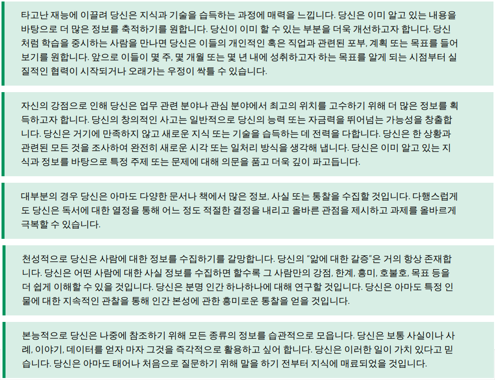
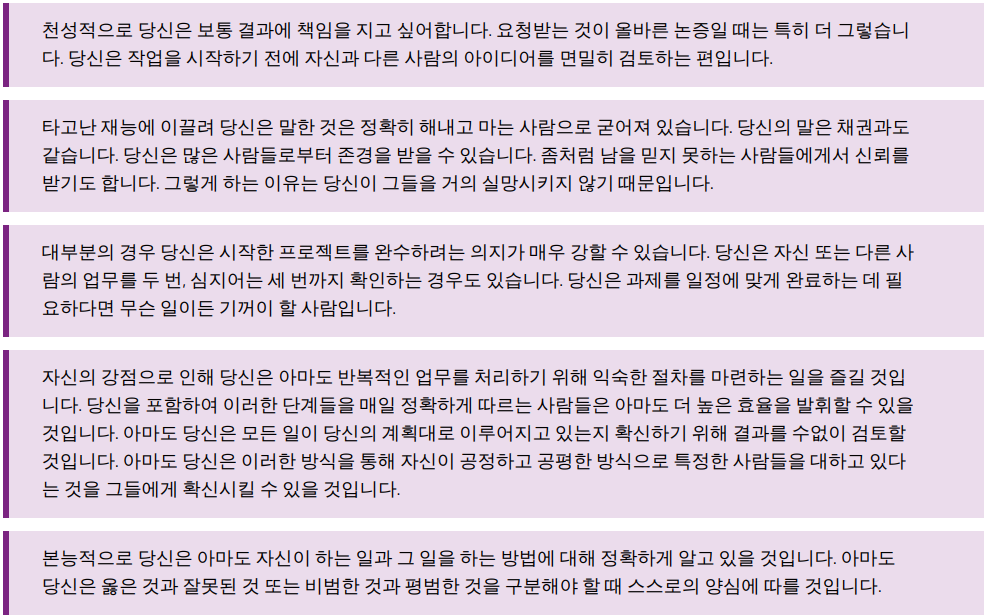
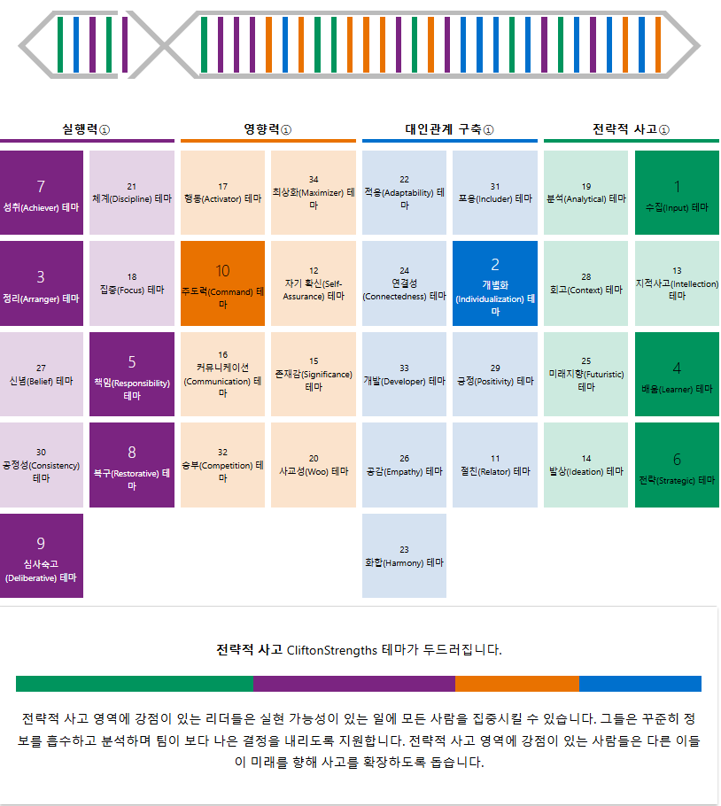
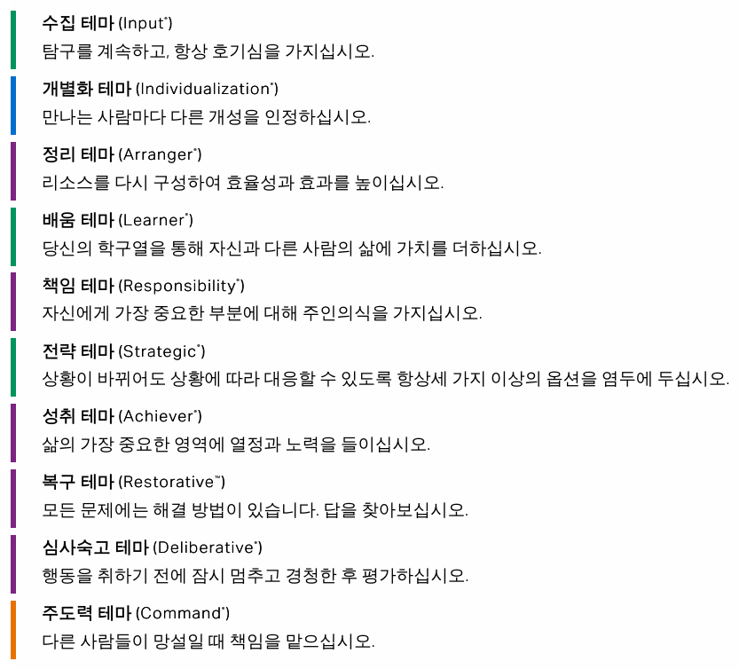

일을 하다 보면 누구나 ‘잘하고 있는 건가?’라는 의문이 들 때가 있다. 그럴 때면 우리는 주변 동료들에게 피드백을 요청하거나 스스로 회고하면서, 현재 나의 모습에 대해 성찰하고 더 나은 방향이 무엇일지 고민하곤 한다.

하지만 이를 위해서는 자기 객관화와 메타인지 능력을 필수적으로 갖춰야 한다. 이 두 가지 능력이 발달되어 있지 않으면 스스로 불필요하게 의문을 갖거나 자책하는 데에 많은 에너지를 쓰게 되고, 성장의 방향을 찾는데 주력할 수 없게 된다.

우리가 회사의 동료들과 함께 '잘' 일하고, 개인의 일상도 '잘' 살아가기 위해서는 결국 자기 객관화와 메타인지를 기반으로 하는 깊은 성찰이 이루어져야 하는 것이다.

4년 차를 향해 가면서 나만의 업무 방식이 어느 정도 정립되었고, 동료들과의 소통 방식에도 나름대로의 프로토콜이 만들어졌다. 그러다 보니 나와 동료들의 차이를 인지하게 되었고 **이는 자연스럽게 나의 강점과 약점에 대한 성찰**로 이어졌다.

그렇게 **갤럽 강점 검사**를 시작했다. 미처 내가 인지하지 못한 나만의 강점과 약점에 대해 확인하기 위해서였다.

갤럽 강점 검사는 크게 상위 강점 5개만 보여주는 **CliftonStrengths Top 5 검사**와 34개의 모든 강점을 순위로 알려주는 **CliftonStrengths 34 검사**로 나뉜다.

TOP 5 검사는 $24.99고, 34개 검사는 $59.99로 결코 만만한 가격은 아니지만 한 번의 검사를 통해 자신의 34개 능력에 대해 분석할 수 있다는 점에서 충분히 투자할만하다고 말하고 싶다. 참고로 [위대한 나의 발견 강점 혁명](https://product.kyobobook.co.kr/detail/S000000600559 "위대한 나의 발견 강점 혁명")이라는 도서를 구매하면 강점에 대한 해석뿐만 아니라 TOP 5 검사 코드를 제공한다고 한다.

나는 아래 나오는 모든 34개의 강점을 순위화하고 싶었기 때문에 [CliftonStrengths 34 검사](https://store.gallup.com/p/en-us/10003/cliftonstrengths-34 "cliftonstrengths-34")를 진행했다.

*출처 - 갤럽 강점 보고서 / 강점 34개 리스트*

### 나의 TOP 5 강점

*출처 - 갤럽 강점 검사 TOP 5 보고서*

나의 TOP 5 강점을 종합하면 **사람과 일, 그리고 배움에 진심인 나는, 깊이 있게 수집하고 성실히 실행하며, 체계와 조화를 통해 함께 더 나은 결과를 만들어가는 사람**이다.

또한 나는 **전략적 사고**와 **실행력** 테마가 두드러지는 사람이라고 한다.

전략적 사고를 통해 실현 가능성이 있는 일에 모든 사람을 집중시키는 능력을 가지고, 꾸준히 정보를 흡수하고 분석하며 팀이 보다 나은 결정을 내리도록 지원하는 리더가 될 수 있다고 한다. 또 다른 이들이 미래를 향해 사고를 확장하도록 돕는 강점을 가진다고 한다.

실행력 테마에 강점이 있는 경우 해결책을 요구받았을 때 완수하기 위해 지치지 않고 일할 수 있는 능력이 있다고 하며, 리더의 경우 아이디어를 착상해서 실현하는 능력을 가진다고 한다.

---

### 1순위. 수집 ( Input )

정보, 아이디어, 산출물, 관계까지도 수집해서 보관하는 능력

나에게 가장 높게 나온 강점은 수집 테마 였다. 수집 테마가 강점인 사람들은 **정보를 잘 흡수하는 사람**이라고 한다. 배울 수 있는 것과 이해할 수 있는 것, 문제를 해결하기 위해 필요한 것을 찾기 위해 정보를 찾고 저장하는 능력이 발달된 사람을 말한다. 수집이 높은 사람은 두뇌 활동을 할 때 유리하기 때문에 **끊임없이 연구하고, 다른 사람과 대화하고, 다른 길에 문을 열어놓는다**는 특징이 있다. 그리고 이때 받아들인 정보를 저장해 잠재적으로 사용할 생각을 한다.

곰곰이 내가 일할 때와 공부할 때의 모습을 돌아보니 들어오는 정보를 빠짐없이 기록하기 위해 상당히 많은 노력을 들인다는 것을 알았다. 주어진 과제를 빠르고 정확하게 해결할 수 있었던 이유가 이 강점 덕분일지도 모른다는 생각이 든다. 언젠가 A를 위해 수집했던 정보가 전혀 의도치 않게 B를 해결하는데 도움을 주었던 경험을 여러 번 겪었기 때문이다.

나에게 수집은 문제를 해결하기 위한 강박으로 작용하기도 하지만, 사실 한편으로는 수집하는 행위 자체를 즐긴다. 오죽하면 스스로를 인간 로거라고 칭하며 원노트와 노션, 블로그나 옵시디언 같은 저장 플랫폼을 꿰뚫고, 하루하루 스프레드시트에 작업 로그를 남기며, 다이어리조차 카테고리를 나눠 정리하면서 나 자신을 DB화 하겠다는 야망을 갖겠는가. 이런 성향이 수집 테마가 강점이라는 데서 나온 결과라니.

강점 검사가 알려주는 또 하나의 묘미는 바로 **맹점**이다. 모든 특징에는 양면이 있기 마련이다. 장점은 마냥 장점이지 않고, 단점도 그저 단점으로 작용하지 않는 것처럼 강점이 때로는 약점이 되기도 한다.

수집 테마의 맹점은 바로 **과부하**이다. Input을 과하게 받아 미처 정리하지 못하고 쌓이게 되면 불필요한 데이터가 되는 것이다. Input이 의미 있게 작용하기 위해서는 미래에 활용할 수 있도록 체계적인 데이터베이스가 되어야 한다. 한편으로는 이 과부하가 타인에게 작용될 수도 있다. 자칫하면 타인에게 과도한 정보를 주게 되는 것이다. 따라서 이 테마가 강점인 사람들은 **내가 전달하는 정보가 과하지 않는지 끊임없이 정제하고 거르는 노력**을 해야 한다.

이 부분에 대해서도 많은 공감을 했는데, 나에게 별거 아닌 Input이 남에게는 매우 많은 Input이 될 수 있음을 종종 느껴왔기 때문이다. 이를 인지한 이후에는 **남에게 정보를 전달할 때 1차, 2차, 3차 수정을 통해 꼭 필요한 내용만 남기는 작업**을 거치는 습관을 만들어 실천하고 있다.

나에게 수집 테마가 강점이라는 것을 알게 된 이후 주변 사람들을 보는 시선도 달라졌다. **모든 사람들이 나만큼 정보를 저장하고 정리하지 않는다는 것을 인정한 것**이다. 강점이라는 것을 알기 전에는 "저번에 분명 나온 이야기인데 왜 계속 회자되는 걸까?"라던가, 놓친 요구사항에 대해서 "쉽게 지나간 내용이긴 했지만 모두 기록했으면 챙겼을 텐데 왜 그러지 못할까?" 같이 수집 능력을 당연히 갖춰야 하는 태도나 행동 정도로 생각하고 있었다. (이런 불만이 생겼음에도 큰 트러블이 없던 이유는 다음 2순위에 나오는 개별화 강점 덕분이었던 것 같다.)

---

### 강점을 알고 난 후,

내 가장 큰 강점이 수집 테마라는 것을 알고 나서 이 강점을 살려 주변에 어떤 긍정적인 영향을 줄 수 있을지에 대한 고민이 자연스레 생겨났다. 그리고 나는 **'수집이란 강점을 살려, 남들이 쉽게 놓치는 부분을 채워****주자'**로 마음을 새로 먹기 시작했다. 갤럽 강점 검사를 통해 나를 이해할 뿐만 아니라 주변 사람들도 함께 이해하는 기회를 얻은 것이다. 누군가를 향한 판단이나 불만이 '정답 또는 오답'에서 오는 게 아닌 '고유한 강점'에서 오는 것을 인지할 수 있다는 점에서 위 검사를 꼭 해보길 추천한다.

---

## 다른 강점들의 의미와 관계

참고로 강점 중 1순위만 유의미한 것이 아니다. 보고서에서는 **강점 순위**에 대해 다음과 같이 말한다.

1. **상위 10개** 테마는 나에게 타고난 가장 강한 재능이므로, 이것을 강화하고 최대한 활용하는데 집중 (단, 맹점에 주의.)

2. **중간 테마**는 행동에서 가끔 나타나며, 특정 순간에는 이 테마에 의존해야 할 수도 있다. 상시 지원 시스템인 것.

3. **하위 테마**는 약점이라고는 할 수 없으나 가장 약한 테마로, 자연스럽게 사용하기 어려운 테마를 말한다. (제대로 관리하지 않으면 잠재력을 극대화하는데 방해가 되기 쉬운 테마)

*** 강점 검사에서 말하는 약점 ?**

- 성공에 방해가 되는 모든 것을 약점으로 정의

- 이 테마가 나의 성공에 방해가 되는가?

- 이 테마와 관련해서 부정적인 피드백을 받은 적이 있는가?

- 이 테마를 사용해야 하는 역할이지만, 그럴 때마다 지치는가?

&gt; 위 질문에 해당하는 테마가 바로 약점인 것

*** 약점을 어떻게 관리해야 하는가 ?**

- 받아들이기 : 어떻게 자신에게 방해가 되는지 파악한다.

- 협업하기 : 파트너에게 지원을 요청한다.

- 강점 적용하기 : 다른 테마를 사용해서 더 나은 결과 달성하기

- 행동하기 : 전념해서 최선을 다하기

## 나머지 강점도 살펴 보기

**_**

### 2순위. 개별화 ( Individualization )

개인의 고유한 특징을 알아내고, 서로 다른 사람들이 어떻게 협력해서 생산적으로 일할 수 있는지 알아내는 능력

---

### 3순위. 정리 ( Arranger )

체계를 세우고 이를 보완하는 유연성이 있으며, 모든 구성요소와 자원을 최적으로 조직하는 방안에 대해 궁리하는 능력

---

### 4순위. 배움 ( Learner )

배우고 지속적으로 발전하는 열망을 가지고 있으며, 배움의 결과물보다 배우는 과정을 즐기는 능력

---

### 5순위. 책임 ( Responsibility )

자신이 하겠다고 말한 것에 대한 심리적인 의무감을 갖고, 정직과 헌신적 애정이라는 안정적 가치에 따르는 능력

---

### 6 ~ 7순위.

#### 6순위. 전략 ( Strategic )

대안을 따지고 가장 적합한 경로를 결정하는 능력. 시나리오를 예측하고 대비하며 어떤 상황에 직면하더라도 패턴과 이슈를 빠르게 파악해 신속하게 의사결정을 하는 능력.

#### 7순위. 성취 ( Achiever )

에너지가 왕성하며 지치지 않고 일할 수 있는 능력. 강한 내재적 성취동기, 열정과 에너지를 기반으로 일을 완수하며 만족감을 얻고 생산성을 높이는 능력.

#### 8순위. 복구 ( Restorative )

상황을 분석해 문제의 근원이 무엇인지 파악하고 해결안과 잠재적인 결점을 찾아내는 능력.

#### 9순위. 심사숙고 ( Deliberative )

철저함과 양심을 기반으로 결정과 선택을 할 때 신중을 기하는 능력. 장애 요인을 예측하는 능력이 타고나 위험을 줄이고 문제를 예방하는 능력.

#### 10순위. 주도력 ( Command )

사람들 사이에서 존재감이 있으며, 상황에 주도권을 가지고 의사결정을 내리는 능력. 책임을 지고 의견을 표현하는 것을 편안해하며 병목을 없애고 위기의 순간에도 다른 사람을 안심시키는 능력.

### 나의 강점 테이블

> "특정 영역에서 상위 테마가 없더라도 걱정할 필요는 없습니다. 이것이 여러분이 전략적인 사고를 하지 못하거나 대인관계를 구축할 수 없다는 뜻은 아닙니다.
>
> 강점 검사는 강점을 측정하기 위함이지, 이를 통해 자신의 약점을 발견해서 보완하고자 하는 검사가 아니기 때문입니다. 순위가 낮은 것은 그 사람의 약점이기 때문이 아니라, 다른 강점에 비해 두드러지지 않는 것 뿐입니다.
>
> 모든 사람이 업무를 완수하고, 다른 사람에게 영향을 미치고, 관계를 구축하고, 정보를 처리합니다.
> 여러분은 단지 동일한 결과를 얻기 위해 다른 영역에서 더 강한 테마를 사용하는 것뿐입니다.
>
> 최고의 팀은 자기 자신과 다른 사람들이 팀에 고유하게 기여하는 바를 이해하는 개개인으로 구성됩니다."

*실행력과 전략적 사고가 발달한 나의 보고서 요약 출처 - CliftonStrenths 34 보고서*

### 상위 강점으로 성장하고 성공하는 방법

*출처 - CliftonStrenths 34 보고서*
