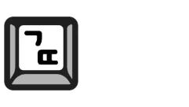
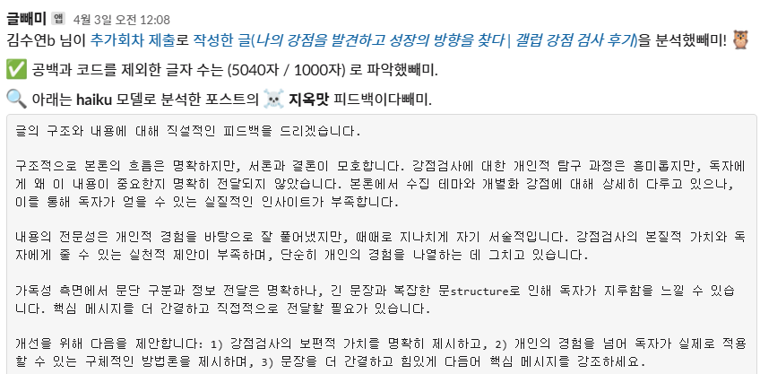
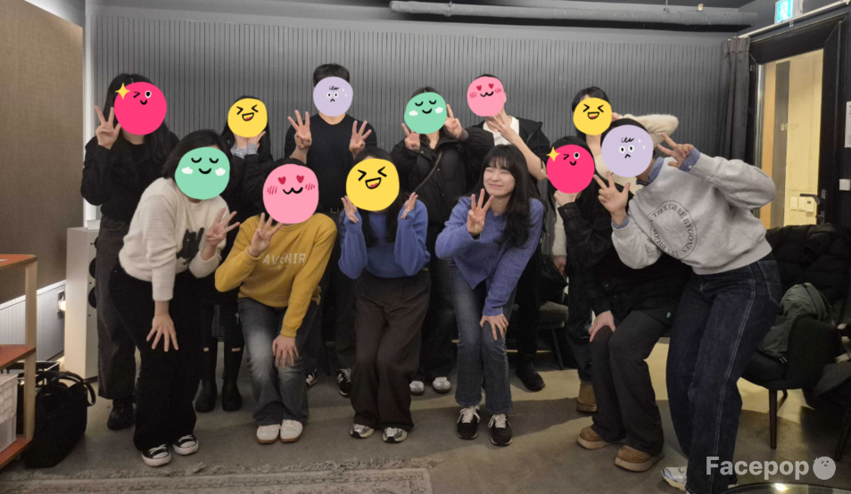
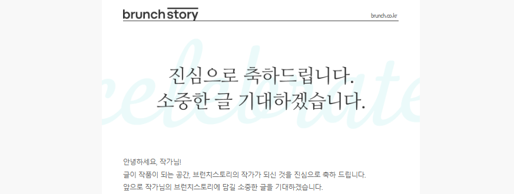

**시작하며**

작년 10월부터 시작한 [글또](https://geultto.github.io/) 10기의 공식적인 활동 기간이 3월부로 종료되었다.

6개월간의 글또 모임을 통해 보고 느끼고 배운 것들과 함께,

꾸준한 글 쓰기와 다른 이들과의 교류가 나에게 어떤 인사이트로 다가왔는지 정리해보고자 한다.

#### 덕분에 꾸준히 썼다

**기술적인 글 5편**

1. [Wireshark Opensource 활용기 | Protocol Dissector를 직접 추가하기](https://wanggonya.tistory.com/99)
2. [DPDK (Data Plane Development Kit)에 대한 큰 그림 파악하기](https://wanggonya.tistory.com/103)
3. [Wireshark Opensource 활용기 | wmem (Wireshark Memory Management)에 대해](https://wanggonya.tistory.com/104)
4. [암호화된 데이터를 LZO (Lempel-Ziv-Oberhumer) 압축하면 왜 데이터 크기가 더 커질까?](https://wanggonya.tistory.com/105)
5. [개인 VM으로 사내 웹 서버 구축하고 RSA 키로 복호화 하기](https://wanggonya.tistory.com/106)

기술 글은 업무 중 배운 것들 위주로 썼다. 일하고 공부하는 것만으로도 글감이 넘쳤고 덕분에 큰 힘을 들이지 않고 써 내려갔던 글들이다. 글또를 시작할 때에는 하나의 주제를 가지고 시리즈처럼 연재하고 싶은 마음이 있었으나 업무량이 많아 다른 주제에 몰두할 여유가 없었다는 점이 아쉬웠다. 하지만 실무와 가까운 글일수록 알맹이가 있는 글이라 생각하기에 업무와 관련된 기술 글을 5편이나 썼다는 점에서 아주 만족스럽다.

덕분에 업무 중에 어려운 과제를 마주칠 때마다 글감으로 어떻게 쓸지 고민하는 습관이 생겼다. 글또를 하기 전에는 배웠던 것들을 어느 한 곳에 산발적으로 모아놓기만 했다면, 이제는 글을 쓰기 위한 구성도와 초안을 먼저 떠올리곤 한다. 그렇게 노션 페이지에는 글감 데이터베이스가 새롭게 생겨났다. 실제 이렇게 쓰게 된 글이 기술 글 중 Wireshark 관련 글과 암호화, 웹 서버 구축 글이다. 이런 식으로 하나의 정제된 글로 남기니 업무 내용에 대해 복기가 잘 되고 관련 기술 문서를 작성할 때에도 훨씬 수월했다.

**생각/회고하는 글 5편**

1. [글또 10기 도전, 나의 『삶의 지도』 그려보기](https://wanggonya.tistory.com/95)
2. [글또 10기 첫 글, 나에게 6개월 간 일어날 일들](https://wanggonya.tistory.com/98)
3. [2024년 회고; 올해의 Graceful Closing을 위해](https://wanggonya.tistory.com/100)
4. [2025년 Action Item; 하루치의 힘, 매일의 순환은 큰 목표를 해낸다.](https://wanggonya.tistory.com/101)
5. [나의 강점을 발견하고 성장의 방향을 찾다 | 갤럽 강점 검사 후기](https://wanggonya.tistory.com/107)

가장 처음 발행한 비 기술 글은 글또 지원 조건이었던 "삶의 지도" 글이다. 모집 마감 3시간 전에 부랴부랴 썼던 기억이 난다. 개발자가 되기 이전의 삶을 정리했다는 점에서 애정이 가는 글이다. 개발자가 된 이후의 삶을 적은 두 번째 삶의 지도를 써보고 싶은 마음이 몰려온다. 만 3년을 달려가는 지금은 또 전혀 다른 삶이기에 그것대로 써 내려가는 재미가 있을 것 같다. 두 번째 글에는 글또 모임에 기대하는 것들을 적었다. 그리고 그다음 글은 회고 글과 새해 다짐글이다. 마지막 글은 강점검사또 채널을 통해 갤럽 강점 검사를 받고 적은 강점 검사 후기에 대한 글이다.

**책을 정리하는 글 1편**

1. [실패는 나침반이다 | 책 리뷰와 함께 적어 보는 나의 커리어 이정표](https://wanggonya.tistory.com/102)

'실패는 나침반이다'는 소모임 책읽었또를 통해 완독 한 책 중 하나로, IT종사자라면 쉽게 읽을 수 있는 에세이 형태의 책이다. 특히 저년 차일 때 읽는다면 커리어의 방향성을 깊게 고민해 볼 수 있을 것이다. 이 책을 읽을 당시, 현재진행중이던 고민과 책 속의 이야기가 일치하는 부분이 많아 블로그에 꼭 정리해야겠다고 마음을 먹었고, 덕분에 쉽게 써내려갔던 글이다. 책에 대한 글은 적고자 하면 그리 어려운 글은 아니지만, 나의 경험을 함께 녹여내다 보면 글이 길어질 수 있어 분량 조절에 신경을 써야 한다. 이 책도 마찬가지였다. 글을 쓰면 쓸수록 하고 싶은 이야기가 많아져서 아쉽게도 한 챕터만 정리했던 글이다.

**기타 블로그 운영 글 1편**
1. [Tocbot API를 이용해서 티스토리 블로그에 목차 적용하는 방법](https://wanggonya.tistory.com/96)

주말에 심심해서 블로그 목차를 추가하고 누군가가 따라 할까 싶어 써본 글이다. 내 블로그의 유입 중 80%가 IT 종사자인데, 이 글을 발행하고 나서는 그 밖의 종사자들이나 취미 블로거들이 마구 유입돼서 신기했던 기억이 난다. 이후로 이런 글을 꾸준히 쓴다면 애드 센스 수익률을 올려볼 수 있지 않을까? 하는 생각이 든다.

#### 글을 잘 쓰고 싶어졌다

이 전에는 기술 블로그에 글을 쓴다고 하면 오로지 나만을 위해 정리하고 기록하기 위함이 대부분이었다. 그래서인지 글의 구성이나 퀄리티, 설명의 친절함 같은 것들은 고려하지 않고 글을 써오곤 했다. 그러던 와중에 글또를 통해 수 십 명의 블로그를 염탐(?)하면서 읽기 좋은 글을 쓰고 싶은 마음이 자연스레 생겨났다.

*지옥맛 글빼미는 이런 피드백을 준다*

사실 고작 10여 편의 글을 쓰면서 글 쓰기 능력이 얼마나 좋아질까 싶다가도, '잘 쓰고 싶다'는 욕심이 들었다는 것부터 '잘 쓰기 위한 준비'가 된 게 아닐까 하는 희망회로를 가지기로 했다. 나의 글을 통해 어려움을 겪는 엔지니어와 개발자들이 해결점을 찾아가길, 언젠가 나의 글쓰기가 다른 누군가에게 도움이 되길 바라본다.

#### 세상은 생각보다 더 넓다

**1. 소모임**

- 다진마늘또

- 강점검사또

- 책읽었또

- 로우레벨도있또

- 감사회고해또

글 쓰는 활동뿐만 아니라 소모임에도 간간히 참여하곤 했는데, 그중 **다진마늘또**가 가장 참여도 높은 소모임이었다. 하루 투두 리스트를 공유하고 각자 완수해 나가면서 마늘처럼 다져지는(?) 모임이다. 이 모임에는 매일 아침, 점심, 저녁에 사람들이 출몰해 자신의 투두 리스트를 남기고, 서로 🧄 마늘 이모티콘을 달며 응원하는 문화가 있다.

다른 소모임인 **강점검사또**를 통해 갤럽 강점 검사에 대한 심도 있는 대화를 나누었고 덕분에 강점 검사에 대한 글까지 발행할 수 있었다. **책읽었또**는 하루 20p씩 읽으며 인상 깊은 한 구절을 소개하고 독서 기록을 인증하는 모임이다. 덕분에 3-4권 정도 완독했고 책 리뷰 글도 발행할 수 있었다. **로우레벨있또** 채널은 35명만이 소속된 만큼 조용한 채널이지만, 비슷한 분야 종사자들과 함께 한다는 점에서 심리적 안정감을 주는 채널이다. **감사회고해또** 채널은 하루를 마무리하고 감사한 점에 대해 나누는 모임이다. 별거 없는 하루였음에도, 다른 이들의 감사 회고를 읽고 나서 나의 하루를 다시 돌아보면 나의 하루가 별 게 넘치는 하루가 된다. 이렇게 감사회고해또는 다른 이들과 온기를 나눌 수 있는 따스한 모임이다.

**2. 커피챗**

- 로우레벨 커피챗

- 다진마늴또

- 백엔드반상회

- 가지솥밥 마리텔

- (기타) 모여공 오프라인 모임

커피챗은 예상만큼 많이 하진 못했다. 다양한 사람들과 교류하고 싶은 마음은 늘 있었으나 바쁘고 정신없이 회사 생활을 하다 보니 따로 커피챗을 할 새도 없이 시간이 훌쩍 흘러버렸다. 600여 명의 사람들 중 네트워크 보안 도메인은 나 하나였고 더욱이 다른 사람들과의 교류가 간절했기에 커피챗에 대해서는 아쉬움이 많이 남는다.

공식적으로 나의 커피챗 횟수는 4회로, 제일 먼저 가졌던 모임은 **로우레벨 커피챗**이다. 분야는 모두 달랐으나 시스템/로우레벨 엔지니어라는 점에서 여러 공감대가 있던 모임이었다. 두 번째 **다진마늴또**는 다진마늘 소모임에서 진행한 마니또 모임이다. 마니또에게 몰래 이모지를 남기고, 마니또를 위한 선물을 준비하고, 마지막 날에는 오프라인으로 모여 아이스브레이킹 하며 대화하는 시간을 가졌다. 다진마늴또를 통해 다양한 직군의 사람들과 교류하며 인사이트가 넓어지는 경험을 했다.

세 번째는 **백엔드 반상회**다. 백엔드/인프라 빌리지 사람들이 참여한 모임으로, 같은 분야에 종사하는 개발자 세 분의 발표를 들은 후 조 별로 모여 다양한 대화 주제에 대해 이야기 나누는 모임이었다. 같은 분야/직군 사람들과 공감대를 이루며 대화하고, 고민 상담과 함께 커리어 개발에 대한 에너지를 얻었던 모임이었다. 네 번째는 솥밥을 좋아하는 사람들이 모여 가지솥밥을 함께 만드는 **가지솥밥 마리텔**(?) 모임이다. 야매요리해또 채널을 통해 알게 된 제품 가마도상 솥을 이용해 2-3명의 사람들과 가지솥밥을 함께 만들어 먹었다.

마지막 **모여공 모임**은 글또 공식적인 커피챗은 아니었으나, 글또를 통해 알게 된 모임이기도 하고, 모임에서 나눴던 대화가 참 인상 깊었기에 리스트에 넣어 보았다. [모여공](https://studywithus.oopy.io/ot "모여공 공식 사이트")은 직장인들이 퇴근 후에 모여 각자 공부하는 모임으로 주로 온라인으로 진행한다. 이 때도 비슷한 분야의 사람들 대여섯 명이 모여 커리어에 대한 질의응답을 하는 시간을 가졌다. '내가 하는 일을 나만의 언어로 소개하기', '나를 표현하는 키워드 3개', '나는 어떤 환경에서 즐겁게 일하는지', '내가 가진 강점과 무엇을 중요하게 생각하는지', '현재 나의 상황은 어떻고 앞으로 어떻게 일해야 하는지'에 대한 주제로 여러 사람의 생각을 들으며 반성하기도 하고 자극받기도 하면서 여러모로 의미가 깊었던 모임이었다.

*모여공 3기 오프라인 모임에서*

#### 아쉬움이 남는다

6개월이 지난 지금에서야 돌아보니 글또를 통해서 처음 기대했던 것 그 이상을 받았다는 느낌이 든다. 가장 먼저 글 쓰기에 대해 마음가짐이다. **나를 위함이 아닌 '남을 위한' 글을 쓰고 싶은 마음**이 생겼다는 점이 글 쓰는 개발자 모임 글또에게 받은 것 중 가장 큰 부분이 아닐까 한다. 글또에게 받은 다른 한 가지는 **넓은 시야와 수용 능력**이다. 다양한 모습의 사람들과 교류하면서 세상을 바라보는 시선이 풍부해졌고, 사람 한 명 한 명의 개별성을 느끼는 바운더리가 전보다 넓어지는 경험을 했다. 또 세상에는 열심히 사는 사람들이 굉장히 많다는 것을 느끼고 덕분에 **겸손함**을 가졌으며, 다른 이들과 **함께 자라기** 위해 더 열심히 살 수 있는 에너지를 얻었다. 마지막으로 개인이 줄 수 있는 **선한 영향력**은 사소해 보여도 큰 힘이 있다는 것을 글또의 수많은 사람들을 통해 새롭게 알게 되었다.

---

#### 마치며

이로써 글또 10기의 공식적인 활동은 종료되었다. 그럼에도 나는 여전히 글을 쓰고, 사람들을 통해 에너지를 얻으며, 나만의 방향대로 커리어를 만들어 나가려고 한다. 4년 차를 앞둔 지금, 6개월 후에는 더 잘 쓰고, 잘 일하며, 사람들과 함께 잘 살아가는 내가 되어있기를 바라며 이만 글또 10기 회고 글을 마친다.

끝은 또 다른 시작이기에!

*- 오늘 받은 브런치 작가 합격 메일 중 -*

**작년 10월부터 작성한 전체 글 목록**

(제출/미제출 포함)

00. [글또 10기 도전, 나의 『삶의 지도』 그려보기](https://wanggonya.tistory.com/95)
01. [Tocbot API를 이용해서 티스토리 블로그에 목차 적용하는 방법](https://wanggonya.tistory.com/96)
02. [글또 10기 첫 글, 나에게 6개월 간 일어날 일들](https://wanggonya.tistory.com/98)
03. [Wireshark Opensource 활용기 | Protocol Dissector를 직접 추가하기](https://wanggonya.tistory.com/99)
04. [2024년 회고; 올해의 Graceful Closing을 위해](https://wanggonya.tistory.com/100)
05. [2025년 Action Item; 하루치의 힘, 매일의 순환은 큰 목표를 해낸다.](https://wanggonya.tistory.com/101)
06. [실패는 나침반이다 | 책 리뷰와 함께 적어 보는 나의 커리어 이정표](https://wanggonya.tistory.com/102)
07. [DPDK (Data Plane Development Kit)에 대한 큰 그림 파악하기](https://wanggonya.tistory.com/103)
08. [Wireshark Opensource 활용기 | wmem (Wireshark Memory Management)에 대해](https://wanggonya.tistory.com/104)
09. [암호화된 데이터를 LZO (Lempel-Ziv-Oberhumer) 압축하면 왜 데이터 크기가 더 커질까?](https://wanggonya.tistory.com/105)
10 [개인 VM으로 사내 웹 서버 구축하고 RSA 키로 복호화 하기](https://wanggonya.tistory.com/106)
11. [나의 강점을 발견하고 성장의 방향을 찾다 | 갤럽 강점 검사 후기](https://wanggonya.tistory.com/107)

12. [글 쓰는 개발자 모임, 글또 10기 종료 | 꾸준히 썼또, 이젠 멈출 수 없또!](https://wanggonya.tistory.com/109)
