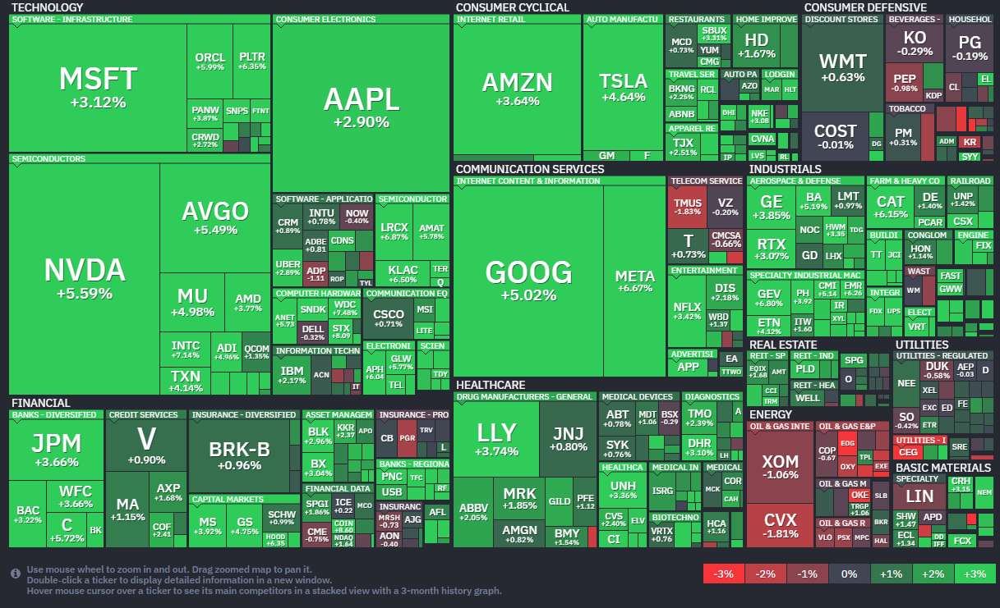
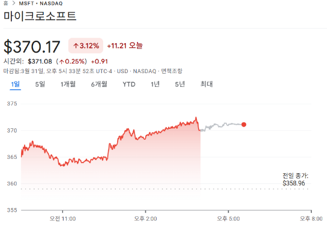

*출처: finviz.com*

#### 오늘의 증시

미국 증권시장이 3/31 **폭등**했다. 다우 지수는 1,100 포인트 넘게 치솟았고, S&P 500, 나스닥 지수는 작년 5월 이후 최고의 하루를 보냈다. 그 이유는 **'중동 전쟁 종식에 대한 희망'** 이었다.

이란과의 전쟁이 끝날 수 있다는 소식이 전해지고 난 후 전쟁 여파로 눌려있던 엔비디아(5.6%▲), 마이크로 소프트(3.1%▲) 등의 대형 기술주들이 큰 폭으로 반등했다.

더 웰스 얼라이언스의 에릭 디톤 사장은 "전쟁 종료를 위한 어떤 움직임이라도 시장은 반기겠지만, 아직 안심하기에 이르다. **결국 석유 공급 문제가 해결되지 않는다면 시장의 압박은 계속될 것**"이라고 분석했다.

#### 증시 포인트: 평화의 신호와 여전한 기름값 걱정

이란과 미국 양측에서 무슨 일이 있었던 것인지 살펴보자.

이란의 마수드 페제시키안 대통령이 **보상금 지급과 향후 침략 방지에 대한 국제적 보장이 있다면 전쟁을 끝낼 의사가** **있다는** 보도가 나왔다.

트럼프 대통령 역시 **호르무즈 해협이 폐쇄된 상태라도 군사적 적대 행위를 끝낼 용의가 있다**고 밝혔다.

실제 상황은 어떨까.

이란이 두바이 인근에서 쿠웨이트 유조선을 공격했다는 소식에 브렌트유 가격은 배럴당 118달러 선까지 치솟고 2022년 이후 최고치를 기록했다. **하지만 시장은 '공격'보다 '협상의 가능성'에 크게 반응하며 안도 랠리(Relief Rally)**를 펼쳤다.

#### 최악의 한달을 보낸 3월 미국 증시

S&P 500 지수는 3월달에만 5.1% 하락하며 2022년 이후 최악의 달을 보냈다.

다우 지수 역시 10개월간 이어오던 상승 행진을 멈췄다.

나스닥은 7% 넘게 빠지기도 했다. 지금의 상승이 단순한 '반짝 반등'일지, 아니면 4월의 진정한 반전 드라마의 시작일지 지켜봐야 한다.

#### 주요 뉴스

**클로드 소스코드 유출**

앤스로픽의 인기 코딩 도구인 '클로드 코드'의 내부 소스코드 일부가 실수로 공개되었다. 사측은 보안 해킹이 아닌 단순 작업 과정의 인적 오류이며 고객 데이터 유출은 없었다고 선을 그었다. 일주일 새 벌써 두 번째 데이터 관리 실수가 반복된 만큼 대응을 지켜볼 필요가 있다.

**OpenAI 몸값이 8520억 달러**

OpenAI가 1220억 달러의 대규모 투자를 유치했다. 그로써 무려 8520억 달러의 기업가치를 인정받았다.

소프트뱅크, 엔비디아, 아마존 등의 글로벌 거물들이 대거 참여했고 챗GPT는 주간 사용자 9억 명을 돌파했다. 다만 월 매출 20억 달러에도 불구, 아직은 적자 상태여서 향후 IPO를 앞두고 이 거대한 몸값을 어떻게 증명해 나갈지 전 세계가 주목하고 있다.

**아마존 파업**

아마존이 파업에 참여한 직원들에게 보복하지 않겠다는 약속을 하며 연방 노동당국과 합의를 마쳤다.

그동안 파업 노동자들의 무급 휴가(UPT) 시간을 불법적으로 차감해 해고 위협을 가했다는 비판을 받아왔는데, 이번에 100명이 넘는 직원의 휴가 시간을 복구해주기로 한 것이다. 앞으로 미국 내 1300개 모든 사업장에 노동 권리를 보장하겠다는 공고문도 게시할 예정이라고 하며, 아마존의 노사 관계에 어떤 새로운 국면이 찾아올지 주목할 필요가 있다.

**스냅 주가, 7배가 뛰다.**

행동주의 투자자 '아이레닉 캐피털'이 스냅의 주가를 현재보다 7배나 높일 수 있는 파격적인 제안을 내놓았다.

AR 글래스 사업부를 정리하고 AI를 도입해 전체 인력의 21%를 감원하는 등의 비용 절감을 강력하게 요구한 것이다.

이 소식에 스냅의 주가는 하루 만에 14% 급등하며, 상장 이후 부진했던 주가가 이번 제안으로 반등할지 주목할 필요가 있다.

**마이크로소프트, AI 수익성 의문에 주가 23% 폭락**

마이크로소프트가 올해 1분기동안 시가총액의 약 4분의 1을 잃었다. 시장에서는 MS가 내놓은 AI 비서 코파일럿의 성과가 기대에 미치지 못하고 있다는 우려가 커지며 투자 심리가 얼어붙은 모습이다.

실제 상업용 오피스 고객 중 코파일럿 라이선스를 보유한 비율은 단 3%에 불과한 것으로 나타났고, 최근 소비자용 코파일럿 개발을 이끌던 무스타파 술레이만이 모델 구축 부문으로 자리를 옮기는 변화가 있었다. 시장에서는 이를 강등으로 받아들이는 분위기 인데다, 게이밍 책임자 필 스펜서와 핵심 리더인 라제쉬 자의 퇴임 소식까지 겹치며 내부적인 리더십 변화도 불안감을 키우는 데 한 몫 했다.

대외적인 거시 경제 환경도 MS를 압박 중이다. 이란 전쟁의 여파로 유가가 급등하며 데이터 구축 및 운영 비용이 치솟고 있다.

이는 어도비, 아틀라시안, 서비스나우 같은 SW 기업들의 주가가 올해 30% 이상 폭락하는 SaaS포칼립스 현상과 맞물려 MS의 밸류에이션 부담을 더욱 키우고 있다.

일각에서는 급락이 과도하다는 분석도 나오는데, DA 데이비드슨의 길 루리아 분석가는 MS의 윈도우와 오피스만큼 기업 시장에서 강력한 제품은 없다면서, 지금이 오히려 매수 기회라고 조언했다. 지난 MS의 분기 매출은 전년 대비 17% 성장하며 가속화되는 모습도 보였기 때문이다.

*31일(현지시간) 마이크로소프트($MSFT) 의 주가 흐름*

**마이크로소프트 주가**

전일 대비 3.12% 오른 370.17달러에 장을 마감했다. 하지만 이 회사의 주가는 올해 들어 23% 이상 떨어졌다.

#### 부동산 뜨거운 이슈

**서울 아파트 시장에서 매매는 쌓이고 전세는 빠지고 있다.**

매물은 쌓이는데 쉽게 팔리지 않는다. 입주 물량도 줄었고, 계약갱신청구권 사용 건수도 늘었다. (임차인이 계약 만료 전 한 번에 한해 2년 연장을 요구할 수 있는 권리)

전세가 줄 만한 조건이 한꺼번에 겹친 것이다.

올해 아파트 입주 물량이 크게 줄어드는 가운데 다주택자 규제로 전세가 사라지고 있다. 연립·오피스텔 등 비 아파트 공급도 줄면서 임대차 시장에서 전세 품귀가 심화되고 있다는 분석이다.

올해 아파트 입주 물량이 크게 줄어드는 가운데 다주택자 규제로 전세가 사라지고 있다. 연립·오피스텔 등 비 아파트 공급도 줄면서 임대차 시장에서 전세 품귀가 심화되고 있다는 분석이다.

**매물이 많은데 전세는 왜 많지 않을까?**

매매가 돌아야 갈아타기도 생기고, 기존 집이 전세로 풀리는 흐름이 살아난다. 지금은 거래가 느려 흐름이 막혀있다. 매물 숫자와 전세 물건 숫자는 따로 봐야 한다.

**매입임대 1만7000가구 입주자 모집**

청년 9112가구, 신혼/출산 8140가구가 대상이다. 전국 16개 시도가 포함된다. LH물량은 [LH청약플러스](https://apply.lh.or.kr/lhapply/main.do)

에서 확인할 수 있다.

#### 오늘의 부동산 용어

**시공능력평가액**

건설사의 체력을 돈으로 환산한 숫자다. 공사 실적, 자본금, 기술력등을 합산해 매년 국토교통부가 발표한다. 이 숫자가 높을수록 큰 공사를 맡을 수 있도, 발주처도 이 숫자를 보고 입찰 자격을 정한다. '1군 건설사'라는 말이 여기서 나오는 것이다.

**도급순위**

시공능력평가액을 높은 순서대로 줄 세운 것을 말한다. 건설사 성적표 순위표로 이해하면 되는데, 분양 광고에서 '시공능력평가 상위 10위'를 내세우는 이유가 바로 이 도급순위를 강조하기 위해서다. 이 순위가 높다고 하자가 없다는 뜻은 아니다.

---

**[Reference]**

매일경제

머니네버슬립
부딩
