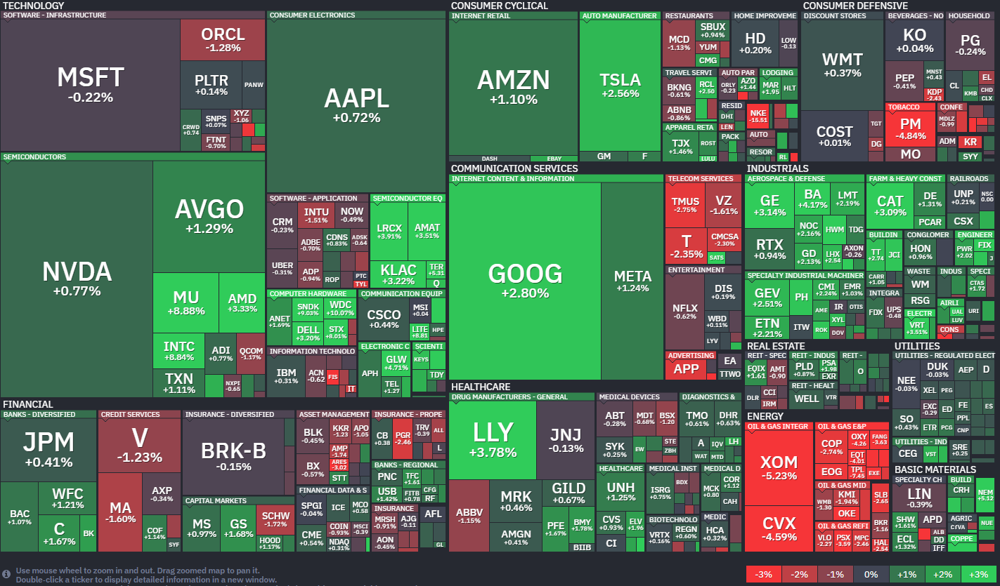
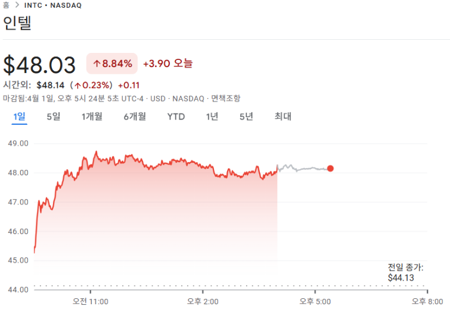

*출처: finviz.com*

#### 오늘의 증시

4월의 첫날, 미국 증시는 일제히 상승했다. 기술주 중심의 나스닥 지수는 1% 올랐는데 그 이유는 바로 '미국과 이란 간의 전쟁이 곧 끝날 수도 있다'는 기대감때문이다.

도널드 트럼프 대통령이 이란 측의 휴전 요청 소식을 전했고 투자자들은 전쟁 리스크가 해소될 것이라는 기대에 공격적인 매수세를 보였다.

매디슨 인베스트먼트의 수석 투자 전략가 패트릭 라이언은 "시장은 향후 몇 주 안에 어떤 형태로든 해결책이 나올 것으로 감지하고 있다"고 분석했다. 또한 "확실한 종전 선언이 나오기 전까지는 단기적인 변동성이 계속될 수 있다"는 경계의 목소리도 함께 말이다.

#### 시장의 핵심 키워드: '종전 협상' 그리고 '유가 하락'

트럼프는 자신의 SNS를 통해 이란 대통령이 휴전을 요청했다고 밝히기는 했으나 강경한 조건도 붙였다. 호르무즈 해협이 "완전히 자유롭고 안전하게 개방"되어야만 휴전 제안을 고려하겠다고 말이다.

전쟁이 끝날 기미가 보이자 국제 유가는 즉각 반응했다.

서부텍사스산원유(WTI)와 브렌트유 모두 하락세를 보였고 배럴당 100달러 선을 위협받기도 했다.

보통 전쟁 위기가 고조되면 유가는 오르고, 이는 기업들의 물류비용 상승과 물가 상승(인플레이션)으로 이어져 주식 시장에는 악재가 된다. 반대로 오늘처럼 유가가 안정되면 기업들의 비용 부담이 줄어들고 소비가 살아날 수 있다는 기대 때문에 주식 시장은 상승한다.

이란의 마수드 페제시키안 대통령은 전쟁을 끝내는 조건으로 '이란의 정당한 권리 인정', '피해 보상금 지급', '향후 재침공 방지에 대한 국제적 보증' 등을 요구하고 있다. 오늘 밤 9시에 예정된 트럼프 대통령의 대국민 연설에서 어떤 언급이 있을지 전 세계 투자자들의 이목이 쏠리고 있다.

#### 주요 뉴스

**테크 기업들이 전쟁 타겟이 되다**

이란 혁명수비대가 엔비디아, 애플, 마이크로소프트 등의 미국 주요 IT 기업 18곳을 '보복 공격 대상'으로 지목했다. 앞으로 암살 사건이 발생할 때마다 미국 기업을 하나씩 파괴하겠다고 강력히 경고했다. 실제 공격 시점까지 특정하며 직원들에게 즉시 대피할 것을 권고해서, 중동 내 테크 시설을 둘러싼 긴장감이 높아지고 있다.

**AI를 위해 오라클이 인원 감원을 하다**

오라클이 AI 데이터 센터 구축 비용을 마련하기 위해 수천 명 규모의 감원을 시작했다. 대규모 인프라 투자에 대한 투자자들의 우려를 잠재우고 현금을 확보하려는 전략이다. 분석가들은 이번 조치가 1인당 생산성을 높여 향후 오라클의 매출을 크게 성장시키는 발판이 될 것으로 내다보고 있다.

**4월 오일 쇼크 가능성**

국제에너지기구(IEA)가 다가오는 4월의 석유 공급 부족 사태가 지난달보다 훨씬 심각해질 것이라고 경고했다. 전쟁 전 출발했던 유조선들의 물량이 소진되며 4월의 석유 손실량이 3월의 두 배에 달할 것으로 보인다. IEA는 이를 역사상 최악의 에너지 위기로 진단하며, 전 세계적인 물가 상승과 에너지 배급제 가능까지 언급하며 비축유 추가 방출을 검토 중이다.

**위고비를 심장마비와 뇌졸중 예방 용도로**

영국의 약가 규제 당국(NICE)이 비만 치료제 '위고비'를 심장마비와 뇌졸중 예방 용도로 사용할 수 있게 권고했다. 비만 치료를 넘어 심혈관 건강까지 챙기는 핵심 치료제로 진화하는 위고비에 시장의 관심이 쏠리고 있다.

**인텔, 아일랜드 공장 지분 142억달러에 전량 회수**

인텔의 주가는 전일 대비 8.84% 오른 48.03달러에 장을 마감했다. 이 회사의 주가는 올해 들어 30% 이상 올랐다.

*1일(현지시간) 인텔($INTC) 의 주가 흐름*

인텔이 재무 건전성 회복 신호를 준 것이다.

아일랜드에 위치한 반도체 생산 시설인 팹 34의 지분 49%를 142억달러에 다시 사들이면서 지난 2024년 자금 조달을 위해 투자회사 아폴로 글로벌 매니지먼트에 112억달러를 받고 팔았던 지분을 2년 만에 되찾아온 것이다. 이 소식이 전해지자 인텔의 주가는 수요일 하루 만에 9%나 급등하면서 시장의 신뢰르 증명했다.

이번 지분 재매입의 배경에는 인공지능 시대에 다시금 중요해진 중앙처리장치(CPU)의 역할이 있다. 그동안 AI 열풍은 그래픽처리장치(GPU)가 주도해 왔지만 최근 에이전틱 AI가 등장하면서 수많은 데이터를 순차적으로 처리하고 관리하는 CPU의 수요도 폭발하고 있기 때문이다. 엔비디아조차 최근 "CPU가 병목 현상의 원인이 되고 있다"고 언급했을 만큼, 컴퓨팅 환경의 변화가 CPU 시장에 새로운 활력을 불어넣고 있다.

특히 아일랜드 공장에서 생산되는 서버용 CPU 제온 6에 대한 수요가 매우 강력하다. 이곳은 인텔의 최신 공정인 18A 전 단계인 인텔 3 공정을 사용하며, ASML의 극자외선(EUV) 노광 장비를 운용하고 있다. 또한 애리조나에서 만든 최첨단 18A 칩을 하나로 묶는 '어드밴스드 패키징' 작업의 일부도 담당하고 있어 전략적 가치가 매우 크다.

업계에서는 2028년경이면 CPU 시장의 성장률이 GPU를 앞지를 수도 있다는 전망까지 나오고 있어, 인텔의 이번 공장 되찾기는 시의적절한 선택이었다고 풀이된다.

#### 주목할만한 기업 소식

- **엔비디아**가 반도체 설계 업체 마벨 테크놀로지에 20억 달러를 투자하기로 했다. 맞춤형 AI 시스템을 개발하고, 실리콘 포토닉스(광통신) 기술 협력에 나선다.

- **OpenAI**가 역대 최대 규모인 1220억 달러 투자 유치에 성공해, 기업가치가 8520억 달러로 불어났다.

- **무신사**가 지난해 1조4979억 원의 매출을 올리며, 사상 최대 실적을 기록했다. 오프라인 매장의 성장과 자체 브랜드 '무신사 스탠다드' 매출이 크게 증가한 영향이다.

- **구글**이 예상보다 적은 자원의 양자컴퓨터로 가상 자산의 암호체계를 깰 수 있다는 연구 결과를 발표했다. 이 후 가상자산의 보안성을 두고 논란이 일고 있다.

#### 우리나라 경제 지표 그리고 정책

우리나라의 3월 수출이 전년 대비 48.3% 증가한 861억3000만 달러를 기록했다. 주력 상품인 반도체 수출액은 처음으로 300억 달러를 넘었다.

고유가 그리고 추경예산안

지난 3월 31일 국무 회의에서 2025년 추가경정(추경)예산안이 통과됐다. 이번 추경의 총규모는 26조2000억 원으로, 나랏빚을 늘리지 않고 세수를 활용한다는 점이 이전과 달라졌다.

반도체 산업 호황과 주식 시장이 활황으로 세금이 예상보다 많이 걷히면서, 빚 없는 추경을 진행할 수 있는 여력이 생겼기 때문이다.

돈을 쓰는 것 외에 1조 원 규모의 국채로 상환하기로 했다. 전체 지출 규모는 늘지만 재정 적자는 줄어든다. 국가의 빚을 늘리지 않고 추가 세수를 활용하는 것이다.

정부는 올해 실질 GDP 성장률이 0.2%p 오르는 효과가 있을 거라는 전망이지만, 추가 성장보다는 전쟁으로 입은 타격을 만회하는 수준이 될 것이라 예상된다.

이번 추경안은 4월 10일 국회 본회의에서 처리될 예정이다.

에너지 의존도가 큰 우리나라 경제 구조상 상황이 위급하다고 판단되어 도입되는 추경안이 '고유가 부담 완화'에 얼마나 도움을 줄지 기대되는 상황이다.

---

**[Reference]**

매일경제

머니네버슬립
UPPITY
