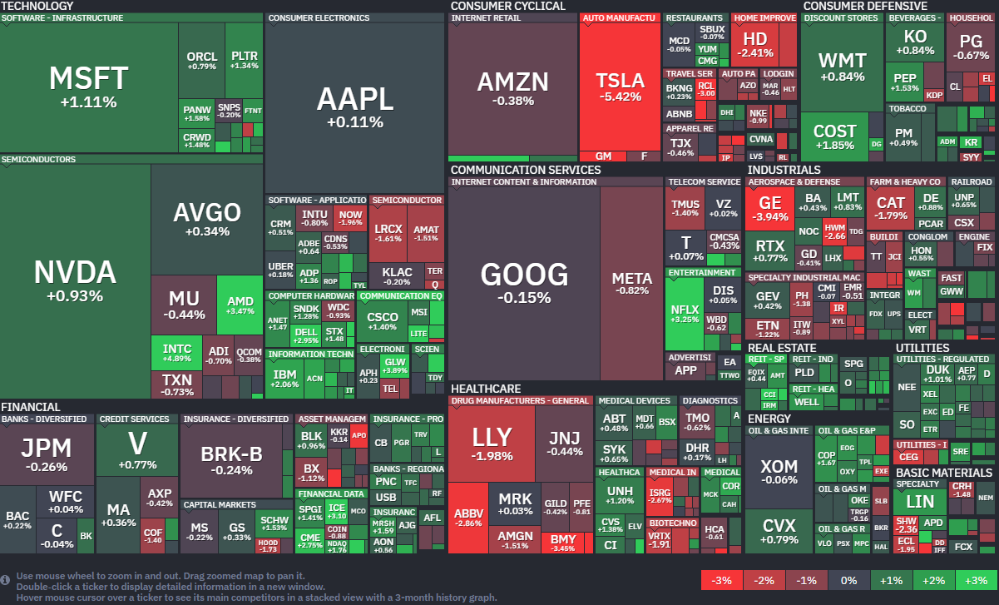
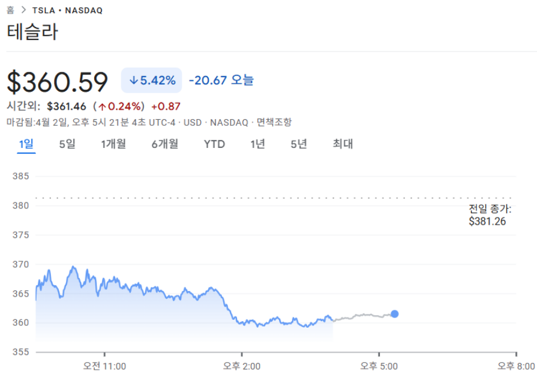

*출처: finviz.com*

#### 오늘의 증시

도널드 트럼프의 발언이 시장을 흔들어놓았다. 전날 밤 "이란과의 전쟁이 몇 주 더 계속될 것"이란 강경한 태도를 보였고, 투자심리가 급격히 얼어붙으며 미국 증권시장은 롤러코스터같은 하루를 보냈다. 하지만 오후 들어 이란이 오만과 협력해 호르무즈 해협을 지나는 선박을 모니터링하기로 했다는 소식이 전해지며 최악의 상황은 피할 수 있을 것이란 기대감이 유입되어 하락 폭을 대부분 만회했다.
다우 지수가 600포인트(1.4%) 넘게 폭락하고 나스닥이 2% 이상 밀리기도 했지만, 장 후반에 극적으로 반등하며 혼조세로 마감했다. S&P 500과 나스닥은 소폭이나마 오름세를 지켜냈지만 다우 지수는 하락세를 벗어나지 못했다.
이러한 변동성은 투자자들이 무조건적인 낙관을 경계하는 데에서 온다고, 심코프의 매니징 디렉터 멜리사 브라운은 말한다.

#### 트럼프의 경고와 유가 폭등: "이란을 석기시대로 돌려보내겠다"

오늘 시장의 가장 큰 화두는 트럼프 대통령의 대이란 발언과 그로 인한 기름값 상승이다.
트럼프 대통령은 연설을 통해 "이란을 매우 강력하게 타격할 것"이라며, 앞으로 2~3주 내에 이란을 "그들이 속한 석기시대로 돌려보내겠다"는 거친 표현을 쏟아냈다. 전쟁이 금방 끝날 줄 알았던 시장의 기대에 찬물을 끼얹은 것이다.

이 발언 직후 국제 유가는 무섭게 치솟았고, 서부텍사스원유(WTI)는 하루 만에 11.41%나 급등하며 배럴당 111달러를 돌파했다. 4년만에 가장 높은 수준이다.

#### 호르무즈 해협의 봉쇄 가능성: 석유보다 무서운 '헬륨' 공급망 위기

오늘 시장이 장중 폭락했던 또 다른 이유는 호르무즈 해협의 봉쇄 가능성 때문이다. 전문가들은 '헬륨 공급망'에 주목하고 있다.

크로스체크 매니지먼트의 토드 숀버거 최고투자책임자는 "미국 입장에서 호르무즈 해협이 다시 열리는 것은 석유보다 헬륨 때문이라도 절실하다"고 짚었다.

헬륨은 첨단 반도체 제조 공정에서 없어선 안 될 필수 자원이다. 반도체를 만들 때 발생하는 엄청난 열을 식히거나 미세 공정의 불순물을 제거하는 데 쓰이는데, 현재로서는 이를 대체할 물질이 거의 없다.
전 세계 헬륨 공급의 상당 부분이 중동 지역(카타르 등)에서 나오는데, 이란의 인접한 호르무즈 해협이 전쟁으로 막히면 전 세계 반도체 생산 라인이 멈출 수도 있다는 공포가 시장을 짓누른 것이다.

3일은 성 금요일(Good Friday) 휴일로 인해 미국 증시가 휴장한다. 시장은 문을 닫지만, 오전에 발표될 3월 고용 보고서 수치에 따라 다음 주 월요일 시장의 향방이 결정될 것으로 보인다.

#### 주요 뉴스

**OpenAI가 인기 테크 팟캐스트 'TBPN'을 인수하다**
샘 올트먼 CEO가 평소 즐겨 듣고 자주 출연하던 'TBPN'을 인수했다. 인수 후에도 편집권의 독립을 유지하며 자유로운 비판과 대화를 이어갈 예정이라고 하며, 단순한 기술 개발을 넘어 직접 미디어 영향력까지 확보하려는 OpenAI의 행보가 보인다.

**수입 약값에 100% 관세 폭탄**
트럼프 행정부가 미국 내 약가를 낮추지 않거나 현지 생산 계획이 없는 제약사에 대해 최대 100%의 수입 관세를 부과하기로 했다. 이미 가격 인하에 합의했거나 미국에 공장을 짓는 기업들은 제외되지만, 그렇지 않은 기업들은 큰 타격을 입을 것으로 보인다. 한국 등 무역 협정국에는 15%의 낮은 세율이 적용되지만, 제약사들을 향한 '미국 내 생산' 압박은 더욱 거세질 전망이다.

**위고비 알약, '파운다요'보다 강력하다**
노보 노디스크가 자사의 '위고비' 알약이 일라이 릴리의 신약 '파운다요'보다 체중 감량 효과와 부작용 측면에서 모두 앞선다는 연구 결과를 발표했다. 위고비 알약은 평균 16.6%의 감량 효과를 보인 반면 파운다요는 12.4%에 그쳤고, 부작용으로 인한 복용 중단율도 위고비가 훨씬 낮았다. 이는 위고비가 비만 치료제 시장의 주도권을 잡겠다는 계획으로 보인다.

**팸 본디 법무장관 경질**
트럼프 대통령이 팸 본디 법무장관을 해임하고 토드 블랜치 차관을 대행으로 임명했다. 제프리 엡스타인 관련 문건 처리 미숙과 정적들에 대한 기소 실패가 주요 경질 사유로 꼽힌다. 트럼프 대통령은 그녀의 노고를 치하하며 민간 부문으로의 이직을 예고했지만, 법무부를 향한 트럼프의 인사 쇄신이 어디까지 이어질지 관심이 집중된다.

**테슬라, 1분기 인도량 쇼크에 주가 5% 급락**
테슬라의 주간느 전일 대비 5.42% 하락한 360.59달러에 장을 마감했다. 이 회사의 주가는 올해 들어 20% 가까이 빠졌다.

테슬라의 주가가 하루 만에 5% 이상 미끄러지며 올해 들어 가장 큰 폭의 하락세를 기록했다. 그 이유는 바로 1분기 차량 인도량이 시장의 기대치를 크게 밑돌았기 때문이다.
테슬라는 이번 분기 총 35만8023대를 인도했다고 발표했는데, 이는 월가 예상치인 37만대는 물론 테슬라 자체 집계 컨센서스인 36만5645대대에도 미치지 못하는 수치다. 지난 분기 대비 14%나 급감한 성적표에 투자 심리가 급격히 위축되며 올해 테슬라 주가는 벌써 20%나 빠진 상태다.

현재 테슬라의 판매는 보급형인 모델3와 인기 모델인 모델Y가 전체 인도량의 97%를 차지하며 절대적 비중을 보이고 있다. 반면 테슬라의 플래그십 모델S와 X는 역사 속으로 사라지게 됐고, 이에 일론 머스크 CEO는 해당 생산 라인을 휴머노이드 로봇 옵티머스 제조에 활용하겠다고 밝혔다. 로봇과 자율주행이라는 미래에 올인하겠다는 선언이지만 시장은 당장의 판매 부진에 더 민감하게 반응하고 있다.

에너지 부문에서도 우려스러운 신호가 포착됐다. 테슬라의 배터리 에너지 저장 시스템 배포량은 지난 분기 14.2GWh로 정점을 찍은 뒤 이번 1분기에는 8.8GWh로 뚝 떨어진 것이다. 전문가들은 글로벌 전기차 수요가 위축된 상황에서 에너지 사업까지 주춤하는 모습에 당혹감을 감추지 못하고 있다. 미래 자율주행을 위해 전기차 사업을 희생하고 있다는 분석까지 나오며 테슬라의 앞날에 물음표가 찍히고 있다.

여기에 '전기차 보조금 중단' 그리고 5주째 이어지는 이란 전쟁이라는 '지장학적 위기'라는 돌발 변수로 인해 테슬라가 타격을 입고 있다. 테슬라는 이제 자율주행 택시인 사이버캡과 휴머노이드 로봇 옵티머스에 회사의 사활을 걸고 있다. 다만 이 제품들은 아직 실제 매출로 이어지지 않는 먼 미래의 이야기라서, 오는 4월 22일 예정된 1분기 실적 발표에서 테슬라가 자동차 부문의 마진율 하락과 공급망 혼란을 어떻게 방어해낼 수 있을지가 향후 주가의 향방을 가를 중대한 분수령이 될 전망이다.

*2일(현지시간) 테슬라($TSLA) 의 주가 흐름*

#### 오늘의 주식 용어

**혼조세**
주가 등이 급락을 거듭하며 불안정한 형태에 있는 형세

**보합세**
가격이 거의 변동없이 그대로 유지되는 시세

#### 부동산 소식과 오늘의 용어

**아파트 주담대 만기 연장의 금지**
오는 17일부터 다주택자의 수도권, 규제지역 아파트 주담대 만기 연장이 원칙적으로 금지된다. 무주택자에는 전세를 낀 주택 매수를 허용해 시장에 미치는 영향이 제한적일 거라는 의견이 나온다.

**세 낀 매물, 연말까지 문 열린다.**
세 낀 매물의 기준이 달라졌다. 5월까지이던 기준이 연말까지로 바뀌었고 대출 조건도 조정됐다.
정부가 4월 1일 가계부채 관리 방안을 내놓으며 무주택자의 세 낀 매물 매수 기준이 바뀌었다.
토지거래허가구역에서 임차인이 살고 있는 집을 무주택자가 살 때, 지난 2월에는 5월 9일 이전 계약이 조건이었지만 이젠 12월 31일까지 구청에 허가 신청을 접수하면 된다.

**금리보다 먼저 봐야 할 것**
대출 관리 기준도 달라졌다. 가계대출 총량관리 목표가 줄었는데, 개인별 대출한도가 한꺼번에 바뀌는 것은 아니지만 은행마다 관리하는 기준이 달라진다. 보금자리론 금리도 올랐다. 그래서 금리만 볼 게 아니라 대출이 '실제로 언제 얼마나 나오는지도' 함께 봐야 한다.

**가계대출 총량관리**란, 은행이 1년간 늘릴 수 있는 가계대출 규모를 정해두는 것이다. 한도가 차면 대출 문턱이 올라간다.
**보금자리론**이란 HF가 무주택자, 1주택자에게 내놓는 장기 고정금리 주택담보대출이다. 만기까지 금리가 바뀌지 않는다.

**반환보증 못 들던 집, 다시보기**
전세보증금반환보증 가입의 걸림돌이던 감정평가 체계가 바뀐다. 그간 5개에 불과하던 평가 기관을 90여 개로 대폭 늘린 것이다. 시세보다 낮은 평가액 탓에 가입할 수 없던 문턱이 낮아질 수 있다는 데서 의미가 있다. 임차인 입장에서는 보증금을 지킬 '방어권'이 강화되는 조치이다.

**갱신권 쓴 임차인, 최대 3억 원 지원**
서울시가 계약갱신청구권을 쓴 무주택 임차인에게 최대 3억 원을 연 3% 금리로 지원한다. 올 8월부터 내년 7월 계약이 만료되는 이들이 대상이다. 갱신권 소진 후 전셋값 상승이라는 외통수에 걸린 이들을 위한 구제책이다.

**빌리면 7%, 맡기면 2%**
주택담보대출 금리 상단은 7%를 넘겼는데 5대 시중은행 정기예금 금리는 아직 2%대다. 빌리는 돈값만 뛰고 맡긴 돈 이자는 제자리다. 예대금리차도  달 새 1.26%p에서 1.47%p로 벌어졌다. 대출을 받으려면 금리 비교를, 여윳돈이 있다면 특판 예금을 챙길 타이밍이다.

**예대 금리차**란, 은행이 대출할 때 받는 금리와 예금할 때 주는 금리의 차이이다. 벌어질수록 은행 수익은 늘고, 고객 부담은 커진다.

**서울시 공공주택 출격**
서울시가 2031년까지 공공주택 13만 가구를 내놓는다. 땅은 공공이 갖고 건물만 파는 토지임대부분양주택 6000가구와 분양가의 20%만 내고 20년간 할부로 갚는 '할부형' 500가구가 포함된다. 특히 할부형은 올 12월, 내년 4월에 입주자를 모집한다.

**토지임대부분양주택**이란, 국가, 지자체 땅을 빌려 짓는 주택이다. 건물값만 반영해 분양가는 낮지만 땅 사용료를 매달 내야 한다.

**3기 신도시, 4월 본청약 개시**
4월부터 3기 신도시 본청약이 본격화된다. 고양 창릉, 남양주 왕숙2, 인천 계양 등에서 총 3647가구가 풀린다. 분양가는 1평당 2000만원 이하로 수도권 민간 평균인 3217만 원보다 1000만 원 넘게 싸다. 청약 일정은 [LH청약플러스](https://apply.lh.or.kr/lhapply/main.do)에서 확인할 수 있다.

**3기 신도시**란, 서울 주택난 해소를 위해 수도권에 조성 중인 대규모 택이다. 창릉, 왕숙, 계양 등 5곳이 해당된다.

---

**[Reference]**
매일경제
머니네버슬립
부딩
