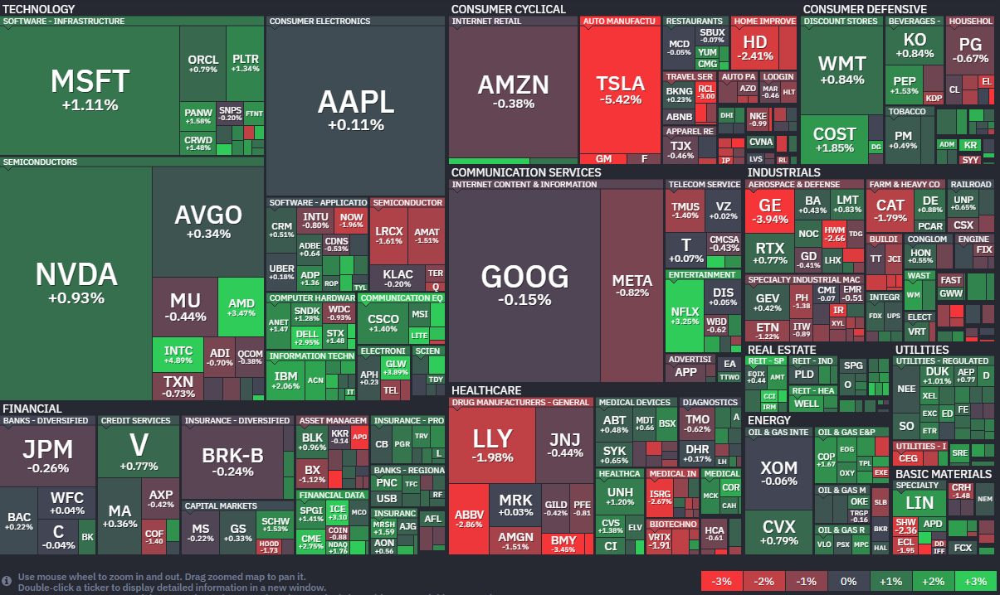

*출처: finviz.com*

#### 오늘의 증시

지난주 미국 증시가 6주 만에 반등했다. 미국과 미란의 협상 진전에 대한 기대감이 저가 매수를 자극한 영향으로 해석된다. 다만 트럼프가 예고한 협상 시한 (현지시작 4월 6일 오후 8시)를 앞두고 있어서 이번 주 증시는 다시 중동 리스크에 따라 출렁일 수 있다.

3일 코스피는 전날의 하락분을 만회하며 상승 출발한 후, 12거래일 만에 돌아온 외국인 매수세에 힘입어 2.74% 오른 5,377.30에 마감했다.

#### 금융시장 동향

한국투자증권이 가상자산 거래소 코인원에 대한 지분투자를 검토하고 있다. 성사될 경우 미래에셋-코빗에 이은 대형 증권사와 거래소 간 빅딜이 될 전망이다.

블루아울 캐피털의 사모대출 펀드들이 또 8조 원 규모의 환매 요청을 받아, 한도를 5%로 제한했다고 밝혔다. 사모대출 자금 유출이 가속화 되고 있다.

#### 투자 재테크, 산업 뉴스

지난 3월 개인 투자자들이 **반도체, 나스닥 3배 레버리지 ETF**를 집중 매수했다. 반등을 기대하고 베팅했지만 지정학적 리스크가 이어지며 손실 우려가 커지고 있다.

**삼성전자, SK하이닉스** 주식을 기초자산으로 하는 레버리지, 인버스, 커버드콜 ETF가 빠르면 다음 달 중 출시될 예정이다. 레버리지 ETF는 기초자산의 등락을 2배로 추종하는 상품인데, 지금처럼 시장 변동성이 클 때는 주의해야 한다.

**삼성전자**가 이례적으로 구형 스마트폰 출고가를 인상했다. AI 수요로 D램 가격이 급등하면서 '칩플레이션'이 현실화되고 있다.

지난해 **삼성전자와 SK하이닉스** 합산 영업이익이 90조 원을 넘으며 전체 상장사 이익의 3분의 1 이상을 차지했다.

고물가 속에서 가성비 소비가 확산되며 **버거 프랜차이즈**들이 역대급 실적을 기록했다. **롯데리아**를 운영하는 롯데GRS는 지난해 매출 1조 1189억 원을 기록했고, **맘스터치**는 결제액 기준 처음으로 1조 원을 넘겼다.

**아마존**이 **스페이스 X**의 '스타링크'와 맞서기 위해 미국 위성 통신없체 글로벌 스타에 대한 인수를 추진한다. 한편, **스페이스X**는 6월을 목표로 본격적인 상장 절차에 돌입했다.

**샤넬**이 '샤넬25백' 가격을 평균 3% 인상했다. 반복된 가격 인상에도 국내에서 지난해 2조 원 넘는 매출을 기록하며 최대 실적을 이어가고 있다.

'라부부'열풍을 이끌었던 **팝마트** 주가가 최근 하락세다. 시장은 라부부의 뒤를 이를 대표 IP가 부족하다는 이유로 팝마트의 성장성을 의심하고 있다.

2일(현지 시각) **테슬라**의 1분기 전기차 인도량이 시장 기대치를 충족하지 못하면서 주가 5% 이상 급락했다. 에너지저장장치 실적도 전망치를 밑돌았다.

**퓨리오사 AI**가 HBM을 탑재한 추론 특화 AI 칩 '레니게이드'를 공개했다. 하반기에는 **삼성 SDS**와 구독 서비스를 출시해 생태계 확장에 나선다.

#### 경제 지표

점차 잡히고 있던 소비자물가 상승률이 지난달 2.2%로 상승한 데는 전쟁 여파로 급등한 석유류 가격 영향이 크다. 석유류가 전체 물가 약 0.4%p 끌어올렸다.

#### 부동산

정부가 공실 상가와 오피르를 매입해 청년, 신혼부부 대상 공공 임대주택으로 공급한다. 올 한 해 2000호 매입을 목표로 하고 있다.

#### 재테크 주요 일정

**4월 6일 월요일**

경제지표 - 3월 ISM 서비스업지수 (미국)

기타 - 중국, 홍콩, 대만, 영국, 프랑스, 독일 증시 휴장

**4월 7일 화요일**

실적발표 - 삼성전자 잠정실적 / 엑손모빌 (미국)

기타 - 홍콩 증시 휴장

**4월 8일 수요일**

경제지표 - 미국 FOMC 의사록 공개

실적발표 - 델타항공 (미국)

**4월 9일 목요일**

경제지표 - 2월 개인소비지출 (미국)

**4월 10일 금요일**

경제지표 - 3월 소비자물가지수 (미국)

실적발표 - TSMC 3월 매출 (대만)

기타 - 금융통화위원회

#### 오늘의 주식 용어

**사모대출**

소수의 투자자에게 비공개로 자금을 빌려주는 대출 형태. 은행 대신 사모펀드 등이 기업에 자금을 공급하는 방식

**환매 요청**

펀드 투자자가 보유한 지분을 현금으로 돌려달라고 운용사에 요청하는 것 (펀드 환불 개념)

**레버리지, 인버스, 커버드콜 ETF**

**레버리지 ETF**

기초 지수의 하루 수익률을 2배 이상으로 확대해 추종하는 ETF로, 단기 수익을 노리지만 변동성과 위험이 큼.

**인버스 ETF**

기초지수가 하락할 때 수익이 나는 ETF로, 시장 하락에 베팅하거나 하락 리스크롤 헤지할 때 활용됨.

**헤지(Hedge)** : 가격이 떨어질 때 생길 손실을 줄이기 위해 반대 방향 투자로 위험을 방어하는 것. 쉽게 말해 "보험 드는 것처럼 손실을 줄이는 전략"

**커버드콜 ETF**

보유한 주식(또는 지수)에 콜옵션을 매도해 프리미엄을 얻는 ETF로, 상승 수익은 제한되지만 안정적인 현금 흐름을 추구함

**콜옵션(Call Option)** : 특정 가격에 주식을 살 수 있는 권리를 거래하는 옵션. 주가가 오르면 이 권리를 가진 사람이 이익을 보고, 대신 판 사람은 프리미엄(옵션료)를 받음

**대표 IP (Intellectual Property)**

기업이 보유한 핵심 지식재산권(캐릭터, 브랜드, 콘텐츠 등)으로 수익의 핵심 자산 역할을 함

**ISM 서비스업지수 (Institute for Supply Management)**

미국 공급관리협회가 발표하는 서비스업 경기 상황을 보여주는 지표로, 50 이상이면 경기 확장, 50 이하면 위축을 의미

**엑손모빌 (ExxonMobil)**

세계 최대 석유, 가스 기업 중 하나로 글로벌 에너지 시장 흐름을 보여주는 대표 기업

**미국 FOMC (Federal Open Market Committee)**

미국 연준의 금리 정책을 결정하는 회의로, 글로벌 금융시장에 큰 영향을 미침

**TSMC**

세계 최대 반도체 위탁생산(파운드리) 기업으로, 글로벌 반도체 산업의 핵심 플레이어

---

**[Reference]**
매일경제
UPPITY
