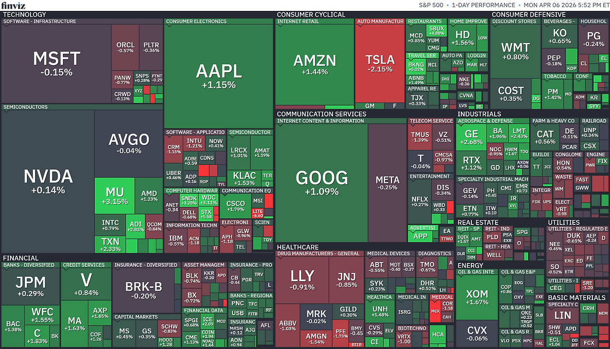

*출처: finviz.com*

#### 오늘의 증시

미국 증권시장이 6일(현지시간) 이란과의 전쟁이 조기 종료될 수 있다는 기대감에 힘입어 일제히 상승 마감했다. S&P 500 wltnsms 4거래일 연속 상승세를 이어가며 6,600선을 돌파했고, 나스닥과 다우 지수 역시 기분 좋게 장을 마쳤다.

시장을 움직인 핵심 동력은 '휴전 가능성'이다. 이날 주요 외신들에서 양측이 일시적 휴전을 논의 중이라는 소식을 전하며 투자 심리가 빠르게 회복되었다. 다만 시장의 낙관론을 경계하는 목소리도 있다. 엔젤레스 인베스트먼트 마이클 로젠 최고투자책임자(CIO)는 "시장이 세계 경제의 혼란 규모를 과소평가하고 있을 수 있다"며 "에너지 공급 중단이 가져올 영향이 예상보다 오래 지속될 수 있고, 이는 곧 고유가 상황이 길어질 수 있음을 의미한다"고 지적했다.

#### 호르무즈 해협의 운명과 45일의 휴전

미국 매체 악시오스(Axios)는 미국과 이란, 중동 지역 중재자들이 '45일간의 휴전' 조건을 논의 중이라고 보도했다. 로이터 통신 역시 파키스탄이 제안한 중재안에 따라 즉각적인 휴전과 호르무즈 해협 재개방이 논의되고 있다고 전했다. 그럼에도 트럼프는 이란이 호르무즈 해협을 열지 않으면 이란의 발전소와 교량등 주요 기반 시설을 파괴하겠다고 강력히 경고했다.

이런 불확실성 때문에 유가는 하루 종일 널뛰기 장세를 보였고 휴전 기대감에 내리는 듯하다가도, 트럼프의 강경 발언이 나오면 다시 오르는 식으로 변동했다. 결국 서부텍사스산원유(WTI)는 배럴당 112달러 선에서 마감되었다. 시장은 올랐지만 이른바 '공포지수'라고 불리는 VIX 지수는 24를 웃돌며 여전히 높은 수준을 유지했다. 이는 투자자들이 겉으로는 웃고 있어도 속으로는 여전히 큰 변동성에 대비하며 긴장을 늦추지 않고 있다는 증거다.

#### 주요 뉴스

**보험 업계의 전례없는 스트레스 테스트**

AI 데이터센터 건설에 수조 달러의 민간 자본이 쏟아지며  보험 업계가 전례 없는 '스트레스 테스트'를 치르고 있다. 단일 지역에 수십조 원 규모의 자산이 집중되다 보니 보험사들의 사고 보상 역량이 한계에 부딪히고, 복잡한 대출 구조로 인해 리스크를 파악하기도 까다로워 진 것이다. 천문학적인 투자 규모에 비해 투명성이 낮아 2008년 금융위기 때와 비슷한 리스크가 발생할 수 있다는 우려의 목소리가 나오고 있다.

**호르무즈 해협, 이란이 선별적으로 통행을 허용**

리서치 기업 시트리니가 현지에 분석가를 보내 확인한 결과, 선박들이 추적 장치를 끄고 하루 약 15척씩 조용히 통과하고 있다는 소식을 전했다. 현재 이란이 선별적으로 통행을 허용하는 체크포인트 형태로 운영되고 있어, 시장의 우려보다는 물류가 조금씩 흐르고 있다는 분석이다. 완전 봉쇄가 아닌 교란 상태가 장기화될 가능성이 높은 만큼 유가 시장의 새로운 변수가 될 것으로 보인다.

#### 부동산 소식

다주택자 주택담보대출 만기 연장이 4월 17일부터 원칙적으로 제한된다. 임대인 대출 얘기 같지만 임차인이 먼저 확인해야 할 것들이 있다. 임대인이 대출을 정리하면 매도, 증여, 상환같은 움직임이 생길 수 있다. 내 계약 상대가 바뀌거나 계약이 끝날 때 자금 흐름이 꼬일 수 있다. 그래서 임차인은 4월 17일 전 등기사항증명서를 살펴야 한다.

임대인 변경-&gt; 바뀔 일이 없는지, 자금 흐름-&gt; 만기 때 돈이 꼬이지 않는지, 권리 순서-&gt; 내 보증금 앞에 뭐가 끼어있는지 체크해야 한다.

등기사항증명서에서 임차인이 봐야할 것은 두 군데다. 임대인이 바뀌었는지, 압류나 가압류가 새로 잡혔는지는 갑구에서 본다. 은행이 먼저 회수할 수 있는 근저당권 설정 금액이 늘었는지는 을구에서 본다. 핵심은 내 보증금 앞에 새 권리가 끼었는지 확인하는 것이다.

갑구 -&gt; 소유권 변동, 가압류, 압류 확인 / 을구 -&gt; 근저당권 변동 확인

전세보증금반환보증은 보호가 이어지는지 확인하는 안전장치이다. 등기사항증명서는 권리 순서를 보는 서류다. 보증서 만기와 계약만료일이 어긋나면 보증 공백이 생길 수 있고 묵시적 갱신이나 임대인 변경이 있었다면 다시 봐야 한다. 등기사항증명서를 뗀 날, 반환보증 만기도 같이 확인하면 된다.

반환보증은 다음 상황에서 본다. 보증서 만기-&gt;계약 종료일과 맞는지 확인 / 묵시적 갱신-&gt;보증기간 다시 확인 / 임대인 변경 -&gt; 변경 신청 필요 여부 확인

#### 부동산 용어

**자금조달계획서**

집을 살 때 돈을 어디서 가져왔는지 밝히는 서류다. 자기 저축, 대출, 가족 지원 등 항목 별로 금액을 적어 신고한다. 투기 지역에선 의무 제출이며 비규제지역이라도 일정 금액 이상이면 내야 한다. '돈 출처를 증명 한다'는 의미라서 증빙 자료까지 함께 준비해야 한다.

**실거래가 신고**

부동산 거래가 끝나고 나면 실제 거래 금액을 정부에 신고하는 절차다. 계약일로부터 30일 이내에 해야 하고, 안 하거나 거짓으로 쓰면 과태료가 붙는다. 신고된 금액은 국토교통부 실거래가 공개시스템에 올라간다. 시세 파악할 때 보는 숫자가 여기서 나온다.

**주택담보대출**

집을 담보로 은행에서 돈을 빌리는 것을 말한다. 구매할 집을 담보로 빌리는 경우, 이미 구매한 집을 담보로 빌리는 경우 등 크게 두 가지 케이스가 있다.

**등기사항 증명서**

부동산의 소유자, 대출 담보, 압류같은 권리 관계를 한눈에 보여주는 공적 문서로, 인터넷등기소에서 열람할 수 있다.

**갑구**

등기사항증명서에서 '누가 임대인인지' 보여주는 칸. 소유권 이전 압류, 가압류 같은 권리 변동이 여기에 기록된다.

**을구**

이 집이 돈이 얼마나 걸려 있는지 보여주는 칸. 은행 근저당권 (대출 담보) 설정 내역이 여기에 나온다.

**전세보증금반환보증**

임대인이 보증금을 돌려주지 않을 경우 보증 기관이 대신 갚아주는 상품이다.

**묵시적 갱신**

계약 만기 전 양쪽 모두 별다른 통보가 없으면 같은 조건으로 자동 연장되는 것을 말한다. 임차인은 언제든 2개월 전 통보로 해지할 수 있어 유리하다.

---

**[Reference]**

매일경제

머니네버슬립
부딩
