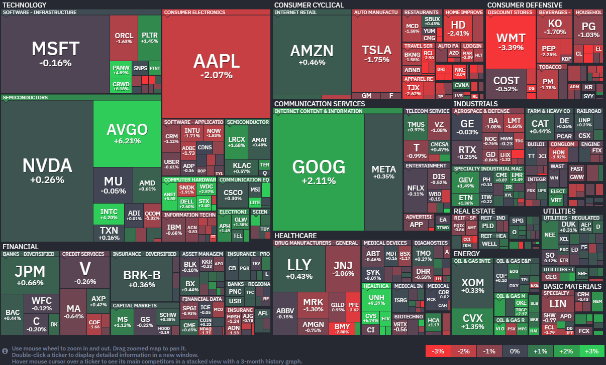

*출처: finviz.com*

#### 오늘의 증시

미국 증권시장이 7일(현지시간) 긴장감 속에 혼조세로 마감했다. 장 중반까지는 도널드 트럼프 대통령이 예고한 이란 공격 데드라인 때문에 공포심이 시장을 지배했다. 다행히 장 마감 직전에 파키스탄이 중재안을 내놓으면서 극적인 타협 가능성이 보이자 하락 폭을 대부분 만회했다. S&P 500과 나스닥 지수는 소폭 상승세로 돌아섰다.

이날 시장을 움직인 핵심 키워드는 '중동의 지정학적 리스크‘다. 트럼프 대통령이 이란의 전력망과 교량 등의 인프라를 타격하겠다고 예고한 시간이 다가오자 투자자들은 움츠러들었다. 하지만 장 후반에 파키스탄 총리가 공격 시점을 2주만 늦춰달라고 요청했다는 소식이 전해지며 숨통이 트인 것이다.

자산운용사 패싯(Facet)의 톰 그라프 최고투자책임자(CIO)는 "이란이 호르무즈 해협을 폐쇄한 것은 협상을 위한 전략적 수단일 뿐"이라며, "이란을 포함해 그 누구에게도 해협 폐쇄가 장기화되는 것은 이득이 아니기 때문에 조만간 해결책이 나올 것"이라고 분석했다.

#### 8시의 공포와 파키스탄의 중재

오늘 시장의 눈과 귀는 온통 이란과 미국의 충돌 여부에 쏠려있었다. 트럼프 대통령은 이란이 봉쇄한 '호르무즈 해협'을 다시 열지 않으면 미 동부 시간 기준 오후 8시에 이란의 주요 시설을 타격하겠다고 선포했다. 트럼프 대통령은 자신의 SNS에 "오늘 밤 한 문명이 사라질 수도 있다." 그런 일이 일어나길 원치 않지만, 아마 일어날 것"이라는 메시지를 남기기도 했다. 이 발언 이후 시작은 급격히 얼어 붙었고 국제 유가는 요동쳤다.

그러나 파키스탄의 셰바즈 샤리프 총리가 트럼프 대통령에게 "공격 시점을 2주만 연기해달라"고 요청했다. 동시에 이란에는 호의의 표시로 2주 동안만이라도 호르무즈 해협을 개방해달라고 제안했다.
백악관에서 "대통령이 이 제안을 인지하고 있으며 곧 응답할 것"이라는 소식이 전해지자, 시장은 전쟁까지는 가지 않을 수도 있겠다는 희망을 품고 반등에 성공했다.

#### 주요 뉴스

**브로드컴, AI 칩 동맹**
브로드컴의 주가가 구글, 앤스로픽과의 파트너십 확대 소식에 6% 넘게 급등했다. 이번 계약을 통해 구글의 차세대 AI 칩을 생산하고, 앤스로픽에는 대규모 컴퓨팅 자원을 공급하게 되었다. 시장에서는 이번 협력이 브로드컴의 AI 매출을 2027년까지 1000억 달러 이상으로 끌어올릴 강력한 성장 동력이 될 것이라는 기대를 모으고 있다.

**일론 머스크가 OpenAI의 샘 알트먼 CEO와 그레그 브록먼 사장의 해임을 요청**
일론 머스크가 이달 말 재판을 앞두고 OpenAI의 샘 알트먼 CEO와 그레그 브록먼 사장의 해임을 법원에 공식 요청했다. 머스크는 이들이 비영리 원칙을 지키겠다는 약속으로 자신을 속여 기부금을 받아냈다면서, 지도부 축출과 함께 OpenAI의 완전한 비영리 복귀를 주장하고 있다. 오는 27일 본격적인 재판이 시작될 예정이며 AI 업계를 뒤흔들 양측의 치열한 법정 공방에 이목이 쏠린다.

**중동의 AWS 데이터 센터가 공격받다**
이란 전쟁의 여파로 바레인과 아랍에미리트에 있는 AWS 데이터 센터가 드론 공격을 받아 일부 서비스에 차질이 생겼다. 아마존은 인프라를 복구하고 고객 서비스를 유지하기 위해 전담팀을 꾸려 24시간 내내 대응에 매달리고 있다. 치솟는 에너지 비용과 공급망 불안이라는 어려운 상황 속에서 맷 가먼 CEO는 중동 지역 잠재력을 높게 평가하며 장기 투자 의지는 여전하다고 강조했다.

**애플 폴더블폰 출시 지연**
애플의 첫 폴더블 아이폰 출시가 지연될 수 있다는 소식에 주가가 5%까지 하락했다. 2026년 9월 출시를 목표로 준비 중이었지만, 기술적인 문제로 난항을 겪고 있어 시간이 더 필요하다는 분석이 나온 것이다. 여전히 예정대로 출시될 것이라는 반론도 팽팽해서 애플의 폴더블폰을 올해 안에 볼 수 있을지 시장의 관심이 집중되고 있다.

**인텔, 머스크의 테라팹 프로젝트 파트너 확정**
7일(현지시간) 인텔의 주가는 전일 대비 4.19% 오른 52.91달러에 장을 마감했다. 테슬라의 주가는 1.75% 내린 346.55달러에 장을 마감했다.
인텔이 일론 머스크가 이끄는 스페이스X, 테슬라, xAI의 전용 반도체를 생산하기 위해 테라팹 프로젝트에 합류했다. 7일(현지시간), 머스크의 회사들과 협력하여 초고성능 칩을 대규모로 설계, 제조 및 패키징할 계획이라고 발표했다. 립부 탄 인텔 CEO와 일론 머스크가 손을 맞잡은 사진이 공개되면서 시장의 기대감이 커지고 있다. 이 소식이 전해진 직후 인텔의 주가는 3% 이상 상승하며 긍정적인 반응을 보였다.

이번 파트너 십은 그동안 엔비디아, AMD같은 경쟁사들에 밀려 고전해온 인텔에게 매우 중요한 돌파구가 될 것으로 보인다. 인텔은 최근 몇 년간 데이터센터 칩 수요가 급증하는 상황에서도 생산 능력을 줄이는 등의 어려움을 겪어왔기 때문이다. 특히 미 정부(트럼프 행정부)가 인텔의 경영 안정을 위해 약 90억달러를 투자해 8.4%의 지분을 확보한 상태라서, 이번 머스트와의 협력은 미국산 반도체의 자존심을 세우는 중요한 계기가 될 전망이다.

로봇부터 우주 인공지능까지 머스크의 반도체 자립 선언이 주목된다. 텍사스주 오스틴에 건설될 테라팹은 한 시설 안에서 칩의 설계부터 제조까지 동시에 진행해 실험 속도를 획기적으로 높이겠다는 머스크의 야심작이다. 여기서 생산될 칩들은 테슬라의 차세대 성장 동력인 로보택시와 휴머노이드 로봇 옵티버스에 우선적으로 탑재될 예정이다.
또한 스페이스X가 소아 올릴 수많은 인공지능 컴퓨팅 위성들을위해, 우주 환경에 최적화된 특수 칩들도 이곳에서 만들어진다.

그동안 머스크의 회사들은 엔비디아, 삼성, TSMC 등 외부 공급사에 칩을 의존해왔으나 자사 제품에 필요한 칩 수요가 파트너사들이 공급할 수 있는 수준을 훨씬 넘어설 것으로 보고 직접 칩을 찍어내기로 결정한 것이다. 테라팹은 단순한 공장을 넘어 실리콘 로직, 메모리, 패키징이 구축되는 방식을 완전히 바꾸는 단계적 변화의 시작점이 될 것으로 보인다.

#### 금융시장 동향

**3차 상법 개정안 시행**으로 상장사들의 자사주 소각이 빠르게 늘고 있다. 지난달 공시된 소각 규모만 16조 원에 육박해서, 이런 흐름이 연중 이어질 가능성이 크다.

**빗썸 코인** 오지급 사태 재발 방지를 위해 모든 가상자산 거래소에 거래 장부와 실제 보유량을 5분마다 점검하는 상시 검증 시스템 도입이 추진된다.

**단일 종목 레버리지 ETF 국내 출시**를 앞두고 임원 거래 관련 규제가 필요하다는 지적이다. 사실상 개별 주식과 유사한 성격이지만, 공시 의무가 없어 불공정 거래 가능성이 제기된다.

중국 기술 기업 상장 열풍 속에 **홍콩 IPO 시장**이 활기를 띠고 있다. 중국 본토 규제 영향으로 자금이 홍콩으로 이동한 결과다.

**유가 상승**이 이어지며, 7일 서울 휘발유 평균 가격이 처음으로 2,000원을 돌파했다.

**신세계그룹**이 **OpenAI**와 AI 커머스 분야 전략적 제휴를 맺었다. 2027년을 목표로 차세대 AI 커머스를 구축할 계획이다.

**LS일렉트릭**과 **일진전기**가 북미에서 초고압 변압기 공급 계약을 체결했다. AI 데이터센터 확대로 전력기기 수요가 공급을 웃돌고 있다.

**LG전자**가 실적 전망치를 웃도는 1분기 실적을 발표했다. 생활가전 등 주력 사업 실적이 개선되고, 미래 먹거리로 내세우고 있는 전장 사업이 안정적으로 성장하고 있다.

나라 살림을 보여주는 **관리재정수지 적자**가 100조 원을 넘어서며 역대 네 번째 규모를 기록했다. 정부는 경기 불확실성이 큰 만큼 재정 지출을 늘릴 필요가 있다며, 엄격한 적자 제한 대신 조정 가능한 '재정 앵커' 도입을 검토하고 있다.

3월 **미국 ISM 서비스업 가격 지수**는 70.7로 전월 대비 7.7p 급등했다. 중동 전쟁 장기화로 물가 상승 압력이 높아지고 있다.

**상업용 부동산 시장**이 둔화세를 보이고 있다. '꼬마빌딩'의 경우 최근 경매시장에서 감정가보다 낮은 가격에 입찰이 이뤄지거나 유찰되는 사례가 나오고 있다.

**삼성전자**, 3개월 만에 영업이익이 3배로 뛰었다. D램부터 낸드플래시까지 메모리 반도체의 가격이 오르고 있으며 AI가 '학습 중심'에서 배운 것을 토대로 답을 내놓는 '추론 중심'으로 전환되며 그 수요는 더 커지고 있다.

---

**[Reference]**
매일경제
머니네버슬립
UPPITY
