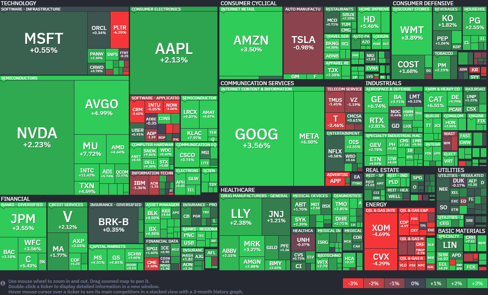

*출처: finviz.com*

#### 오늘의 증시

미국 증권시장이 8일 (현지시간) 폭발적인 상승세를 보였다. 다우 지수는 1,300포인트 넘게 치솟으며 2025년 4월 이후 최고의 하루를 보냈고 S&P 500과 나스닥 지수 역시 2.5% 이상의 높은 수익률을 기록하며 장을 마쳤다. 도널드 트럼프 대통령이 5주간 이어지던 이란과의 교전을 2주간 중단하겠다고 발표하면서 시장을 짓누르던 전쟁의 공포가 한풀 꺾였다. '지장학적 리스크의 완화'로 인해 국제 유가가 10% 이상 급락하며 인플레이션 우려를 덜어준 점이 증시 전체에 강력한 추진력이 되었다. 그러나 프리덤 캐피털 마켓의 수석 전략가 제이 우즈는 "이 2주라는 시간이 과연 완전한 해결로 이어질지가 관건"이라고 말했다.

#### 호르무즈 해협이 열리고 숨통이 트인 시장

오늘 시장에서 가장 핵심적인 키워드는 '호르무즈 해협의 재개방'과 그로 인한 '유가 급락'이었다. 후르무즈 해협은 중동의 산유국들이 석유를 실어 나르는 좁은 바닷길이다. 전 세계 석유 해상 물동량의 약 20%가 이곳을 지나간다. 지난 5주간 이어진 미국과 이란의 갈등으로 이 길이 막히며 전 세계 에너지 공급에 비상이 걸렸던 것이다. 기름값이 오르면 물가(인플레이션)이 오르고, 이는 기업들의 비용 부담으로 이어져 주식 시장에는 아주 큰 악재가 된다.

트럼프 대통령은 이란으로부터 10개 항의 제안을 받았으며 이를 협상의 기본 토대로 삼겠다고 밝혔다. 이란 역시 미국이 공격을 멈추는 조건으로 호르무즈 해협을 2주간 다시 열기로 했다. 이 소식에 서부텍사스산원유(WTI) 가격은 하루 만에 16% 넘게 폭락하고 배럴당 94달러 선까지 내려왔다. 2020년 팬데믹 초기 이후 최대 낙폭이다.

기름값이 떨어지자 산업 전반에는 활기가 돌았다. 특히 에너지 비용에 민감하고 공급망 차질 우려가 컸던 반도체 섹터가 크게 올랐다. 반도체 ETF(SMH)는 5% 넘게 급등했고, 브로드컴과 마이크론 등 주요 기업들도 큰 폭으로 상승했다. 반면 그동안 유가 상승의 수혜를 입었던 엑슨 모빌이나 쉐브론 같은 에너지 기업들은 주가가 4% 이상 빠지는 모습을 보였다.

시장은 일단 환호하고 있지만, 전문가들은 '완전한 평화'라고 보기에 아직 이르다고 조언한다. 이란 측에서 "미국이 이미 휴전 합의를 위반했다"는 주장이 나오는 등 여전히 불신이 깊기 때문이다. 모던 웰스 매니지먼트의 스티븐 턱우드 이사는 "증시가 직선으로 계속 오르기만 하지는 않겠지만, 현재 강력한 Base를 형성한 것으로 보인다"고 분석했다.

#### 주요 뉴스

**전쟁 중의 금리 인하**

미국 연준(Fed) 위원들이 전쟁과 관세 같은 불확실성 속에서도 올해 금리 인하 전망을 유지하기로 했다. 3월 회의 인사록에 따르면 위원들은 고유가가 고용과 소비에 타격을 줄 경우 금리를 내려야 할 수도 있다고 판단했다. 다만 인플레이션이 여전히 목표치 위에 머물고 있는 만큼, 시장 상황에 맞춰 '민첩하게' 대응하겠다는 입장이다. 연내 한 차례 정도의 금리 인하가 실제로 이루어질지 시장의 관심이 쏠린다.

**OpenAI 주식 배정 계획**

OpenAI가 기업공개(IPO)를 진행할 때 개인 투자자들에게도 주식을 배정할 계획이라고 밝혔다. 시라 프라이어 CEO는 소수만 혜택을 누리는 대신 모두가 AI의 성장에 참여해 신뢰를 쌓는 것이 중요하다는 점을 강조했다. 최근 진행한 펀드에서도 개인 투자자들의 수요가 예상보다 3배나 몰릴 정도로 열기가 뜨거웠다. 이르면 올해 4분기쯤 챗GPT의 주주가 될 수 있는 기회가 올 수도 있다.

**델타항공의 성장 멈춤**

델타항공이 중동 전쟁 여파로 치솟은 연료비 부담을 이기지 못하고 운항 확대 계획을 대폭 축소하기로 했다. 연료비로만 이번 분기에 20억 달러를 더 써야 하는 상황이라, 무리한 성장보다는 내실 다지기에 집중하겠다는 전략이다. 다행히 직접 보유한 정유소에서 3억 달러 규모의 이득을 챙기며 버티고는 있으나 높아진 비용 탓에 항공권 가격이나 수하물 수수료 인상은 피하기 어려울 것으로 보인다.

**AI 칩의 마지막 단계, 첨단 패키징의 병목 현상**

AI 칩 생산의 마지막 단계인 '첨단 패키징'이 새로운 병목 현상으로 떠오르고 있다. 현재는 미국에서 만든 칩도 패키징을 위해 대만까지 왕복해야 하는 상황이다. 이에 TSMC는 미국 내 패키징 공장 건설에 나섰고, 인텔은 일론 머스크와 손을 잡으며 이 시장의 주도권을 잡기 위해 속도를 내고 있다. 칩의 성능을 극대화하는 이 '포장 기술'이 앞으로 AI 패권 다툼의 핵심이 될 전망이다.

#### 메타, 알렉산드르 왕 영입 후 첫 결실 '뮤즈 스파크' 공개

8일(현지시간) 메타의 주가는 전일 대비 6.5% 오른 612.42달러에 장을 마감했다. 이 회사의 주가는 최근 5거래일 동안 5.96% 상승했다.

메타가 수조원 규모의 투자 끝에 새로운 주력 인공지능 모델인 '뮤즈 스파크'를 공개했다. 이번 모델은 9개월 전 메타에 합류한 인공지능 최고 책임자 (CAIO) 알렉산드르 왕이 이끄는 메타 슈퍼인텔리전스랩의 첫 번째 결과물이다. 이 소식이 전해지자 메타의 주가는 하루에만 약 9% 급등하며 1월 이후 가장 큰 상승폭을 기록했다. 이란의 공격 중단 소식에 따른 시장 전반의 훈풍도 있었지만 시장이 메타의 새로운 AI 전략에 거는 기대감이 그만큼 크다는 반증이다. 메타는 올해 AI 인프라 확충에만 최대 1350억달러를 쏟아부을 예정이다. 이는 지난해보다 거의 두배나 늘어난 엄청난 규모이다.

**오픈 소스 방식이 아닌 폐쇄형의 모델**

주목할 점은 메타가 이번 모델을 기존의 오픈 소스 방식이 아닌 폐쇄형으로 출시했다는 것이다. 그동안 무료 배포를 통해 생태계를 확장하던 전략에서 벗어나 유료 수익화의 길을 모색하기 시작한 것이다. 메타는 우선 선정된 파트너들에게 기술 연동 인터페이스인 API를 비공개로 미리 제공하고 향후 유료 API 서비스를 통해 제3자 개발자들에게 기술을 판매하는 새로운 수익 모델을 본격화할 계획이라고 밝혔다.

**심사숙고(Contemplating) 모드라는 강력한 기능**

가장 강력한 기능은 점진적으로 도입될 심사숙고(Contemplating) 모드이다. 이 모드에서는 여러 개의 AI 에이전트가 병렬로 추론을 수행해 구글의 제미나이 딥싱크나 OpenAI GPT프로와 같은 최상화 모델들과 경쟁한다. 메타의 강점인 SNS 데이터를 이용한 쇼핑 모드도 추가된다. 사용자가 팔로우하는 크리에이터의 스타일과 브랜드 스토리를 분석해 옷을 고르거나 방을 꾸미는 데 도움을 주는 맞춤형 서비스다.

메타는 그동안 생성형 AI를 광고 사업 강화에 활용해 왔지만 모델 시장 자체에서는 경쟁사들에 다소 밀리는 형국이었다. 하지만 이번 뮤즈 스파크 출시를 기점으로 다시 한번 주도권을 잡겠다는 의지가 확고해 보인다. 향후 버전에서는 다시 오픈 소스로 전환할 가능성도 열어두는 등 유연하면서 공격적인 행보를 이어갈 것으로 보인다.

#### 금융시장 동향

대형주가 부재한 IPO 시장에서 **중소형주**의 흥행이 이어지고 있다. 제도 변화에 따라 상장 직후 물량이 줄어든 상황에서 단기 수익을 노린 자금이 중소형주에 몰리고 있다.

세계 최대 자산운용사 **블랙록**이 나스닥100 추종 ETF를 출시한다. 인베스코의 나스닥100 추종 ETF인 QQQ 중심의 독점 구조에 변화가 생길지 주목된다.

중동 전생 속에서 **국내 바이오, 헬스 산업**의 1분기 수출액이 41억6000만 달러(약 6조 원)를 돌파했다.

**브로드컴**이 **구글**과 맞춤형 AI 반도체 TPU를 개발하고 공급하는 장기 계약을 맺었다. **앤트로픽**은 구글, 브로드컴과 TPU 기반 컴퓨팅 용량 약 3.5GW를 쓰는 새로운 계약을 맺었다.

국내 증시 호황 속에서도 **네이버와 카카오**의 주가 부진이 이어지고 있다. 미래 성장동력에 대한 의구심이 커지며 투자심리가 위축되었다.

**포스코**가 제철소 협력사 인력 약 7,000명을 직접 고용하기로 했다. 법원 판결과 관련 법이 제정되는 등의 규제가 강화된 것이 결정에 영향을 미쳤다.

**셀트리온**이 바이오시밀러 '트룩시마'로 미국 처방 점유율 1위를 기록했다. 바이오시밀러에 대한 관세 부담이 완화되며 성장세가 가속화될 전망이다.

**삼성전자**의 실적 발표 이후 시장의 관심이 이달 말 예정된 **SK하이닉스** 실적으로 이동하고 있다. AI 메모리 수요 확대와 ADR 상장 추진에 대한 기대로 증권가는 목표 주가를 올리고 있다.

#### 오늘의 주식 용어

**연준(Fed)**

연준(Fed, Federal Reserve System)은 미국의 중앙은행 제도로, 한국의 한국은행과 같은 역할을 하는 세계 경제의 핵심 기관이다. 달러화 발행, 기준금리 결정, 통화 정책 수립을 통해 미 경제와 세계 금융 시장에 절대적인 영향을 미치며, 투자자들은 연준의 금리 인상/인하 움직임을 주시한다.

**기업공개(IPO)**

기업공개(IPO, Initial Public Offering)는 비상장 기업이 외부 투자자들에게 주식을 공개하고, 코스피(KOSPI)나 코스닥(KOSDAQ)같은 주식시장에 등록(상장)하여 공식적으로 주식을 거래하게 하는 절차다. 주식 분산을 통해 자금을 조달하고 경영 투명성을 높이며 기업 신뢰도를 제고하는 것이 주요 목적이다.

**QQQ**

QQQ는 미국 나스닥(NASDAQ)에 상장된 금융 기업을 제외한 시가총액 상위 100개 기업(나스닥 100 지수)에 투자하는 가장 대표적인 ETF(상장지수펀드)다. 애플, 마이크로소프트, 엔비디아 등 대형 기술주 비중이 60% 이상으로 높아 성장성이 높으나 변동성도 크다.

---

**[Reference]**
매일경제
머니네버슬립
UPPITY
