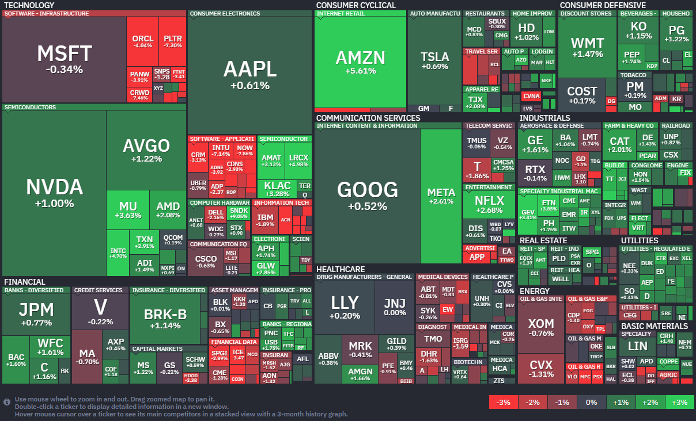

*출처: finviz.com*

#### 오늘의 증시

미국 증권시장이 9일(현지시간) 일제히 안도 랠리를 이어갔다. 드디어 다우 지수는 올해 수익률 '플러스'로 전환했고 지지부진하던 흐름을 깨고 반등에 성공했다. 시장을 짓누르던 지정학적 리스크가 조금씩 해소될 기미를 보이자 투자자들이 다시 지갑을 열기 시작했다.

'중동발 훈풍'이 상승장에 크게 영향을 미쳤다. 미국과 이란의 휴전이 유지될 것이라는 낙관론에 더해, 이스라엘이 레바논과 직접 협상에 나서기로 했다는 소식이 전해지며 긴장감이 한풀 꺾였다. 여기에 빅테크의 활약이 더해졌다. 메타가 새로운 인공지능 모델을 선보이며 주가가 2.6% 올랐고, 월마트나 유틸리티 같은 방어주(경기가 불안정할 때 찾는 안정적인 주식)들도 동반 상승하여 시장을 탄탄하게 받쳐주었다.

RFG 어드바이저의 릭 웨델 최고투자책임자(CIO)는 "휴전이 존재하고 양측이 이에 동의했다는 사실 자체가 투자자들에게 이 상황이 장기적으로 해결될 수 있다는 믿음을 준다"고 분석했다.

**미-이란 휴전과 호르무즈 해협의 재개?**

중동의 호르무즈 해협은 전 세계 석유 물동량의 약 20%가 통과하는 '세계 에너지의 목줄'과 같은 곳이다. 최근 5주간 이어진 분쟁으로 이 해협이 폐쇄되면서 기름값이 치솟고 공급망이 엉망이 되었다. 트럼프 대통령이 이란과의 공격을 잠시 멈추기로 한 대신, 이란은 이 해협을 다시 열기로 약속했다. 그러나 휴전 조건이 '2주간'이라는 한시적인 데다, 실제로 해협을 통과하는 배들이 아직은 기름을 실은 유조선이 아닌 일반 화물선 위주다. 실제로 이날 국제 유가(WTI)는 장중 한때 배럴당 100달러를 넘기기도 하는 등 불안한 모습을 보였다. 완전히 정상화되기까지는 시간이 더 필요하다는 것이다.

트럼프 대통령은 이란이 합의를 어길 경우 "지금까지 본 적 없는 수준의 군사적 대응을 하겠다"며 강하게 압박하고 있다. 투자자들은 이 아슬아슬한 평화가 깨지지 않기를 바라며 상황을 지켜보고 있다. 릭 웨델 CIO는 "해협이 폐쇄되는 기간이 길어질수록 공급 충격에서 회복하는 데 더 많은 시간이 걸릴 것"이라고 덧붙였다.

#### 주요 뉴스

**중국 전기차 BYD와 치킨 KFC의 협력**

중국의 전기차 거인 BYD가 KFC와 손잡고 '9분 급속 충전' 드라이브스루 네트워크를 구축한다. BYD의 차세대 배터리 기술을 활용해, 운전자가 KFC에서 식사하는 짧은 시간 동안 차량 충전을 마칠 수 있게 한 것이다. 차량 내부 화면으로 음식을 바로 주문하는 스마트 기능까지 도입한다는 소식이 전해졌다.

**OpenAI의 스타게이트 잠정 중단**

OpenAI가 영국에 구축하려던 대규모 AI 인프라 프로젝트인 '스타게이트'를 잠정 중단하기로 했다. 세계에서 가장 비싼 수준인 영국의 산업용 전기료와 까다로운 저작권 규제 등이 발목을 잡은 것이다. AI 강국을 목표로 하던 영국의 전략에 일단 제동이 걸린 만큼 OpenAI가 원하는 투자 환경이 언제쯤 다시 조성될 수 있을지 지켜볼 필요가 있다.

**캐나다 왕립은행 RBC의 브릿지바이오 매수 의견 내다**

캐나다 왕립은행 RBC가 제약사 브릿지바이오 파마에 대해 '매수' 의견을 내며 목표 주가를 100달러로 제시했다. 심장병 치료제인 '어트루비(Attruby)'가 출시 1년 만에 엄청난 매출을 기록하며 시장에 성공적으로 안착했기 때문이다. 전문가들은 현재 성장의 초기 단계인 데다 다른 신약 후보군들도 저평가되어 있어, 앞으로 주가가 상승할 여력이 충분하다고 내다봤다.

**전쟁 전부터 이어진 미국의 인플레이션 비상?**

미국의 2월 근원 물가 상승률이 3%를 기록하며 연준의 목표치를 여전히 웃돌았다. 심지어 작년 4분기 경제 성장률은 0.5%까지 하향 조정되어 저성장과 고물가가 겹친 '스태그플레이션' 우려가 커지고 있다. 이번 수치는 이란과의 전쟁으로 인한 유가 급등분이 반영되기도 전의 기록이라서 앞으로 대중이 체감할 물가 압박은 더욱 거세질 것으로 보인다.

**메타, AI 클라우드 기업 코어위브에 210억달러 추가 베팅**

9일(현지시간) 메타의 주가는 전일 대비 2.61% 오른 628.39달러에 장을 마감했다. 코어위브의 주가도 3.45% 오른 92달러에 장을 마감했다.

메타가 AI 클라우드 인프라 확보를 위해 코어위브에 210억달러를 추가로 투가하기로 했다. 이는 기존에 약속했던 142억달러에 더해지는 엄청난 규모다. 이번 계약은 2027년부터 2032년까지 이어지는 장기 프로젝트다. 최근 메타가 야심 차게 공개한 차세대 AI 모델 뮤즈 스파크를 비롯해 고도화되는 인공지능 야망을 뒷받침하기 위한 강력한 엔진을 확보한 것이다.

메타의 AI 투자는 매우 공격적이다. 올해 메타의 자본 지출(Capex) 예상치는 1150억달러에서 1350억달러 사이로, 이는 작년 지출액의 거의 두배에 달하는 수치다. 월가의 예상을 훌쩍 뛰어넘는 이 자금들은 자체 데이터센터 구축은 물론 코어위브와 같은 외부 파트너와의 협력에 쏟아부어지고 있다. 지난 3월 텍사스에 10억달러 규모의 데이터센터를 짓겠다고 발표한 것도 같은 맥락이다.

대규모 투자 소식에 발표 당일 코어위브 주가는 3.5% 상승했고 메타 역시 2.6% 오르며 투자자들의 기대감을 반영했다. 메타가 광고 사업에서 AI의 덕을 보고 있는 만큼 모델 경쟁에서도 뒤처지지 않기 위해 인프라라는 기초 체력을 다지는 데 돈을 아끼지 않는 모습이다.

**코어위브가 보유한 수십만 개의 엔비디아 그래픽 처리 장치(GPU)**

메타가 자체 시설이 있음에도 코어위브를 선택한 이유는 코어위브가 보유한 수십만 개의 엔비디아 GPU 덕분이다. 마이크 인트레이터 코어위브 CEO는 인터뷰에서 "메타처럼 직접 컴퓨팅 자원을 살 수 있는 기업들도 우리를 찾는 이유는 제품의 품질 때문"이라고 자신감을 보였다. 급증하는 AI 수요를 감당하기 위해 자체 구축만 고집하기엔 리스크가 너무 크다는 판단이다.

실제로 코어위브는 구글, 마이크로소프트, OpenAI 등 내로라하는 테크 거인들에게 AI 전용 인프라를 빌려주는 핵심 공급처 역할을 하고 있다. 메타 역시 2023년부터 코어위브와 손을 잡아왔다. 인트레이터 CEO는 "메타가 자체 인프라를 계속 구축하겠지만 동시에 우리와의 협력도 이어갈 것"이라며, "그렇게 하지 않기에는 감수해야 할 리스크가 너무 크기 때문"이라고 설명했다.

코어위브 입장에서도 이번 계약은 큰 호재다. 작년 매출의 62%를 차지했던 마이크로소프트에 대한 의존도를 낮추고 고객사를 다변화할 수 있게 되었다. 작년에 상장한 코어위브는 인프라 확충을 위해 최근 30억달러의 신규 부채를 조달하는 등 몸집을 불리고 있다. 작년에 상장한 코어위브는 인프라 확충을 위해 최근 30억달러의 신규 부채를 조달하는 등 몸집을 불리고 있다. 메타와 코어위브의 이번 동맹은 AI 전쟁에서 인프라 선점이 얼마나 중요한지 단적으로 보여주는 사례다.

#### 국내 소식

**시행 한 달을 맞은 노란봉투법**

노란봉투법은 '노동조합 및 노동관계조정법 2,3조 개정 법률'이다. 노란봉투법이라는 별칭이 생긴 이유는 잘 알려진 파업 사태와 관련이 있다. 2009년 쌍용자동차에서 해고당한 일부 노동자들은 공장을 점거하고 파업에 돌입했다. 법원은 이 파업이 막대한 피해를 줬다며 노동자들이 47억 원을 회사에 배상하라고 2014년에 판결했다. 이 때 노동자들을 위해 여러 시민이 성금을 보냈고, 그 시작은 한 시민이 노란색 봉투에 담아 보낸 4만 7000원이었다고 한다. 결국 15억 원 가까운 돈을 모금한 이 움직임에는 '노란봉투 캠페인'이라는 이름이 붙었다. 과거 월급봉투가 노란색이었다는 점도 영향을 주었다고 한다. 10년 넘게 시간이 흘러 제정된 노란봉투법의 핵심 내용을 정리하면 다음과 같다.

**1. 파업 손해배상 청구 어렵게**

이전에는 파업으로 회사에 피해가 발생하면 노조 구성원 모두가 똑같은 책임을 져야했다. 노란봉투법은 각 근로자가 파업에 참여한 정도에 따라 책임을 다르게 지도록 한다. 회사가 노조에 손해 배상을 청구하려면, 파업한 노조원들이 각각 회사에 어떤 피해를 끼쳤는지 따져서 입증해야 한다. 과정이 까다로워져 사실상 손해 배상 청구가 어려워졌다는 분석이 많다.

**2. 하청노조, 원청 만날 수 있게**

규모가 큰 기업들은 모든 일을 직접 처리하지 않고 여러 작은 회사로 넘기는 경우가 많다. 스마트폰을 만드는 삼성전자는 '원청', 스마트폰 액정과 배터리를 삼성에 납품하는 중소기업들은 '하청'으로 부른다. 예전엔 하청업체 노동자들이 원청업체 사장을 대상으로 단체교섭을 요구할 수 없었다. 서로 직접 근로계약을 맺지 않았기 때문이다. 노동자 단체인 노조가 고용주나 임금, 노동 시간, 근로 조건을 두고 협상하는 것을 공식 용어로 '단체교섭'이라고 부른다.

노란봉투법은 원청업체 사장이 하청업체 노동자의 근로조건을 실질적이고 구체적으로 결정하는 지위에 있는 경우, 원청의 '사용자성'을 인정하고 하청업체 노동자들이 원청업체 사장과 만나서 교섭할 수 있도록 했다. 사용자성을 인정한다는 것은 원청의 사장이 실질적으로 하청 노동자를 고용한 것과 같다고 인정한다는 의미다.

**시행 한달, 1000개의 요구**

아직 1번의 변화는 큰 영향을 미치지 않았지만 2번 변화에 따른 움직임은 존재했다.

하청 노동자들의 교섭 요구가 쏟아졌고, 앞으로도 비슷한 움직임이 당분간 계속될 것으로 보인다. 법 시행 첫날에만 8만 명이상이 소속된 하청노조 407곳이 일제히 원청에 교섭을 요구했다. 이후에도 교섭 요구는 이어졌다. 지난 4월 7일까지 원청업체를 상대로 교섭을 요구한 하청노조는 987곳에 달한다. 소속 조합원만 약 14만 4000명이고, 이들이 교섭을 요구한 원청업체는 368곳이다.

기업들이 제일 먼저 걱정하는 것은 수많은 하청노조와 동시에 교섭해야 하는 상황이다. 삼성전자나 현대자동차 같은 대기업들은 하청업체가 수백 개에 달하는데, 최악의 경우 이 업체들과 동시에 교섭해야 할 수 있기 때문이다. 정부는 이런 문제를 고려해 하청노조들이 교섭에 참여할 '대표 노조' 한 곳을 뽑는 '교섭 창구 단일화' 제도를 설계했다. 하청노조 사이에도 입장 차이가 있을 수 있는 만큼, 하청 노조가 별도로 교섭을 원하면 '교섭단위 분리' 요청을 할 수 있도록 했다.

**포스코의 첫 사례**

정부의 '교섭 창구 단일화' 제도에도 불구하고 대기업들이 여러 노조와 동시에 협의하는 '다중교섭'은 현실화하고 있다. 포스코 하청노조들은 국내 양대 노동조합인 민주노총과 한국노총 중 한 곳을 소속으로 택해서 노조를 운영하고 있다. 하청업체들의 업무 특성 차이에 소속된 상급 노조가 다른 점까지 반영되어 하청노조들의 교섭 단위는 여러 개로 쪼개졌다. 고용노동부 산하 노동위원회도 분리를 허락했다. 포스코는 이르면 올해부터 하청노조 3곳과 단체 교섭을 하게 됐다. 한국노동 금속노조, 민주노총 금속노조와 민주노총 플랜트건설노조가 대상이다. 포스터 원청노조를 포함하면 매년 4개 단체와 임금, 복지 등을 두고 협상을 벌이게 된 것이다.

**노란봉투법의 미래**

우리나라는 반도체, 자동차, 조섭 등 제조업 분야의 대기업 중심으로 성장해 왔고, 제조업은 하청노동자 비율이 높은 산업이다. 그만큼 노란봉투법 제정은 많은 노동자들의 권리를 보장하기 위한 의미 있는 변화다. 노동자 권리 보호를 위한 법이 소기의 목적을 달성할 수 있을지 지켜볼 필요가 있다.

#### 부동산 소식

**전세 자리를 월세가 채우다**

서울 새 아파트 단지의 월세 비중이 평균 60%에 달했다. 작년 여름 이후 입주한 서울 신축 단지의 임대차 거래를 올해 3월 초까지 분석한 결과다. 서울 아파트 전체 신규 임대차월세 비중(50%)보다 10%p 높다. 입주장에선 비교적 낮은 보증금으로 전세를 먼저 들어가보는 흐름이 익숙했는데, 지금은 반대다.

그 이유는 전세로 잔금을 맞추던 구조가 흔들렸기 때문이다. 원래는 임대인이 임차인의 전세보증금으로 분양 잔금을 맞추는 경우가 많았다. 그런데 627 대책 이후 전세대출로 잔금을 맞추던 길이 막혔다. 전세금으로 잔금을 치르기 어려워지자 매물도 전세보다 월세 쪽으로 기울었다.

새 아파트만의 이야기는 아니다. 4월 6일 서울 아파트 임대차 매물은 처음으로 3만 건 아래로 내려왔다. 이제는 전세, 월세보다 고를 매물 자체가 줄어든 시장이다.

**1주택자도 세 끼고 팔 수 있을까**

토지거래허가구역의 세 낀 아파트, 이제 1주택자도 팔게 할지 정부가 검토 중이다. 지금은 2026년 12월 31일까지 허가 신청된 다주택자 매물에 한해 길을 열어두었다. 범위가 넓어지면 세 낀 집을 처분하려는 1주택자도 한결 움직이기 쉬워질 수 있다. 다만 현재 검토 단계다.

**공공임대 공고를 연 10회로**

공공임대주택 입주 공고를 연 7회에서 10회로 늘린다. 수도권은 매달 5일, 비수도권은 15일에 공고를 모아 내고, 9월부터는 공실 정보도 공개한다. 같은 유형과 자격이면 자격 검증도 1년간 유지한다는 점에서 반복되는 서류 제출이 줄어드는 변화인 것이다.

**전세대출도 관리 안으로**

가계부채 관리, 방안에 한 단계가 추가된다. 비거주 1주택자, 전세대출, 소액대출이 검토 대상에 올랐기 때문이다. 그간 DSR 사각지대던 무주택자 고액 전세대출과 1억 원 이하 소액대출도 들여다보는 중이다. 대출 계획이 있다면 지금 조건이 계속될지 지켜봐야 한다.

#### 부동산 용어

**627 대책**

2025년 6월 27일 발표한 대출 규제. 소유권 이전 조건부 전세대출이 막히며 전세금으로 분양 잔금을 치르는 통로가 좁아졌다.

**토지거래허가구역**

일정 규모 이상 주택, 토지를 거래할 때 지자체 허가가 필요한 제도. 실거주 목적만 허가받을 수 있다. 1015 대책 이후 서욱 전역과 경기 12곳이 이것으로 묶였다.

**1015 대책**

서울 전역과 경기 12개 지역을 투기과열지구, 조정대상지역, 토지거래허가구역으로 지정하는 '삼중 규제'가 핵심이다. 고가 주택 대출 한도 축소, 스트레스 DSR 강화, 다주택자 세제 중과 등으로 실수요자 외 거래를 차단하여 집값 안정을 목표로 한다.

**DSR 그리고 DSR 강화**

DSR(Debt Service Ratio, 총부채원리금상환비율)은 연소득 대비 1년간 갚아야 할 모든 대출의 원리금(원금+이자) 비율을 뜻한다. 대출 한도를 제한하는 핵심 규제다. DSR 강화는 이 비율을 낮추거나 '스트레스 DSR' 처럼 가상의 금리를 더해 대출 한도를 출여 가계 부채를 관리하는 조치다.

**스트레스 DSR**

금리 상승 가능성을 고려해 실제 금리에 '스트레스 금리'를 가산하여 DSR을 계산, 대출 가능 금액을 낮추는 방식.

**분담금**

재건축, 재개발 조합원이 새 아파트를 받기 위해 내는 돈이다. 내가 가진 기존 주택의 가치와 새로 받을 아파트 가격의 차액이다. 기존 집값이 더 낮으면 차액을 내고, 더 높으면 돌려받는다. 사업 초기 조합이 제시하는 '예상 분담금'은 분양가를 토대로 뽑은 추정치라서 확정값이 아니다.

**추가 분담금**

사업 진행 중 비용이 더 들어, 처음 냈던 분담금 위에 얹어 내는 돈이다. 공사비 인상, 설계 변경, 일반분양 수입 감수 같은 이유로 붙는다. 최근엔 자재비, 인건비가 뛰면서 수천만 원에서 수억 원 단위로 추가되는 경우가 많아 재건축, 재개발 뉴스에서 가장 자주 등장하는 용어 중 하나다.

---

**[Reference]**
매일경제
머니네버슬립
부딩

디그(dig)
