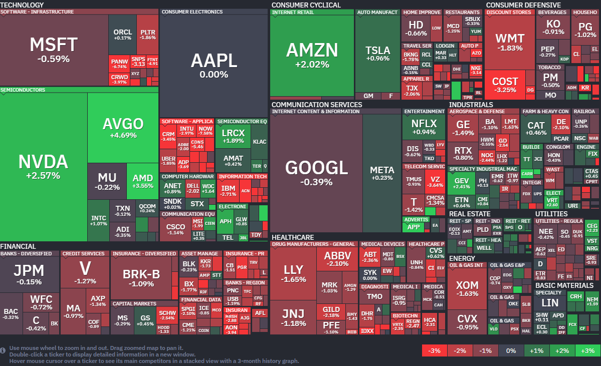

*출처: finviz.com*

#### 오늘의 증시

10일(현지시간), 미국 증권시장은 혼조세로 마감했다. 다우 지수와 S&P 500 지수는 소폭 하락했지만, 나스닥 지수는 엔비디아와 브로드컴 같은 반도체 대장주들의 활약에 힘입어 홀로 상승 불을 켰다. 지난 주에만 미국과 이란 사이의 '2주간의 일시적 휴전' 소식때문에, S&P 500은 주간 3.6%, 나스닥은 4.7%나 올랐으며 이는 지난해 11월 이후 주간 최대 상승 폭이다.
시장의 분위기에 대해 오리온(Orion)의 최고투자책임자(CIO) 팀 홀랜드는 "연준(Fed)은 3, 4월 데이터들을 일단 지켜보려 하겠지만 만약 6월 초까지도 국제 유가가 배럴당 100달러 선에서 머문다면 인플레이션 우려가 커지며 경제에 매우 힘든 상황이 올 수 있다"고 경고 섞인 코멘트를 남겼다.

**호르무즈 해협의 긴장**
도널드 트럼프 대통령은 소셜미디어 '트루스 소셜'을 통해 이란을 강하게 비난했다. 특히 이란이 호르무즈 해협을 지나는 유조선들에게 통행료를 징수하려는 움직임에 대해 "당장 멈추라"며 강력한 경고장을 날렸다. 이날 국제 유가는 등락을 반복하다가 서부텍사스산원유(WTI) 기준 1.33% 하락한 96.57달러에 마감했다. 휴전 중이긴 하지만 여전히 100달러에 육박하는 높은 수준이라 투자자들은 긴장의 끈을 놓지 못하고 있다.

**숫자에 가려진 인플레이션의 진실**
이번 주 발표된 3월 소비자물가지수(CPI) 성적표도 시장의 큰 관심사였다. 결과는 연 3.3% 상승으로 시장 예상치에 부합했다. 전쟁 여파로 에너지 가격이 한 달 만에 10.9%나 폭등했음에도 전체 수치가 선방한 이유는 근원 CPI(Core CPI) 덕분이다. 에너지와 식품 가격을 제외한 근원 물가는 전월 대비 0.2% 상승에 그치며 예상보다 낮게 나타났기 때문이다.

CPI는 우리가 먹고 쓰는 모든 것의 가격을 합친 지표다. 반면 근원 CPI는 변동성이 너무 심한 기름값과 식료품값을 빼고 계산한 수치다. 경제 전문가들은 물가의 '진짜 체력'을 확인하고 싶을 때 이 근원 수치를 더 중요하게 본다. 미시간 대학교의 소비자 설문조사에 따르면 일반 시민들이 예상하는 향후 1년간의 기대 인플레이션은 4.8%로 껑충 뛰었다. 지난달(3.8%)보다 무려 1% 포인트 오른 것이며 정부가 발표하는 숫자보다 시민들이 느끼는 물가 부담이 훨씬 크다는 뜻이어서 앞으로의 소비 심리가 위축될 가능성이 제기되고 있다.

#### 주요 뉴스

**미국과 이란 합의 실패**
미국과 이란은 전쟁 43일 만에 대면 평화 협상에 나섰지만 21시간의 마라톤 협상 끝에 합의에 실패했다. 미국은 이란에 핵 포기 확약을 요구했는데 이란이 이를 과도한 요구라고 맞서면서 입장차를 좁히지 못했다.

**마이클 버리의 팔란티어 베팅**
마이클 버리가 팔란티어의 하락에 거는 베팅을 멈추지 않고 있다. 최근 트럼프 대통령이 팔란티어의 군사적 역량을 극찬하며 주가가 잠시 반등하기도 했으나 버리는 여전히 이 회사가 "심각하게 고평가됐다"고 진단했다. 그는 팔란티어의 진짜 가치가 현재 주가의 절반도 안 되는 50달러 미만이라면서 앞으로의 하락 베팅(풋옵션)을 유지하겠다는 단호한 입장을 전했다.

**정체불명의 1위 AI는 알리바바**
알리바바가 최근 전 세계 영상 AI 순위를 휩쓴 정체불명의 모델 '해피홀수(HappyHorse)-1.0'의 개발사라고 공식 발표했다. 이 모델은 익명으로 공개되자마자 영상 생성 분야에서 나란히 1위를 차지하며 업계의 궁금증을 자아냈다. 경쟁사들이 주춤한 사이 알리바바가 기술력을 증명하며 글로벌 AI 시장의 새로운 강자로 떠오르게 되었다.

**디즈니, 1000명 직원 해고**
디즈니가 비용 절감을 위해 최대 1000명의 직원을 해고할 계획이다. 지난 3월 조쉬 다마로가 새로운 CEO로 취임한 이후 처음으로 단행하는 대규모 감원이다. 이번 조치는 최근 조직이 하나로 통합된 마케팅 부서에 집중될 예정이며, 전임 CEO 시절 7000명을 감원한 데 이어 디즈니의 '군살 빼기' 전략이 계속되는 모습이다.

**사우디 석유 공급에 비상**
이란이 사우디아라비아의 주요 송유관과 생산 시설을 공격하며 석유 생산량에 큰 차질이 생겼다. 이번 공격으로 하루 약 130만 배럴의 생산 및 운송 능력이 줄어들었고, 유일한 수출 통로였던 송유관마저 타격을 입은 것이다. 호르무즈 해협까지 사실상 폐쇄된 상황이라 전 세계적인 석유 공급난이 더욱 심각해질 것이라는 우려가 나오고 있다.

**코어위브, 10대 AI 기업 중 9곳이 우리 고객, 앤스로픽까지 품은 'GPU 파워'**
10일(현지시간) 코어위브의 주가는 전일대비 10.87% 오른 102.00달러에 장을 마감했다. 이 기업의 주가는 올해 들어 28.59% 상승했다.

AI 인프라 전문 기업인 코어위브가 챗GPT의 강력한 대항마인 클로드(Claude)를 만드는 앤스로픽(Anthropic)과 다년 계약을 체결했다는 소식이다. 이 소식이 전해지자 코어위브의 주가는 11%나 급등하며 시장의 뜨거운 관심을 받았다. 이번 계약을 통해 앤스로픽의 자사 AI 모델을 구동하는 데 필요한 막대한 연산 자원을 코어위브로부터 공급받게 된다.

코어위브는 이른바 '네오클라우드(Neocloud)'라고 불리는 신생 클라우드 서비스 기업이다. 우리가 흔히 아는 구글이나 마이크로소프트처럼 거대한 클라우드 서비스를 제공하지만, 특히 AI 모델 학습에 필수적인 엔비디아의 그래픽 처리 장치(GPU)를 수십만 대 규모로 보유한 데이터 센터를 운영하는 데에 특화되어 있다.

이번 앤스로픽과의 계약으로 세계 10대 AI 모델 개발사 중 무려 9곳이 코어위브의 플랫폼을 사용하게 됐다. 코어위브 측은 일론 머스크의 xAI를 제외한 거의 모든 주요 AI 기업이 자사 고객이라고 밝히기도 했다. 특히 앤스로픽의 경우 올해 연간 반복 매출(Run rate) 전망치가 작년 말 90억 달러에서 최근 300억 달러까지 치솟을 정도로 가파르게 성장하고 있어, 이들의 인프라를 책임지게 된 코어위브의 위상은 더욱 공고해질 전망이다.

하루 전에는 페이스북의 모기업인 메타(Meta)가 코어위브에 210억 달러를 추가로 지출하기로 약속했다는 소식이 전해졌다. 이미 지난 9월에 발표된 142억 달러 규모의 계약에 더해진 확정치다. 빅테크 기업들이 자체 데이터 센터를 짓고 있음에도 불구하고, 쏟아지는 AI 수요를 감당하기 위해 코어위브의 인프라를 앞다투어 빌려 쓰고 있는 상황이다.

그러나 코어위브에는 엄청난 규모의 빚도 자리 잡고 있다. 코어위브는 지난해 상장한 이후, AI 인프라 확장을 위해 막대한 부채를 끌어다 쓰고 있다. 2025년 말 기준 대차대조표상의 부채는 210억 달러에 달했고 올해 3월에 새로운 시설 투자를 위해 85억 달러를 추가했다. 이번 메타와의 계약을 뒷받침하기 위해서도 또다시 30억 달러의 신규 대출을 일으켰다.

코어위브 CEO 마이크 인터레이터는 "지금은 한 세대에 한 번 올까 말까 한 기회"라며 확장의 중요성을 강조했다. "우리는 사업을 대규모로 확장하는 데 에너지를 집중해야 하며, 규모를 키우는 데는 많은 비용이 듭니다"라고 덧붙였다. 지금 당장 천문학적인 돈을 빌려 엔비디아의 칩을 확보하고 데이터 센터를 지어 놓아야만 폭발하는 AI 시장의 주도권을 완전히 쥘 수 있다는 판단을 내린 셈이다.

**아마존, 자체 개발 AI 반도체 판매 소식**
아마존이 자체 개발한 AI 반도체를 외부 기업에 판매할 거라고 밝혔다. 반도체 사업의 연 매출이 현재 200억 달러를 넘어설 정도로 급성장 중이라고 밝혔다.

**테슬라, 저가 소형 전기 SUV 개발 계획**
테슬라가 저가의 소형 전기 SUV를 개발할 계획이다. 전기차 수요가 둔화되는 상황에서 판매량을 늘리려는 전략이지만 수익성을 압박할 거란 우려도 있다.

**OpenAI, 중간 단계 요금제 출시**
OpenAI가 코딩 에이전트 코덱스 활용도가 높은 이용자를 위한 100달러 수준의 중간 단계 요금제를 출시한다.

#### 국내 뉴스

**한국은행 기준금리 동결**
10일 한국은행 금융통화위원회가 기준금리를 연 2.50%로 동결했다. 전쟁 여파로 환율, 물가, 성장이 불안한 상황에서 향후 사태의 추이와 영향을 지켜보겠다고 판단했다. 올해 성량률은 2월 전망치인 2%를 하회하고, 물가도 2%대 중후반 수준으로 높아질 것이라 보았다.

**국내 ETF 시장 규모 400조 원 돌파**
중동 전쟁 발발 이후 주춤했던 국내 ETF 시장 규모가 400조 원 돌파를 앞두고 있다. 코스피를 추종하는 'KODEX 200'은 국내 ETF 사상 처음으로 순자산 20조 원을 돌파했다.

**기아, 미래 사업 경쟁력 강화**
기아가 5년간 49조 원을 투자해 '모빌리티 솔루션 기업'으로 전환에 나선다. 자율주행 기술을 개발하고, 휴머노이드 로봇 '아틀라스'를 공장에 도입하는 등 미래 사업 경쟁력을 강화한다.

**금감원, 한화솔루션에 유상증자 증권신고서 정정 제출 요구**
금융감독원이 한화솔루션 유상증자 증권신고서에 대해 정정 제출을 요구하며 제동을 걸었다. 한편 한화에어로는 풍산의 탄약 사업 인수 협의를 중단했는데, 한화솔루션 유상증자를 둘러싼 비판 여론으로 인한 부담이 작용했다는 평가다.

**LG의 AI 모델 공개**
LG가 AI 모델 엑사원 4.5를 공개했다. 빅테크들의 경량 AI모델을 앞서는 성능을 보였다.

**네이버 개발 AI 모델 서비스 종료**
네이버가 자체 개발한 AI 모델 기반의 챗봇 '클로바X' 서비스를 종료했다.

**국내 채용 시장 변화**
국내 기업들의 채용 기준이 'AI 사용 금지' 에서 'AI 활용 필수'로 바뀌고 있다. 채용 전형 자체를 AI 중심으로 재편한 사례도 있다.\

---

**[Reference]**
매일경제
머니네버슬립
UPPITY
