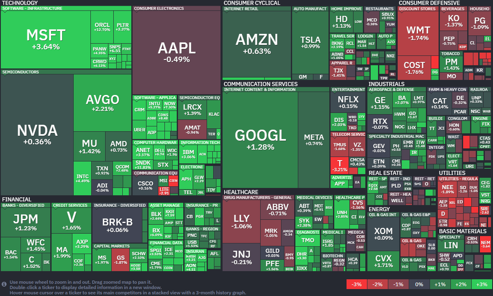

*출처: finviz.com*

#### 오늘의 증시

미국 증권시장이 13일(현지시간) 극적인 반등에 성공하며 거래를 마쳤다. 장 초반만 해도 분위기는 좋지 않았는데, 미국과 이란 사이의 평화 협상이 결렬되고 호르무즈 해협 봉쇄가 현실화되면서 다우 지수가 0.9% 가까이 빠지는 등 하락세로 출발했기 때문이다. 하지만 장 후반 도널드 트럼프 대통령이 "상대측(이란)으로부터 연락이 왔고, 그들이 간절히 합의를 원하고 있다"는 소식을 전하며 분위기가 반전됐다. 특히 기술주들 중 소프트웨어 업체인 오라클이 13% 가까이 폭등했고 팔란티어도 3% 이상 오르면서 시장의 상승 동력을 만들어냈다. 덕분에 S&P 500 지수는 이번 전쟁 여파로 입었던 손실을 모두 만회하며 전쟁 이전 수준을 회복했다. 벨웨더 웰스의 클라크 벨린 최고투자책임자(CIO)는 "투자자들이 중동 갈등의 끝이 보이지 않는다는 점을 고려해 주식의 적정 가치를 재평가하고 있다"며 "호르무즈 해협은 유가와 시장 심리의 핵심이며, 이번 주 내내 이 수로를 둘러싼 긴장감이 이어질 것"이라고 분석했다.

**'봉쇄'와 '대화' 사이의 줄타기**

오늘 시장의 큰 화두는 미국과 이란의 갈등, 그 핵심 요충지인 호르무즈 해협이다. 지난 주말 파키스탄 이슬라마바드에서 열린 미-이란 평화 협상이 성과 없이 끝났다. JD 밴스 부통령은 이란의 핵무기 포기 거부를 이유로 협상장을 떠났고, 트럼프 대통령은 곧바로 이란 항수를 드나드는 모든 해상 교통을 차단하는 '나발 블록케이드(Naval Blockade, 해상 봉쇄)'를 단행했다.

봉쇄라는 초강수에도 불구하고 증시가 반동한 이유는 '대화의 가능성' 때문이다. 트럼프 대통령이 이란 측의 연락을 언급하며 협상 재개 가능성을 시사했기 때문이다. 파키스탄, 이집트, 터키 등 주변국들이 중재자로 나서서 양국 사이의 다리를 놓고 있다는 소식도 들려오고 있다. 이란은 호르무즈 해협에 대한 통제권과 전쟁 배상금, 동결 자산 해제 등을 요구하고 있고, 미국은 이란의 핵 포기를 양보할 수 없다는 입장이라서 양측의 간극이 매우 크다. 하지만 블랙록은 이번 전쟁의 거시경제적 영향이 어느 정도 '통제 가능한 수준'이라고 평가하며 미국 주식에 대한 전망을 상향 조정했다. 기업들의 실적이 탄탄하다면 전쟁의 공포도 이겨낼 수 있다는 낙관론이 시장에 퍼지기 시작한 것이다.

#### 주요 뉴스

**아마존과 손잡은 OpenAI**

OpenAI가 아마존과의 파트너십을 발판 삼아 기업용 AI 시장 공략에 박차를 가하고 있다. 매출 총괄 드니즈 드레서는 사내 메모를 통해 그동안 마이크로소프트(MS)와의 관계가 오히려 다양한 기업 고객을 만나는 데 제약이 되기도 했다고 밝혔다. 실제로 아마존의 플랫폼 '베드록'에 합류한 이후 기업들의 수요가 폭발적으로 늘고 있다고 한다. 경쟁사 엔스로픽과의 치열한 선두 다툼 속에서 이번 동맹이 어떤 결과를 가져올지 주목된다.

**델타항공의 '델타 원' 스위트 좌석**

델타항공이 10년 만에 새로운 '델타 원' 스위트 좌석을 공개했다. 침대 길이를 3인치 늘리고 다리 공간을 더 확보해 장거리 비행의 편안함을 극대화했다. 최근 프리미엄 티켓 매출이 전년 대비 14%나 급증하면서, 부유한 여행객을 사로잡기 위한 항공사들의 프리미엄 객실 업그레이드 경쟁이 갈수록 치열해지고 있다.

**가입자 수보다 수익이 먼저**

월스트리트 투자자들이 스트리밍 업체의 가입자 수보다 '얼마나 버는지'에 더 집중하고 있다. 이에 업체들은 요금을 올리고 광고 요금제를 도입하는 등 수익성 개선에 사활을 걸고 있다. 압도적인 규모로 영업이익률 30%에 육박하는 넷플릭스가 업계의 표준이 된 가운데, 디즈니 등 전통 미디어 기업들이 이를 얼마나 따라잡을 수 있을지가 관건이다.

**AI에 밀리던 소프트웨어주의 반격, 오라클 주도로 일제히 반등 성공**

13일 (현지시간) 오라클의 주가는 전일대비 12.69% 오른 155.62달러에 장을 마감했다. 이 기업의 주가는 올해 들어 20.48% 하락했다.

최근 인공지능(AI) 기술의 급격한 발전으로 인해 "기존 소프트웨어 기업들이 설 자리를 잃는 것 아니냐"는 우려가 많았다. 13일 (현지시간), 오라클의 주가가 12% 가까이 급등하며 소프트웨어 업종의 화려한 부활을 이끌었다. 오라클뿐만 아니라 어도비(6% ▲), 세일즈포스(5% ▲), 서비스나우와 워크데이(각각 7% ▲) 등 주요 소프트웨어 종목들이 일제히 강세를 보였다. 보안 관련주인 테너블, 센티넬원, 크라우드스트라이크 등도 6~7%대 상승률을 기록하며 힘을 보탰다. 이번 랠리의 주요 배경 중 하나로는 미국과 이란 간의 평화 협상 가능성이 제기되며 투자 심리가 회복된 점이 꼽힌다. 지정학적 리스크가 줄어들 것이라는 기대감이 시장 전반에 온기를 불어넣은 셈이다.

OpenAI나 앤스로픽 같은 기업들이 내놓은 강력한 AI 도구들이 기존 소프트웨어 비즈니스 모델을 대체할 것이라는 공포 때문에 소프트웨어 기업들은 힘든 시간을 보냈다. 올해 들어 허브스팟은 시가총액의 절반을 잃었고, 아틀라시안은 60% 넘게 폭락하기도 했다. 오라클과 서비스나우 역시 각각 20%, 40% 이상 하락하며 고전을 면치 못했다.

투자자들이 무서워한 것의 핵심은 '효율성'에 있다. AI 모델을 활용하면 누구나 단 몇 분 만에 웹사이트나 소프트웨어를 직접 구축할 수 있게 되는데, 이렇게 되면 기존 소프트웨어 기업들의 미래 성장성과 수익성이 나빠질 수밖에 없다는 논리이다. 즉, "비싼 돈 주고 기업용 소프트웨어를 구독할 필요가 있나? AI로 직접 만들면 된다"라는 의구심이 시장을 지배한 것이다.

여기에 AI를 악용한 해킹 위협까지 커지며 사이버 보안 기업들도 큰 압박을 받아왔다. 상황이 이렇다 보니 기업들은 자구책 마련에 분주하다. 아틀라시안을 포함한 일부 기업들은 AI 프로젝트에 자금을 투입하기 위해 인력을 감축하는 강수를 두기도 했다. 소프트웨어 기업들의 주가 폭락은 금융 시장 전체로도 불안이 번지는 양상이다. 소프트웨어 기업들에 돈을 빌려준 사모펀드 대출 시장(Private Credit Market)에서는 "기업들이 망해서 빌려준 돈을 못 갚으면 어쩌나" 하는 채무 불이행 리스크까지 거론될 정도였다. 그러나 이번 오라클의 급등을 기점으로, 소프트웨어 기업들의 AI라는 위기를 기회로 바꿔 AI 기업으로 거듭날 수 있을지 다시금 관심이 쏠리고 있다.

**TSMC 사상 최대 실적 경신**

TSMC가 전년 대비 35% 증가한 매출을 기록해, 사상 최대 실적을 또 한 번 경신했다.

**앤스로픽 소식**

앤스로픽이 AI 클라우드 기업 코어위브와 수조 원 규모의 다년 간 계약을 체결했다. 코어위브 주가는 10일(현지 시각) 10% 이상 급등했다. 또한 차세대 AI 모델 '미토스'가 보안 환경에 미칠 영향을 우려해 미국 정부가 금융, 기술 업계와 대응 논의에 들어갔다. 앤스로픽은 이 모델의 일반 출시를 미루고 사이버 보안 강화를 위해 일부 기업에 우선 제공한 상황이다.

#### 부동산 소식

**6억 원 한도가 가른 생애 첫 집 매수자들의 행선지**

올 2,3 월 서울 생애 첫 집 매수자는 1만2248명이었다. 주 행선지는 강서, 노원구(928명, 816명) 이었다. 주택담보대출 6억 원 한도 안에서 움직이다 보니, 그 한도가 닿는 자리에 발길이 쏠린 것이다. 30대의 비중은 56.1%로 절반을 넘겼다.

**청약통장 두달 새 10만 명 이탈**

청약통장 가입자가 두달 새 10만 명 가까이 줄었다. 7%대 주택담보대출 금리와 3%대 통장 이자, 낮은 대출한도가 무용론을 키운 것이다. 다만 납입 인정액이 월 25만 원으로 오른 뒤 가입자는 빠져도 1인당 납입액은 되레 늘었다.

**5대 시중은행 가계대출 증가율 목표: 2%에서 1% 안팎으로**

올해 5대 시중은행 가계대출 증가율 목표가 평균 1% 안팎으로 잡힐 전망이다. 은행권이 예고한 2%의 절반 수준이다. 5대 은행이 1년간 늘릴 수 있는 가계대출은 약 6조4000억 원, 월 5400억 원 남짓이다. 주택거래가 늘면, 더 조일 수 있다.

**가계 여윳돈 역대 최대**

가계 여윳돈을 보여주는 순자금 운용액이 지난해 269.7조 원으로 역대 최고치를 기록했다. 소득은 늘고 새 아파트 입주가 줄어 대출받을 일이 적어진 결과인데, 그사이 GDP 대비 가계빚 비율도 88.6%로 6년 만에 가장 낮았다.

**분양과 임대를 섞되 동선은 분리하는 LH**

LH가 '선택적 만남' 설계라는 분양과 임대를 섞되 동선은 분리하는 설계를 도입한다. 시설은 공유하되 경로는 나눠 공간 운영계획을 새로 짜는 게 골자다. 서울 가양, 번동, 수서 단지부터 적용하는데, 분양과 임대를 한 단지에 함께 짓는 건 LH 사업에서 처음이다.

**서울 아파트 물량 감소**

서울 아파트 전월세 물량이 3개월 새 30% 이상 감소했다. 물량 감소로 전월세 가격이 상승하자 무주택 실수요자들이 매매로 방향을 돌리면서 외곽 지역 아파트 값이 오르고 있다는 분석이 나온다.

#### 국내 소식

**정부가 AI 경쟁력 강화를 위해 공공 데이터 전수조사**에 나선다. 기관별로 분산된 데이터를 체계적으로 파악해 활용도를 높이려는 취지다.

**국세청이 기업 명의로 보유한 고가 주택 2,630채에 대한 전수 점검**에 나선다. 사주 일가의 사적 사용, 세금 회피 여부를 점검할 예정이다.

**정부가 중동 전쟁 종전까지 비상 체제를 유지**하며 대응하겠다고 밝혔다. 나프타 물량을 전쟁 전 수준까지 확보하기 위해 필요시 예비비를 투입하는 방안을 고려한다.

**상법 개정안 등 밸류업 정책과 반도체 슈퍼사이클**이 코스피 상승을 이끌었지만, 지속적인 상승을 위해서는 반도체 의존도를 낮추고 연금 등 장기 투자자금 유입을 늘리는 시장 구조 개선이 필요하다는 분석이 나왔다.

**국내 액티브 ETF 시장이 빠르게 성장**하며 100조 원 돌파를 앞두고 있다. 시장 변동성이 커지며 더 적극적으로 수익 기회를 포착하는 투자자들이 늘고 있다.

**국내 신규 등록 전기차**가 전년 대비 2.5배 늘었다. 보조금이 소진되기 전 혜택을 받기 위해 연초부터 구매 수요가 몰린데다, 국내외 전기차 브랜드가 중저가 시장을 적극 공략했기 때문이다.

**조선업 슈퍼사이클 속에서 선박 엔진 업체들**의 수주 물량이 크게 늘어 생산시설을 풀가동하고 있다.

전쟁 여파로 항공유 공급 부족 우려가 커지며 **항공 업계**가 비상에 걸렸다. 유럽에서는 비축분이 8~10일 치에 불과해 배급제 가능성까지 거론된다. 티웨이 항송은 승무원을 대상으로 무급 휴직을 실시한다.

**한국은행**이 중동 전쟁 등 불확실성에도 불구, AI 수요를 바탕으로 메모리 반도체 호황이 적어도 내년 상반기까지 이어질 것으로 전망했다.

**삼성전자**가 1분기 글로블 스마트폰 1위 자리를 애플에 처음 내줬다. 신제품 출시 지연과 보급형 수요 둔화로 출하량과 점유율이 모두 감소했다.

**LIG넥스원**이 변경된 상호 'LIG디펜스앤에어로스페이스'로 거래된다.

---

**[Reference]**
매일경제
머니네버슬립
UPPITY

부딩
