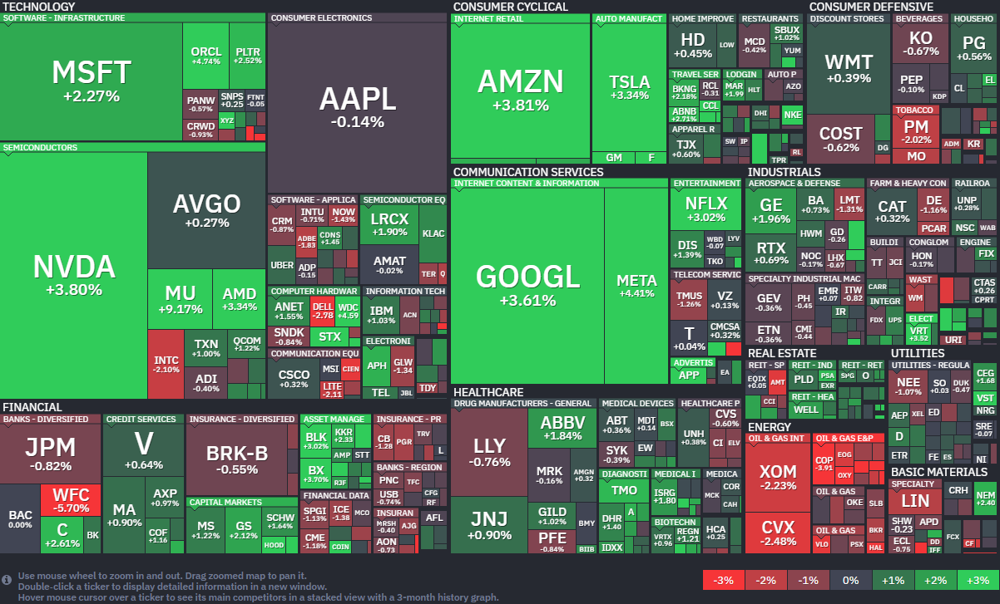

*출처: finviz.com*

#### 오늘의 증시

미국 증권시장이 14일 (현지시간) 일제히 상승했다. 특히 S&P 500 지수는 1% 넘게 오르며 사상 최고치에 다가섰고, 기술주 중심의 나스닥은 2% 가까운 급등세를 보였다. 지난 주말 미국과 이란 사이의 평화 협상이 결렬되었다는 소식에 시장이 위축될까 우려가 컸지만 투자자들은 오히려 '결국 합의가 이뤄질 것'이라는 낙관론에 베팅했다. 여기에 도널드 트럼프 대통령이 "상대방(이란)으로부터 전화를 받았다. 그들은 간절히 협상을 원한다"고 언급하며 얼어붙었던 투자 심리가 녹아 내렸다.

기술주 중 오라클을 필두로 엔비디아, 팔란티어 등 주요 기술주들이 지수를 끌어올렸다. 베어드(Baird)의 투자 전략가 로스 메이필드는 "이란과의 갈등에 대한 불안감은 이미 시장 가격에 상당 부분 반영되어 있다"며 "현재 시장은 훨씬 깨끗해진 포지션에서 실적 시즌이 가져올 상승 동력을 기대하고 있는 상황"이라고 평가했다.

**전쟁 공포를 이겨낸 '협상 기대감'**

오늘 증시에서 가장 결정적인 역할을 한 것은 역설적이게도 '이란'이었다. 트럼프 대통령의 발언 직후, 백악관 관계자는 미국과 이란 간의 2차 협상이 논의 중이라고 전했다. '대화의 창이 열려 있다'는 사실만으로 시장은 안도했다. 덕분에 급등했던 국제 유가도 큰 폭으로 꺾였다. 서부텍사스산원유(WTI) 선물은 7.87% 급락하며 배럴당 91.28달러로 내려앉았고, 브렌트유도 4% 넘게 떨어졌다. 기름값이 떨어지면 기업들의 생산비용이나 물류비 부담이 줄어들기 때문에 증시에는 호재로 작용한다.

**인플레이션의 예고편, PPI**

오늘 시장에 훈풍을 불어넣은 요인은 3월 생산자물가지수(PPI)다. 발표된 지표가 예상보다 훨씬 낮게 나오면서 물가 상승 압력이 줄어들고 있다는 신호를 보냈다. 생산자물가가 낮게 나오면 연방준비제도(Fed, 연준)가 금리 인하를 결정하는 데 있어 큰 명분이 된다. 물가가 잡히고 있다는 확신이 생기기 때문이다.

다만, 기업들의 실적 발표는 조금 엇갈린 모습을 보였다. JP모건 체이스는 예상치를 웃도는 실적을 냈음에도 불구하고 핵심 수익 지표인 순이자이익(NII) 전망치를 낮춰 잡으면서 주가가 소폭 하락했다. 웰스파고는 실장스러운 실적 수치를 내놓으며 5% 넘게 급락했다.

#### 주요 뉴스

**세계 최대 항공사 탄생의 기대, 유나이티드 항공**

유나이티드 항공이 경쟁사인 아메리칸 항공과의 합병을 트럼프 정부에 제안했다는 소식이다. 성사된다면 미국 시장 점유율 40%에 달하는 세계 최대 항공사가 탄생하게 되지만 독점 우려와 항공 요금 인상 가능성 때문에 규제 당국의 반대가 만만치 않을 것으로 보인다. 업계 전문가들 사이에서는 실제 법원의 승인을 받기가 매우 어려울 것이라는 시각도 나오고 있다.

**미토스, 해킹 통로의 가능성**

JP모건의 제이미 다이먼 CEO가 앤스로픽의 최신 AI 모델 '미토스(Mythos)'가 기업의 사이버 취약점을 더 많이 노출하고 있다고 경고했다. 미토스가 이미 수천 개의 소프트웨어 결함을 찾아내면서 오히려 공격자들에게 새로운 해킹 수단을 제공하는 셈이 됐다는 것이다. 다이먼은 AI가 보안 강화에 도움을 줄 수도 있지만 당장은 위험을 키우고 있다며 철저한 네트워크 관리와 기본 수칙 준수를 강조했다.

**상장 준비 중인 크라켄**

가상자산 거래소 크라켄이 미국 증시 상장을 위해 비밀리에 IPO 신청서를 제출했다. 아르준 세티 공동 CEO가 컨퍼런스에서 직접 이 사실을 확인하며 본격적인 행보에 나섰다. 최근 비트코인 가격이 7만6000달러 선을 회복하는 등 시장 분위기가 좋아지자, 한동안 멈췄던 상장 계획을 다시 밀어붙이는 것으로 보인다.

**엔비디아, 10거래일 연속 상승 랠리, 에이전틱 AI 열풍에 CPU 시장 정조준**

14일(현지시간) 엔비디아의 주가는 전일 대비 3.8% 오른 196.51달러에 장을 마감했다. 이 회사의 주가는 올해 들어 5.37% 상승했다.

엔비디아가 10거래일 연속 주가 상승이라는 기록적인 행진을 이어가며 이 기간 동안 약 18%의 수익률을 기록했다. 이는 2023년 이후 가장 긴 상승 랠리다. 14일(현지시간) 장에서 주가는 3.8% 추가 상승하며 기세를 올렸다. 비록 2024년 주식 분할을 반영한 작년 10월의 사상 최고치(212.19달러)보다는 약 8% 낮은 수준이지만, 시장의 폭발적인 수요가 주가를 견인하고 있다.

상승세 뒤에는 압도적인 실적 수치가 자리 잡고 있다. 젠슨 황 CEO는 최근 열린 GTC 컨퍼런스에서 현재의 블랙웰과 차세대 베라 루빈 GPU를 포함해 2027년까지 예약된 주문 규모가 1조 달러를 넘어섰다고 밝혔다. 실제로 엔비디아의 데이터 센터 매출은 전년 대비 75% 급증했으며, 이제 전체 비즈니스의 88%를 차지할 만큼 압도적인 비중을 보여주고 있다. 5년 전만 해도 게임 사업이 주력이었던 점을 감안하면 완벽한 체질 개선에 성공한 셈이다.

시장 일각에서 제가됐던 델(Dell)이나 HP 등 대형 PC 제조사 인수설을 공식 부인한 점도 불확실성을 해소하는 데 일조했다. 엔비디아는 "어떤 PC 제조업체와도 인수 논의를 진행하고 있지 않다"고 선을 그었다. 루머로 인해 등락을 반복하던 관련주들과는 달리, 엔비디아는 퀀텀 컴퓨팅 가속화를 위한 오픈소스 모델 아이싱(Ising)을 발표하는 등 본업인 AI 인프라와 기술 리더십 강화에만 집중하는 모습이다.

**에이전틱 AI가 불러온 CPU 수요, 메타와 손잡고 인프라 장악**

엔비이아의 성장은 GPU뿐만 아니라 자체 중앙처리장치(CPU)인 베라를 앞세워 CPU 시장에서도 새로운 수요를 창출하고 있다. 최근 에이전틱 AI가 확산되며 컴퓨팅 요구 사항이 변했기 때문이다. 특히 작년 12월 200억달러에 인수한 칩 스타트업 그록의 기술을 활용한 언어 처리 장치(LPU) 등 새로운 유형의 칩을 선보이며 컴퓨트(연산 능력)가 곧 수익화라는 테마를 입증하고 있다.

가장 눈에 띄는 파트너는 메타다. 마크 저커버그의 메타는 엔비디아 독립형 CPU의 첫번째 주요 고객이 됐다. 전 세계 데이터 센터에 수백만개의 엔비디아 칩을 배치하기로 한 데 이어, 최근에는 클라우드 기업 코어위브와 210억달러 규모의 추가 계약을 맺고 엔비디아의 베라 루빈 랙 스케일 시스템을 대거 확충하기로 했다. 메타뿐만 아니라 아마존(AWS)과 알파벳(구글)의 수장들고 일세히 더 많은 AI 연산 능력을 갈구하고 있다는 점이 엔비디아의 상승세에 정당성을 부여하고 있다.

칩 분석가들은 현재 시장을 "전략과 인프라의 희소성 시대"라고 진단하며, "인프라를 배포해야만 AI 수익화가 가능한 현 상황에서 엔빋아가 내놓는 모든 솔루션이 시장에 매우 매력적으로 다가가고 있다"고 평가한다. 공급이 수요를 따라가지 못할 정도로 폭발적인 이 사이클이 단발성이 아닌 장기적인 흐름이라는 신호가 나타나며 엔비디아의 독주는 당분간 계속될 전망이다.

**업비트와 빗썸 업무협약 체결**

가상자산 거래소 업비트와 빗썸이 달러 스테이블코인 발행사 서클과 잇달아 업무협약을 체결했다.

**샌디스크 소식**

**샌디스크**가 오는 20일부터 나스닥100지수에 편입된다는 소식에 13일(현지 시각) 주가가 12% 이상 급등했다.

**오라클 소식**

**오라클**이 AI 기반 플랫폼 '유틸리티 오파워'를 공개하며 그간 지지부진했던 주가가 크게 올랐다. 한편, 오라클은 데이터센터 전력 확보를 위해 블룸에너지로부터 대규모 연료 전지 전력을 구매 계약 체결했다고 밝혔다.

#### 실적 발표 및 일정

미국 증시에서 **ASML**, **뱅크오브아메리카**, **모건스탠리** 등 주요 기업의 실적 발표가 있다.

미국 **연준**의 **경제 동향 보고서**인 **베이지북**이 공개된다.

**국회 재정경제기획위원회**가 **신현송** 한국은행 총재 후보자의 **인사청문회**를 개최한다.

#### 국내 주요 뉴스

**코스피 상황**

어제 코스피는 전일 미국 증시 반등에 힘입어 장중 6,000선을 탈환했다. 외국인과 기관의 순매수가 이어지며, 2,74% 상승한 5,967.75에 마감했다.

**변동성완화장치(VI) 발동 증가**

중동 전쟁 이후 국내 증시 변동성이 커지며 ETF 시장에서 변동성완화장치(VI) 발동이 늘었다. 이런 환경에서는 ETF 가격이 기초자산을 제대로 반영하지 못해 괴리율이 확대된다.

**반도체, 방어주의 역할**

지정학 리스크 속에서 방어주로 필수 소비재가 주목받는 가운데, 안정적 실력과 수출 경쟁력을 갖춘 반도체 같은 주도주가 방어주 역할을 할 수 있다는 의견도 있다.

**롯데카드 채권, 손실로 이어질 가능성**

롯데카드가 회수 여부가 불투명해진 홈플러스 관련 채권을 '추정손실'로 처리했다. MBK 계열사인 롯데카드가 떠안았던 채권이 실제 손실로 이어질 가능성이 커졌다.

**정부의 코스닥 활성화 정책 추진**

정부는 '코스닥 3000'을 목표로, 코스닥 활성화 정책을 추진하고 있다. 연기금 등 공적자금의 코스닥 투자를 독려한다거나, 상장폐지 요건을 강화하고 부실기업을 정리해 시장 규모와 질을 개선하는 방안이 대표적이다. 부양 정책에 대한 기대감으로 코스닥 액티브 ETF에도 자금이 몰렸으나 여러 악재가 겹쳐 현재는 투자 심리가 얼어붙은 상태다. 정부는 제약, 바이오 업종의 공시 체계를 이해하기 쉽도록 개선할 것이라고 밝혔다. 무너진 신뢰를 회복하고 얼마나 빠르게 시장의 투명성을 높여가는지가 관건이다.

### 오늘의 주식 용어

**VI (Volatility Interruption, 변동성 완화장치)**

VI (Volatility Interruption, 변동성 완화장치)란 개별 종목의 주가가 급등하거나 급락할 때, 일시적으로 거래를 멈춰 투자자들에게 냉정할 시간을 주고 주가를 안정시키는 제도다. 발동 시 2분간 단일가 매매로 전환되며, 정적 VI(전일 종가 대비 일정 비율)와 동적 VI(직전 체결가 대비 일정 비율)로 구분된다.

※ 주의: 흔히 혼동하는 VIX는 'Volatility Index'의 약자로, S&P 500 지수의 향후 30일간 변동성 기대를 나타내는 '공포지수'를 의미한다.

---

**[Reference]**
매일경제
머니네버슬립
UPPITY
