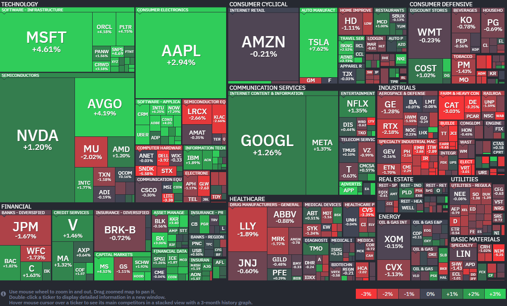

*출처: finviz.com*

#### 오늘의 증시

미국 증권시장이 15일(현지시간) 이란과의 전쟁 종식에 대한 기대감에 힘입어 S&P 500 지수와 나스닥 지수는 사상 최고치를 경신했다. 특히 기술주 중심의 나스닥은 11거래일 연속 상승이라는 기분 좋은 성적표를 받아 들었다. 다우 지수는 소폭 하락하며 혼조세를 보였다. 미국과 이란의 전쟁이 예상보다 빨리 끝날 수 있다는 소식이 전해지자 그동안 지정학적 리스크 때문에 몸을 사렸던 투자자들이 다시 매수 버튼을 누르기 시작했다. 글로벌트 인베스트먼트 수석 포트폴리오 매니저 토마스 마틴은 "투자자들이 혹시 모를 상황에 대비해 위험 자산을 줄여왔다가(De-risking), 상황이 악화되지 않을 것 같자 상승장에서 소외되지 않기 위해 다시 주식을 사들이고 있다"고 분석했다.

도널드 트럼프 대통령은 폭스 비즈니스와의 인터뷰에서 "이란 전쟁이 끝나기 직전(Very close to over)" 이라며, 이란이 매우 간절하게 협상을 원하고 있다고 밝혔다. 이란과 맞닿아 있는 호르무즈 해협은 전 세계 원유 수송량의 약 20%가 통과하는 핵심 통로다. 전쟁이 길어지면 이 통로가 막히고 기름값이 폭등하면서 전 세계 물가(인플레이션)를 자극할 수 있는데, 평화 협상 소식은 이러한 공포를 한 번에 잠재우는 효과가 있다.

백악관 내부에서는 테헤란(이란 수도)과의 2차 협상을 논의 중이라는 구체적인 소식까지 들려오고 있어, "이제 곧 호르무즈 해협이 다시 열리고 물류가 정상화될 것"이라는 낙관론에 베팅하고 있다.

#### 주요 뉴스

**클로드, 서비스 장애 발생**

AI 스타트업 앤스로픽의 챗봇 '클로드'와 API 서비스 등이 현지시간 수요일 오전 한때 서비스 장애를 겪었다. 다행히 약 3시간 만에 모든 시스템이 정상화 되었다. 최근 사용자가 급증하며 기업용 시장에서 치열하게 경쟁 중인 만큼 일시적인 먹통 소동에도 관심이 쏠렸다.

**파월 의장에게 해고 경고**

트럼프 대통령이 제롬 파월 연준 의장에게 임기가 끝난 후 스스로 물러나지 않으면 강제로 해고하겠다고 강력히 경고했다. 연준 본부 개보수 조사와 후임자 인선 문제까지 얽히며 양측의 팽팽한 기 싸움이 이어지고 있다.

**반도체 거물들이 찜한 웨이브**

영국의 자율주행 스타트업 웨이브(Wayve)가 퀄컴, AMD, Arm으로부터 투자를 유치했다. 지난번 엔비디아에 이어 주요 반도체 기업들을 모두 우군으로 확보하여 독보적인 파트너십을 구축한 셈이다. 웨이브는 어떤 칩을 쓰든 자동차든 자사 AI를 쉽게 탑재할 수 있게 되어, 글로벌 자율주행 시장 공략에 더욱 속도를 낼 전망이다.

**노르웨이 데이터 센터, MS가 맡기로 하다**

OpenAI가 노르웨이 '스타게이트' 데이터 센터를 직접 임대하려면 계획을 취소하고, 파트너사인 마이크로 소프트가 그 자리를 대신하기로 했다. 직접 계약 대신 MS를 통해 컴퓨팅 자원을 빌려 쓰는 것이 비용 면에느 더 합리적이라고 판단한 것이다. 올해 상상을 앞두고 효율적인 비용 관리에 집중하는 모습이다.

**엔비디아 탈출을 꿈꾸는 메타, 브로드컴과 AI 맞춤 칩 동맹**

15일(현지시간) 메타와 브로드컴 주가는 전일대비 1.37%, 4.19% 오른 671.58달러, 396.72달러에 장을 마감했다.

반도체 기업 브로드컴은 메타와 협력하여 메타 전용 맞춤형 AI 가속기를 설계하기로 했다고 발표했다. 이 소식에 힘입어 브로드컴의 주가는 당일 4% 가까이 급등했다. 이번 계약은 초기 1기가와트(GW) 규모의 전력용량을 처리할 수 있는 수준으로 시작해, 2029년까지 여러 기가와트 규모로 확장될 예정이다. 이런 전력의 규모로 보아 메타가 브로드컴과 손잡고 구축하려는 AI 인프라의 규모가 어마어마하다는 것을 의미한다.

이번 파트너십이 강화되며 브로드컴의 CEO인 호크 탄(Hock Tan)이 메타의 이사회에서 물러나기로 했다. 그는 2024년부터 메타 이사진으로 활동해 왔는데, 두 회사 사이의 비즈니스 규모가 너무 커지다 보니 혹시 모를 이해상충 문제를 방지하고 기업 경영의 투명성을 높이기 위해 내린 결정으로 풀이된다.

월가 전문가들은 이번 발표를 브로드컴이 AI 및 네트워킹 분야에서 선두 자리를 굳히는 강력한 증거라고 평가하고 있다.

브로드컴은 이미 지난주에도 구글, 앤스로픽과 유사한 계약을 맺으며 보폭을 넓히고 있다. 골드만삭스의 애널리스트 제임스 슈나이더는 브로드컴의 XPU 플랫폼이 업계를 선도하고 있다고 치켜세웠다. 여기서 XPU란 브로드컴이 제공하는 맞춤형 AI 가속기 설계 플랫폼을 말한다. 엔비디아가 만드는 범용 GPU와 달리, 구글이나 메타 같은 하이퍼스케일러(Hyperscaler, 대규모 데이터 센터 운영 기업)들이 자신들의 특정 서비스에 딱 맞게 최적화해서 직접 설계하는 칩을 의미한다. 기성복이 아닌 맞춤 정복을 입는 것과 비슷하다.

일각에서는 이번 소식이 아주 새로운 내용이 아니라는 의견도 있다. 울프 리서치의 크리스 카소 애널리스트는 "브로드컴이 지난 실적 발표 때 이미 메타에 대규모 칩을 공급할 것이라고 언급했다"며 다만. 2029년이라는 구체적인 시점이 공개된 점이 긍정적이라고 덧붙였다. 결과적으로 이번 계약은 메타가 엔비디아에 대한 높은 의존도에서 벗어나, 자체 인프라를 통해 비용을 절감하고 효율성을 높이려는 장기 전략의 핵심 조각이 될 것으로 보인다.

**아마존의 글로벌 스타 인수**

아마존이 '스페이스X'가 주도하는 위성 인터넷 시장을 공략하기 위해 위성통신업체 '글로벌스타'를 인수했다.

**3월 미국 생산자물가지수(PPI)**

3월 미국 생산자물가지수(PPI) 상승률은 전월 대비 0.5%로 시장 예상치인 1.1%를 크게 밑돌았다. 전쟁 이후 물가 압력이 생각했던 것보다는 강하지 않다는 것을 보여줬지만, 에너지 가격이 8.5% 급등한 점은 우려스러운 지점이다.

**국제통화기금(IMF) 올해 세계 경제성장률 전망치 발표**

국제통화기금(IMF)이 올해 세계 경제성장률 전망치를 0.2%p 낮췄다. AI 투자 확대로 반도체 경기가 계속 확장하는 것을 고려해 우리나라 성장률 전망치는 1.9% 유지했다.

#### 국내 주요 뉴스

**신현송 한국 은행 총재 후보자**가 고유가로 인한 물가 상승이 지속된다면 통화 정책의 역할이 있을거라고 밝혔다. 한국은행의 역할에 대한 질의에서도 물가 안정 책무를 강조했다.

**국민 연금**이 해외 투자 자산의 환헤지 비율을 10%에서 15%로 높였다. 환헤지 비율을 올리면 달러 공급이 늘어나 환율이 안정되는 효과가 있다. 또한 국민연금의 국내 상장사 주식 보유 평가액이 최근 1년여간 3배 가까이 늘어났다. 삼성전자와 SK하이닉스가 평가액 증가를 이끌었다.

**외국인 투자자들이 이달 들어 다시 코스피**로 돌아오고 있다. 이란 전쟁의 긴장감이 정점을 통과했다는 인식이 확산되고 기업 실적에 대한 기대감이 투자 심리를 자극한 영향이다.

지난달 출시된 **'국내시장 복귀 계좌' RIA 이용자**들이 미국 빅테크를 팔고, 국내 대형 우량주와 지수추종 ETF를 매수한 것으로 확인됐다.

**티웨이 항공**이 오늘부터 '트리니티항공'으로 사명을 변경한다.

**두산에너빌리티**가 원자력, 가스 등 본업 중심으로 영업이익 1조 원을 돌파할 전망이다. 데이터센터가 확대되고, 발전 수요가 증가하며 성장세가 빨라지고 있다.

**한솔그룹**이 삼성전가 시스템LSI 협력사인 윌테크놀러지를 인수한다. 반도체 장비, 소재, 테스트를 아우르는 밸류체인을 구축했다는 평가다.

---

**[Reference]**
매일경제
머니네버슬립
UPPITY
