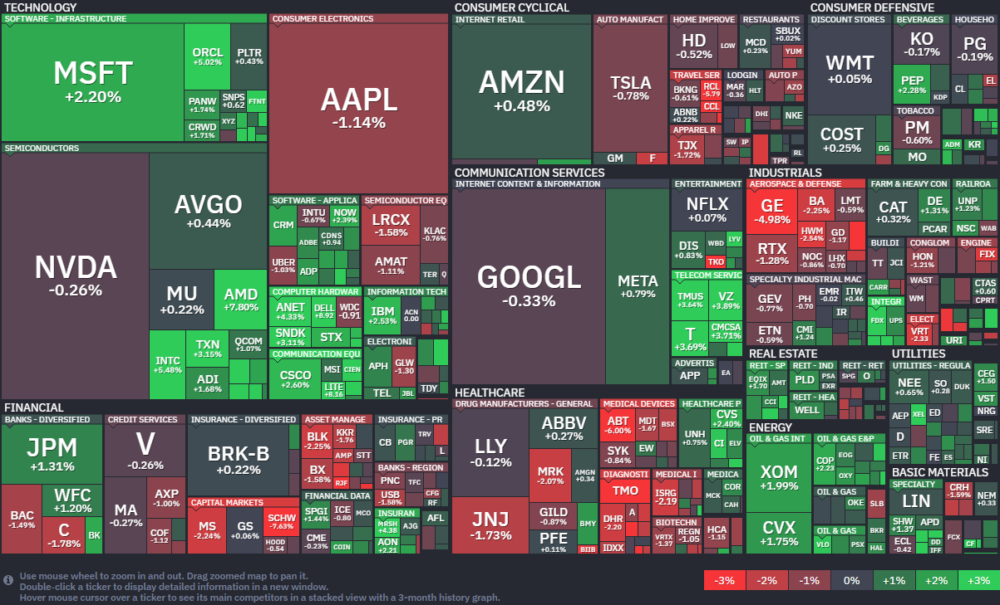

*출처: finviz.com*

#### 오늘의 증시

미국 증권시장이 16일(현지시간) 또 한 번의 역사를 썼다. S&P 500 지수가 종가 기준으로 사상 처음 7,000선을 돌파했고, 나스닥 지수 역시 24,000선을 넘기며 나란히 사상 최고치를 경신했다. 특히 나스닥은 12거래일 연속 상승이라는 대기록을 세웠는데, 이는 금융위기 직후였던 2009년 이후 가장 긴 상승랠리다. 오늘 증시를 끌어올린 결정적인 한 방은 '중동발 평화 소식'이다. 도널드 트럼프 대통령이 이스라엘과 레바논이 10일간의 휴전에 합의했다는 소식을 전하며, 오랜 시간 시장을 짓눌렀던 전쟁 리스크가 해소될 것이라는 기대감이 번졌기 때문이다. 그러나 세이지 어드바이저리의 로브 윌리엄스 수석 투자 전략가는 "전쟁이 해결되는 건 큰 호재지만, 미국 경제 성장률이 2% 미만으로 떨어지는 저성장 국면을 몇 분기 정도 견뎌야 할 수도 있다"며 시장이 아직 이 부분에 대해서는 충분히 대비하지 못했을 수 있다고 경고했다.

**'중동 평화'의 의미**
오늘 시장이 가장 뜨겁게 반응한 뉴스는 단연 이스라엘과 레바논의 10일 휴전 합의다. 미국과 이란은 현재 전쟁 중인 상황인데, 이란 측은 그동안 "이스라엘이 레바논 공격을 멈추는 것이 미국과 이란이 대화를 시작하기 위한 핵심 조건"이라고 못 박아왔다. 그런데 오늘 트럼프 대통령이 레바논과 이스라엘 총리와 직접 통화하며 휴전을 끌어냈다고 발표한 것이다. 즉, 미국과 이란이 직접 만나 평화 협상을 할 수 있는 판이 깔린 셈이다.

트럼프 대통령은 이번 주 초부터 "이란 전쟁이 거의 끝나간다"며 이란 측이 협상을 간절히 원하고 있다고 언급해왔다. 실제로 다음 주말쯤 대면 협상이 이뤄질 가능성까지 시사했다. 투자자들은 "전쟁이 끝나면 유가가 안정되고 글로벌 공급망 불안이 사라질 것"이라는 시나리오에 베팅하며 주식을 사들였다. 시장은 이미 발 빠르게 움직이고 있다. S&P 500 지수는 이번 주 초에 이미 이란 전쟁 시작 이후 발생했던 낙폭을 모두 만회했다. 전쟁이라는 불확실성이 사라지자, 기업들의 실적과 경제 펀더멘털(기초 체력)에 다시 집중할 수 있는 환경이 조성된 것이다.

#### 주요 뉴스

**앤스로픽의 더 똑똑하고 안전한 AI**
앤스로픽이 코딩과 실무 능력을 대폭 강화한 신규 모델 '클로드 오퍼스 4,7'을 출시했다. 이전 버전보다 성능은 좋아졌지만, 사이버 범죄에 악용될 수 있는 위험 기능은 의도적으로 제한해 안전성을 높인 것이 특징이다. 현재 구글, 아마존 등 클라우드 서비스를 통해 이용할 수 있으니 성능과 책임감을 모두 잡은 앤스로픽의 최신 모델을 확인해보자.
또한 앤스로픽은 약 8000억 달러(1180조 원) 수준의 기업가치로 투자 제안을 받으며 OpenAI와의 격차를 빠르게 좁히고 있다.

**펩시코의 실적 발표**
펩시코가 도리토스와 레이즈 등 주요 스낵 가격을 최대 15% 인하하며 시장 예상치를 뛰어넘는 깜짝 실적을 발표했다. 가격 인하 전략 덕분에 북미 식품 판매량이 2년 만에 반등하며 소비자의 지갑을 다시 여는 데 성공한 것이다. 고물가에 지친 소비자들을 공략하기 위해 '가성비'를 택한 펩시코의 결단이 실적을 올리는 데 역할을 한 것으로 보인다.

**TSMC와 ASML 의외의 주가 하락세**
반도체 대장주인 TSMC와 ASML이 이번 주 나란히 강력한 실적을 발표했다. TSMC는 AI 칩 수요 폭증에 힘입어 1분기 순이익이 전년 대비 58%나 급등하며 역대 최고치를 기록했다. 하지만 시장의 기대치가 워낙 높아진 탓에, 정작 발표 이후 두 회사의 주가는 오히려 하락세를 보였다. '역대급' 실적으로도 투자자들의 눈높이를 맞추기 어려워진 AI 반도체 시장의 분위기를 잘 보여주고 있다.

**엔비디아, 양자 컴퓨팅 시대를 이끌 세계 최초 오픈소스 양자 AI 모델 공개**
16일(현지시간) 엔비디아의 주가는 전일대비 0.26% 떨어진 198.35달러에 장을 마감했다. 다만, 양자 컴퓨팅 기업 아이온큐(IonQ)와 디웨이브 퀀텀(D-Wave)의 주가는 전일대비 3.31%오른 44.68달러, 3.41% 오른 21.52달러로 마감했다. 리게티 컴퓨팅(Rigetti)은 1.78% 오른 19.45달러로 장을 마감했다.

이번 주 미국 주식 시장에서 가장 뜨거운 키워드는 단연 양자 컴퓨팅이었다. 인공지능(AI) 반도체의 절대 강자인 엔비디아가 양자 컴퓨팅 기술을 가속화하기 위한 새로운 AI 모델을 공개하면서, 관련 기업들의 주가가 그야말로 폭등 수준의 랠리를 이어가고 있다. 이번 상승세를 이끈 주인공은 엔비디아가 선보인 새로운 오픈소스 AI 모델 제품군인 아이징(Ising)이다. 엔비디아 최고경영자(CEO) 젠슨 황은 "양자 컴퓨팅을 실용화하는 데 AI는 필수적"이라며, "아이징을 통해 AI가 양자 기계의 운영체제(OS)와 같은 제어 평면 역할을 하게 될 것"이라고 강조했다.

그의 말처럼 이번에 공개된 도구들은 양자 컴퓨팅의 가장 큰 숙제로 꼽히는 양자 오류 수정(Error Correction)과 보정(Calibration) 작업을 AI로 해결하는 데 초점을 맞추고 있다. 사실 양자 컴퓨터는 아주 미세한 환경 변화에도 데이터가 깨지기 쉬운 취약한 큐비트 기반으로 작동하는데, 엔비디아는 AI를 활용해 이 불안정한 시스템을 더 확장 가능하고 신뢰할 수 있는 하이브리드 시스템으로 바꾸겠다는 청사진을 제시한 것이다.

이 소식에 투자자들은 환호했고 이온큐(IonQ)와 디웨이브 퀀텀(D-Wave)의 주가는 이번 주에만 50% 이상 치솟았다. 리게티 컴퓨팅(Rigetti) 등 다른 관련주들도 30% 넘는 급등세를 보였다.

**작지만 강력한 미래, 양자 컴퓨팅의 현주소**
양자 컴퓨팅은 기존 컴퓨터로는 수만 년이 걸릴 문제를 순식간에 해결할 수 있어, 신약 개발이나 복잡한 연산 분야를 혁신할 꿈의 기술로 불린다. 그래서 엔비디아 뿐만 아니라 마이크로소프트, 구글(알파벳), 아마존 같은 거대 IT 기업(하이퍼스케일러)들도 이미 자체 칩을 발표하며 이 경쟁에 뛰어든 상태다. 툭히 IBM은 오는 2029년까지 오류를 스스로 수정하는 대규모 양자 컴퓨터를 개발하겠다는 목표를 세우고 속도를 내고 있다.

다만 양자 컴퓨팅 시장은 아직 초기 단계라 변동성이 매우 크다. 전체 시장 가치가 약 310억달러 규모로 작고, 기술적 실현 가능성에 기대는 투기적 성격이 강하기 때문이다. 실제로 이번 급등 전까지 디웨이브나 리게티 같은 기업들은 올해 들어 주가가 10% 넘게 빠지기도 했다. 하지만 개별 기업들의 성과도 눈에 띈다. 이온큐는 최근 두 대의 원격 양자 컴퓨터를 연결하는 기술적 이정표를 세웠고, 미국 국방부 산하 고등연구계획국(DARPA)과 계약을 체결했다는 소식을 전하며 기술력을 입증하고 있다.

**일론 머스크, 차세대 AI 반도체 설계 완료 발표**
테슬라 CEO인 일론 머스크가 차세대 AI 반도체인 'AI5'의 테이프아웃(설계 완료)을 발표했다. 해당 칩은 TSMC와 삼성전자 파운드리 공장에서 양산될 예정이다.

#### 국내 주요 뉴스

**우리나라 순자산 1% 기준선**
우리나라 순자산 1% 가구의 기준선은 34억 8000만 원이라는 분석 결과가 나왔다. 이들은 평균 63세의 가구주로, 전체 자산의 82.9%가 부동산에 집중되어 있다.

**네이버 AI 데이터 센터 확장과 GPU 도입**
국민성장펀드가 네이버의 AI 데이터 센터 확장과 GPU 도입에 4000억 원 저리 대출을 지원한다. 국내 소버린 AI 생태계 구축을 뒷받침한다는 계획이다.

**정부, '메가 특구' 추진**
정부가 지역 균형 발전을 위해 로봇, 재생에너지, 바이오, AI 자율주행차 등 4개 분야에 대한 '메가 특구'를 추진한다.

**SK하이닉스 미국 증시 상장 준비**
SK하이닉스가 미국 증시 ADR 상장 시점을 6~7월로 정하고 준비 중이다.

**업비트 운영사 두나무, 합병과 상장 추진**
업비트 운영사 두나무가 네이버파이낸셜과 합병한 후 2031년을 목표로 상장을 추진한다. 미국 나스닥 상장을 고려하는 것으로 알려졌다.

**상장지수펀드(ETF) 시장의 400조 원 이상의 규모**
상장지수펀드(ETF) 시장이 사상 최초로 400조 원 규모를 넘어섰다. 300조 원을 돌파한 이후 약 3개월 만인데, 증시 활황으로 ETF를 통한 간접 투자가 증가한 영향이다.

#### 부동산 소식

4월 17일 오늘부터 다주택자가 보유한 수도권 및 규제지역 아파트 담보대출의 만기연장이 원칙적으로 금지된다.

**보금자리론과 디딤돌**
정책대출로 집을 살 때 보금자리론부터 보는 사람이 늘었다. 은행 주택담보대출 고정금리 상단이 연 7%를 뚫는 동안, 보금자리론은 3~4%대를 유지한 이유가 컸다. 다만 4월 기본금리는 4%대 중반으로 올랐고, 우대 적용 시 3%대다.
**보금자리론의 조건**
- 대출한도 : 최대 3억6000만 원(집값 6억 원 이하)
- 소득 기준 : 부부 합산 연 7000만 원 이하
- 금리 : 연 4.35~4.65%(4월 기준, 우대 시 3%대)

**디딤돌이 뒤로 밀린 이유**
디딤돌대출은 금리가 더 싸지만 수요는 빠졌다. 문제는 금리보다 조건이다. 지난해 6.27 대책으로 한도가 최대 1억 원 깎였다. 가계대출 총량을 조이는 과정에서, 디딤돌대출 계산이 더 빡빡해졌다. 그 결과 올 1분기 디딤돌대출 실행액은 4조791억 원으로, 지난해보다 2조 원 넘게 줄었다.
**디딤돌대출 조건**
- 대출한도 : 최대 2억 원(집값 5억 원 이하)
- 소득기준 : 부부 합산 연 6000만 원 이하
- 금리 : 연 2~4% 대

#### 오늘의 부동산 용어

**정책 대출**
서민, 청년, 신혼부부 등을 위한 정부 지원 대출로, 시중보다 금리가 낮다.

**보금자리론**
HF가 무주택자, 1주택자에게 내놓는 장기 고정금리 주택담보대출이다. 만기까지 금리가 바뀌지 않는다.

**디딤돌대출**
무주택 세대주를 위한 장기 고정금리 대출로, 보금자리론보다 금리가 낮지만 한도와 소득 기준이 까다롭다.

---

**[Reference]**
매일경제
머니네버슬립
UPPITY
부딩
