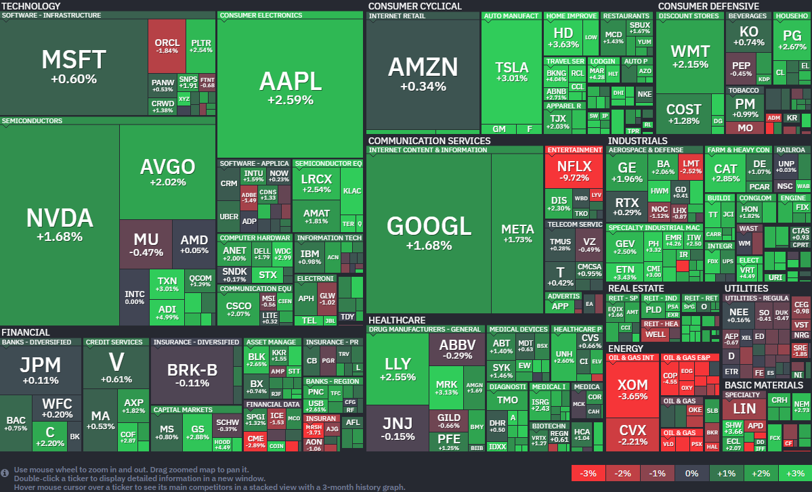

*출처: finviz.com*

#### 오늘의 증시

17일 (현지시간) 뉴욕증시의 3대 지수는 중동발 지정학적 리스크가 크게 해소되면서 일제히 급등했다. 특히 S&P 500 지수는 역사상 처음으로 7,100선을 돌파하며 종가 기준 최고치를 경신했고, 나스닥 지수는 13거래일 연속 상승이라는 대기록을 세웠다. 그 이유는 중동의 평화 소식과 함께 이스라엘과 레바논의 휴전 소식에 이어 이란이 "호르무즈 해협을 완전히 개방하겠다"고 발표하면서 시장의 불안감이 순식간에 안도감으로 바뀌었기 때문이다. 아메리프라이즈 파이낸셜의 앤서니 사글림베네 수석 시장 전략가는 "시장은 이제 최악의 시나리오를 지워나가고 있다"며 "미국과 이란이 갈등을 끝낼 경로를 확인하면서 투자자들이 이를 주가에 반영하고 있다"고 분석했다.

**호르무즈 해협 개방과 유가 폭락**

이란 외무장관이 이스라엘-레바논 휴전에 발맞춰 이 해협을 통과하는 모든 상업용 선박에 항로를 완전히 개방한다고 발표한 후 국제 유가는 폭락했다. 서부텍사스산원유(WTI) 선물은 12% 가까이 급락하여 배럴당 83달러 선으로 내려앉았고, 브렌트유 역시 9% 넘게 떨어졌다. 기름값이 떨어지자 그동안 유가 상승으로 고생했던 항공주(보잉 등)와 크루즈주(로열 캐리비안 등)가 각각 2%, 7%씩 오르며 강한 반등을 보였다.

도널트 트럼프 대통령은 자신의 SNS를 통해 이란의 결정을 환영하면서도, 완전한 평화 합의가 이뤄질 때까지 미국 해군의 이란 항구 봉쇄는 계속될 것이라며 강온 양면책을 구사했다. 다만 "대부분의 쟁점이 이미 협상되었기에 평화 프로세스가 매우 빠르게 진행될 것"이라고 덧붙여 시장의 기대감을 높였다.

그러나 이란 측에서 "적대적인 국가와 관련된 선박은 여전히 통과가 제한될 수 있다"거나 "미국의 봉쇄가 계속되면 다시 폐쇄할 수 있다"는 경고 섞인 보도도 나왔기 때문에 변수는 아직 남아있다. 하지만 시장은 일단 '전쟁 종료와 공급망 정상화'라는 큰 흐름에 더 무게를 두는 모습이다. 이번 랠리가 계속 되려면 앞으로 발표될 빅테크 기업들의 실적 전망치가 시장의 눈높이를 얼마나 맞춰주느냐가 관건이 될 것으로 보인다.

#### 주요 뉴스

**OpenAI 핵심 리더의 사임**

동영상 앱 '소라'를 이끌던 빌 피블스와 과학 부문 부사장 케빈 웨일 등 주요 임원 3명이 동시에 사임 소식을 알렸다. 최근 제품 및 마케팅 책임자들의 이탈에 이어 또다시 경영진 공백이 생긴 것이다. OpenAI는 현재 '소라' 서비스를 종료하고 과학 부문을 팀별로 분산시키는 등, 기업 공개(IPO)를 앞두고 효율성을 높이기 위한 대대적인 조직 개편을 진행 중인 것으로 보인다.

**우버, 딜리버리 히어로 지문 추가 확보**

우버가 딜리버리 히어로의 지분을 추가 확보하며 투자를 확대했다. 약 3억 1800만 달러(약 2억 7000만 유로)를 들여 기존 대주주인 프로서스로부터 지분 4.5%를 더 사들이기로 합의한 것이다. 이번 거래를 통해 프로서스는 유럽 당국의 규제 요건을 충족하게 되었고, 우버는 2024년 첫 투자 이후 딜리버리 히어로와의 파트너십을 더욱 공고히 다지게 되었다.

**인도 이커머스 시장의 성장**

인도의 이커머스 시장이 소규모 지방 도시를 중심으로 전 세계에서 가장 빠르게 성장하고 있다. 현재 인도 온라인 쇼핑객의 60% 이상이 지방 거주자로, 이들이 대도시를 제치고 시장의 핵심 동력으로 떠오른 것이다. 이에 아마존, 월마트 등 글로벌 기업들도 지방 곳곳에 초고속 배송망을 구축해 점유율 경쟁에 박차를 가하고 있다. 2030년에는 지방 쇼핑객 수가 대도시의 2배에 달할 것으로 보여 그 영향력은 더욱 커질 전망이다.

**월마트, '그레이트 밸류'의 패키지 디자인 전면 교체**

월마트의 최대 자체 브랜드(PB)인 '그레이트 밸류'가 10여 년 만에 패키지 디자인을 전면 교체한다. 오는 5월부터 약 1만 개의 제품이 더 현대적인 디자인으로 변신할 예정인데, 가격과 품질을 유지하면서 MZ 세대와 고소득층 고객까지 사로잡으려는 전략이다. 단순히 저렴한 PB 상품을 넘어 디자인 경쟁력까지 갖추려는 월마트의 노력이다.

**팔란티어, 탈레스, ASI의 미국 FAA 차세대 AI 관제 시스템 수주 3파전**

17일(현지시간) 팔란티어의 주가는 전일 대비 2.54% 상승한 146.39달러에 장을 마감했다. 반면 미국 시장에서 ADR(주식예탁증서)로 거래되는 탈레스(THLLY)의 주가는 1.12% 하락한 62.64달러에 거래를 마쳤다.

미국 연방항공청(FAA)이 국가 항공 교통 관리 시스템을 현대화하기 위한 새로운 인공지능 툴 개발에 팔란티어, 탈레스, 에어 스페이스 인텔리전스를 참여시켜 경쟁을 붙였다. 이번 조치는 노후화된 관제 시스템을 혁신해 하늘길의 안전을 강화하고 기술적 가동 중단 사고를 줄이기 위한 광범위한 노력의 일환이다.

FAA는 현대화 프로젝트를 통해 의회로부터 125억달러를 확보한 상태다. 그러나 전체 오버 홀(전면 개부소) 작업을 완료하기 위해서는 앞으로 약 200억달러가 추가로 더 필요할 것으로 보고 있다. 숀 더피 교통부 장관은 최근 워싱턴에서 열린 컨퍼런스에서 "현재 세 개의 기업이 비행 관리 소프트웨어 개발을 위해 우리와 협력하고 있다"며 프로젝트의 실체를 공식화했다.

AI로 항공 정체 및 충돌 방지, 클라우드 기반 소프트웨어로 혁신

FAA가 추진하는 이번 혁신의 핵심은 중앙 집중식 클라우드 기반 소프트웨어 시스템으로의 전환이다. 이 시스템은 AI를 활용해 항공 교통 흐름을 예측하고, 비행 간의 충돌을 해결하기 위해 출발 시간을 자동으로 조정하는 기능을 갖추게 된다. FAA는 지난 17일(현지시간) 성명을 통해 "소프트웨어를 현대화함으로써 항공 교통 관리에 혁명을 일으킬 것"이라며 AI 도입에 대한 강력한 의지를 드러냈다.

이 새로운 AI 기술에는 항공기가 서로 너무 가까워질 경우 관제사에게 즉시 알림을 보내는 안전 장치 역할도 수행하게 된다. 또한, 이착륙이 집중되는 정체 시간대를 미리 파악해 혼잡을 완화하는 등 효율적인 공항 운영에도 기여할 전망이다. 현재 탈레스 측은 공식적인 답변을 피했으며, 팔란티어와 에어 스페이스 인텔리전스 역시 구체적인 입장을 내놓지 않았으나 물밑 경쟁은 치열하게 전개되고 있다.

FAA의 이번 프로젝트에 천문학적인 예산이 투입되는 만큼 어떤 기업의 AI 기술이 채택되느냐에 따라 향후 글로벌 항공 인프라 시장의 주도권이 결정될 것으로 보인다. 시장에서는 팔란티어와 탈레스 등 각기 다른 장점을 가진 기업들이 이번 경쟁을 통해 AI 관제 기술의 표준을 정립하고, 장기적으로 항공 안전의 패러다임을 바꿀 수 있을지 주목하고 있다.

#### 국내 주요 뉴스

**코스피 소폭 하락**

지난 17일 코스피는 미국과 이란의 2차 회담에 대한 기대가 이어지고 있음에도 단기 급등에 따른 부담에 소폭 하락해 6,196.92에 마감했다. 외국인은 2조 원 가량 매도했다.

**스테이블코인과 코인 거래소 지분 투자**

국내 스테이블코인 법안 처리가 늦어지는 사이 증권사들은 코인 거래소 지분 투자 등을 통해 시장 진출을 준비하고 있다. 신현송 한은 총재 후보자도 스테이블코인의 역할을 인정하면서 정책 기류 변화 가능성이 커지고 있다.

**원자력, 대안으로 주목**

중동 전쟁 이후 원자력이 대안으로 주목받으며, 국내 상장 원자력 ETF로 1조3000억 원이 넘는 자금이 유입됐다.

**대차거래 잔고, 사상 최대치 경신**

16일 공매도 선행지표로 여겨지는 대차거래 잔고가 사상 최대치를 경신했다. 최근 증시가 빠르게 회복하면서 고점이라는 인식이 확산해 하락 베팅이 늘었기 때문이다.

**삼성전자 소식**

삼성전자가 북미 시장 핵심 거점인 미국 텍사스주 파운드리 공장의 가동 준비를 마쳤다.

**중복상장 심사 강화**

금융당국이 7월부터 계열사 중복상장에 대한 심사를 강화하고 주주 동의 절차를 명문화할 방침이다. 중복상장은 지배주주가 추가 출자 없이 자금을 조달하는 수단으로 이용되며, '코리아 디스카운트'의 원인 중 하나로 지목되어 왔다.

#### 부동산 소식

**정부가 투기 목적 '비거주 1주택자'에 대한 대출 규제**를 강화하는 방안을 이르면 5월 발표 예정이다. 신규 전세대출 보증과 기존 전세대출의 만기 연장을 금지하는 내용이 유력하다.

지난달 **강남3구 아파트 신고가 거래**가 전년 동기 대비 83% 급감했다. 특히 강남구, 서초구의 상위 10개 아파트 평균 거래가격은 20% 이상 하락했다.

#### 오늘의 주식 용어

**대차거래 잔고, 공매도**

**대차거래 잔고(Loan Balance)**는 투자자가 주식을 빌린 후 아직 갚지 않은 물량을 뜻하며, 대다수가 공매도를 위해 빌린 물량이므로 공매도 증가를 예고하는 선행지표로 활용된다. 잔고가 증가하면 향후 공매도 압력(주가 하락 요인)이 커질 수 있고, 반대로 감소하면 빌린 주식을 되사서 갚는 숏커버링(주가 상승 요인)이 나타날 수 있다.

**공매도(Short Selling)**는 주가 하락이 예상될 때, 주식을 빌려서 먼저 매도한 후 주가가 떨어지면 싼값에 다시 사들여(쇼커버링) 빌린 주식을 갚아 차익을 남기는 투자 기법이다. 주가 하락 시 수익이 발생하지만, 상승 시 손실이 무제한이 될 수 있는 고위험 투자다.

우리나라는 주식을 빌린 후 매도하는 '차입공매도'만 허용되므로, 대차잔고증가는 향후 공매도할 물량이 많아진다는 신호로 해석된다.

---

**[Reference]**
매일경제
머니네버슬립
UPPITY
