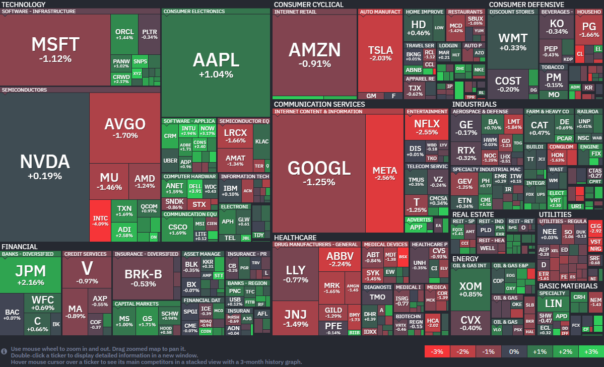

*출처: finviz .com*

#### 오늘의 증시

미국 증권시장이 20일(현지시간) 중동 지역의 긴장감이 다시 고조되면서 소폭 하락 후 마감했다. 특히 기술주 중심의 나스닥 지수는 13거래일 연속 상승이라는 대기록을 뒤로하고 하락 전환했다. 이는 1992년 이후 가장 긴 상승 랠리였다. 반면 중소형주 중심의 러셀 2000 지수는 0.58% 오르며 사상 최고치를 경신했다. 미국과 이란 사이의 군사적 갈등으로 인해 투자자들의 심리를 위축시켰고, 이로 인해 안전 자산 선호 현상이 나타나며 증시는 숨 고르기에 들어갔다. 애트러스 캐피털 어드바이저스의 데이비드 와그너 포트폴리오 매니저는 "시장은 이미 이란과의 전쟁 이슈를 어느 정도 극복해 나가고 있다"며 S&P 500 기업들의 이익 성장세가 시장이 더 높이 올라갈 수 있는 화력을 제공하고 있다"고 긍정적으로 평가했다.

**중동 전쟁, "선박 나포와 폭발 위협"**
주말 사이 미국과 이란의 갈등이 심화되며 시장에 긴장감이 오고 갔다. 도널드 트럼프 대통령은 미국이 오만만(Gulf of Oman)에서 이란 국적의 화물선을 나포해 압류했다고 밝혔다. 선박은 과거 불법 활동 이력으로 인해 미 재무부의 제재 대상에 올라있던 배다. 이란이 파키스탄에서 열릴 예정이었던 평화 회담에 불참하자 미국이 강경 대응에 나선 것이다. 트럼프 대통령은 본인의 SNS를 통해 "만약 이란이 합의에 응하지 않는다면 이란 내 모든 발전소와 다리를 폭파하겠다"고 경고했다. 이번 주에 양국 간의 휴전 협정이 만료될 예정이라 긴장감은 극에 달하고 있다.

**요동치는 기름값, '호르무즈 해협'의 경고**
미국과 이란의 충돌 소식으로 기름값이 무섭게 치솟았다. 서부텍사스산원유(WTI) 선물 가격은 전날보다 6.87%나 폭등하며 배럴당 89.61달러를 기록했고, 브렌트유 역시 5.64% 오른 95.48달러에 마감했다. 이란은 한때 개방했던 호르무즈 해협의 통행을 다시 제한하기 시작했다. 이란 측은 "미국이 의무를 이행하지 않았다"고 주장하고 있고, 트럼프 대통령은 이란이 요구 조건에 합의할 때 까지 해협 봉쇄를 유지하겠다고 맞서고 있다.

#### 주요 뉴스

**암 치료제, '릴리'가 인수**
일라이 릴리가 항암제 기업 '켈로니아'를 최대 70억달러에 인수하기로 했다. 켈로니아는 몸 안에서 암 세포를 공격하도록 T세포를 재설계하는 차세대 기술을 보유하고 있다. 번거로운 과정 없이 단 한 번의 주사로 치료가 가능해 항암 시장의 새로운 혁신으로 기대를 모으고 있다. 비만 치료제로 쌓은 수익을 바탕으로 항암제 분야까지 본격적으로 영토를 넓히고 있다.

**'블루 오리진' 로켓, 잘못된 궤도 배치**
제프 베이조스의 '블루 오리진' 로켓이 AST 스페이스모바일의 위성을 잘못된 궤도에 배치하는 실수를 범했다. 이 사고로 위성이 유실되며 월요일 AST의 주가가 5% 넘게 하락했다.

**전기차 스타트업 '리비안', 토네이도 습격으로 건물 파손**
전기차 스타트업 '리비안'의 일리노이주 공장이 지난 주말 토네이도 습격을 받아 건물 일부가 파손됐다. 다행히 인명 피해는 없었지만, 올봄 출시를 앞둔 핵심 모델인 'R2'의 부품 보관 및 물류 시설이 피해를 입었다. 리비안 측은 이번 주 중으로 복구를 마치고 운영을 재개할 계획이라고 밝혔다.

**커서(Cursor), 기업 가치 70조 원 돌파**
AI 코딩 스타트업 '커서(Cursor)'가 500억달러(약 70조원) 이상의 기업 가치로 20억달러 규모의 투자 유치를 논의 중이다. 엔비디아와 안드레센 호로위츠 등 거물급 투자자들이 힘을 보탤 것으로 보인다. 개발 업무를 돕는 AI 에이전트 열풍 속에 몸 값이 두 배 가까이 뛰며 존재감을 보이고 있다.

#### 주요 일정

20~21일 양일단 전기차 충전인프라 업체 '채비'가 코스닥 공모주 청약을 진행한다.
21일(현지 시각) 케빈 워시 미국 연준 의장 후보자의 인사청문회가 개최된다.
국내 증시에서 LF ELECTRIC, 부광약품, SGC에너지 등 주요 기업들의 실적 발표가 있다.
미국 증시에서 GE에어로스페이스, 유나이티드헬스, 3M, DR호튼, 레이시온 테크놀로지스 등 주요 기업들의 실적 발표가 있다.

#### 국내 주요 뉴스

**인도 정상회담**
20일(현지 시각) 이재명 대통령이 인도 모디 총리와 정상회담을 가졌다. 호르무즈 해협을 통과하는 선박들의 안전 보장과 자동차, 조선, 금융, 방산 등 전방위적인 협력 확대를 논의했다.

**코스피 상장사 총배당금 증가**
지난해 코스피 상장사들의 총배당금이 전년 대비 15.5% 늘어난 35조1000억 원을 기록했다.

**정부 에너지 전략 변화**
정부가 중동 전쟁 이후에도 미국 등 비중동산 원유 도입과 수송로 다변화를 지속하겠다고 밝혔다. 가격보다 공급망 안정성을 우선하는 방향으로 에너지 전략을 바꾸고 있다.

**정부, 비수도권 중소기업 채용 지원**
정부가 비수도권 중소기업의 기술인력 부족 문제를 해결하기 위해 채용 지원에 나선다. 기술 인력을 채용하고 3개월 이상 고용을 유지하면 비용을 지원받을 수 있다.

**국내 경제 지표**
우리나라의 GDP 대비 국가부채 비율이 내년 선진 비기축통화국 평균을 처음으로 넘어설 전망이다. 경제 성장보다 빠른 부채 증가 속도가 주요 원인으로 지목된다.

---

**[Reference]**
매일경제
머니네버슬립
UPPITY
