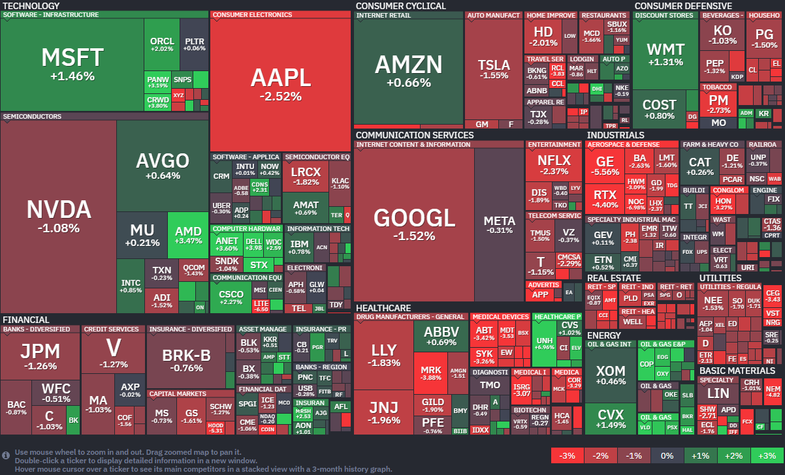

*출처: finviz .com*

#### 오늘의 증시

미국 증시가 21일(현지시간) 일제히 하락하며 거래를 마쳤다. 최근 사상 최고치 행진을 이어가던 S&P 500과 나스닥 지수도 잠시 숨 고르기에 들어간 모습이다. 가장 큰 원인은 미국과 이란 사이의 지정학적 긴장감이었다. 현재 양국은 휴전 종료 시한을 앞두고 평화 협상을 진행 중인데, 이 협상이 매끄럽지 않다는 소식이 전해지며 투자자들의 불안 심리를 자극했다. 제이디 밴스(JD Vance) 부통령의 협상단 합류가 잠정 중단됐다는 보도가 나오며 "정말 평화 협정이 맺어질 수 있을까?"하는 의구심이 커졌다.

잭스 인베스트먼트 매니지먼트의 브라이언 멀버리 수석 시장 전략가는 "이 상황에서 신뢰를 샇는 것은 매우 어렵다"며 "이란의 오랜 역사와 현재 이란 내부 정보 및 군부의 분열 상황을 고려할 때, 대표단이 평화 합의를 제대로 이행할 수 있을지 의구심이 드는 상황"이라고 분석했다.

**이란 휴전 협상과 기름값 역습**
도널드 트럼프 대통령은 특유의 '강온양면' 전략을 보였다. 낮에는 CNBC와의 인터뷰에서 "이란과 훌륭한 거래를 할 것으로 기대한다"고 말하면서도, 동시에 "만약 시한 내에 서명하지 않으면 미군은 이란을 폭격할 준비가 되어 있다"며 강력한 경고를 날렸다. 하지만 장 마감 직후에는 "이란의 제안이 제출될 때까지 휴전을 연장하겠다"고 한발 물러서는 모습을 보였다. 이런 불확실성이 시장의 변동성을 키운 핵심 요인이다. 지정학적 위기 속에서도 지수가 더 크게 폭락하지 않은 것은 기업들의 실적 덕분이다. 유나이티드헬스(UnitedHealth)는 1분기 실적이 예상을 뛰어넘으며 주가가 약 7% 급등했다. 아마존(Amazon)은 AI 스타트업인 '앤스로픽(Anthropic)'에 최대 250억 달러를 투자하기로 했다는 소식에 주가가 약 0.7% 올랐다.

브라이언 멀버리 전략가도 지적했듯, 현재 시장은 '기업들이 돈을 잘 벌고 있다'는 사실이 강력한 하방지지선 역할을 해주고 있다. 정치적 불확실성만 해소된다면 다시 상승 가도를 달릴 준비가 되어 있는 것으로 본다.

#### 주요 뉴스

**게이츠 재단, 인력 감축과 과거 조사 착수**
게이츠 재단이 비용 절감을 위해 2030년까지 전체 직원의 20%인 약 500명을 감원하기로 했다. 이와 함께 과거 제프리 앱스타인과의 관계에 대한 외부 조사를 진행하며 대대적인 조직 정비에 나섰다. 빌 게이츠는 앱스타인과의 과거 교류에 대해 사과하면서도 불법 행위는 없었다고 선을 그었으며, 오는 6월 미 하원 위원회의 조사를 앞두고 세간의 이목이 쏠리고 있다.

**엑스박스 게임 패스 가격이 확 내려간다.**
마이크로소프트의 새 게임 부문 수장인 아샤 샤르마가 팬들의 목소리를 반영해 '게임 패스' 구독료 인하를 전격 발표했다. 가장 높은 얼티밋 요금제 기준 월 29.99달러에서 22.99달러로 가격이 낮아지며 게이머들의 부담이 줄어들 예정이다. 다만 '콜 오브 듀티'같은 신작은 출시 당일 구독 서비스에서 제외되는 등 수익성 개선을 위한 서비스 운영 방식에도 변화가 생길 전망이다.

**아마존 대형 전기 트럭**
아마존이 스웨덴의 전기 트럭 스타트업 '아인라이드'와 협력해 대형 전기 트럭 75대를 물류망에 도입하기로 했다. 이 트력들은 물류 거점 사이를 연결하는 '미들 마일' 구간에 투입되어 연간 약 300만 마일을 배출 가스 없이 주행하며 탄소 감축에 힘을 보탤 예정이다. 기업공개(IPO)를 앞둔 아인라이드와 손 잡고 대형 화물 운송의 전동화를 가속화하는 아마존의 행보가 기대된다.

**유나이티드 항공, 올해 실정 전망치 대폭 축소**
중동 전쟁의 여파로 항공유 가격이 급등하면서 유타이티드 항공의 경영에 비상이 걸려, 기존 주당 최대 14달러였던 예상 수익을 7~11달러 수준으로 하향 조정하고 비용 절감을 위해 운항 노선 축소까지 검토하고 있다. 이는 치솟는 연료비 부담으로 인한 것으로 보인다.

**아마존, 진료부터 처방, 배송까지 원스톱 해결**
21(현지시간) 아마존의 주가는 전일 대비 0.66% 오른 249.91달러에 장을 마감했다. 이 회사의 주가는 올해 들어 8% 이상 상승했다.
아마존이 폭발적으로 성장하는 비만 치료제 시장에 승부수를 던졌다.  21일(현지시간) 자사의 1차 진료 부문인 '아마존 원 메디컬'을 통해 인기 있는 GLP-1 치료제에 대한 접근을 단순화하는 새로운 관리 프로그램을 출시한다고 발표했다. 이번 서비스는 비만 치료를 일회성 처방이 아닌 정기적인 만성 질환 관리 영역으로 통합해 가상 및 대면 진료, 처방 관리, 그리고 아마존 파마시(약국)를 통한 의약품 배송까지 한번에 연결하는 것이 특징이다.

가격 경쟁력 또한 파격적인데, 보험 적용 시 노보 노디스크의 위고비나 최신 경구용 GLP-1 치료제의 가격은 월 25달러부터 시작된다. 보험이 없는 현금 결제 환자의 경우, 경구용 치료제는 월 149달러부터, 위고비나 일라이 릴리의 제바운드 같은 주사제는 월 299달러부터 이용할 수 있다. 아마존 파마시의 탄비 파텔(Tanvi Patel) 부사장은 "고객에게 빠르고 편리한 약품 접근성과 투명한 가격을 제공하는 것은 아마존이 약국 경험을 혁신하는 핵심 방법"이라며 자신감을 드러냈다. 아마존의 강점인 강력한 물류 네트워크를 활용한 배송 편의성도 있다. 29달러부터 시작하는 메시지 상담 및 49달러의 화상 진료를 통해온디맨드(On-demand) 처방 갱신 서비스도 제공한다.

이러한 아마존의 거침없는 행보에 기존 비만 치료제 관련 기업들의 주가는 즉각 반응했다. 발표 직후 힘스앤허스(Hims & Hers Health), 바이킹 테라퓨틱스(Viking Therapeutics), 암젠(Angen), 셉터나(Septuna) 등 경쟁 관계에 있는 기업들의 주가는 아마존의 시장 잠식 우려로 인해 일제히 하락세를 보였다. 투자자들은 아마존의 거대한 소비자 접점과 압도적인 배송 인프라가 기존 원격 의료 및 바이오 업체들에게 상당한 위협이 될 것으로 내다보고 있다. 아마존은 편의성과 가격 투명성이라는 무기로 헬스케어 시장의 문턱을 대폭 낮추고 있으며, 시장에서는 아마존이 물류 경쟁력을 바탕으로 비만 치료제 유통 시장의 판도를 흔드는 상황에서 기존 헬스케어 강자들 사이 독보적인 점유율을 확보할 수 있을지 주목하고 있다.

**애플 CEO 교체 소식**
팀 쿡 애플 CEO가 오는 9월 자리에서 물러날 예정이다. 차기 CEO는 하드웨어 엔지니어링 부문 수석 부사장 존 터너스다.

**블루오리진, 로켓 재사용 성공**
블루오리진이 스페이스X에 이어 1단 로켓 재사용에 성공했다. 대형 발사체 시장에서의 경쟁이 본격화될 전망이다.

**TSMC, LPU시장에 재합류**
TSMC가 추론용 AI칩 LPU 시장에 다시 뛰어든다. 삼성전자와 파운드리 경쟁이 더 치열해질 전망이다.

**미국 국가안보국, 미토스 사용**
미국 국가안보국(NSA)이 앤스로픽의 보안 특화 AI 모델 '클로드 미토스 프리뷰'를 사용하고 있다. NSA의 상위 기관인 국방부가 앤스로픽을 블랙리스트에 올렸음에도 보안 취약점을 찾는데 미토스를 활용하며 모순적 태도라는 지적이 나온다.

#### 주요 일정

**미국 증시**에서 테슬라, GE버노바, AT&T, 보잉, 램리서치, IBM, 버티브, 텍사스인스트루먼트, 서비스나우 등 주요 기업들의 실적 발표가 있다.
**국내 증시**에서 OCI, 삼성바이오로직스, 유니드, 제주은행 등 주요 기업들의 실적 발표가 있다.

#### 국내 주요 뉴스

**코스피와 SK하이닉스 최고치 경신**
어제 코스피는 두달 만에 사상 최고치를 경신하며 6,388.47에 마감했다.
23일 실적 발표를 앞둔 SK하이닉스는 처음으로 120만원을 넘었고, ESS 수요 확대 기대감으로 배터리주도 강세였다.

**카드론 잔액, 역대 최대치 기록**
카드론 잔액이 43조 원에 육박하며 역대 최대치를 기록했다. 실물 경기 악화로 저신용 차주의 자금 수요가 늘었다.

**국채, 외국인들이 상당 수 매수**
우리나라 국채가 세계국채지수(WGBI)에 편입된 지 약 2주 만에 외국인들이 8조 원 상당의 국고채를 매수했다.

**상법개정안 도입과 코스피, 코스닥 영향**
코스피, 코스닥 상장사들의 배당률과 배당성향이 크게 늘었다. 상법개정안 도입 이후 주주환원 중심 경영이 점차 자리 잡는 흐름이다.

**코리아밸류업지수의 성과**
올해 코리아밸류업지수가 코스피 지수를 웃도는 성과를 냈다. 이 지수를 추종하는 ETF들의 순자산총액 규모도 3조 원을 돌파했다.

**포스코, 인도 현지 제철소 건설 투자**
포스코가 약 5조 3650억 원을 투자해 인도 1위 철강사 JSW스틸과 함께 현지 제철소를 건설한다. 현지 생산기지를 구축해 인도 내 철강 수요에 대응할 예정이다.

**삼성SDI, 벤츠와 배터리 계약 체결**
삼성SDI가 독일 메르세데스-벤츠와 수조 원대의 전기차 배터리 공급 계약을 체결했다.

**반도체 수출 실적 호조**
반도체 수출 실적이 호조를 띄면서, 4월 1일에서 20일 사이의 수출 실적이 503억7600만 달러로 역대 최대치를 기록했다.

**국민성장펀드, 퓨리오사AI 투자처 검토**
국민성장펀드가 AI 반도체 스타트업 퓨리오사AI를 차기 투자처로 검토하고 있다. 앞서 펀드는 'K 엔비디아' 육성 전략으로 리벨리온에 직접 투자한 바 있다.

#### 부동산 소식

**정부, 지역주택조합제도 정비**
정부가 지역주택조합 제도를 정비해 사업 속도와 안정성을 동시에 높인다. 토지 확보 기준은 완화하고 조합원 보호 장치는 강화하는 방향이다.

#### 생애최초, 청약 밖으로

3월 생애최초 서울 주택 매수자 중 30대 비중은 57.2%로 역대 최고치였다. 청약도 비슷한데, 올 1~2월 전국당첨자 중 30대 이하가 61.2%로 처음 60%를 넘겼다. '생애최초'가 청약에서만 보이는 말이 아니라, 실제 매수 쪽에서도 그 비중이 또렷해졌다.

**시장 전면에 나선 첫 집 마련**
서울 생애최초 매수: 3월 30대 비중 57.2%
전국 청약 당첨: 1~2월 30대 이하 61.2%

흔히 생애최초라고 하면 청약을 떠올리지만 거기서 끝나지 않는다. 자격요건만 맞으면 청약 외에 대출과 세금 혜택을 함께 받을 수 있다.
**1) 청약 특별공급**
가점이 낮아도 한번 더 노려볼 수 있는 기회. 일반공급 외에 따로 배정되기 때문
-**기준**: 세대원 전원 무주택이 기본이다. 공공분양은 유형에 다라 소득기준이 다르고, 민간분양은 전년도 도시근로자가구월평균소득 160% 이하가 기준이다.
-**체크**: 가점이 낮다고 일반공급으로 넘기기 쉽지만, 따로 경쟁하는 특별공급부터 보는 편이 낫다. 내 소득이 어디에 걸리는지부터 확인할 것!

**2) 주택담보대출 우대**
자금을 마련할 때 가장 먼저 부딪히는 갈래
-**기준**: 디딤돌대출은 집값 5억 원 이하(신혼,2자녀 6억 원 이하)가 기본이지만, 보금자리론은 6억 원 이하다. 소득 상한도 상품마다 다르다.
-**체크**: 한쪽이 막혔다고 다른 쪽까지 포기하지 말것. 디딤돌대출은 생애최초에 금리 우대, 한도 확대 혜택이 있고, 보금자리론은 생애최초 대출한도가 더 넓다.

**3) 취득세 감면**
집살 때 내는 세금을 깎아주는 장치. 다만 자동이 아니라 직접 신청해야 한다.
-**기준**: 잔금을 치른 후 60일 안에 시,군,구청이나 위택스에서 직접 신청해야 한다.
-**체크**: 알아서 깎아주지 않는다. 특히 신생아 가구라면 '출산,양육 취득세 감면'이 한도 500만 원으로 더 유리할 수 있으니, 신청 전 비교해볼 필요가 있다.

#### 부동산 시장

**오피스텔 수익률 5.32%**
아파트 수요가 오피스텔로 옮겨가고 있다. 아파트 대출 규제가 강해진 데다, 전세의 월세화로 임대수익도 나아진 영향이다. 실제로 지난 3월 수도권 오피스텔 수익률은 5.32%로, 2017년 5월 이후 8년 10개월 만에 최고치다.

**변동 VS 고정, 선택의 무게**
4월 19일 기준 5대 시중은행 주택담보대출 금리는
변동형 연 3.65~6.05%
고정형 연 4.15~6.75% 였다.
고정형이 변동형보다 하단 0.5%p, 상단 0.7%p 높았다. 작년 말에는 하단 0.21%p, 상단 0.36%p 차이였는데, 석 달 새 격차가 더 벌어졌다. 대출 시 금리 구조를 살펴야 할 때!

**손해 보고도 깨는 연금**
주택연금을 손해 보면서 해지하는 사람이 늘었다. 실제로 올 2월 중도해지는 256건으로 4년 2개월 만에 가장 많았다. 반면 신규 가입은 1719건으로 4년 만에 최저치였다. 가입 시점에 월 수령액이 고정되니, 집값이 오를 것 같으면 연금을 끊고 직접 굴리자는 계산이다.

**비거주 1주택 규제 검토**
정부가 '비거주 1주택자' 전세대출 규제를 검토 중이다. 실거주하지 않는 1주택자의 신규 보증을 막고, 만기 연장도 제한하는 방안이 거론된다. 정책 목표는 매물 유도지만, 실제로 매도와 실거주 복귀, 월세 전환으로 갈릴 수 있어 시장의 반응을 더 지켜봐야 한다.

#### 부동산 용어

**지역주택조합제도**
무주택자(85㎡ 이하 1주택 소유자 포함)가 특정 지역 내에서 스스로 조합을 구성하여 토지를 매입하고, 건설사(시공사)를 선정해 아파트를 직접 짓는 제도. 청약통장이 필요 없으며, 동일 지역에 거주하는 무주택자 등이 결성.

**주택연금**
집을 담보로 맡기면 죽을 때까지 국가에서 매달 연금을 받는 상품이다. 2024년 기준 전국 평균 72세애 가입해 3억 8000만원 짜리 집을 담보로 내놓고 월 122만원을 받는다.

---

**[Reference]**
매일경제
머니네버슬립
UPPITY
부딩
