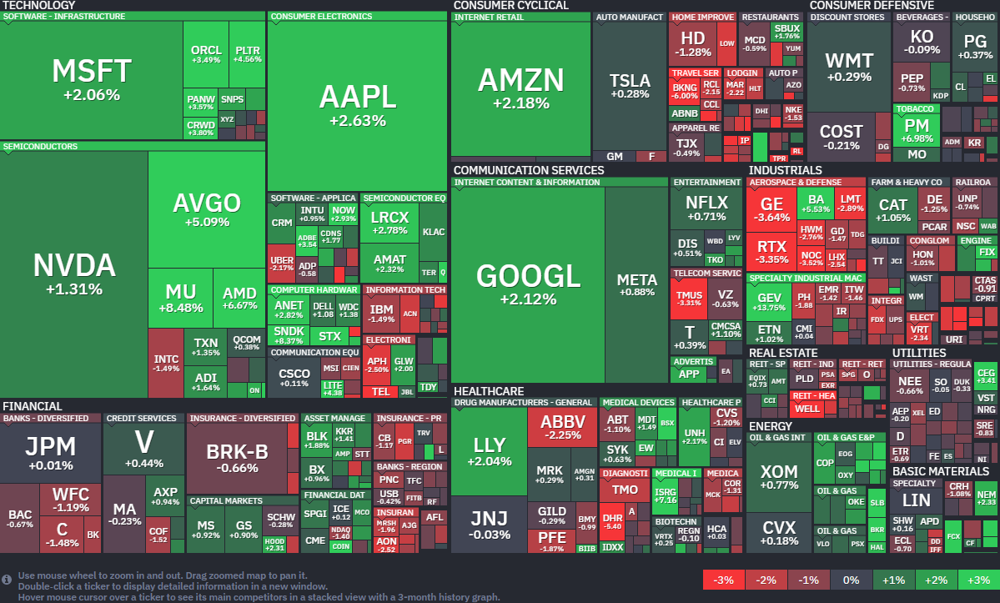

*출처: finviz .com*

### 오늘의 증시

미국 증권시장이 22일(현지시간) 일제히 상승하며 기분 좋게 장을 마쳤다. 특히 S&P 500 지수와 나스닥 지수는 종가 기준 사상 최고치를 경신했다. 시장을 끌어올린 두 가지 핵심 요소는 '이란과의 휴전 연장' 소식과 '주요 기업들의 호실적'이었다. 트럼프 대통령이 이란과의 휴전 기간을 연장하겠다고 발표하면서, 중동발 전쟁 공포로 위축됐던 투자 심리가 빠르게 회복됐다. 여기에 보잉과 GE 버노바 등 굵직한 기업들이 예상보다 좋은 성적표를 내놓으며 상승세에 불을 지폈다.

다만, 시장이 너무 빠르게 오른 데에 대한 경계의 목소리도 있다. WEBs 인베스트먼트 CEO 벤 풀턴은 "일주일 전만 해도 상승 가능성이 리스크였다면, 이제는 시장이 너무 많이 올라서 오히려 하락 위험(Downside risk)을 살펴야 할 때"라며 투자자들이 냉정함을 유지해야 한다고 조언했다.

**트럼프의 이란 휴전 연장**
도널트 드럼프 대통령은 자신의 SNS(트루스 소셜)을 통해 "이란 정부가 심각하게 균열되어 있다"며, 파키스탄 지도부의 요청에 따라 이란에 대한 공격을 일단 유예하고 휴전을 연장하겠다고 밝혔다. 중동 지역은 전 세계 석유 공급의 핵심이다. 만약 미국과 이란 사이의 전쟁이 본격화되면 석유 공급에 차질이 생기고, 이는 기름값 상승 -&gt; 물가 상승(인플레이션) -&gt; 금리 인상 압박으로 이어져 주식 시장에 타격을 준다. '휴전'을 시장이 반기는 평화의 신호탄인 셈이다.

그러나 안심하기엔 이르다. 휴전은 연장됐지만 이란 해군이 호르무즈 해협에서 컨테이너선 2척을 나포했다는 소식이 전해졌기 때문이다. 이 영향으로 국제유가(브렌트유)는 배럴당 100달러를 돌파했다. '불안한 평화'가 이어지고 있는 상황이라, 지정학적 리스크는 여전히 시장의 변수로 남아있다.

**기업들의 어닝 서프라이즈**
지정학적 불안 속에서도 증시를 받쳐준 건 기업들의 '실적'이다. 미국의 현재 1분기 실적 발표 시즌인 '어닝 시즌(Earning Season)'을 지나고 있으며, 특히 오늘 보잉(Boeing)은 예상보다 손실 규모를 줄였다는 소식에 주가가 5.5% 올랐고, 에너지 기업인 GE 버노바(GE Vernova)는 매출이 시장 전망치를 훌쩍 뛰어넘으며 14% 가까이 폭등했다. 펙트셋(FactSet)에 따르면, 현재까지 실적을 발표한 S&P 500 기업 중 82% 이상이 시장의 예상을 뛰어넘는 '어닝 서프라이즈'를 기록 중이다. 전쟁 가능성이라는 요소가 있어도 정작 기업들은 돈을 잘 벌고 있다는 사실이 확인되며 투자자들이 다시 주식 매수에 나선 것으로 풀이된다.

#### 주요 뉴스

**엔비디아가 찜한 '바스트 데이터'**
AI 데이터 관리 소프트웨어 기업인 '바스트 데이터(Vast Data)'가 엔비디아 등이 참여한 투자 라운드에서 10억 달러를 유치했다. 이번 투자로 기업 가치는 작년보다 3배 뛴 300억 달러로 평가받게 되었다. 엔비디아는 AI 생태계에서의 영향력을 공고히 하기 위해 최근 유망한 AI 스타트업에 대한 투자를 적극적으로 늘려가는 모습이다.

**리비안 R2, 생산 시작**
리비안이 보급형 전기 SUV인 'R2'의 본격적인 생산을 시작했다는 반가운 소식이다. 지난 22일 일리노이 공장에서 첫 번째 고객용 차량이 출고되며 올봄으로 예정된 인도를 위한 중요한 발판을 마련했다. 기존 모델보다 저렴한 가격대의 R2는 리비안의 수익성을 개선할 핵심 기대주로 꼽히는 만큼, 앞으로의 생산 확대 행보가 주목된다.

**어도비, 위기 뚫고 반등 시작**
주가 하락으로 고전하는 어도비가 250억 달러 규모의 대규모 자사주 매입을 발표하며 분위기 반전에 나섰다. 여기에 엔비디아의 젠슨 황 CEO가 직접 나서서 "AI가 창작자들의 예술성을 한층 높여줄 것"이라며 어도비의 비전을 적극 지지하고 나섰다. 강력한 주주 환원 정책과 든든한 우군의 응원 덕에 어도비가 AI 시대의 승자가 될 것이라는 기대감이 살아나고 있다.

**보잉, 737 맥스 증산에 청신호**
보잉의 CEO 켈리 오트버그가 주력 모델인 '737 맥스'의 생산량을 올여름부터 47대까지 늘리겠다고 밝혔다. 최근 발표된 1분기 실적에서 손실 폭을 예상보다 크게 줄이며 경영 정상화에 박차를 가하고 있다. 고객들로부터 품질에 대한 긍정적인 피드백을 받고 있다며 위기 극복과 실적 회복에 대한 강한 자신감을 드러냈다.

**테슬라, 매출 부진에도 수익성 깜짝 방어**
22일(현지시간) 테슬라의 주가는 전일 대비 0.28% 오른 387.51달러에 장을 마감했다. 하지만 이 회사의 주가는 올해 들어 14% 가까이 빠졌다.
테슬라가 2026년 1분기 실적 발표에서 시장의 예상을 뛰어넘는 순이익을 기록하며 수익성 회복의 신호를 보냈다. 비록 매출은 분석가들의 기대치인 226억4000만달러에 소폭 못 미치는 223억9000만달러를 기록했으나, 조정 주당순이익(EPS)은 예상치인 37퍼센트를 상회하는 41센트를 달성했다.올해 들어 빅테크 중 가장 부진한 주가 흐름을 보였던 테슬라는 실적 발표 직후 시간외 거래에서 약 4% 상승하며 반등의 기틀을 마련했다.

이번 실적의 핵심은 자동차 부문 마진의 회복이다. 탄소 배출권 판매 수익을 제외한 자동차 총마진은 19.2%를 기록하며 지난해 어느 분기보다 높은 수치를 나타냈다. 테슬라는 이에 대해 원자재 비용 하락으로 인한 대당 제조 원가 절감과 평균 판매가 상승이 주요했다고 밝혔다. 또한 연방 대법원이 트럼프 행정부의 광범위한 관세 정책에 제동을 걸면서 발생한 관세 환급금 등 일회성 이익도 수익성 개선에 힘들 보탰다. 하지만 본업인 자동차 판매 사업은 여전히 거센 도전에 직면해 있다. 중국의 BYD와 샤오미 등 글로벌 경쟁사들이 고사양, 저가 모델을 쏟아내며 테슬라의 노후화된 라인업을 압박하고 있기 때문이다. 이에 테슬라는 모델 Y와 모델 3의 보급형 트림을 출시해 대중 시장 공략을 강화하겠다는 계획을 재확인했다. 아울러 일론 머스크 CEO의 정치적 행보와 우파적 언론 노출로 인한 소비자 반발 역시 테슬라가 넘어야 할 과제로 지적된다.

로봇 공장으로의 대전환, 연간 옵티머스 100만대 생산 예고
일론 머스크는 이번 실적 발표를 통해 테슬라의 체질을 전기차 제조사에서 자율주행 및 로봇 공학 기업으로 전환하겠다는 의지를 분명히 했다. 테슬라는 기존 모델 S와 모델 X의 생산을 중단하고, 캘리포니아 프리몬트 공장을 옵티머스 휴머노이드 로봇 생산 기지로 전환하겠다고 밝혔다. 당장 2분기부터 대규모 로봇 공장 설립을 위한 준비에 착수하며 1세대 라인을 통해 연간 100만대의 로봇을 생산하겠다는 야심찬 목표를 제시했다.

이러한 미래 기술로의 체질 개선은 재무 지표에서도 나타난다. 테슬라의 1분기 자본 지출(CapEx)은 전년 동기 대비 67% 급증한 24억9000만달러를 기록했다. 이는 자율주행 모델 테스트와 로봇 대량 생산을 위한 인프라 구축에 막대한 자금이 투입되고 있음을 보여준다. 비록 에너지 사업 부문 매출이 전년 대비 12% 감소하는 등 일부 부침이 있었지만 머스크는 자율주행 택시와 로봇 중심의 새로운 성장 서사로 시장의 시선을 돌리는 데 주력하고 있다.

테슬라는 이번 분기 실적을 발표한 첫 번째 조 단위(Trillion-dollar) 테크 기업으로서 다음 주 이어질 알파벳, 아마존, 마이크로소프트 등의 실적 발표에 대한 가늠자 역할을 하게 됐다. 시장에서는 테슬라가 관세 환급 등 일회성 호재를 넘어 본업인 전기차의 저가형 모델 출시와 옵티머스 로봇의 양산화를 통해 실질적인 설장을 증명해낼 수 있을지 주목하고 있다.

**앤스로픽, 아마존으로부터 추가 투자 유치**
앤스로픽이 아마존으로부터 50억 달러(약 7조 원)의 추가 투자를 유치했다. 일정한 상업적 성과를 달성할 경우 총투자 규모는 최대 250억 달러(약 36조 원)로 늘어날 수 있다.

**일론 머스크의 스페이스X, 커서(Cursor) 인수**
일론 머스크의 스페이스X가 AI 코딩 스타트업 커서를 600억 달러(약 89조 원)에 인수하기로 했다. 경쟁사 대비 약한 코딩 역량을 강화하기 위한 승부수다.

**OpenAI, '챗GPT 이미지 2.0' 공개**
21일(현지시각) OpenAI가 새 이미지 생성 모델 '챗GPT 이미지 2.0'를 공개했다. 한글과 같은 아시아권 언어 텍스트를 구현하는 능력이 크게 향상되었다.

**구글, '제미나이 인 크롬' 출시**
21일 구글이 크롬 브라우저 안에 AI를 넣은 '제미나이 인 크롬'을 출시했다. 브라우저 상단에 '제미나이에게 물어보기'를 클릭하면 웹페이지를 요약하거나 필요한 정보를 정리할 수 있다.

**미국 통화 정책의 불확실성**
21일(현지시각) 케빈 워시 미국 연준 의장 후보자가 대통령은 기준금리 인하를 선호하지만, 자신은 이를 그대로 따를 의사가 없다고 밝혔다. 한국은행은 청문회 결과를 두고, 향후 미국 통화 정책의 불확실성이 더 커졌다고 진단했다.

#### 주요 일정

국내 증시에서 SK하이닉스, 현대차, KB금융, 신한지주, 삼성에스디에스, LG디스플레이 등 주요 기업들의 실적 발표가 있다.
미국 증시에서 아메리칸 익스프레스, 인텔, 유니언퍼시픽, 허니웰 등 주요 기업들의 실적 발표가 있다.

#### 국내 주요 뉴스

**삼성전자 및 SK하이닉스 단일종목 레버리지 ETF 거래 가능 예정**
다음 달 22일부터 삼성전자, SK하이닉스의 단일종목 레버리지 ETF를 거래할 수 있게 된다.

**네이버 및 카카오, AI 데이터센터 전력 확보를 위한 재생에너지 투자**
네이버와 카카오가 AI 데이터센터에 필요한 전력 확보를 위해 한전을 거치지 않고 직접 재생에너지 구매 계약을 맺거나 관련 회사에 투자하고 있다.

**방산 수출의 경제적 파급효과**
방산 수출의 경제적 파급효과가 제조업 평균을 웃도는 것으로 나타났다. 지난해 방산 수주액 약 22조7000억 원에 따른 생산유발효과가 46조4000억 원에 달하는 것으로 나타났다.

**현대차, 인도와 손잡다**
현대차가 인도 업체와 협업해 친환경 이동 수단 '3륜 전기차(EV)'의 상용화에 나선다.

**LG, '암 에이전틱 AI' 기술 공개**
LG AI연구원이 암 진단부터 치료법에 이르는 과정을 하루 만에 설계하는 '암 에이전틱 AI' 기술을 공개했다.

#### 주식 용어

**레버리지 ETF**

레버리지(Leverage)는 지렛대라는 뜻이다. 적은 힘으로 무거운 물건을 들어 올리듯, 금융 시장에서는 기초 자산의 변동폭을 몇 배로 확대해 수익을 추구하는 상품을 말한다. 레버리지 ETFF는 특정 지수나 종목의 일간 수익률을 정확히 2배만큼 추종하는 구조다. 예를 들어, 기초 자산이 1% 상승하면 ETF는 2% 상승하고, 반대로 1% 하락하면 2% 하락을 목표로 한다. 수익 극대화와 효율적 헤지(시장 하락이 예상될 때 인버스 2배 상품을 통해 포트폴리오 손실을 방지하는 도구)로 활용이 가능하다는 장점이 있지만, 장기 보유가 위험하다는 것과 원금 회복이 어려울 수 있다는 단점이 있다. 따라서 레버리지 ETF를 이용하려면 단기 트레이딩에 집중하는 것을 전문가들은 제안하고 있으며, 확실한 추세에서만 진입하고, 손절 원칙을 철저하게 가져가야 한다.

---

**[Reference]**
매일경제
머니네버슬립
UPPITY
