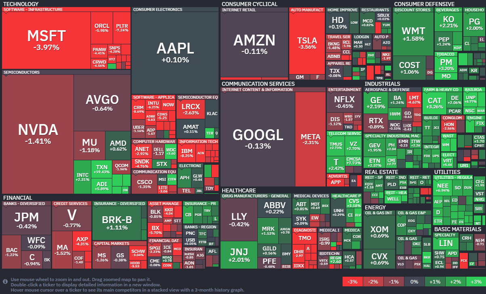

*출처: finviz .com*

#### 오늘의 증시

오늘 미국 증시는 '고점에서 미끄러진 하루'였다. 장 초반만 해도 S&P 500과 나스닥 지수는 나란히 역대 최고치를 새로 쓰며 기세를 올렸다. 하지만 소프트웨어 기업들의 실망스러운 실적 발표와 중동발 전쟁 리스크가 커지면서 상승분을 모두 반납하록 하락 전환했다. 특히 소프트웨어 섹터의 하락세가 매서웠다. IBM은 예상치를 웃도는 실적을 냈음에도 향후 정망(가이던스)을 보수적으로 유지하면서 8% 넘게 급락했고, 서비스나우(ServiceNow)는 중동 분쟁 여파로 구독 수익 성장이 둔화됐다는 소식에 18% 가까이 폭락했다. 이 여파로 마이크로소프트 (-4%), 팔란티어(-7%) 등 주요 소프트웨어 종목들이 줄줄이 하락하며 나스닥 지수를 끌어내렸다.

여기에 유가 상승도 부담을 더했다. 이란과의 전쟁 불확실성이 커지며 브렌트유는 배럴당 105달러를 돌파했다. 바넘 파이낸셜 그룹의 크리스 캠피트시스 매니징 파트너는 "시장이 지난 3월 저점 이후 엄청난 반등을 보인 뒤 갈 길을 찾으려 애쓰고 있다"며 "다음 촉매제가 나타날 때까지 당분간은 박스권(일정한 범위 내에서 등락을 반복하는 구간)에 머물 것"이라고 분석했다.

**호르무즈 해협의 총성 없는 전쟁과 유가 쇼크**
오늘 시장을 뒤흔든 가장 큰 거시경제 이슈는 다시 격화된 중동의 지정학적 위기다. 단순히 교전이 이어지는 수준을 넘어, 이제는 전 세계 에너지 공급의 혈맥인 '호르무즈 해협'을 둘러싼 미국과 이란의 해상 대치 상황으로 번지고 있다. 도널드 트럼프 대통령은 이날 자신의 SNS(트루스 소셜)를 통해 호르무즈 해협에서 기뢰를 설치하는 이란 선박에 대해 "발견 즉시 격퇴(Shoot and kill)하라"는 강경한 명령을 내렸다. "주저하지 말라"는 표현까지 썼을 정도로 긴박함이 느껴졌으며, 이번 주 양국이 서로 상대방의 상선을 나포하는 등 해상 대치가 심회되자 나온 강력한 대응이다.

이란 내부 소식도 시장을 불안하게 했다. 이란 국회의장이 협상팀에서 사퇴했다는 보도가 나오며, 이란 내 강경파인 혁명수비대가 정국 주도권을 잡는 것 아니냐는 우려가 커졌다. 실제로 이날 이란 수도 테헤란에서는 방공 시스템이 가동되어 적대적 목표물을 타격하는 소리가 들렸다는 외신 보도도 이어졌다. 이런 소식들은 즉각 국제 유가를 끌어올렸다. 기름값이 오르면 기업의 생산 비용이 늘어나고, 소비자들의 지갑이 닫히며 전반적인 경제 성장이 둔화될 수 있다. 오늘 소프트웨어 주식들이 급락한 이유 중 하나도 전쟁으로 인한 비즈니스 중단과 수익성 악화 우려 때문이었다.

#### 주요 뉴스

**OpenAI, 새로운 AI 모델 'GPT-5.5' 전격 공개**
OpenAI에서 이전 모델 출시 후 불과 두 달 만에 나온 신모델로, 코딩과 데이터 분석은 물론 리서치 능력이 대폭 강화됐다. 특히 별도의 가이드 없이도 스스로 문제를 파악하고 해결하는 등 '컴퓨터 업무의 기초'가 될 모델이라는 평가를 받고 있다. 현재 챗GPT 플러스 등 유료 구독자들을 대상으로 먼저 제공되기 시작했다.

**WBD와 파라마운트, 한 식구가 되다**
워너 브라더스 디스커버리(WBD) 주주들이 파라마운트와의 합병안을 최종 승인했다. 넥플릭스, 컴캐스트 등과의 치열한 인수 경쟁 끝에 파라마운트가 주당 31달러를 제시하며 최종 승기를 잡은 것이다. 규제 당국의 승인을 거쳐 올해 3분기 중 합병이 마무리되면 거대 미디어 공룡이 탄생할 전망이다. 다만 주주들은 이번 합병 과정에서 CEO에게 지급될 8억 달러 규모의 막대한 보상안에는 반대 목소리를 높였다고 한다.

**나이키, 올해 두 번째 감원 발표**
나이키는 기술 부서를 중심으로 약 1,400명의 직원을 줄이기로 했다. 이는 부진한 매출을 회복하기 위한 'Win Now' 전략의 일환으로, 조직을 더 빠르고 효율적으로 개편해 성장에 속도를 내겠다는 계획이다. 엘리엇 힐 CEO 체제 아래에서 대대적인 체질 개선에 박차를 가하는 모습이다.

**앤스로픽, 억대 연봉 전문가 채용**
앤스로픽이 유럽 내 AI 인프라 확장을 위해 억대 연봉 전문가 채용에 나섰다. 데이터 센터 계약을 전담할 이 역할은 연봉이 최대 약 4억 7,000만 원(27만 파운드)에 달할 정도로 핵심적인 자리인데, 최근 아마존과 대규모 인프라 협력을 맺은 데 이어, 이제는 유럽 전역으로 컴퓨팅 자원을 확보해 AI 경쟁력을 강화하겠다는 계획이다.

**마이크로소프트, 창사 51년 만의 첫 명예퇴직 실시**
23일(현지시간) 마이크로소프트의 주가는 전일 대비 3.97% 하락한 415.75달러에 장을 마감했다. 이 회사의 주가는 올해 들어 14% 이상 빠졌다.

마이크로소프트가 창사 이래 처음으로 미국 내 직원을 대상으로 자발적 명예퇴직(Buyout) 프로그램을 도입한다. 이번 프로그램은 연령과 근무 연수의 합이 70 이상인 '시니어 디렉터' 레벨 이하의 정규직 직원을 대상으로 하며, 전체 미국 인력 12만 5000명 중 약 7%가 해당할 것으로 보인다. 마이크로소프트는 23일(현지시간) 내부 메모를 통해 이를 발표했다.

이번 결정은 생성형 AI 모델을 ㅈ처리하기 위한 데이터 센터 구축 등 인프라 비용이 급증하는 상황에서 나왔다. 마이크로소프트는 알파벳, 아마존 등 경쟁사들과 함께 AI 주도권을 잡기 위해 막대한 자본 지출을 이어가고 있으며 동시에 앤스로픽과 같은 신흥 강자들의 코딩 도구가 기존 소프트웨어 시장을 위협하면서 수익성 방어에 대한 압박을 받고 있다. 에이미 콜먼 마이크로소프트 인사 담당 부사장은 "이번 프로그램이 대상 직원들이 회사의 관대한 지원 속에 스스로의 조건에 맞춰 다음 단계로 나아갈 수 있는 선택권을 주길 바란다"고 밝혔다.

지난해 이미 여러 차례의 정리해고를 통해 비용 절감에 나섰던 마이크로소프트는 이번 명예퇴직을 통해 인력 구조의 자연스러운 세대교체와 효율화를 꾀하고 있다. 다만 영업 인센티브 플랜이 적용되는 영업직군은 이번 프로그램 참여 대상에서 제외됐다. 2025년 6월 기준 전 세계 22만8000명의 직원을 보유한 거대 조직이 AI 시대에 발맞춰 몸집 줄이기를 넘어 체질 개선에 돌입했다는 분석이다.

**마이크로소프트의 보상 체계 전면 개편, 주식-현금 보너스 분리로 성과주의 강화**
마이크로소프트는 인력 감축과 더불어 내부 보상 체셰에도 큰 변화를 준다. 가장 눈에 띄는 대목은 연례 보상 과ㅓㅈㅇ에서 주식 증여와 현금 보너스를 분리(Decoupling)하기로 한 점이다. 기존에는 관리자들이 주식과 현금 보너스를 연동하여 지급해야 했으나 앞으로는 관리자의 재량에 따라 고성과자에게 더 유연하고 파격적인 보상을 할 수 있도록 자율권을 부여했다. 또한 관리자들의 인사 평가 및 급여 결정 과정도 한층 단순해졌는데, 기존 9단계에 달했던 급여 옵션을 5단계로 간소화하여 의사 결정의 속도를 높이기로 한 것이다. 이는 복잡한 관료적 절차를 줄이고 성과에 기반한 보상을 더 신속하게 집행하기 위한 조치로 풀이된다. 콜먼 부사장은 이를 통해 "관리자들이 고성과자들을 의미 있게 인정하고 보상할 수 있는 유연성을 더 많이 갖게 될 것"이라고 설명했다.

이런 전격적인 보상 체계 변화는 AI 인재 확보 경쟁이 치열해지는 상황에서 우수 인력을 지키기 위한 고육지책이기도 하다. 시장에서는 마이크로소프트의 이번 결정이 AI 투자를 위한 재원 확보와 핵심 인재를 향한 보상 집중이라는 두 마리 토끼를 잡을 수 있을지 주목하고 있다.

**투자 은행들의 코스피 목표치 상향 조정**
골드만삭스, JP모건 등 글로벌 투자 은행들이 코스피의 목표치를 잇달아 8,000 포인트 이상으로 상향 조정했다. 다만 일각에서는 이를 고점 신호로 해석하고 경계하고 있다.

**일라이 릴리, MSD의 면역항암제를 넘어서며 글로벌 제약 시장 변화**
글로벌 제약 시장의 중심축이 이동하고 있다. 지난해 일라이 릴리의 비만 및 당뇨 치료제 성분 '터제파타이드' 합산 매출이 세계 1위인 면역항암제 '키트루다'를 넘어섰다.

**미국 의회, 동맹국까지 중국 반도체 장비 수출 규제 확대**
미국 의회가 중국에 대한 반도체 장비 수출 규제를 동맹국까지 확대해 우회 조달 통로를 막는 법안을 검토 중이다. 중국에 공장이 있는 국내 반도체 업계도 이를 예의주시하고 있다.

**테슬라, 1분기 실적 발표**
테슬라가 1분기 실적 발표에서 전년 대비 136% 증가한 영업이익을 발표했다. 구독형 FSD(완전자율주행)의 신규 구독자 수는 사상 최고치를 기록했다.

**GE버노바, 1분기 실적 발표 및 주가 급등**
GE버노바가 1분기 예상치를 웃도는 실적을 발표하며, 22일(현지 시각) 주가가 13% 이상 급등했다. AI 데이터 센터와 송전 인프라 수요 덕분에 수주액이 급등한 영향이다.

**구글, AI 에이전트와 칩 공략을 위한 전략**
구글이 '제미나이 엔터프라이즈 에이전트 플랫폼'을 공개하며 OpenAI, CLAUDE와 경쟁에 나선다. 자체 AI 칩 TPU를 훈련용(8t) 과 추론용(8i)으로 분리해 내놓으면서 엔비디아에 도전장을 내밀었다. AI 에이전트와 칩 모두를 공략하는 양면전술이라는 평이다.

#### 주요 일정

**국내 증시**에서 하나금융지수, 기아, 현대로템, 현대모비스, HD현대마린솔루션, 기업은행, 호텔신라 등 주요 기업들의 실적 발표가 있다.
**미국 증시**에서 P&G, HCA헬스 등 주요 기업들의 실적 발표가 있다.
오늘 24일부터 **4차 석유제품 최고 가격제**가 시행된다.

#### 국내 주요 뉴스

**SK하이닉스, 1분기 실적 발표**
23일 SK하이닉스가 시장 예상치를 뛰어넘는 1분기 실적을 발표했다. 영업이익은 37조6103억 원으로 작년 동기 대비 405% 증가했고, 영업이익률이 72%에 달했다. 회사 측은 향후 3년간의 HBM 수요가 회사 자체 생산 능력을 상회할 것이라고 밝혔다.

**현대차, 1분기 실적 역대 최대 매출 기록**
현대차는 지난 1분기 하이브리드차 판매 호조에 힘입어 역대 최대 매출을 기록했다. 반면, 미국 관세 및 원자재 가격 상승 여파로 영업이익은 전년 대비 30% 감소했다.

**듀오, 개인정보 유출 사고**
결혼중개 업체 듀오정보에서 혼인경력, 직장 등이 포함된 회원 43만 명의 개인정보가 유출됐다

**신용융자와 공매도 잔고, 역대 최대 수준**
21일 기준 신용융자와 공매도 잔고가 나란히 역대 최대 수준으로 치솟았다. 시장의 과열과 경계 심리를 동시에 보여주고 있다.

**전쟁 이후 건설사 주가 급등**
중동전쟁 이후 재건 기대감에 건설사 주가는 2~8배 급등했지만 현장에서는 폐업과 감원이 이어지며 금융시장과 실물경제 간 온도차가 벌어지고 있다.

**LIG 국내 함정 방어 미사일 수출**
LIG 디펜스&에어로스페이스의 함정 방어 미사일 '해궁'이 말레이시아에 처음으로 수출된다.

**이디야, 매출과 영업이익 하락**
이디야가 매출과 영업이익이 동반 하락하며 성장세가 꺾이고 있다. 프리미엄과 저가 사이에서 뚜렷한 경쟁력을 확보하지 못해 '회색지대'에 갇혔다는 평가다.

**국내총상산(GDP) 증가**
반도체 수출 호조에 힘입어 1분기 실질 국내총생산(GDP)이 전년대비 1.7% 증가했다. 2023년 3분기 이후 최고치다.

**4월 소비자심리지수 하락**
중동 전쟁 여파로 경기 불확실성이 커지며 4월 소비자심리지수가 99.2로 하락했다. 기준선인 100 아래로 떨어지면, 장기평균 대비 비관적임을 의미한다.

#### 정부의 국내주식시장 제도 개편 방안 추가 공개

우리나라 금융정책을 총괄하는 정부 기관인 금융위원회는 한국 기업들의 '중복상장'을 원칙적으로 금지하는 방안을 최근 발표했다. 이르면 올해 7월부터 중복상장을 예전보다 훨씬 엄격하게 심사한다는 내용이다. 회사가 중복상장을 추진하려면, 주주들의 동의를 받으라는 내용도 포함될 것으로 보인다. 중복상장은 이미 한 기업이 주식시장에 상장된 상태에서, 해당 기업이 보유한 자회사를 추가로 상장시키는 행위를 말한다.

**중복상장을 세 가지 유형으로 정리할 수 있다.**
**1) 물적 분할 자회사 상장**
한 기업의 특정 사업 분야를 떼어내서 회사를 하나 더 세우고, 새로 만든 회사를 주식시장에 상장하는 방식이다. 회사를 새로 만들 때 생긴 주식 중 많은 지분은 원래 존재했던 회사가 보유하고, 일부는 내다 팔아서 자금을 확보하려는 목적이다. 이렇게 하면 새 회사 주식을 팔아 자금을 확보하면서도, 원래 존재했던 회사는 지분을 많이 가진 모회사가 되어서 새 회사에 대한 지배력을 유지할 수 있다.

국내에선 LG화학과 LG에너지솔루션이 대표적 사례다. LG화학은 배터리 사업이 빠르게 성장하자, 지난 2022년 배터리 분야를 떼어내 자회사인 'LG에너지솔루션'을 만든 뒤 주식시장에 따로 상장했다.

물적 분할의 특징은 기존 회사 주식을 보유한 주주들에게 새 회사 주식을 주지 않는다는 것이다. 이러면 기존 회사에 투자한 주주들이 피해를 볼 수 있다. LG화학의 경우 유망한 분야인 배터리 사업부가 떨어져 나가며 큰 폭의 주가 하락을 겪어야 했다.

**2) 인적 분할 자회사 상장**
인적 분할 또한 물적 분할처럼 한 기업의 특정 사업부를 떼어내 새 회사를 새로 설립하는 방식이다. 회사를 새로 만들고 모회사-자회사 관계가 된다는 점에서 물적 분할과 똑같다. 결정적 차이는 물적 분할과 달리 기존 주주들에게 새로 만드는 회사 주식을 공평하게 나눠준다는 것이다. 기존 회사 주식 지분을 10% 갖고 있었던 주주라면, 새 회사 주식도 10%를 받게 되는 것이다.

인적 분할을 하면 기존 회사가 모든 주식을 가지게 되는 게 아니어서 대규모 자금을 확보하는 데에는 물적 분할보다 불리하다. 하지만, 하나의 회사에 복잡하게 얽혀 있는 여러 성격의 사업을 연관성 높은 분야끼리 분리해서 전문성을 높이는 데에 유리하다. 새 회사의 추가 상장을 통해 새로운 투자자가 모여드는 효과 또한 기대할 수 있다.

**3) 설립,인수 자회사 상장**
물적 분할이나 인적 분할이 아닌 중복상장 방법도 있다. 규모가 큰 기업들은 한 회사를 굳이 따로 나누지 않아도, 이미 자회사를 보유한 곳이 많다. 사업을 하다가 직접 회사를 하나 더 만들어서 자회사가 생긴 경우도 있고, 유망한 기업을 통째로 인수해서 자회사가 추가된 경우도 있다. 이런 곳들을 추가로 상장하는 것도 물적 분할이나 인적 분할처럼 중복상장이라고 볼 수 있다. 물적 분할과 인적 분할을 통한 중복상장 외에 기존 자회사의 상장도 굼융위원회가 발표한 중복상장 규제 대상에 포함될 것으로 보인다.

**중복상장, 왜 금지하는 걸까?**
그동안 한국 주식시장에서 중복상장은 꽤 자주 일어나는 일이었다. 경영 자금이 부족할 때 쉽게 돈을 마련할 수 있는 수단이었기 때문이다. 기업공개(IPO)를 통해 주식시장에 상장한다는 건 회사의 가치를 어느 정도 인정받아야 한다는 점에서 쉽지 않은 일인데, 규모가 큰 기업들의 경우 이미 가치를 인정받는 자회사를 많이 보유하고 있으니, 상대적으로 상장이 수월했다.

모든 중복상장에 발생하는 문제가 있다. 기업 가치가 중복으로 평가된다는 것이다. 모회사 실적에는 자회사가 벌어들인 이익이 포함된다. 예를들어 어떤 모회사가 자회사의 회사 지분을 50% 갖고 있고, 자회사가 100억원의 순이익을 올렸다면 모회사는 자회사의 순이익 50%에 해당하는 50억원을 모회사 순이익으로 계산한다. 모회사가 실제로 올린 순이익이 100억원이라면, 회계상 순이익은 자회사 덕에 150억원이 되는 것이다. 실제로 두 회사 순이익이 200억원이어도, 중복상장 때문에 두 회사 순이익 합이 250억원으로 보이는 것이다.

이를 '더블 카운팅' 또는 회계 용어로 '이익 계상'이라고 부른다. 정상적인 회계에 따라 발생하는 현상이다. 다만 이런 회계 방식은 주식시장 전체의 이익 규모를 부풀릴 수 밖에 없다. 결국 중복상장이 많이 일어나는 곳일수록 해당 주식시장은 '가치 뻥튀기' 가능성이 커지는 것이다. 국내 주식시장은 다른 주요국 시장과 비교하면 중복상장 비율이 높아서 '더블 카운팅' 이익 뻥튀기 효과가 큰 곳이다.
정부는 이런 한국의 특성을 코리아 디스카운트의 원인 중 하나라고 판단했다.

정부는 지난 16일 중복상장을 심사하는 구체적 기준을 발표했다. 일단 원칙적으로 중복상장은 금지고, 일부 예외가 허용된다. 예외를 허용하는 이유는 '자회사 상장'이 성장하는 사업에 투자하기 위한 자금 조달에 유용하기 때문이다. 대기업과 재벌의 필요에 따라 인위적으로 상장시키는 게 아니라, 아주 자연스러운 성장을 거쳐 주식시장에 진입하는 건 막을 이유가 없다. 주식시장 성장에 도움이 되는 일이기 때문이다.

#### 부동산 소식

**전세보증금반환보증 가입 기준 축소**
전세보증금반환보증 문턱이 더 높아질 전망이다. 보증 사고로 재정 부담이 커지자, 가입 기준인 전세가율 90%를 70%까지 단계적으로 낮추는 방안을 검토 중이다. 일부 연립,다세대주택은 가입이 막힐 수 있으니, 계약을 앞두고 있다면 짚어보아야 한다.

**장기보유특별공제 요건 강화 검토**
여당이 1주택자 장기보유특별공제(장특공) 요건을 강화하는 방안을 검토하고 있다. 최근 장특공 폐지를 담은 소득세법 개정안이 발의된 이후 이를 두고 논란이 벌어지고 있다.

#### 주식 용어

**회색지대**
주식 시장에서 회색 지대(Gray Zone)은 법적, 제도적으로 명확하게 규정되어 있지 않아 합법인지 불법인지 불분명한 상황이나 영역을 뜻한다. 주로 투자자 보호 규칙이 미비하거나, 새로운 금융 상품이 기존 법 테두리를 벗어나 있을 때 발생하며 투자자들에게 높은 위험과 동시에 기회가 공존하는 상태를 의미한다.

**코리아 디스카운트**
한국 상장 기업의 주가가 비슷한 수준의 해외 기업에 비해 낮게 평가받는 현상. 북한과의 대치 상황, 재벌 중심의 불투명한 지배구조, 미흡한 주주환원(낮은 배당) 등이 주원인으로 꼽히며, 낮은 PBR(주가순자산비율)과 PER(주가수익비율)이 특징이다.

**PBR(주가순자산비율, Price-to-Book Ratio)**
주가를 1주당 순자산(BPS)으로 나눈 값으로 기업의 청산 가치 대비 주가 수준을 말한다.

**PER(주가수익비율, Price-to-Earnings Ratio)**
주가를 1주당 순이익(EPS)으로 나눈 값으로 이익 대비 주가 수준을 나타내는 대표적인 저평가 분석 지표다.
일반적으로 PBR과 PER이 낮을수록 기업 가치 대비 주가가 저평가되어 있다고 판단한다.

#### 부동산 용어

**분양전환 공공임대주택**
처음에 임대로 살다가, 임대의무기간이 끝나면 입주자가 우선 분양받을 수 있는 공공임대주택이다. 임대로 먼저 살고, 나중에 내집으로 만들 수 있는 구조다. 다만 분양전환 가격을 두고 논란이 붙는 경우가 있다.

**장기전세주택**
주변 전세 시세의 80% 이하 보증금으로 오래 살 수 있게 만든 공공임대주택이다. 월 임대료 없이 전세 방식으로 공급하는 점이 특징이다. 서울에서는 과거 '시프트'라는 이름으로 불렸다. 최장 20년까지 거주할 수 있다.

---

**[Reference]**
매일경제
머니네버슬립
UPPITY

부딩

디그(Dig)
