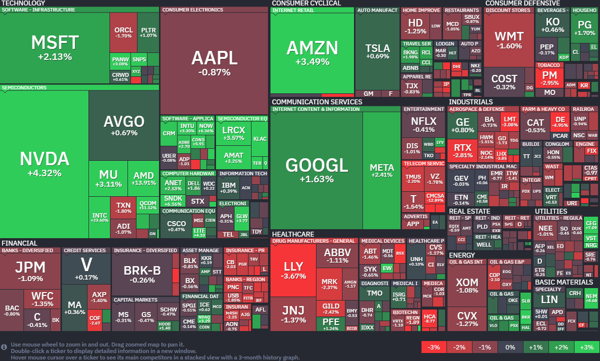

*출처: finviz .com*

#### 오늘의 증시

미국 증권시장이 24일(현지시간) 혼조세로 마감했다. S&P 500 지수와 나스닥 지수가 나란히 사상 최고치를 경신했다. 기술주 중심의 나스닥은 1.6% 넘게 급등했으나, 우량주 중심의 다우 지수는 소폭 하락하며 온도차를 보였다. 시장의 가장 큰 동력 첫째는 '중동 지역의 지정학적 긴장 완화 기대감'이고, 둘째는 '인텔의 어닝 서프라이즈'였다. 전쟁 공포가 줄고 반도체 업황에 대한 확신이 더해지자 투자자들이 지갑을 연 것이다. 더 웰스 얼라이언스(The Wealth Alliance) 최고 경영자 로버트 콘조는 "시장은 현재 중동 갈등을 옆으로 밀어두고 기업의 펀더멘털(기초 체력)에 집중하고 있다"며 "투자자들이 미국의 경제 기초 체력을 신뢰하면서 시장이 계속 우상향하고 있다"고 분석했다.

**중동 평화의 바람과 유가 하락**

오늘 시장이 가장 반긴 소식은 미국과 이란 사이의 대화 가능성이었다. 파키스탄 관리에 따르면, 이란 외무장관ㅇ ㅣ파키스탄 중재자들과 미국과의 2차 협상을 논의하기 위해 이슬라마바드에 도착할 예정이라고 한다. 여기에 트럼프 대통령이 이스라엘과 레바논 휴전을 3주 더 현장하기로 합의했다는 소식을 전하면서 시장의 불안감이 크게 해소됐다. 최근 호르무즈 해협에서 미국과 이란이 상선들을 나포하여 일촉즉발의 상황이었는데, '대화'의 장이 열린 셈이다. 이 소식이 전해지자 서부텍사스산원유(WTI) 선물 가격은 1.51% 하락하며 배럴당 94달러 선으로 내려왔다.

**인텔의 화려한 부활, 반도체 랠리를 이끌다**

기술주 상승의 일등 공신은 당연 인텔이었다. 인텔의 주가는 무려 23.6% 폭등했고, 이는 1987년 10월 이후 하루 최대 상승 폭이다. 인텔은 월스트리트의 예상을 뛰어넘는 1분기 실적을 발표했을 뿐만 아니라, 이번 분기 전망치(가이던스)도 매우 낙관적으로 내놓았다. 그동안 엔비디아 등에 밀려 고전하던 '반도체 형님' 인텔이 건재함을 과시하자 반도체 업계 전체에 온기가 퍼졌다. 덕분에 반도체 종목을 모아놓은 ETF인 'iShares Semiconductor ETF(SOXX)'는 18거래일 연속 상승이란느 대기록을 세우며 이번 주에만 11% 올랐다.

**CPU의 화려한 재발견과 AMD 급등**

AMD 주가가 특별한 자사 호재 없이도 하루 만에 12%나 급등했다. 라이벌인 인텔이 실적 발표를 통해 AI 구축에 필요한 CPU 수요가 엄청나다는 걸 보여주며 투자 심리를 자극했기 때문이다. 그동안 GPU에만 쏠렸던 관심이 AI 시대의 필수 기반인 CPU로 옮겨오면서, 전문가들도 AMD 목표 주가를 375달러까지 상향하며 큰 기대감을 드러내고 있다.

**원자력도 AI 열풍타고 급등**

차세대 원자력 발전 기업 'X-에너지'가 뉴욕 증시에 화려하게 데뷔했다. 상장 첫날 주가가 무려 27%나 급등하며 원자력 분야 역대 최대 규모인 10억 달러 이상의 자금을 조달했다. AI 산업의 급성장으로 전력 수요가 폭발하면서 원자력 에너지에 대한 투자자들의 관심이 집중된 결과다. 아마존 등 대기업들과 손잡고 차세대 원자로 기술을 선보일 X-에너지의 향후 행보가 기대된다.

AI가 불러온 해고 한파

메타와 마이크로소프트가 무려 2만 명 규모의 대규모 인력 감축을 예고하며 긴장감이 커지고 있다. 천문학적인 자금을 AI 인프라 구축에 쏟아붓는 대신, AI를 활용해 효율성을 높이고 인건비는 줄이겠다는 전략이다. 업계 전문가들은 이를 단순한 구조조정이 아닌 AI가 주도하는 노동 시장의 근본적인 체질 개선이 시작된 것으로 보고 있다. 급격한 기술 변화가 일자리 지형을 어떻게 바꿀지 지켜볼 필요가 있다.

**엔비디아, 주가 사상 최고치 경신하며 시총 5조달러 돌파**

24일(현지시간) 엔비디아의 주가는 전일 대비 4.32% 상승한 208.27달러에 장을 마감했다. 이 회사의 주가는 올해 들어 11.67% 올랐다. 엔비디아가 주가 사상 최고치를 경신하며 시가총액 5조달러 시대를 열었다. 2022년 말 이후 무려 14배 이상 폭등한 엔비디아의 성장세는 구글, 마이크로소프트, 메타, 아마존과 같은 빅테크는 물론 OpenAI, 앤스로픽 등 AI 모델 개발사들의 폭발적인 GPU 수요가 뒷받침하고 있다.

이날 엔비디아의 기록적인 랠리를 촉발한 기폭제는 의외로 경쟁사 인텔이었다. 전날 예상을 뛰어넘는 실적을 발표한 인텔의 주가가 1987년 이후 최고의 날을 보내며 24% 폭등하자 투자자들이 반도체 섹터 전반으로 몰려든 것이다. 이에 힘입어 AMD가 14%, 퀄컴이 11% 급등하는 등 칩 제조사 전반이 강한 오름세를 보이며 엔비디아의 시총 5조달러 달성을 견인했다.

투자자들은 다음 주 예정된 하이퍼스케일러(대규모 클라우드 기업)들의 실적 발표를 앞다투어 AI 칩 관련주를 사들이고 있다. 그동안 엔비디아는 AI 인프라 수요가 식지 않았음을 증명하며 시장의 주도권을 쥐어 왔으며, 이번 시총 5조달러 돌파는 전 세계적인 AI 열풍이 여전히 정점에 있음을 보여주는 상징적인 사건으로 평가받고 있다.

그러나 주요 고객사인 알파벳(구글)이 엔비디아의 대항마가 될 자체 칩을 발표하며 도전장을 내밀었다. 구글은 올해 말 클라우드 고객들에게 이 칩을 제공하며 엔비디아의 독점적 지위를 위협할 계획이다. 고객사가 잠재적 경쟁자로 변모하는 복잡한 구도 속에서도 시장의 자금은 여전히 엔비디아의 압도적인 하드웨어 장악력에 베팅하고 있다. 결국 엔비디아의 시총 5조달러 돌파는 다음 주 빅테크 실적 시잔의 화려한 서막과도 같다. 시장의 관심은 이제 아마존, 메타, 마이크로소프트 등 거대 기업들이 AI 인프라에 얼마나 더 많은 자본을 투입할 것인지, 그리고 그 투자가 엔비디아의 실적을 어디까지 더 끌어올릴 수 있을지에 쏠려있다.

**OpenAI의 GPT-5.5 공개**

OpenAI가 두 달만에 새로운 AI 모델 GPT-5.5를 공개했다. OpenAI는 이 모델이 현재 준비 중인 차세대 '슈퍼앱'의 핵심 엔진이 될거라고 밝혔다.

**노키아 1분기 영업이익 발표**

노키아의 1분기 영업이익이 시장 예상치를 웃돌았다. 휴대전화 제조 사업을 축소하고 AI 인프라 중심으로 포트폴리오를 전환한 전략이 실적 개선으로 나타났다.

**IBM과 서비스나우 실적 발표와 소프트웨어 주식 주가 급락**

23일(현지시간) IBM과 서비스나우의 실적 발표 이후, AI로 인한 시장 잠식 우려가 불거지면서 소프트웨어 주식들의 주가가 급락했다.

#### 국내 뉴스

**주요 기업 실적 발표**

국내 증시에서 HD건설기계, LG이노텍, 한화시스템, 한화오션, 안랩 등 주요 기업들의 실적 발표가 있다.

**라운드힐 메모리 ETF, 2주 만에 10억 달러 돌파**

삼성전자와 SK하이닉스 비중이 절반을 넘는 미국 상장 '라운드힐 메모리' ETF(티커명 DRAM)가 출시 2주 만에 10억 달러를 돌파했다.

**'코너스톤 투자자 제도' 도입**

공모주 상장 직후 급락을 막기 위해 '코너스톤 투자자 제도'가 도입된다. 기관이 공모주 물량을 사전 배정받는 대신 6개월 이상 보유하도록 하는 제도다.

---

**[Reference]**
매일경제
머니네버슬립
UPPITY
