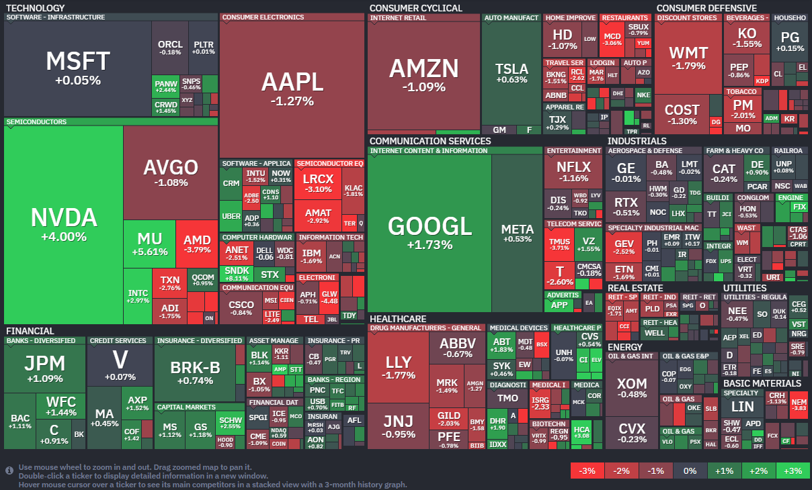

*출처: finviz .com*

#### 오늘의 증시

미국 증권시장이 27일(현지시간) 엇갈린 흐름을 보이며 마감했다. S&P 500 지수와 나스닥 지수는 나란히 종가 기준 사상 최고치를 경신하며 랠리를 이어갔지만, 상승 폭은 다소 제한적이었다. 반면 다우 지수는 소폭 하락하며 숨 고르기에 들어간 모습이다. 미국과 이란 사이의 평화 회담이 교착 상태에 빠졌다는 소식에 국제 유가가 급등하며 투자 심리를 억눌렀으나, 이번 주 예정된 '빅테크' 기업들의 대규모 실적 발표를 앞두고 시장에 흐르는 기대감이 지수 하락을 방어하며 기록적인 마감을 이끌어냈다. 바이탈 노리지(Vital Knowledge)의 아담 크리사풀리 설립자는 "회담 중단 소식이 단기적으로는 부정적인 변수지만, 전체적인 흐름은 여전히 갈등이 완화되는 방향으로 가고 있다고 본다"고 분석하며 지나친 확대 해석을 경계했다.

**멈춰버린 평화 회담과 '호르무즈 해협'의 긴장**

가장 큰 뉴스는 트럼프 대통령이 이란과의 휴전 협상을 위해 파키스탄에 보내려던 특사 파견 계획을 전격 취소했다는 소식이다. 트럼프 대통령은 자신의 SNS(트루스 소셜)를 통해 "이동하는 데 시간이 너무 많이 낭비된다"며 "우리가 모든 카드를 쥐고 있으니, 대화하고 싶으면 그들이 직접 전화하면 된다"고 특유의 강경한 태도를 보였다. 이 소식에 서부텍사스산원유(WTI)와 브렌트유 모두 큰 폭으로 올랐다. 특히 세계 원유 수송의 동맥이라 불리는 '호르무즈 해협'을 둘러싼 긴장감이 다시 높아진 것이 결정적이다. 팔콘 웰스의 가브리엘 샤힌 CEO는 "유가는 시장을 움직이는 핵심 동력"이라며 "호르무즈 해협이 안정되기 전까지는 이란 이슈가 시장의 최우선 관심사가 될 것"이라고 강조했다.

**매그니피센트7이 주도하는 슈퍼위크**

중동 리스크에도 불구하고 지수가 버틸 수 있었던 이유는 이번 주가 실적 시즌의 가장 중요한 고비인 '슈퍼위크'이기 때문이다. 특히 이번 주에는 시장을 이끄는 7개의 대형 기술주, 이른바 '매그니피센트 7(M7)' 중 무려 5개 기업이 실적을 발표한다. 시장은 이미 지난주부터 긍정적인 실적 기대감을 선반영하며 주가를 끌어올려 왔다. 투자자들은 지정학적 불안감보다는 당장 눈앞에 닥친 빅테크 기업들의 성적표에 더 집중하는 모양새다. 만약 이들 기업이 AI(인공지능) 분야에서 확실한 수익성을 증명한다면 중동발 악재를 뚫고 추가 상승을 노려볼 수 있다는 낙관론이 우세하다.

#### 주요 뉴스

**OpenAI와 마이크로소프트의 파트너십 전격 개편**

OpenAI는 마이크로소프트에 지급하는 수익 배분액에 상한선을 두기로 했고, 마이크로소프트의 클라우드 뿐만 아니라 아마존이나 구글 등 다른 서비스도 자유롭게 이용할 수 있게 되었다. 양사의 전략적 동맹은 계속되지만, OpenAI가 독립적인 서비스 확장을 위해 더 넓은 선택권을 갖게 된 셈이라 앞으로의 행보가 기대된다.

**메타, 중국 정부의 불허**

메타가 20억 달러를 들여 추진하던 AI 스타트업 '마누스(Manus)' 인수에 대해 중국 정부가 공식적으로 불허 명령을 내렸다. 싱가포르에 본사를 둔 마누스는 중국계 창업자들이 세운 기업으로, 중국 당국은 자국 AI 인재와 기술의 해외 유출을 막기 위해 이번 거래를 중단시킨 것으로 보인다. 소위 '싱가포르 세탁'을 통해 미,중 규제를 피하려던 기술 기업들에게 이번 조치는 상당한 압박이 될 것으로 보인다.

**에너지 거물 쉘, 캐나다 기업 '통큰' 인수**

글로벌 석유 메이저 쉘(Shell)이 캐나다의 에너지 기업인 ARC 리소스를 164억 달러에 인수하기로 했다. 이번 거래로 쉘은 하루 37만 배럴의 생산량을 추가로 확보하며 장기적인 석유 및 가스 자원 기반을 탄탄히 다지게 되었다. 본업인 에너지 사업 역량을 강화해 주주 가치를 높이겠다는 전략이라 앞으로의 성장이 기대된다.

**마이크론, 샌디스크 AI 메모리 수요 2030년까지 지속 전망에 주가 상승**

27일(현지시간)마이크론의 주가는 전일 대비 5.6% 상승한 524.66달러에 장을 마감했다. 같은 날 샌디스크의 주가는 8.11% 오른 1070.20달러에 장을 마감했다.

멜리우스 리서치가 발표한 보고서에 따르면 AI 구동에 필수적인 메모리 수요가 2030년까지 강력하게 유지될 것으로 전망됐다. 이에 따라 마이크론은 월요일 5.6% 상승하며 지난 1년동안 약 550%라는 경이로운 수익률을 기록했고 시가총액은 6000억달러에 육박하고 있다. 벤 라이즈 멜리우스 분석가는 마이크론에 대한 투자 의견을 매수로 상향하며, 향후 12개월 동안 주가가 41% 더 생승할 수 있다고 내다봤다. 라이즈는 "시장은 결국 AI가 가능하게 만든 비정상적일 정도의 마진 내구성과 수요 프로필에 대해 더 높은 가치를 지불하게 될 것"이라며 "현재 우리가 AI 사이클의 초기 단계에 머물러 있으며 메모리에 대한 필요성이 그 어느 때보다 강력하다"고 강조했다.

샌디스크 역시 이날 8.1% 급등하며 지난 1년 동안 무려 3000%가 넘는 폭등세를 기록했으며 시가총액 1570억달러를 돌파했다. 마크 뉴먼 번스타인 분석가는 "수치 자체가 모든 것을 말해준다"며 "매우 강력한 메모리 가격에 힘입어 기업들의 실적 전망치가 대폭 상향 조정되고 있다"고 평가했다. 샌디스크는 다음 주 분기 실적 발표를 앞두고 있어 투자자들의 기대감이 한층 고조된 상태다.

범용 메모리 부족에 따른 가격 폭등..5년 장기 계약 체결 확산

최근 메모리 가격의 폭등은 AI 데이터 센터의 핵심인 고대역폭메모리(HBM) 수요에서 비롯되었다. 마이크론과 삼성, SK하이닉스 등 주요 메모리 제조사들이 엔비디아와 AMD의 GPU에 직접 결합되는 HBM 생산에 범용 DRAM 공급 물량을 대거 투입하면서 일반 DRAM 시장의 공급 부족 현상이 심화된 것인데, 이로 인해 DRAM 시장은 2분기 연속 전 분기 대비 30%의 고성장을 기록하고 있다. 가트너는 올해 PC 가격이 약 17% 상승할 것으로 예측했으며 실제로 PC 내부에 들어가는 SSD 가격은 작년 12월 대비 2~3배나 폭등한 것으로 나타났다. 특히 SSD에 들어가는 낸드(NAND) 플래시 메모리를 제조하는 샌디스크는 AI 서버용 데이터 저장 장치 수요가 급증함에 따라 유례없는 호황을 누리고 있다.

불안정한 공급 상황 속에서 대형 클라우드 기업(하이퍼스케일러)들은 경쟁사보다 먼저 물량을 확보하기 위해 3년에서 최대 5년에 이르는 장기 공급 계약을 체결하고 있다. 대표적으로 브로드컴은 이미 2027년까지의 메모리 공급 물량을 확보한 상태다. 마이크론은 이에 대응하기 위해 싱가포르 낸드 공장 확장에 240억달러를 투입하고 뉴욕과 아이다호에 거대 팹을 건설하는 등 생산 능력 확대에 박차를 가하고 있다.

**미국 금융당국의 사모대출 관리 및 감독**

미국 금융당국에 부실 우려가 커진 사모대출 시장에 대한 관리, 감독에 본격적으로 나서고 있다..

**일본, 살상무기 수출 규정의 개정**

일본이 그간 원칙적으로 금지했던 살상무기 수출을 허용하도록 규정을 개정하고 중고 무기를 무상이나 저가로 개발도상국에 제공하는 것을 검토 중이다. 한편 미국과 드론 생산 협력도 추진 중인데, 중국을 견제하고 방산 공급망을 강화하려는 의도다.

**주요 석유제품 수입 감소와 미국산 원유 수입 증가**

중동 전쟁이 길어지면서 원유를 비롯한 주요 석유제품의 수입이 전년 대비 5.3% 감소했다. 한편 미국산 원유 수입은 전년보다 75.8% 증가하며 중동산을 대체하는 흐름을 보였다.

**구글과 아마존의 앤스로픽 투자**

구글이 앤스로픽에 최대 400억 달러(약 59조 원)를 투자하기로 결정했다. 아마존은 앞서 앤스로픽에 50억 달러(약 7조 원) 투자를 약속한 바 있다.

**딥시크 최신 모델 'V4' 아쉬운 성능**

딥시크가 최신 AI 모델 'V4'를 공개했지만 아쉬운 성능으로 파급력이 부족한 모습이다. 미국의 수출 통제로 고성능 AI 칩 확보가 어려운 상황이 영향을 미쳤다는 평가다.

**CPU 수요 상승 및 메타의 아마존 CPU 도입**

AI가 학습 중심에서 추론 중심으로 이동하면서 CPU 수요가 늘어나 인텔과 AMD 주가가 상승세다. CPU의 중요성이 날로 커지는 가운데, 메타는 아마존의 CPU 1000만 개를 도입한다고 밝혔다.

#### 주요 일정

**일본은행이 금융정책회의에서 기준금리를 결정한다.**

국내 증시에서 HD현대일렉트릭, 대우건설, 현대건설, 금호타이어, 두산로보틱스, 삼성SDI, 한화솔루션 등 주요 기업들의 실적 발표가 있다.

미국 증시에서 코카콜라, 코닝, GM, 비자, 스타벅스, 로빈후드, 블룸에너지 등 주요 기업들의 실적 발표가 있다.

#### 국내 뉴스

**쿠팡, 미국 상대 로비활동 중**

쿠팡이 정보유출 사태 이후 미국 정계와 정부부처를 상대로 로비 활동을 크게 늘리면서, 1분기 109만 달러(약 16억 원)를 지출한 것으로 나타났다.

**삼성전기 1분기 영업이익 증가 전망**

삼성전기의 1분기 영업이익이 36.3% 증가할 전망이다. AI 인프라 투자가 확대되며 적층세라믹콘덴서(MLCC) 등 고부가 기판 수요가 급증한 덕이다.

**국내 주요 웹툰 플랫폼, 불법 웹툰 사이트 폐쇄**

네이버웹툰과 카카오엔터테인먼트 등 국내 주요 웹툰 플랫폼들이 스페인어권 대형 불법 웹툰 사이트를 폐쇄했다. 누적 피해 규모가 수백억 원 이상에 이를 것으로 추산된다.

**우리나라 연금 지출 증가 속도**

IMF가 우리나라의 연금 지출 증가 속도가 주요 선진국 중 가장 빠를 거라고 전망한 가운데, 65세인 노인연령 기준을 단계적으로 높일 경우 30년 간 최대 600조 원을 절감할 수 있다는 연구 결과가 나왔다.

#### 부동산 소식

**청약통장, 일부 해지 법안**

청약통장을 일부만 해지할 수 있게 하는 법안이 나왔다. 지금은 급한 돈이 필요해도 통장을 통째로 깨야 하는데, 이 법안은 가입 기간은 살리고, 필요한 돈만 빼게 하자는 취지다. 올 1~3월 청약통장 해지자는 91만 명으로, 신규 가입자보다 약 10만 명 많았다.

**원룸 월세 70만원 대**

3월 서울 소형 원룸 평균 월세가 전달보다 5.2% 오른 71만 원으로, 70만 원 선을 넘어섰다. 강남구는 평균 100만 원대에 진입했고 서초, 성동, 용산이 그 뒤를 잇고 있다. 지역별로 뚜렷해진 월세 양극화가 주거비 부담을 키우고 있다.

**1분기 전국 땅값 상승**

올 1분기 전국 땅값이 0.58% 오르며 3년 넘게 상승세를 이어가고 있다. 서울(1.1%)은 전국에서 유일하게 1%대 상승률을 보였고 강남(1.5%), 용산(1.31%), 서초(1.26%)가 그 흐름을 주도했다. 반면 제주는 홀로 하락(-0.22%)했다.

#### 부동산 용어

**청약통장(주택청약종합저축)**

새 아파트를 청략하려면 보통 필요한 통장이다. 매월 2만~50만 원을 자유롭게 넣고, 일정 기간,납입 조건을 채우면 청약 1순위 자격을 얻을 수 있다. 국민주택과 민영주택 모두 이 통장 하나로 청약할 수 있다.

**청약가점제**

1순위 안에서 당첨 순서를 가르는 점수제다. 무주택 기간(최대 32점), 부양가족 수(최대 35점), 청약통장 가입 기간(최대 17점), 총 84점 만점이다. 점수가 높을수록 유리하고, 서울 인기 단지는 당첨선도 높게 형성된다.

---

**[Reference]**
매일경제
머니네버슬립
UPPITY

부딩
