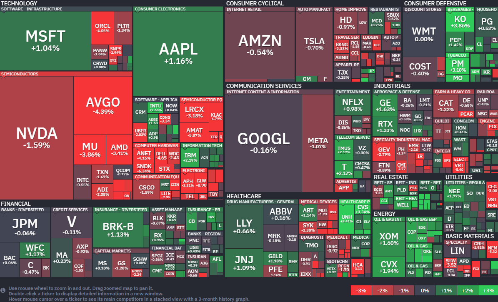

*출처: finviz .com*

#### 오늘의 증시

미국 증권시장이 28일(현지시간) 전날의 상승세를 뒤로하고 일제히 하락 마감했다. 사상 최고치 기록을 경신하던 S&P 500과 나스닥 지수는 뒷걸음질 쳤고, 다우 지수 역시 약보합권에 머물렀다. 시장을 끌어내린 주범은 인공지능 업계의 대장주 격인 OpenAI에 대한 우려 섞인 보고서와 다시 치솟기 시작한 국제 유가다. 특히 기술주 중심의 나스닥 하락 폭이 컸다. 장 초반에는 관망세가 짙었으나, 오후 들어 AI 수익성에 대한 의구심이 번지며 반도체주들을 중심으로 매도세가 쏟아졌다. 인티그레이티드 파트너스의 스티븐 콜라노 최고투자책임자(CIO)는 "내일부터 발표될 이른바 '매그니피센트 7' 기업들의 실적 발표를 앞두고, 투자자들이 일단 수익을 챙기려는 차익 실현 매물을 내놓으며 조심스러운 태도를 보이고 있다"고 분석했다. 그나마 다우 지수는 코카콜라가 예상치를 웃도는 어닝 서프라이즈를 기록하며 4% 가까이 급등한 덕분에 하락 폭을 방어할 수 있었다.

**OpenAI가 쏘아 올린 'AI 거품론'의 공포**

이날 시장을 가장 흔든 소식은 월스트리트저널(WSJ)의 보고서였다. 챗GPT로 전 세계 AI 열풍을 일으켰던 OpenAI의 매출과 신규 사용자 증가세가 자체 목표치에 못 미치고 있다는 내용이 보도된 것이다. 여기에 더해 OpenAI의 최고재무책임자(CFO)인 사라 프라이어가 "매출이 충분히 빠르게 늘지 않는다면 향후 막대한 AI 연산 비용(컴퓨팅 계약)을 감당하지 못할 수도 있다."고 경영진에게 우려를 표했다는 사실이 알려지며 투자 심리가 급격히 얼어붙었다. 이 소식은 즉각 반도체 섹터의 폭락으로 이어졌다. 'OpenAI가 돈을 못 벌면, 굳이 엔비디아의 칩을 더 살 이유가 없지 않을까?'하는 우려가 시장을 지배했다. 반도체 기업들의 주가를 모아놓은 상장지수펀드(ETF)인 SMH는 이날 하루에만 3%나 빠졌다. 이번 주는 알파벳, 아마존, 메타, 마이크로소프트, 애플 등 빅테크 기업들의 실적 발표가 몰려 있는 만큼, AI에 쏟아부은 천문학적인 돈이 실제로 수익으로 연결되고 있는지를 증명해야 하는 무거운 숙제를 안게 되었다.

**다시 불붙은 중동 긴장과 유가 $100 돌파 압박**

미국과 이란 사이의 평화 협상이 교착 상태에 빠졌다는 소식이 전해졌다. 도널드 트럼프 대통령은 당초 이란과의 휴전 논의를 위해 특사팀을 파견하려던 계획을 취소하고, "협상은 전화로도 가능하다"며 압박 수위를 높였다. 이에 이란 외무부 역시 "현재 미국과의 회담 계획은 없다"고 맞받아치면서 긴장감이 고조되었다. 이 여파로 서부텍사스산원유(WTI) 선물은 3% 이상 급등하며 배럴당 99.93달러로 마감, 심리적 저항선인 100달러 턱밑까지 차올랐다. 브렌트유 역시 2.8% 오른 111.26달러를 기록했다 .시장은 특히 '호르무즈 해협'의 재개방 여부에 주목하고 있다. 이 해협은 전 세계 석유 수송의 혈관과도 같은 곳인데, 최근 이란 측에서 전쟁 종료와 미국의 봉쇄 해제를 조건으로 개방 가능성을 언급한 바 있다. 하지만 협상이 결렬될 경우 에너지 공급망 불안이 지속될 수 밖에 없어 인플레이션 우려를 다시 자극하고 있다.

#### 주요 뉴스

**코카콜라 실적과 예상을 뛰어넘는 1분기 실적**

코카콜라가 전 세계적인 수요 증가에 힘입어 시장 예상을 뛰어넘는 1분기 실적을 발표했다. 매출과 이익 모두 전망치를 웃돌자, 올해 전체 이익 성장 가이드라인도 8~9%로 상향 조정했다. 중동 분쟁과 인플레이션 등 대외적인 불확실성 속에서도 제로 슈거와 프리미엄 제품군이 성장을 이끌어준 덕분이다.

**에어버스 실적 반토막**

에어버스의 1분기 영업이익이 엔진 공급 부족 여파로 전년 대비 52%나 급감했다. 주력 기종의 인도 실적이 작년보다 줄어들며 수익성에 직격탄을 맞은 것이다. 부품 공급사인 프랫앤휘트니의 생산 차질이 실적 성장의 발목을 잡고 있는 상황이다. 공급망 문제를 해결하고 올해 인도 목표치를 달성할 수 있을지 주목된다.

**스포티파이 실적과 주가 반비례**

스포티파이가 시장 예상을 웃도는 1분기 실적을 발표했지만 주가는 오히려 13% 넘게 급락했다. 다음 분기 유료 구독자 증가세와 영업이익 전망치가 시장의 기대에 미치지 못한 것이 원인이다. 수익성 개선을 위해 가격 인상 카드까지 꺼내 들었음에도 불확실한 미래 가이드 라인에 투자자들이 민감하게 반응한 모습이다.

**약값 정책, 18개월 뒤가 문제**

노바티스 CEO가 트럼프 정부의 '최혜국 대우(MFN)' 약가 정책이 향후 18개월 내에 제약사와 환자들에게 큰 영향을 미칠 것이라고 경고했다. 이 정책은 미국의 약값을 다른 부유한 국가 수준으로 낮게 묶는 방식인데, 제약사들은 수익성 악화로 인해 혁신에 대한 보상이 줄어들까 우려하고 있다. 자칫 신약 출시가 늦어져 환자들이 제때 치료받지 못하는 상황이 올 수도 있는 만큼, 앞으로의 파장을 주의 깊게 지켜볼 필요가 있다.

**목표치 미달에 내부 갈등, 상장 앞둔 OpenAI의 성장통**

28일(현지시간) OpenAI의 주요 파트너사인 엔비디아의 주가는 1.59% 내린 213.17달러에, 오라클은 4.05% 내린 165.96달러에 장을 마감했다. 특히 OpenAI에 600억달러 이상을 투자하기로 한 소프트뱅크 그룹의 주가는 도쿄 시장에서 9.86% 내린 5268엔에 장을 마감했다.

월스트리트저널(WSJ)의 보도에 따르면 OpenAI의 최고재무책임자(CFO)인 사라 프라이어가 매출 성장 속도가 뒷받침되지 않을 경우 향후 인공지능 연산에 필요한 컴퓨팅 계약 비용을 지불하기 못할 수도 있다는 우려를 경영진에 전달했다. 이사회 역시 최근 몇 달간 데이터 센터 계약을 면밀히 검토하며, 사업 성장세가 둔화되었음에도 불구하고 더 많은 컴퓨팅 파워를 확보하려는 샘 올트먼 최고 경영자(CEO)의 행보에 의문을 제기하고 있다. 여기서 컴퓨팅 파워란 AI 모델을 훈련시키고 작동시키는 데 필요한 서버와 데이터 센터의 처리 능력을 말한다. 기사에 따르면 샘 올트먼은 그동안 컴퓨팅 부족이 성장의 가장 큰 걸림돌이라고 주장하며 작년 한 해에만 미래 지출 약속으로 6000억달러를 쏟아붓는 공격적 매수 전략을 펼쳐왔다. 하지만 기대만큼 돈이 벌리지 않자, 살림을 책임지는 CFO와 갈등이 생긴 것이다.

실제로 챗GPT의 성장은 작년 말부터 눈에 띄게 둔화되었다. OpenAI는 작년 말까지 챗GPT의 주간 활성 사용자(WAU) 10억명 돌파를 목표로 세웠으나 이를 달성하지 못했다. WAU는 일주일 동안 얼마나 많은 사람이 실제로 서비스를 이용했는지 나타내는 시표로, 서비스의 인기를 증명하는 핵심 수치다. 이 목표 달성 실패 소식에 투자자들도 불안해하고 있다. 게다가 구글의 AI 모델인 제미나이가 점유율을 치고 올라오고, 코딩 및 기업용 시장에서는 앤스로픽에 밀리며 월간 매출 목표를 여러 번 놓치기도 했다.

물론 OpenAI가 위태롭기만 한 것은 아니다. 최근 실리콘밸리 역사상 최대 규모인 122억달러의 투자 유치에 성공하며 재무적 기반은 마련했기 때문이다. 하지만 워낙 쓰는 돈이 많아서 야심 찬 매출 목표를 달성한다는 가정하에도 이 막대한 자금을 향후 3년 안에 모두 소진할 것으로 예상된다. OpenAI를 둘러싼 대외적 환경도 녹록지 않다. 현재 OpenAI는 2인자였던 피지 시모가 갑작스럽게 병가를 내며 리더십 공백이 생긴 상태고, 설상가상으로 일론 머스크가 샘 올트먼의 해임과 OpenAI의 영리 기업 전환 취소를 요구하며 제기한 소송의 재판도 이번 주에 시작되었다.

**일론 머스크 'X', 새 금융 서비스 'X머니' 출시**

머스크 테슬라 CEO의 SNS 플랫폼 엑스가 이달 새로운 금융 서비스 'X머니'를 출시한다. 3%까지 캐시백을 제공하고, 예치금에 최대 연 6% 수준의 금리를 제공할 예정이다.

**중국 정부, AI 기술 유출을 막기위해 메타에 제동**

중국 정부가 AI 스타트업 마누스를 인수하려던 메타에 제동을 걸었다. 자국 AI 기술의 해외 유출을 막으려는 목적이다.

**OpenAI, 스마트폰 프로세서 개발**

OpenAI가 미디어텍, 퀄컴과 협력해 스마트폰 프로세서 개발에 나선다. AI 디바이스 경쟁이 본격화될 가능성이 커지고 있다.

#### 국내 주요 뉴스

**국내 구글 협력 거점 역할의 AI 캠퍼스 설립 예정**

이재명 대통령이 우리나라를 찾은 데미스 하사비스 구글 딥마인드 CEO를 만나 AI 시대의 기본소득 필요성에 대한 공감대를 형성하고, 협력을 논의했다. 구글은 국내에 협력 거점 역할을 할 AI 캠퍼스를 설립할 예정이다.

**코스피, 코스닥 시가총액 6000조 원 돌파**

코스피와 코스닥 합산 시가총액이 처음으로 6000조 원을 넘어셨다. 명목 국내총생산(GDP)의 2.3배 규모로 '프리미엄' 구간에 진입한 가운데, 최근 급등세가 지나치다는 우려도 있다.

**한화, 중동에 방산 ETF 상장 예정**

중동에서 방산으로 입지를 다진 한화가 방산 ETF를 현지 금융 증시에 상장한다. 중동의 자금을 국내 자본시장으로 끌어온다는 구상이다.

**전력기기주 강세, AI 인프라 확대 및 북미 노후 전력망 교체 수요 증가**

AI 인프라 확대와 북미 노후 전력망 교체 수요에 힘입어 전력기기주가 강세를 이어가고 있다. 효성중공업은 지난 1년 사이 주가가 약 700% 이상 급등했다.

**삼성전자, 중국 사업 철수 가능성**

삼성전자가 연내 중국에서 가전, TV 판매 사업을 철수한다는 보도가 나왔다. 회사 측은 아직 결정된 것이 없다고 밝혔다.

**임원 보수와 성과 공개하는 공시 개정안 시행**

다음 달부터 임원 보수와 성과를 함께 공개하는 공시 개정안이 시행된다. 그동안은 총액만 공개돼 투자자들이 적정 수준 여부를 판단할 근거가 없었다.

---

**[Reference]**
매일경제
머니네버슬립
UPPITY
