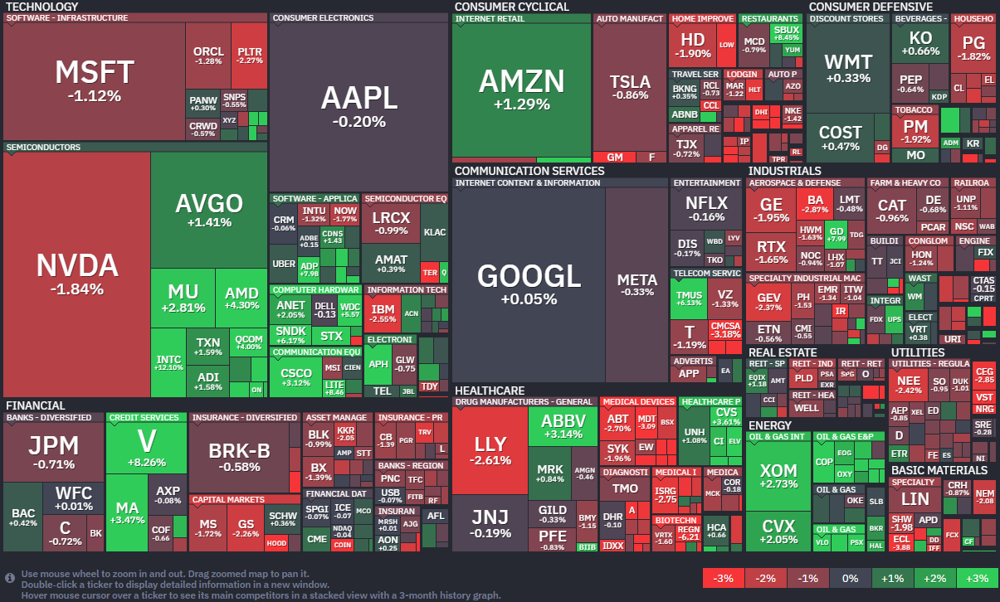

*출처: finviz .com*

#### 오늘의 증시

29일(현지시간) 미국 증시는 다소 무거운 분위기였다. 특히 다우 지수는 5거래일 연속 하락하며 48,000선으로 내려왔다. 가장 큰 원인은 '국제 유가'였다. 미국이 이란 항구를 봉쇄한다는 소식에 에너지 가격이 급등하자, 물가가 다시 오를 수 있다는 공포가 시장을 덮쳤다. 여기에 Fed가 금리를 동결하며 신중한 태도를 보였다. 다만 나스닥 지수는 실적 발표를 앞둔 빅테크들에 대한 기대감과 일부 반도체 기업들의 깜짝 실적 덕분에 아주 미세하게나마 상승했다. SWBC 투자 책임자 크리스 브리가티는 "시장의 시선은 이제 기업들의 인공지능에 쏟아부은 막대한 돈이 실제 수익으로 돌아오고 있는지를 증명하는 '가이던스'에 쏠려 있다"고 분석했다.

오늘 시장을 가장 흔들었던 건 유가의 폭주다. 서부텍사스산원유(WTI)가 하루 만에 7% 넘게 폭등하며 배럴당 100달러를 훌쩍 넘어섰다. 도널드 트럼프 대통령이 이란의 핵 프로그램 문제를 해결하기 위해 이란 항수에 대한 장기 봉쇄를 준비하고 있다는 소식이 전해졌다. 이란은 이에 맞서 전 세계 원유 수송의 동맥인 호르무즈 해협을 다시 열겠다고 제안했지만 트럼프 대통령이 이를 거절했다. 기름값이 오르면 물가(인플레이션)가 오르고, 물가가 오르면 연준은 물가를 잡기 위해 금리를 높게 유지할 수 밖에 없다. 금리가 높으면 기업들은 돈을 빌리기 힘들어지고 소비는 줄어들어 주가에는 악재가 된다.

**파월의 '작별 인사'와 연준 내의 반란**

이번 4월 연방공개시장위원회(FOMC) 회의에서 연준은 기준 금리를 3.5%~3.75% 범위에서 동결하기로 했다. 사실 동결 자체는 시장이 예상했던 결과라 놀랍지 않았지만 그 이면의 내용이 심상치 않았다. 이번 결정에는 투표권을 가진 위원 12명 중 무려 4명이 반대표를 던졌다. 1992년 이후 30여 년 만에 가장 많은 반대표가 나온 것이다. 이는 현재 경제 상황을 두고 연준 내부에서도 의견이 거세게 갈리고 있음을 보여준다. 제롬 파월 의장은 오는 5월 임기가 끝나지만 의장직에서 물러난 뒤에도 '연준 이사'직은 유지하겠다고 밝혔다. 차기 의장으로 지명된 케빈 워시가 트럼프 대통령의 측근인 만큼 파월이 이사로 남아 연준의 독립성을 지키는 방패 역할을 하려 한다는 해석이 나온다.

#### 주요 뉴스

**구글 모기업 알파벳의 놀라운 1분기 실적**

구글의 모기업 알파벳이 시장 예상을 뛰어넘는 놀라운 1분기 실적을 발표했다. 특히 구글 클라우드 매출이 AI 솔루션 수요에 힘입어 전년 대비 63%나 급성장하며 전체 실적을 견인했다. 알파벳은 AI 주도권을 잡기 위해 2026년 시설 투자(CapEx) 규모를 최대 1,900억 달러까지 상향 조정하고 내년에는 이보다 더 공격적으로 투자를 확대할 계획이라고 밝혔다.

**벤모, 홀로서기 준비 중**

페이팔의 새 CEO 엔리케 로레스가 인기 결제 앱 '벤모'를 별도의 독립 사업부로 분리하기로 했다. 이는 벤모의 성과를 더욱 정밀하게 관리하고, 향후 잠재적인 매각 절차를 더 쉽게 만들기 위한 전략적 포석으로 풀이된다. 스트라이프 등 경쟁사들이 페이팔을 주시하고 있는 상황에서, 이번 조직 개편이 어떤 변화의 신호탄이 될지 업계의 관심이 쏠리고 있다.

**아마존, 클라우드 매출 28% 급증하며 '어닝 서프라이즈'**

29일(현지시간) 아마존의 주가는 전일 대비 1.29% 상승한 263.04달러에 장을 마감했다. 이 회사의 주가는 최근 한달 동안 30.9% 올랐다.

아마존의 클라우드 사업 부문인 아마존 웹 서비스(AWS)가 올해 1분기 28%의 매출 성장률을 기록하며 시장 예상치를 가뿐히 뛰어넘었다. 아마존의 발표에 따르면 AWS 분기 매출은 375억9000만달러로, 전년 동기 292억7000만달러에서 큰 폭으로 늘어났다. 이는 증권가 예상치였던 366억4000만달러를 웃도는 수치다. 이로써 AWS는 아마존 전체 매출의 약 21%를 차지하며 명실상부한 그룹의 핵심 엔진임을 입증했다. 수익성 측면에서도 괄목할 만한 성과를 거뒀다. AWS의 영업이익은 전년 대비 약 23% 증가한 121억6000만달러를 기록하며 시장 컨센서스인 128억4000만달러를 크게 상회했다. 아마존 전체 수익의 막대한 비중을 차지하는 AWS의 이 같은 성장은 공격적인 AI 인프라 투자와 파트너십 확대가 실질적인 매출로 이어지기 시작했음을 보여준다. 특히 이번 분기에는 AI 반도체 기업 세레브라스의 저지연 실리콘을 기반으로 한 클라우드 서비스를 도입한다고 밝히는 등 기술적 차별화에도 속도를 내고 있다. 클라우드 인프라 시장의 절대 강자 자리를 지키기 위해 고성능 하드웨어와 소프트웨어 생태계를 동시에 강화하는 전략이 실적에 긍정적인 영향을 미친 것으로 풀이된다.

**아마존의 OpenAI와 앤스로픽에 천문학적 베팅**

AWS는 이번 실적 발표와 함께 AI 연구소들과의 파트너십을 전례 없는 규모로 확대하며 경쟁사들과의 쩐의 전쟁을 선포했다. OpenAI는 기존 380억달러 규모의 AWS 이용 약정을 향후 8년간 1000억달러 더 늘리기로 했으며, 아마존은 이에 화답하듯 OpenAI에 500억달러를 직접 투자하기로 했다. 또한 최근 앤스로픽에도 기존 80억달러 외에 추가로 최대 250억달러를 더 투자하기로 합의하며 AI 인프라 구축에 사활을 걸고 있다 .이러한 공격적 행보는 마이크로소프트와 구글의 매서운 추격을 따돌리기 위한 포석이다. 같은 날 실적을 발표한 마이크로소프트 애저는 40%, 구글 클라우드는 무려 63% 매출 성장률을 기록하며 AWS의 점유율을 위협하고 있다. 이에 대응해 AWS는 이번 주부터 OpenAI 모델을 자사 AI 앱 구축 서비스인 아마존 베드락에서 공식 제공하기로 하는 등 MS의 독점 구도를 깨고 고객 선택권을 넓히는 전략을 취하고 있다. 결국 아마존의 이번 실적은 AI 시대의 클라우드 경쟁이 단순한 인프라 제공을 넘어 누가 더 강력한 AI 모델 생태계를 품느냐의 싸움으로 번졌음을 시사한다. 아마존은 OpenAI라는 거물급 파트너를 포섭하고 앤스로픽과의 결속을 다짐으로써 클라우드 1위 수성을 위한 가장 강력한 방어선을 구축하게 됐다.

#### 국내 주요 뉴스

**코스피 사흘 연속 사상 최고치 경**

코스피가 29일 OpenAI의 성장 둔화 우려에도 불구하고 개인과 기관의 매수에 힘입어 사흘 연속 사상 최고치를 경신하며 6,690.90에 마감했다.

**LS일렉트릭의 배전 솔루션 공급 계약 체결**

LS일렉트릭이 블룸에너지와 2억2000만 달러(약 3190억 원) 규모의 배전 솔루션 공급 계약을 체결했다는 소식에 전력주가 동반 상승했다.

**삼성SDI, 1분기 적자 폭 감소**

삼성SDI가 ESS 수요 회복에 힘입어 지난 1분기 적자 폭을 크게 줄였다. 고유가 시대의 전기차 수요와 AI 데이터센터 수요를 바탕으로 하반기 흑자 전환을 목표로 하고 있다.

**정부, 공공부문 기간제 노동 처우 개선**

정부가 내년부터 공공부문에 종사하는 1년 미만 기간제 노동자에게 공정수당을 지급하기로 확정했다. 퇴직금 지급 회비 목적의 '쪼개기 계약'도 원칙적으로 금지된다

**정부, 에너지 저소비 제품과 할인 혜택 제공**

정부가 에너지절약마크를 부착한 에너지 저소비 제품을 지역사랑상품권으로 구입하면 최대 5%p의 할인 혜택을 추가로 제공한다.

---

**[Reference]**
매일경제
머니네버슬립
UPPITY
