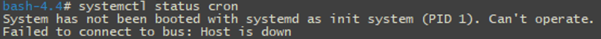
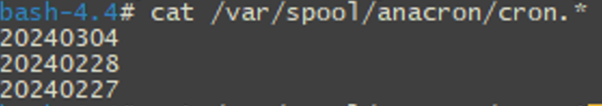
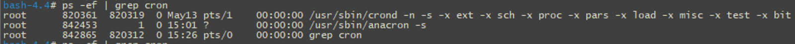
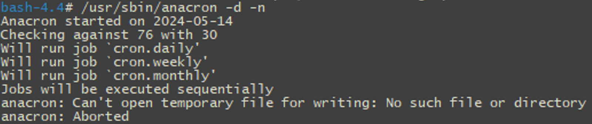
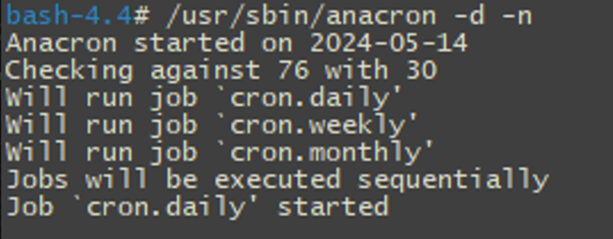
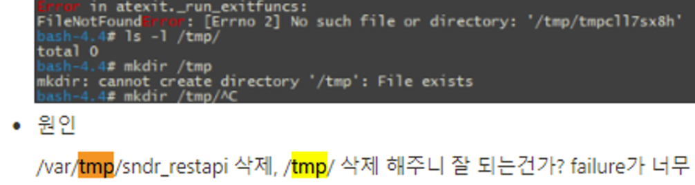

> ※ 아래 내용은 CentOS 8을 기준으로 하고 있습니다.
> ※ crond (daemon) 를 기준으로 하고 있습니다.

**crond가 작동하지 않는 원인 몇 가지**

1. crond가 실행하는 스크립트에 실행 권한이 있는가?
2. 환경변수 설정은 제대로 되어 있는가?
3. Debian을 사용하는가, CentOS를 사용하는가? 이 둘은 /etc/cron* 하위 스크립트의 저장 방식이 다르다고 한다.
4. 혹시 /tmp 디렉토리가 올바르게 존재하는가? (나의 케이스였다.)

**crond 디버깅 시 고려해봐야 할 것**

1. /etc/cron* 아래 스크립트를 테스트 모드로 실행해 보았는가?
2. crond가 모두 정상 작동하지 않는가? ( cron.hourly, cron.daily 등 ) 이 중, 혹시 cron.daily만 작동하지는 않는가?
3. anacron에 문제가 있는가?

---

> ※  아래 내용은 제가 crond 문제를 해결하기 위해 삽질한 이야기입니다. 재밌게 읽어주세요.
> ※  기승전결 중에 '결' 부분은 맨 아래에 나옵니다.
> ※  내용과 관련하여 질문이 있으시거나 잘못된 부분이 있다면 댓글 부탁드립니다.

## 나의 트러블슈팅 이야기

만약 당신이 cron이 제대로 동작하지 않아 여기까지 흘러들어왔다면, 대게는 위에 적혀있는 몇 가지 원인 때문일 것이다.
하지만 나의 경우는 예외였다. 트러블슈팅이 무척 어려웠다. 정말이지 구글링으로 정보를 얻는 게 너무 x100 힘들었다. 무엇보다 초반부터 문제의 근본적인 원인을 파악할 때 포커스에서 살짝 빗나간 바람에, 잘못된 걸 붙들고 꽤 오랜 시간을 삽질했다. 부끄럽지만 나는 이 crond 문제를 해결하는 데까지 (좌절하는 시간 포함해서) 일주일 넘게 걸렸다.

아래에는 내가 crond 트러블슈팅을 어떻게 했는지 그 과정을 정리해 보았다. 개인적으로 이 과정을 꼭 정리하고 싶었는데, 그 이유는 crond가 동작하지 않는 수많은 케이스 중 나의 케이스가 굉장히 독특했기 때문이다. 나와 동일한 케이스로 crond를 고치느라 애먹는 사람이 있다면 (거의 없겠지만) 아마도 굉장한 어려움을 겪고 있을 것이다. 만약 그 사람이 한국인이라면, 내 글을 통해서 조금이나마 시간을 아끼시길 바란다.

#### cron이란?


*출처 - PC Freak.Net*

[위키 백과](https://ko.wikipedia.org/wiki/Cron)를 보면 UNIX 운영체제에서 사용하는 잡 스케쥴러 유틸리티라고 적혀 있다.
쉽게 말해서, 로그 백업 같은 매일매일 반복해야 하는 행동들을 cron 유틸리티에 등록해 놓으면 운영체제가 자동으로 처리해 주게끔 할 수 있다. crond는 cron + daemon을 의미한다.

나는 당시 담당하고 있는 제품의 기능 중 한 가지(A라고 칭함)를 자동화하는 방식으로(B라고 칭함) 개선시키는 작업을 했고, 설계 단계부터 crond를 사용하는 것을 염두하고 개발을 시작했다.

기존의 A 기능은 사람이 매일, 또는 적어도 일주일에 한 번씩 수동으로 작업해야 하는 기능이다. 아무래도 수동 작업하는 시간이 쌓이면 시간 낭비로 이어지기 쉽고, 휴먼 에러가 발생할 가능성이 생길뿐더러 무엇보다 번거로우니 이를 자동화하는 B 기능을 만들고자 했다.

그리고 개발을 마친 후 테스트를 진행했다. 기대했던 결과는 B 기능이 crond에 의해 매일매일 실행되면서 3일 전 데이터를 가지고 자동으로 기능이 수행되길 원했다. 그런데 웬일인지 crond가 정상 작동하고 있지 않았다. 로그 백업도 되고 있지 않았다. 무려 두 달가량 전부터...

내가 사용하고 있는 테스트 장비에서는 이전부터 crond를 로그 백업 등의 용도로 잘 사용하고 있었다. 또 웬만해서는 cron 관련 설정 파일을 건드릴 일이 없기 때문에 큰 문제가 있지 않은 이상 정상 동작이 보장되는 데몬이다. 게다가 그간 제품 경험을 하면서 cron 관련 이슈는 한 번도 본 적이 없었기에 cron을 꽤나 안정적인 유틸리티라고 생각하고 있었다. **그런데 왜 하필 내 테스트 장비에서만 crond가 동작하지 않는 걸까. 그리고 왜 이런 이슈가 나온 걸까.**

나는 새로 개발한 B 기능의 테스트를 하기 위해서는 무조건 crond가 정상 동작을 했어야 했다. 이 문제가 해결되지 않으면 테스트를 할 수 없고 기능 개발을 마무리할 수 없기 때문이다.

기능 테스트가 우선이라고 생각한 나는 처음 생각한 해결 방법으로 해당 도커를 내렸다 다시 올리는 걸 떠올렸다. 대게는 도커를 재구동하면 대부분의 문제가 해결되고 초기의 정상 상태로 돌아가기 때문이다.

**그런데 과연 이게 괜찮은 해결 방법일까?**
막상 도커를 내려버리기엔 가장 염려가 되었던 부분이
1. 그동안 crond는 거의 문제를 일으키지 않는 유틸리티였다. 따라서 그런 crond가 제대로 안 돈다는 것은 생각보다 더 큰 문제일 수 있다.
2. 만약 제대로 트러블슈팅 하지 않고 지나가서 나중에 동일한 문제가 발생한다면 어떻게 할 것인가? 만약 고객사에서 동일한 문제가 발생한다면 어떻게 할 것인가? 실제 고객사에서는 도커를 내렸다 올리는 행위는 웬만해서는 하면 안 되는 행위다.
3. 결정적으로, crond가 마지막으로 정상 작동했던 (cron.daily의 작업 리스트 중 logrotate가 마지막으로 정상 작동했던) 날짜가 고객사 마지막 패치 날짜와 비슷한 시기였다. 따라서 고객사에서도 동일한 이슈가 발생했을지 모른다. 잠재적인 위험성이 크다고 판단했고 내 입장에서는 무조건 crond를 고칠 해결 방법을 찾아야 했다.

다행히 즉시 확인한 결과 고객사에서는 아무 문제가 없었다. 고객사 장비와 테스트 장비에 무슨 차이가 있었길래 테스트 장비에서만 이런 문제가 나온 걸까.

앞에서 상술한 여러 의문점들과 함께, 시간이 조금 걸리더라도 테스트 장비에서 트러블슈팅을 제대로 하는 게 맞다고 판단했다.

(적다 보니 생각난 방법인데, 트러블슈팅과 별개로 B 기능 테스트 시간을 아끼기 위해서 중복 이름을 피해서 정상 도커를 띄우고 거기서 테스트했어도 됐었겠다. 시간을 많이 아낄 수 있었을 듯. 당시에는 당황해서 이런 생각을 못했다.)

#### 다음 몇 가지의 crond가 동작하지 않는 이유들, 또는 crond 에러 해결 방법들

cron error와 관련한 구글링 서치 결과, cron이 동작하지 않는 이유로 대략 다음의 것들을 제안한다.

**1. systemctl에서 cron 상태는 어떠한가?**
**2. crond가 실행해야 하는 스크립트의 실행 권한은 어떠한가?**
**3. crond가 실행하는 스크립트에서 문제가 있진 않은가? (스크립트 자체의 문제가 아닌가?)**

하나씩 살펴보았다.

**1. systemctl에서 cron 상태는 어떠한가?**

=&gt; 도커 내에서 systemctl 명령어가 다음과 같은 이유로 작동하지 않았다.



cron 뿐만 아니라 도커 안에서 systemctl 자체가 전혀 먹지 않았다. 이 현상부터 해결하고자 도커의 yml을 수정해서 도커 내에서도 systemctl 명령어가 정상 작동하도록 하려고 했으나 실패.
혹시나 해서 crond가 **정상 작동하는 테스트 장비를 확인해 보니 거기서도 동일한 이유로 systemctl 명령어가 먹지 않았다.** **일단 systemctl로는 할 수 있는 게 없었다. 다른 방법을 찾아야 했다.**

**2. crond가 실행해야 하는 스크립트의 실행 권한은 어떠한가?**

```bash
-rwxr-xr-x 1 root root  77 Jul 16 10:33 B.sh
```

cron 에러로 서치 했을 때 대부분의 사람들이 겪은 문제는 스크립트의 실행 권한과 관련되어 있었다. **하지만 이것도 다른 정상 케이스와 다를 바가 없었고, 실행 권한도 전혀 문제가 없었다.**

**3. crond가 실행하는 스크립트에서 문제가 있진 않은가? (스크립트 자체의 문제가 아닌가?)**

=&gt; 수동으로 해당 스크립트를 실행했을 때 아무런 문제가 발생하지 않았었다.
혹시나 싶어 **test 모드로 스크립트를 실행했을 때도 문제가 없었다.**

#### 그런데, 여기서 이상한 점을 발견했다. cron.hourly는 정상 작동 하고 있었다.

위에서 나는 매일 3일 전 데이터를 가지고 B 기능을 수행하도록 설계했다고 적었다. "매일" 작업을 수행하는 것은 /etc/cron.daily 하위 스크립트들이다. 더불어 cron.daily에서 작업을 하는 logrotate 같은 로그 백업 기능도 전혀 일어나고 있지 않았다.

그런데 이상한 점이 있었다. **cron.hourly에서 실행하도록 설정한 disk cleaner 스크립트는 정상 작동을 하고 있었다.**
**cron 자체의 문제인 줄 알았는데, cron.daily만 문제가 있고 cron.hourly는 정상인 걸까?**

굉장한 미궁에 빠져들었다.
혹시나 싶어 B 기능을 수행하는 스크립트를 cron.hourly로 옮겨보았더니 너무 잘 작동하는 게 아닌가??? 그래서 구글링의 방향을 바꾸었다. 계속 crond error 또는 crond not running 또는 crond dont work 로만 검색하고 있었다면, 방향을 바꾸어 **centos why dont work only cron.daily but work cron.hourly로** 검색하기 시작했다. (영어 문법이 맞는지는 모르겠다.)


**마침내 나와 비슷한 상황의 사람들을 발견했다.**

**1. [Cronjob cron.daily does not run (debian) [closed]](https://stackoverflow.com/questions/14647447/cronjob-cron-daily-does-not-run-debian)**
답변자들이 제안한 것들은 다음과 같다.

**1-1) 스크립트 문제인가? 스크립트 내부에 오류가 있다거나, 실행 권한이 없다거나, 스크립트 파일 이름에 점이 있는가?**

```bash
run-parts -v --report /etc/cron.daily
```

=&gt; 이미 스크립트 문제가 아니라는 것은 확인했다. 또한 스크립트에 점이 있는 경우, 즉 B.sh 가 아니라 B 여야만 동작을 할 것이라는 답변과 관련해서, 나는 이에 해당되지 않았다. 다른 정상 장비에서도 B.sh과 같은 형태임에도 정상 작동을 하고 있었고, 이 케이스는 데비안에서만 발생하는 문제란다. 나는 CentOS 8 환경이어서 상관이 없는 내용이다.

**1-2) anacron이 설치되어 있는가?**
**=&gt; anacron이 갑자기 왜 등장하는가? anacron과 cron이 관련이 있는가?**
그러고 보니 ps -ef | grep cron으로 프로세스를 확인할 때,


위와 같이 anacron은 실행 중이었다. 하지만 관련 답변에 따르면 anacron이 설치되어 있다면 daily, weekly, monthly는 실행되었어야 한다. 내 장비에서는 anacron은 이미 설치된 상태였다.

**2. [Debian daily cron job won't run, but does run in cron.hourly.](https://www.linuxquestions.org/questions/linux-general-1/debian-daily-cron-job-won%27t-run-but-does-run-in-cron-hourly-946114/#google_vignette)**

=&gt; 놀랍게도 여기 또한 마찬가지로 **anacron** 이야기가 등장한다.
하지만 답변자가 제안한 내용은 서버가 OFF 상태일 때를 가정한 것이었다. 답변자 말에 따르면 cron.daily는 서버가 OFF 상태일 때 동작하지 않으니 이를 해결하기 위해서 anacron을 사용한다고 한다. 하지만 질문 작성자의 입장과 동일하게 나의 테스트 장비도 24시간 구동되는 장비다.
이때 나는, 내 케이스가 서버의 ON/OFF 상태와 상관이 없으므로 anacron과도 관련이 없다고 판단했다. 여전히 cron.daily만의 문제라고 생각하며 트러블슈팅을 이어갔다. 그리고 질문 작성자는 나와 마찬가지로 cron.hourly에서는 정상 작동한다며 미치겠다고 말한다 😊 저도 미치겠네요 작성자님

#### 단서를 찾지 못한 채 그렇게 서치를 이어갔다.

하지만 다들 스크립트의 정상 동작 유무와 crontab 오류만을 말했다. (내 테스트 장비에서는 crontab을 쓰지 않는다.) 정말 미칠 지경이었다. 대체 무엇 때문일까? 내 테스트 장비에서만 이런 문제가 발생하는 이유가 뭘까? 해결할 수 있는 문제 이긴 한 걸까? 약간의 자괴감을 느끼는 시간을 가진 후, **다시 원점으로 돌아가서 crond가 정상적으로 작동하는 장비와 문제의 테스트 장비를 하나씩 비교해 보았다.**

#### 결국 TOP 디렉토리부터 cron 관련된 디렉토리&파일을 모조리 뒤졌다.

```bash
find / -name "*cron*"

find / -name "*cron*" -type d
```

그리고 아래와 같은 디렉토리를 발견했다.



```bash
cat /var/spool/anacron/cron.daily
```

"**20240304**"라고 기록되어 있는 해당 날짜는 내 장비에서 **cron.daily가 정상적으로 작동했던 마지막 날짜**였다. 위에서도 anacron 이야기가 나왔지 않은가. cron.daily 에러와 anacron이 관련이 있다는 것에 확신을 가졌다. 다른 정상 장비에서도 이 값들을 확인해 보았다. 모두 최신 날짜로 저장되어 있었다. 마치 cron.daily가 작동하면 해당 파일에 로그처럼 남기는 것 같았다.

**고로, 이 파일의 날짜가 갱신되었다는 것은 cron.daily가 정상 작동했다는 뜻이다.**

그렇다면 사실 cron.daily는 anacron으로 동작하는 걸까? 나의 테스트 장비는 anacron이 잘못되어서 cron.daily이 동작하지 않은 것처럼 보인 것일까? 그런데 위에서 ps -ef | grep cron으로 확인했을 때 anacron은 떠있지 않았는가? anacron은 동작하고 있는데 왜 cron.daily는 아무 일도 안 하는가?



그리고 도커 밖 호스트에서도 관련 데이터를 찾아본 결과 /var/log 아래 있는 syslog에 cron 관련 로그를 발견했다.

```bash
 grep anacron /var/log/ -r
```


*자체 모자이크 주의*

처음에는 이게 무슨 로그지? 싶었으며, 일단 도커가 아니라 호스트의 로그였기 때문에 내 케이스와 관련이 없을 거라 생각하고 스킵했다. 또 해당 라인을 해석하진 않았고 맨 앞 test -x를 보고 중요한 로그가 아니라고 판단해서 무심코 넘겼다. (하지만 이는 아래에서 아주 중요한 로그로 사용된다.)

일단은 저 /var/spool/anacron/ 아래 파일을 누가 쓰는지 알아볼 필요가 있었다. **who write var spool anacron**으로 서치를 해보기도 하고,


ps -ef에 떠있는 anacron은 왜 떠있는지도 알아봐야 했으므로**why working /usr/sbin/anacron -s로** 검색해 보았다.


*결정적 단서*

### 결정적인 단서, cron과 anacron의 관계

[꽃삽질 : cron과 anacron. 과연 둘은 친한 사이일까?](https://www.nemonein.xyz/2020/05/3778/)

**이 게시글은 아주 중요한 게시글입니다...**
여기서는 아래 로그가 왜 존재하는지, anacron과 cron.daily의 관계를 설명해주고 있다.


내 글보다 위 게시글을 읽는 것이 훨씬 이해가 빠를 것이다. 간단하게 위 로그의 의미만 설명해 보자면 test -x를 통해 anacron이 설치되어 있는지 확인하고, anacron이 설치되어 있으면 뒤의 run-parts cron.daily는 실행되지 않는다는 것이다.
반면에 cron.hourly는 바로 run-parts를 실행하도록 되어 있다. daily, weekly, monthly는 모두 anacron이 대체할 수 있게끔 해놨다.

이것으로 왜 트러블슈팅 과정에서 anacron이 자꾸 등장했는지, cron.hourly는 정상인데 cron.daily만 이상했던 건지 의문이 풀렸다. (또 위 글에서 /var/spool/anacron/ 아래 파일들의 정체 또한 아주 잘 설명해주고 있다. 관련 이해가 필요한 사람은 저분의 글을 읽어보자.)

### 결론,

**cron.daily를 디버깅할 게 아니라, anacron을 디버깅해야 한다는 것을 깨달았다.**

다음 명령어로 anacron을 즉시 실행하도록 해보았다.

```bash
/usr/sbin/anacron/ -d -n
```

-d 옵션을 통해 백그라운드 실행이 아닌 포어그라운드에서 바로 로그를 뱉어주도록 했고,
-n 옵션을 통해 시간을 기다리지 않고 바로 anacron이 동작하도록 해보았다.

*아래는 anacron 옵션이다. 참고하자.

```bash
# /usr/sbin/anacron -h
Usage:
 anacron [options] [job] ...
 anacron -T [-t anacrontab-file]

Options:
 -s         Serialize execution of jobs
 -f         Force execution of jobs, even before their time
 -n         Run jobs with no delay, implies -s
 -d         Dont fork to the background
 -q         Suppress stderr messages, only applicable with -d
 -u         Update the timestamps without actually running anything
 -V         Print version information
 -h         Print this message
 -t <file>  Use alternative anacrontab
 -T         Test an anacrontab
 -S <dir>   Select a different spool directory

See the anacron(8) manpage for more details.
```

### 마침내 해결...



보이는가? 저 로그가?

**anacron: Can't oepn temporary file for writing: No such file or directory**
**anacron: Aborted**

이런 로그는 [ctags: cannot open temporary file : No such file or directory에서도](https://github.com/universal-ctags/ctags/issues/1647) 볼 수 있듯이 꽤 흔한 로그이다. **/tmp 디렉토리가 없어서 anacron이 제대로 동작을 하지 않은 것이다.**

**그렇게 돌고 돌아, 다음 명령어 한 줄로 깔끔하게 해결**

```bash
mkdir /tmp
```



*해결*

---

#### 번외

왜 내 테스트 장비에서만 이런 문제가 발생했는가?
그 이유는, 한창 내 테스트 장비 도커에 restapi를 올리면서 테스트하는 과정 중 /tmp를 삭제한 적이 있기 때문이다. cron.daily가 마지막으로 돌았던 20240304 언저리에 /tmp를 삭제했던 기억이 난다.



*restapi 작업 당시 나의 이슈해결 기록*

**그리고 느낀 점**
1. 도커는 함부로 내리는 게 아니다는 것을 다시 한번 체감함.
2. 이슈 기록 꼼꼼하게 해 놓길 잘했다. /tmp 삭제했던 과거의 내가 기록으로 남아있다니
3. 세상에 도움 안 되는 삽질은 없는 것 같다. 중간에 포기하려고 했지만 하지 않은 나 칭찬해
4. 이거 영어로도 적고 싶다. 영어권 사람들이 보고 해결할 수 있도록 말이다.
5. cron... 그리고 anacron... 궁금은 했지만 이렇게까지 자세히 알고 싶었던 건 아니야.. 마른세수

---

**[ Reference ]**
cron과 anacron으로 애먹고 있는 사람은 이 분 글을 많이 참고하시길
[꽃삽질 : cron과 anacron. 과연 둘은 친한 사이일까?](https://www.nemonein.xyz/2020/05/3778/)

[🔗 꽃삽질 : cron 과 anacron. 과연 둘은 친한 사이일까? – 바깥 세상으로.. (As a kite by then)](https://www.nemonein.xyz/2020/05/3778/)

cron 사진 출처 : PC Freak.Net
