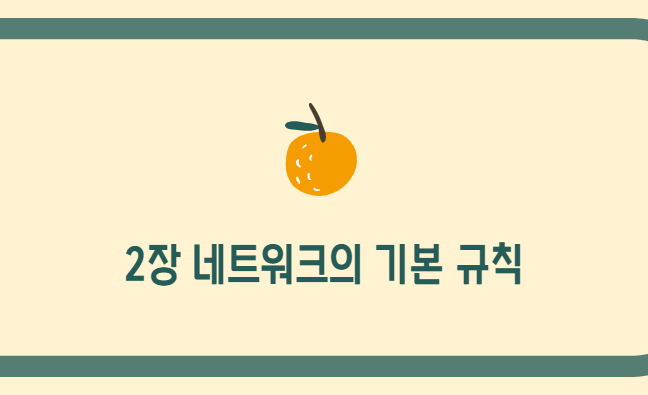
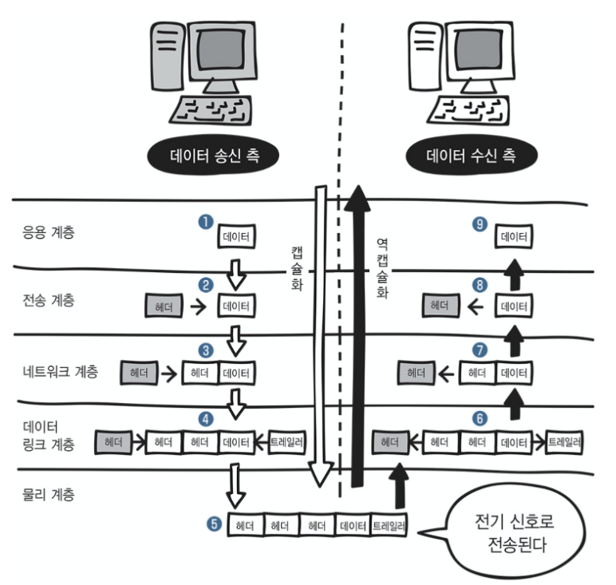

*2장 꼬 !*

> **네트워크에서 지켜야 하는 규칙**

## 프로토콜 (protocol)

네트워크에서 문제없이 통신하기 위한 규칙(약속)이다.

우리가 편지를 쓸 때를 예로 들어보자.

1. 편지를 쓴다

2. 편지를 우체통으로 넣는다. ---&gt; 주소를 적고 우표를 붙이는 작업이 필요

3. 우편 배달부가 우체통에서 편지를 수거한다.

4. 수거한 편지를 가까운 우체국으로 가져간다.

5. 편지를 분류한다.

6. 우편배달부가 수신처에 가까운 우체국으로 편지를 운송한다.

7. 운송된 편지를 수신처의 우편함에 넣는다.

8. 우편함에서 편지를 찾는다.

9. 편지의 내용을 읽는다.

이러한 과정에서는 "편지를 쓰는 규칙", "편지를 보내는 규칙", "우체국의 규칙" 등 여러 규칙이 있고, 서로 영향을 주지 않는다는 특징이 있다.

프로토콜은 이러한 규칙들과 비슷한 개념이다.

---

> **데이터를 주고받기 위한 통신 규격**

## OSI 모델

옛날에는 같은 회사의 컴퓨터끼리만 통신이 가능했다. 케이블을 연결하는 커넥터가 다르다던가 하는 사유로 두 회사는 서로 통신할 수 없었다. 이를 해결하기 위해 공통으로 사용할 수 있는데 표준 규격을 정해야만 했다. 따라서 ISO (International Organization for Standardization) 라는 국제 표준화 기구에서 OSI 모델이라는 표준 규격을 제정했다.

네트워크 기술의 기본이 되는 모델이다. 데이터의 송수신은 컴퓨터로 데이터를 전송하는 것이다. 이 때 컴퓨터 내부에서는 여러가지 일을 하는데, 이런 일을 일곱 개의 계층(레이어)으로 나눠서 한다.

아래는 OSI 모델의 7계층이다.

| 응용계층  ---- 7계층 | 이메일 & 파일전송, 웹사이트 조회 등 애플레케이션에 대한 서비스 제공한다. |
| --- | --- |
| 표현 계층 ---- 6계층 | 문자 코드, 압축, 암호화 등 데이터를 변환한다. |
| 세션 계층 ---- 5계층 | 세션 체결, 통신 방식을 결정한다. |
| 전송 계층 ---- 4계층 | 신뢰할 수 있는 통신을 구현한다. |
| 네트워크 계층 ---- 3계층 | 다른 네트워크와 통신하기 위한 경로 설정 및 논리 구조를 결정한다. |
| 데이터 링크 계층 ---- 2계층 | 네트워크 기기 간의 데이터 전송 및 물리 주소를 결정한다. |
| 물리 계층 ---- 1계층 | 시스템 간의 물리적인 연결과 전기 신호를 변환 및 제어한다. |

통신할 때는 맨 위 응용 계층에서 순차적으로 아래 계층으로 전달 된다.

| **데이터 송신 측** |  | **데이터 수신 측** |
| --- | --- | --- |
| 응용 계층 | **↓                            ↑** | 응용계층 |
| 표현 계층 | **↓                            ↑** | 표현 계층 |
| 세션 계층 | **↓                            ↑** | 세션 계층 |
| 전송 계층 | **↓                            ↑** | 전송 계층 |
| 네트워크 계층 | **↓                            ↑** | 네트워크 계층 |
| 데이터 링크 계층 | **↓                            ↑** | 데이터 링크 계층 |
| 물리 계층 | **↓                            ↑** | 물리 계층 |

> 데이터

데이터를 전송하는 쪽(송신 측)은 데이터를 보내기 위해 상위 계층에서 하위 계층으로 데이터를 전달한다. 각 계층은 독립적이므로 데이터가 전달되는 동안 다른 계층의 영향을 받지 않는다. 데이터를 받는 쪽 (수신 측)은 하위 계층에서 상위 계층을 통해 전달된 데이터를 받게 된다.

---

## TCP/IP 모델

위의 7계층을 4계층으로 바꾼게 TCP/IP 모델이다.

<table border="1" data-ke-align="alignLeft" data-ke-style="style7" style="border-collapse: collapse; width: 40.3488%; height: 146px;">
<tbody>
<tr>
<td>응용 계층 ---- 4계층</td>
</tr>
<tr>
<td>전송 계층 ---- 3계층</td>
</tr>
<tr>
<td>인터넷 계층 ---- 2계층</td>
</tr>
<tr>
<td>네트워크 접속 계층 ---- 1계층</td>
</tr>
</tbody>
</table>

---

## OSI 모델과 TCP/IP 모델의 비교

TCP/IP 모델은 표현 계층, 세션 계층을 응용 계층에 포함하고 있다.

<table border="1" data-ke-align="alignLeft" data-ke-style="style15" style="border-collapse: collapse; width: 100%; height: 160px;">
<tbody>
<tr>
<td><b>OSI 모델</b></td>
<td><b>TCP/IP 모델</b></td>
</tr>
<tr>
<td>응용계층</td>
<td rowspan="3">응용계층</td>
</tr>
<tr>
<td>표현 계층</td>
</tr>
<tr>
<td>세션 계층</td>
</tr>
<tr>
<td>전송 계층</td>
<td>전송 계층</td>
</tr>
<tr>
<td>네트워크 계층</td>
<td>인터넷 계층</td>
</tr>
<tr>
<td>데이터 링크 계층</td>
<td rowspan="2">네트워크 접속 계층</td>
</tr>
<tr>
<td>물리 계층</td>
</tr>
</tbody>
</table>

## 각각의 계층에는 다양한 프로토콜이 있다. !!!!!!

---

> **데이터를 송수신할 때 이루어지는 캡슐화와 역캡슐화**

## 캡슐화, 역캡슐화

데이터를 보낼 때는 앞부분에 필요한 정보를 붙여서 다음 계층으로 보낸다.

이 정보를 "헤더"라고 한다. 헤더에는 데이터를 전달받을 상대방에 대한 정보도 포함되어 있다.

이렇게 헤더를 붙여 나가는 것을 캡슐화라고 한다.

데이터를 받는 쪽에서는 헤더를 하나씩 제거해야하는데, 이를 역캡슐화라고 한다.

*캡슐화와 역캡슐화 흐름의 전체 구성*

송신 측 컴퓨터에서 웹사이트에 접속하려고 할 때,

1) 응용 계층에서 웹사이트를 접속하기 위한 요청 데이터가 만들어진다.

2) 전송 계층으로 해당 데이터가 전달된다. 전송 계층에서 신뢰할 수 있는 통신이 이루어지도록 응용 계층에서 만들어진 데이터에 "헤더"를 붙인다.

3) 전송 계층에서 만들어진 데이터를 다른 네트워크와 통신하기 위해 네트워크 계층에서 "헤더"를 붙인다.

4) 네트워크 계층에서 만들어진 데이터에 물리적인 통신 채널을 연결하기 위해 데이터 링크 계층에서 "헤더"와 *"트레일러"를 붙인다.

### *트레일러

데이터를 전달할 때 데이터의 마지막에 추가하는 정보를 말한다.

이것으로 전송 계층 헤더, 네트워크 계층 헤더, 데이터 링크 계층 헤더, 트레일러가 추가되었다.

데이터 링크 계층에서 만들어진 데이터는 최종적으로 전기 신호로 변환되어 수신 측에 도착한다.

#### 이러한 과정이 바로 캡슐화!

---

그림을 다시 보자.

*캡슐화와 역캡슐화 흐름의 전체 구성*

수신 측에서는 헤더를 제거하고 있다. 각 계층의 헤더를 제거하면서 데이터를 전달하고 있다.

아까와는 반대로 데이터 링크 계층부터 순서대로 상위 계층으로 전달하고 있다.

송신 측 데이터 링크 계층에서 추가된 헤더와 트레일러 -&gt; 수신 측 데이터 링크 계층에서 제거

데이터 링크 계층 헤더, 트레일러 제거 -&gt; 네트워크 계층 헤더 제거

전송 계층 헤더 제거 -&gt; 모든 헤더가 제거된 데이터가 수신 측에 도착

---

> **보충**

## VPN (Virtual Private Network, 가상 사설망)

가상 통신 터널을 만들어 기업 본사, 지사같은 거점 간을 연결해서 통신한다.

또는 외부에서 인터넷으로 사내에 접속하는 것을 말한다.

### VPN의 종류

1. 인터넷 VPN

- 거점 간 접속
- 원격 접속 연결

둘다 일반 인터넷망을 사용한다. 거점간접속은 외부에서 사용하는 컴퓨터와 사내 네트워크를 연결하기 때문에 암호화된 통신로를 만든다.

2. IP-VPN

MPLS라는 기술을 사용해서 인터넷망이 아닌 통신 사업자 전용 폐쇄망을 사용한다. MPLS는 폐쇄망을 사용하기 때문에 제삼자에 의한 해킹이나 데이터 변조의 위험이 없어 암호화 기능이 필요하지 않다.

---

**&lt; Reference &gt;**

미즈구치 카츠야, **『모두의 네트워크****』**, 길벗(2021), p41-62.
