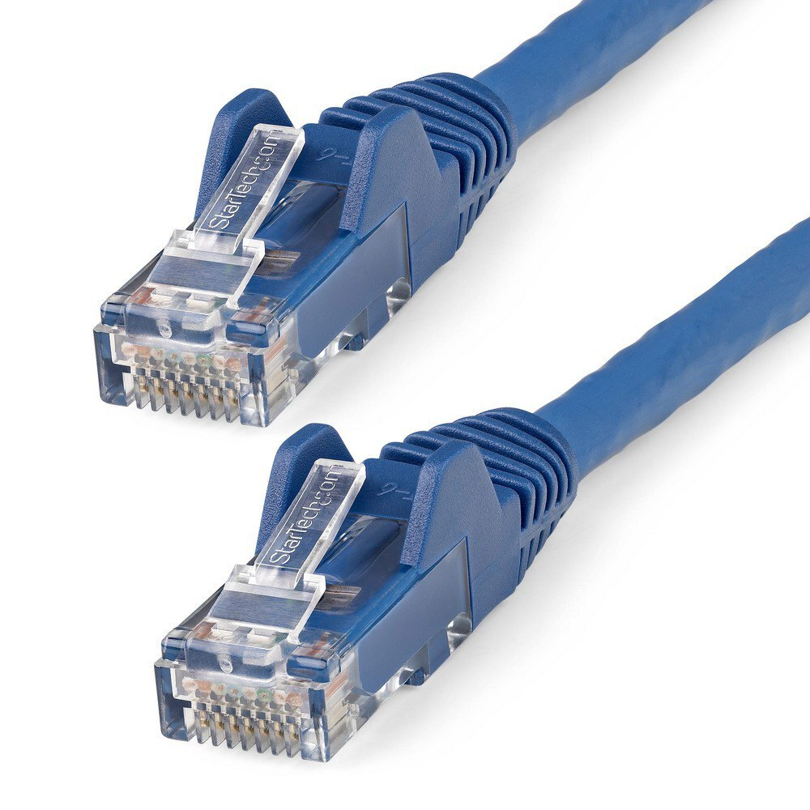
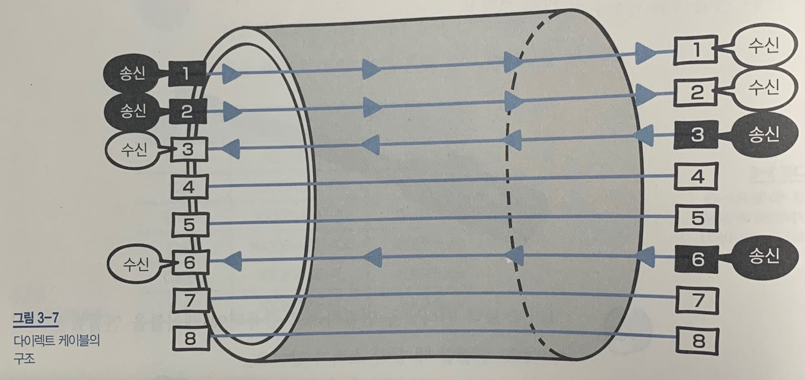
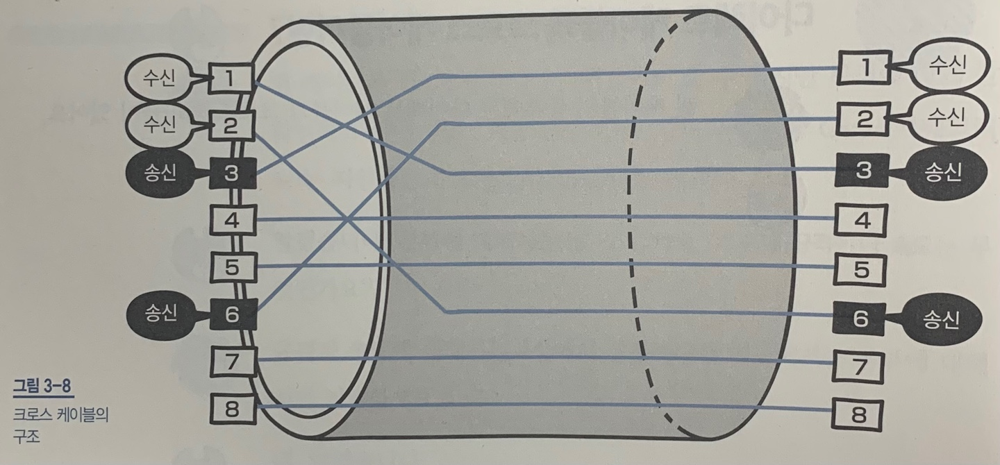
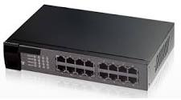

> **물리계층의 역할과 랜 카드를 알아보자**

## 전기 신호

앞서 OSI 모델에 대해 배웠는데,

0과 1만으로 이루어진 비트열을 전기 신호로 변환하려면 아래 표과 같이 맨 아래 계층인 물리계층의 기술이 필요하다.

<table border="1" data-ke-align="alignLeft" data-ke-style="style7" style="border-collapse: collapse; width: 36.2967%; height: 262px;">
<tbody>
<tr>
<td colspan="2">응용계층  ---- 7계층</td>
</tr>
<tr>
<td colspan="2">표현 계층 ---- 6계층</td>
</tr>
<tr>
<td colspan="2">세션 계층 ---- 5계층</td>
</tr>
<tr>
<td colspan="2">전송 계층 ---- 4계층</td>
</tr>
<tr>
<td colspan="2">네트워크 계층 ---- 3계층</td>
</tr>
<tr>
<td colspan="2">데이터 링크 계층 ---- 2계층</td>
</tr>
<tr>
<td colspan="2"><b>물리 계층 ---- 1계층</b></td>
</tr>
</tbody>
</table>

네트워크를 통해 데이터를 주고받을 때에는

**0과 1의 비트열 -&gt; 전기신호** !!! 변환해야 한다!!

### 전기 신호의 종류

#### 1. 아날로그 신호

   - 전화 회선, 라디오 방송에 사용되는 신호

   - 물결 모양

#### 2. 디지털 신호

   - 막대 모양

> 데이터는 어떻게 전달되는거지...?

<table border="1" data-ke-align="alignLeft" data-ke-style="style7" style="border-collapse: collapse; width: 100%; height: 40px;">
<tbody>
<tr>
<td>데이터 송신 측 컴퓨터</td>
<td rowspan="2">- - &gt; 전기 신호로 변환 - - &gt;</td>
<td rowspan="2">- - &gt;  네트워크를 통해 이동  - - &gt; </td>
<td>데이터 수신 측 컴퓨터</td>
</tr>
<tr>
<td>0과 1의 비트열 데이터</td>
<td>전기 신호를  0과 1의 비트열 데이터로 복원</td>
</tr>
</tbody>
</table>

> 그래서 0과 1을 어떻게 전기 신호로 변환하냐구 . . .

## 랜 카드

데이터를 전기 신호로 바꾸어주는 장치이다.

<table border="1" data-ke-align="alignLeft" style="border-collapse: collapse; width: 100%; height: 40px;">
<tbody>
<tr>
<td>0과 1의 정보 - - -&gt; </td>
<td>- - &gt; <b>랜 카드</b> - - &gt;</td>
<td> - - &gt; 전기 신호로 변환!</td>
</tr>
</tbody>
</table>

- 내장형 랜 카드 (메인 보드에 포함되어 있음)
- 별도의 랜 카드

정리하자면,

물리 계층은 컴퓨터와 네트워크 장비를 연결하고 이 둘 간에 전송되는 데이터를 전기 신호로 변환하는 계층이다.

---

> **케이블 종류, 구조 - 네트워크 전송 매체**

## 전송 매체

데이터가 흐르는 물리적인 서로를 말한다. 종류는 유선과 무선!

### 유선 전송 매체

1. 트위스트 페어 케이블

2. 광케이블

등 등

### 무선 전송 매체

1. 라디오파

2. 마이크로파

3. 적외선

등 등

이 중 트위스트 페어 케이블을 알아보자.

## 트위스트 페어 케이블 == 랜케이블 !!!(LAN cable, 랜 선)

### 종류

**1. UTP 케이블**

**2. STP 케이블**

### 1. UTP 케이블

구리 선 여덟 개를 두 개씩 꼬아 만든 네 쌍의 전선이다. *실드(shield)로 보호되어 있지 않은 케이블이다. 일반적으로 많이 사용한다. 데이터 전송 품질에 따라 종류가 나뉜다.

**장점** - 저렴하다.

**단점** - 실드로 보호되어 있지 않아서 *노이즈의 영향을 받기 쉽다.

### *실드

금속호일이나 금속의 매듭같은 것으로, 외부에서 발생하는 노이즈를 막는 역할을 한다.

### *노이즈

케이블에 전기 신호가 흐를 때 발생한다. 노이즈의 영향을 적게 받으려면 구리 선 두 개를 비틀어 꼬아야한다.

노이즈의 영향을 받으면 전기신호가 막대모양에서 심장박동처럼 못생겨진다...

### 2. STP 케이블

두 개씩 꼬아 만든 선을 실드로 보호한 케이블이다. 노이즈의 영향을 매우 적게 받는다.

**장점** - 노이즈 영향 매우 적게 받음

**단점** - 비싸서 잘 사용 안 함

지금부터는 트위스트 페어 케이블 (UTP, STP)를 랜 케이블이라고 부를거다.

랜 케이블은 가전 용품점이나 인터넷에서 살 수 있다. 대신 목적에 맞게 잘 확인해야한다. 종류 별로 지원하는 속도가 다르기 때문!

*RJ-45 (Startech 네트워크 케이블 상품 사진)*

렌 케이블 양쪽 끝에는 RJ-45라고 부르는 커넥터가 붙어있다. 이 커넥터를 컴퓨터 랜 포트나 네트워크 기기에 연결한다.

> 랜 케이블에도 종류가 있나?

## 다이렉트 케이블 & 크로스 케이블

*다이렉트 케이블 구조*

**다이렉트 케이블**은 구리 선 여덟 개를 같은 순서로 커넥터에 연결한 케이블이다.

*크로스 케이블 구조*

**크로스 케이블**은 구리 선 여덞 개 중 한쪽 커넥터의 1번과 2번에 연결되는 구리 선을 다른 쪽 커넥터의 3번과 6번에 연결한 케이블이다.

둘 다 실제로는 1번, 2번, 3번, 6번 구리 선을 사용하고 있다. 나머지 선 네 개는 사용하지 않는다. (!!)

| 다이렉트 케이블 | 크로스 케이블 |
| --- | --- |
| 컴퓨터와 스위치를 연결할 때 사용 | 컴퓨터 간 직접 랜 케이블로 연결할 때 사용 |

컴퓨터 간 직접 데이터를 보낼 때는 양쪽 컴퓨터 모두 1번과 2번 선을 사용한다.

---

> **물리계층의 네트워크 장비인 리피터와 허브**

## 리피터 (repeater)

전기 신호를 정형 (일그러진 전기 신호를 복원)하고 증폭하는 기능을 가진 네트워크 중계 장비이다.  약해진 신호 세기가 리피터를 거치면 신호가 증폭되어 파형이 정상화된다. 통신하는 상대방이 멀리 있을 때 리피터를 사이에 넣어주면 된다.

예전에 사용하던 장비로, 요즘은 다른 네트워크 장비가 리피터 기능을 지원하기 때문에 리피터를 쓸 필요가 없다.

## 허브(hub)

여러 개의 포트(실제로 통신하는 통로)를 가지고 있다. 리피터 허브라고도 부른다. 리피터는 일대일 통신만 가능한데, 허브는 포트를 여러 개 가지고 있어서 컴퓨터 여러 대와 통신할 수 있다.

*허브 (해시넷위키)*

랜 케이블을 이용해서 컴퓨터와 허브를 연결할 수 있다.

리피터와 마찬가지로 전기 신호를 정형하고 증복하는 기능을 한다. 컴퓨터에서 보낸 전기 신호가 허브에 도착하는 동안 노이즈의 영향으로 파형이 변경될 때가 있다. 그럴 때 허브가 파형을 정상으로 되돌리는 기능을 한다.

**장점** - 컴퓨터 여러 대를 직접 연결하지 않아도 통신할 수 있도록 한다!!

**단점** - 어떤 특정 포트로부터 데이터를 받는다면 해당 포트를 제외한 나머지 모든 포트로도 받은 데이터를 전송하는 특징이 있다. 컴퓨터1은 컴퓨터2에게만 전송하고 싶어도, 3, 4, 5까지 모두 데이터를 받게 된다.

> 허브의 다른 이름!?

허브는 스스로 판단하지 않고, 전기 신호를 모든 포트로 보내서 **더미 허브(dummy hub)**라고도 한다.

> 허브는 그럼 비효율적인데?

더미 허브의 단점을 보완하는게 바로 스위치 (switch)!

스위치는 4장에서 설명하겠다. 후훗

---

> **보충**

## auto MDIX (auto Medium-Dependent Interface crossover)

다이렉트 케이블, 크로스 케이블을 자동으로 판단하는 기능이다. 컴퓨터나 라우터의 인터페이스는 MDI (Media Dependent Interface)라고 하고, 스위치나 허브의 인터페이스는 MDI-X (MDI crossover)라고 한다.

일반적으로 MDI와 MDI-X를 연결할 때는 다이렉트 케이블을 사용하고,

MDI 끼리나 MDI-X 끼리 서로 연결할 때는 크로스 케이블을 사용한다.

최근에는 케이블 배선 실수로 인한 통신 문제를 해결하기 위해 MDI 와 MDI-X 차이를 자동으로 판단하여 연결 신호를 전환하는 기능을 가진 스위치나 허브를 많이 사용한다. 컴퓨터와 허브를 연결하거나 허브 간 연결한다면 케이블의 차이를 고려하지 않아도 된다!

---

**&lt; Reference &gt;**

미즈구치 카츠야, **『모두의 네트워크****』**, 길벗(2021), p63-82.
