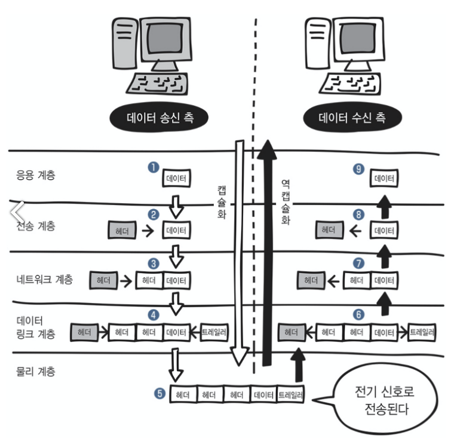
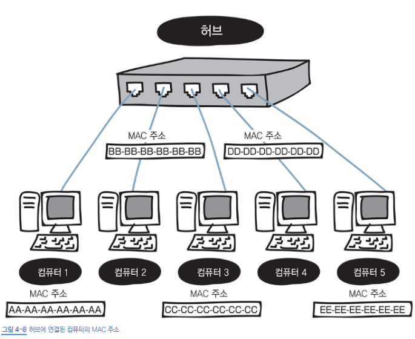
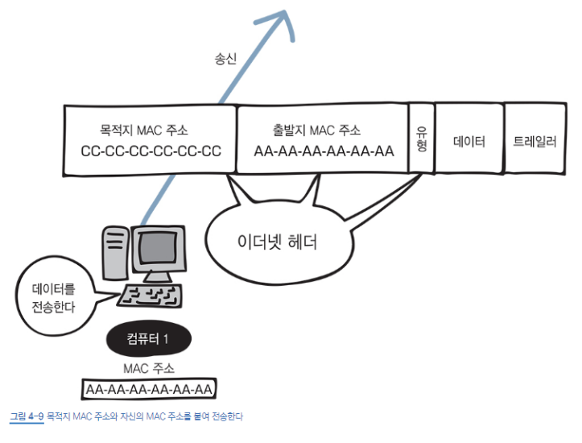
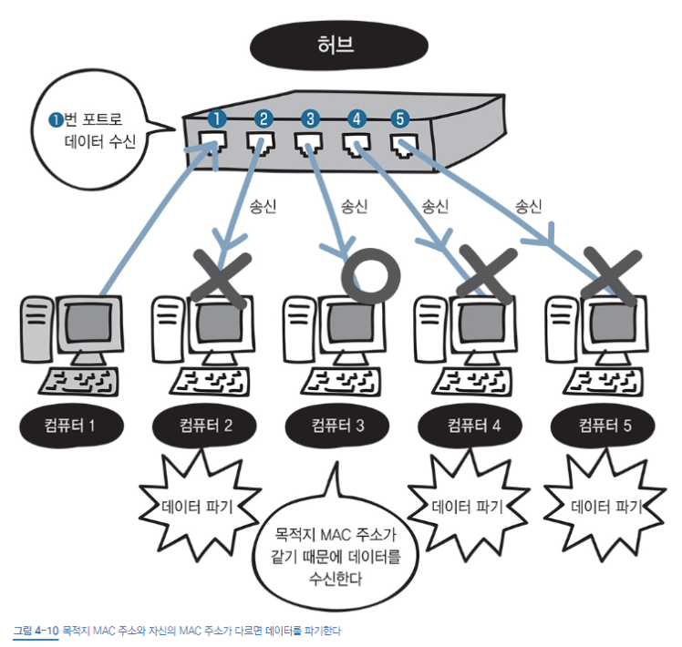

*4장 고고곡*

> **랜에서 데이터를 주고받는 규칙 : 이더넷, 알아보자**

랜에서 데이터를 주고받으려면 데이터 링크 계층의 기술이 필요하다. 어떤 기술일까?

<table border="1" data-ke-align="alignLeft" data-ke-style="style7" style="border-collapse: collapse; width: 40.1163%; height: 249px;">
<tbody>
<tr>
<td colspan="2">응용계층  ---- 7계층</td>
</tr>
<tr>
<td colspan="2">표현 계층 ---- 6계층</td>
</tr>
<tr>
<td colspan="2">세션 계층 ---- 5계층</td>
</tr>
<tr>
<td colspan="2">전송 계층 ---- 4계층</td>
</tr>
<tr>
<td colspan="2">네트워크 계층 ---- 3계층</td>
</tr>
<tr>
<td colspan="2"><b>데이터 링크 계층 ---- 2계층</b></td>
</tr>
<tr>
<td colspan="2">물리 계층 ---- 1계층</td>
</tr>
</tbody>
</table>

먼저 데이터 링크 계층에 대해서 구체적으로 알아보자.

## 데이터 링크 계층

네트워크 장비 간에 신호를 주고받는 규칙을 정하는 계층이다. 정상적인 데이터를 주고받으려면 데이터 링크 계층이 필요하다. 여기서 "규칙" 중 하나가 바로 "이더넷"이다.

## 이더넷 (Ethernet)

이더넷은 허브*같은 기기로 **연결된 컴퓨터끼리** 데이터를 주고 받을 때 사용한다.

### *허브 복습

허브는 약해지거나 파형이 뭉그러진 전기 신호를 복원시킨다. 해당 전기 신호를 다른 포트에 전달한다. 원하지 않아도 다른 **모든 포트로 전기 신호가 전달**된다는 특징이 있다. 그래서 **더미 허브**라고도 부른다.

> 특정 컴퓨터에만 데이터를 보내고 싶다.
> 관계없는 다른 컴퓨터까지 그 데이터를 받아서 내용을 보면.. 난 싫어! 어떻게 하지?

이런 경우를 대비해서 데이터의 내용을 못 보게 하는 확실한 규칙이 정해져 있다. 데이터에 목적지 정보를 추가해서, 목적지가 아닌 컴퓨터는 데이터를 받아도 무시하게 되어있다. (아래 나올 MAC 주소를 이용한다. 모르겠다고? 일단 쭉 읽어보자.)

> 그럼 여러 대에서 동시에 데이터를 보내면 충돌하지 않을까?

이를 해결할 이더넷에서의 방법! 바로

## CSMA/CD (Carrier Sense Multiple Access with Collision Detection,

## 반송파 감지 다중 접속 및 충돌 탐지)

데이터를 보내는 시점을 늦추는 방법이다. 컴퓨터 여러 대가 동시에 데이터를 보내면 데이터들이 서로 부딪힐 수도 있다. 이것을 충돌 (Collision)이라고 한다. 그래서 이더넷은 여러 컴퓨터가 동시에 데이터를 전송해도 충돌이 일어나지 않는 구조로 되어 있다. 단어 뜻을 자세히 보자.

**CS (Carrier Sense)**는 '데이터를 보내려고 하는 컴퓨터가 케이블에 신호가 흐르고 있는지 아닌지를 확인한다'는 규칙이다.

**MA (Multiple Access)**는 '케이블에 데이터가 흐르고 있지 않다면 데이터를 보내도 좋다'는 규칙이다.

마지막으로 **CD (Collision Detection)**은 '충돌이 발생하고 있는지를 확인한다'는 규칙이다.

하지만.. CSMA/CD는 효율 문제로 사용하지 않는다. 스위치 (switch)라는 네트워크 장비를 이용하면 충돌이 일어나지 않는다. (스위치는 나중에 배운다)

---

> **랜 카드*를 제조할 때 정해지는 물리적인 주소**

### 랜 카드* 복습

비트열 (0과 1)을 전기신호로 변환한다.

## MAC 주소

비트열을 전기 신호로 변환하는 랜카드에는 MAC 주소라는 번호가 정해져 있다. 제조할 때 새겨지기 때문에 **물리 구조**라고도 부른다. 전 세계에서 유일한 번호로 할당되어 있다.

MAC 주소에는 중복되지 않도록 하는 규칙이 있다. 48비트 숫자로 구성되어 있는데, 앞쪽 24비트는 랜 카드를 만든 제조사 번호고 뒤쪽 24비트는 제조사가 랜 카드에 붙인 일련번호이다.

### 00   -   23   -   AE   -   D9-   7A   -   9A

**랜 카드를 만든 제조사 번호          제조사가 붙인 일련번호**

> MAC 주소로 어떻게 통신하는 걸까?

먼저 OSI 모델과 TCP/IP 모델을 생각해보자. 각 계층에서 **헤더**를 붙였었다.

OSI 모델에서는 데이터 링크 계층, TCP/IP 모델에서는 네트워크 계층, 이 계층에서 **이더넷 헤더**와 **트레일러**를 붙인다.

## 이더넷 헤더

이더넷 헤더의 구성을 보자.

<table border="1" data-ke-align="alignLeft" style="border-collapse: collapse; width: 100%; height: 40px;">
<tbody>
<tr>
<td>목적지 MAC 주소 (6바이트 = 48비트)</td>
<td>출발지 MAC 주소 (6바이트 = 48비트)</td>
<td>유형* (2바이트 = 16비트)</td>
</tr>
</tbody>
</table>

이렇게 이더넷 헤더는 **목적지**와 **출발지의 MAC 주소**, 그리고 **유형***. 이렇게 총 **14바이트**로 구성되어 있다.

## (이더넷) 유형* (Ethernet type)

이더넷 유형은 이더넷으로 전송되는 상**위 계층 프로토콜**의 종류를 말한다.

| **유형 번호** | **프로토콜** |
| --- | --- |
| 0800 | IPv4 |
| 0806 | ARP |
| 8035 | RARP |
| 814C | SNMP over Ethernet |
| 86DD | IPb6 |

이더넷 유형에는 위의 표에 나와 있는 프로토콜을 식별하는 16진수 번호가 들어간다.

## 트레일러 (FCS, Frame Check Sequence라고도 한다.)

데이터를 전송하는 도중에 오류가 발생하는지를 확인하는 용도로 사용한다.

## 프레임

이더넷 헤더와 트레일러가 추가된 데이터를 말한다.

그래서 결국 네트워크를 통해 **프레임**이 전송된다고 할 수 있다.

*목적지의 AMC주소와 자신의 MAC주소를 붙여 전송하는 컴퓨터 1*

위 사진을 보자

컴퓨터 1에서는 이더넷 헤더에 "목적지 MAC 주소 + 자신의 MAC 주소 + 유형 + 데이터 + 트레일러" 정보를 넣고 데이터를 전송한다.

이렇게 컴퓨터 1에서는 **캡슐화**가 일어난다.

데이터 링크 계층에서 데이터에 "이더넷 헤더 + 트레일러"를 추가해서 **프레임**을 만들고,

물리 계층에서 프레임을 전기신호로 변환하여 네트워크를 통해 전송하는 것!

이렇게 MAC 주소를 이용하면, 원치 않는데도 더미 허브로 데이터를 받은 컴퓨터는 자신의 MAC 주소와 다른 것을 알고 데이터를 파기한다.

반면 데이터를 잘 받은 수신 컴퓨터 3에서는 **역 캡슐화**가 일어난다.

물리 계층에서 "전기 신호로 전송된 데이터를 비트열로 변환"하고,

데이터 링크 계층에서 "이더넷 헤더와 트레일러를 분리"한다. 이렇게 수신하는 컴퓨터에서는 역 캡슐화를 한 다음 데이터를 수신한다.

여러 대의 컴퓨터가 동시에 전송하는 경우 충돌을 방지하기 위해 앞서 설명했던 **CSMA/CD** 방식을 사용한다.

따라서 충돌이 감지되면 다른 송신 컴퓨터는 잠시 대기하고 있다가 데이터를 전송한다.

**이렇게 이더넷도 네트워크에서 발생할 수 있는 문제를 확실하게 고려하는 규격인 것이다!**

---

**&lt; Reference &gt;**

미즈구치 카츠야, **『모두의 네트워크****』**, 길벗(2021), p83-95.
