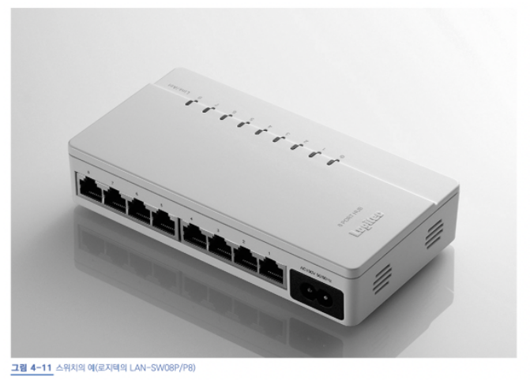
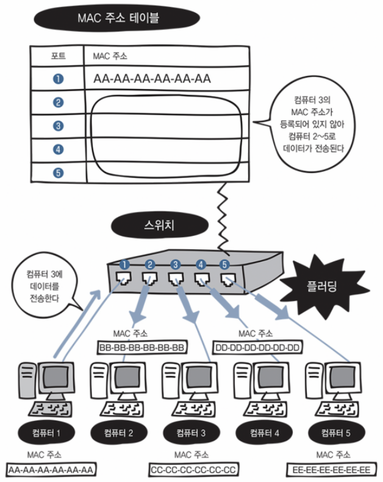

*4장 스위치 ㄱㄱ*

> **허브와 다르게 데이터 충돌이 일어나지 않는 스위치**

## 스위치

데이터 링크 계층에서 동작한다. 다른 이름으로는 레이어 2 스위치, 스위칭 허브가 있다.

외형 모습은 허브와 비슷하다.

*스위치*

## MAC 주소 테이블 (MAC address table)

스위치 내부에 있다.

스위치의 포트 번호 + 해당 포트에 연결되어 있는 컴퓨터의 MAC 주소가 등록되는 **데이터 베이스**이다.

브리지 테이블 (bridge table) 이라고도 한다.

*4-13 플러딩*

## MAC 주소 학습 기능

스위치의 전원을 켠 상태에는 아직 MAC 주소 테이블에 아무것도 등록되어 있지 않다.

## 프레임

컴퓨터에서 목적지 MAC 주소가 추가된 것이라는 데이터가 전송되면, MAC 주소 테이블이다.

## 스위치를 통한 데이터 전송 과정

<table border="1" data-ke-align="alignLeft" style="border-collapse: collapse; width: 100%; height: 167px;">
<tbody>
<tr>
<td rowspan="2"><b>프레임</b> 컴퓨터에서 목적지 MAC 주소가 추가된 것  </td>
<td><b>-&gt; MAC 주소 등록되어 있음</b></td>
<td><b>MAC 주소 필터링</b> 해당 목적지 주소에만 데이터 전송. 스위치에서 MAC 주소를 기준으로 목적지를 선택하는 것</td>
</tr>
<tr>
<td><b>-&gt; MAC 주소 등록되지 않음</b></td>
<td><b>플러딩 </b>연결된 모든 포트에 데이터(프레임)이 전송되는 플러딩이 일어남.  <b>MAC 주소 학습 기능</b> MAC 주소를 포트와 함께 등록</td>
</tr>
</tbody>
</table>

---

**&lt; Reference &gt;**

미즈구치 카츠야, **『모두의 네트워크****』**, 길벗(2021), p96-101.
