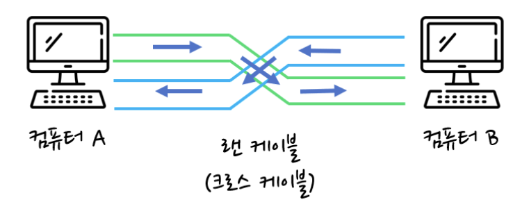
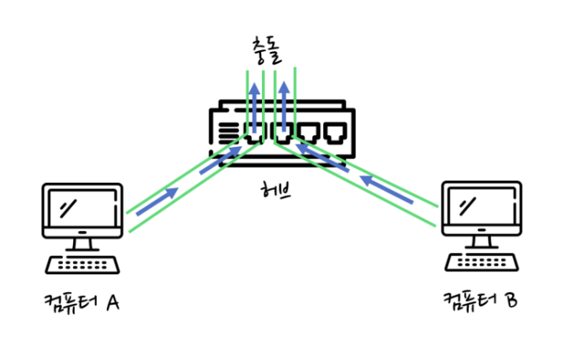
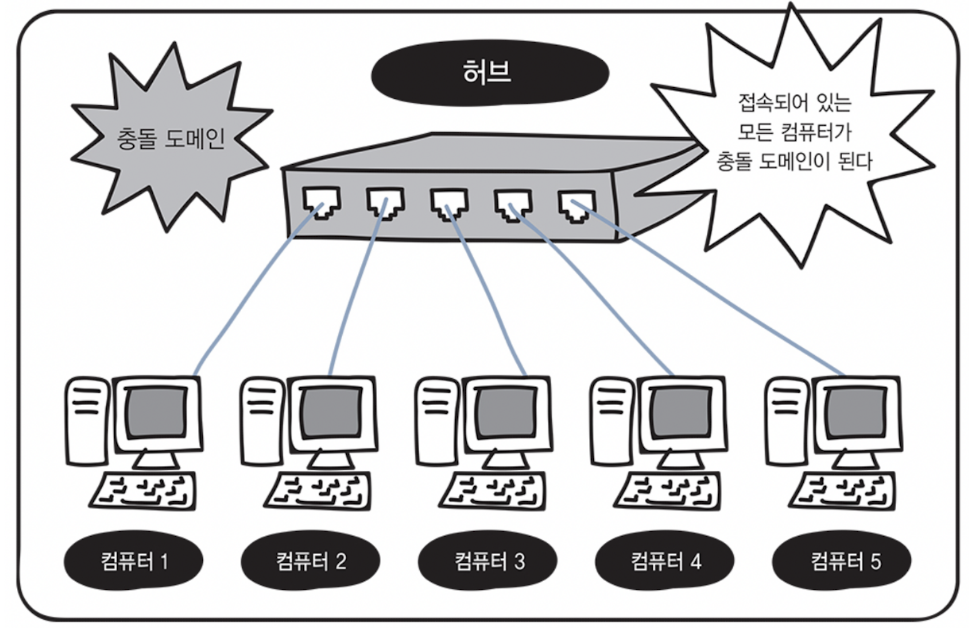
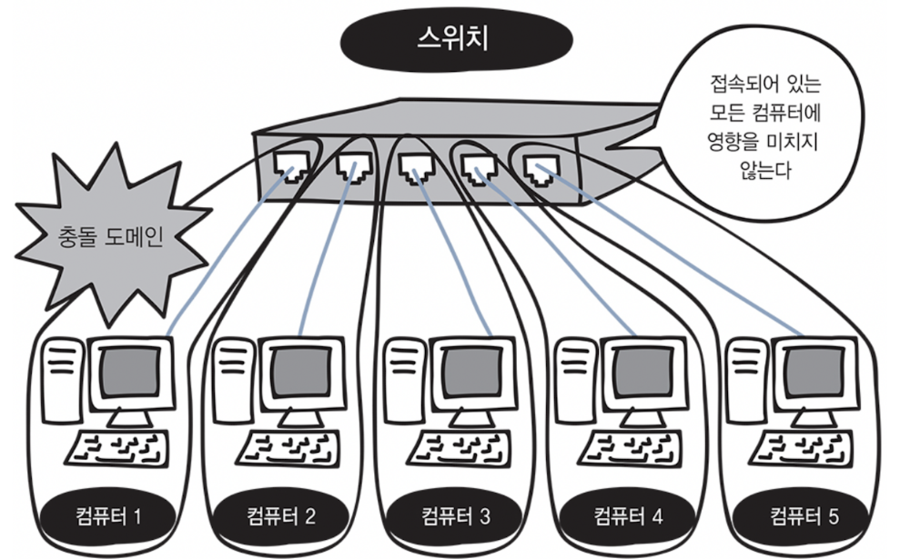

> **케이블에 데이터가 아무리 많이 전송되어도 데이터가 충돌하지 않는 구조가 있다?**

<table border="1" data-ke-align="alignLeft" data-ke-style="style3" style="border-collapse: collapse; width: 100%;">
<tbody>
<tr>
<td>
<h2><b>전이중 통신</b></h2>
</td>
<td>
<h2><b>반이중 통신</b></h2>
</td>
</tr>
<tr>
<td>데이터의 송수신을 동시에 통신하는 방식</td>
<td>회선 하나로 송신과 수신을 번갈아가면서 통신하는 방식</td>
</tr>
<tr>
<td>데이터를 동시에 전송해도 충돌이 발생하지 않음</td>
<td>데이터를 동시에 전송하면 충돌이 발생함</td>
</tr>
<tr>
<td><b>스위치</b> 충돌이 일어나지 않는 구조로 되어 있다. 따라서 전이중 통신 방식으로도 데이터를 주고 받을 수 있다.</td>
<td><b>허브</b> 내부에 송수신이 나누어져 있지 않기때문에  컴퓨터1과 컴퓨터2를 허브로 연결하면  동시에 데이터를 보낼 때 충돌이 일어난다.  허브에서는 회선 하나를 송신과 수신이  번갈아가면서 사용하는 반이중 통신 방식을 사용한다.</td>
</tr>
<tr>
<td colspan="2">
<h2><b>네트워크로 효율이 높은 <u>스위치</u>를 사용하는 것이 표준!</b></h2>
</td>
</tr>
</tbody>
</table>

*컴퓨터 간을 직접 랜 케이블로 연결하는 방식이 전이중 통신 방식이다. (출처 : minseojo.io)*

*허브에 연결하는 경우는 반이중 통신 방식이다. (출처 : minseojo.io)*

## 충돌 도메인 (collision domain)

#### 허브

데이터를 전송하며 충돌이 일어날 때 그 영향이 미치는 범위를 충돌 도메인이라고 한다. 아래 그림처럼 허브는 연결되어 있는 모든 컴퓨터가 하나의 충돌 도메인이 된다.

허브는 충돌의 영향이 모든 컴퓨터에 미친다고 보면 된다.

*허브는 모든 컴퓨터에 충돌의 영향이 미친다.*

#### 스위치

스위치는 아래 그림처럼 충돌 도메인의 범위가 좁다. 데이터를 동시에 송수신할 수 있는 전이중 통신 방식이기 때문이다. 이렇게 충돌 도메인의 관점에서 보더라도 스위치를 사용하면 통신 효율이 훨씬 높아진다는 것을 알 수 있다.

*스위치는 충돌 도메인이 좁다.*

충돌 도메인의 범위가 넓을수록 네트워크가 지연되는 것!

네트워크를 지연시키지 않기 위해서라도 충돌 도메인의 범위를 좁히는 것은 매우 매우 중요하다!

---

> **보충**

## ARP (Address Resolution Protocol)

목적지 컴퓨터의 IP 주소를 이용하여 MAC 주소를 찾기 위한 프로토콜이다.

### ARP 요청

출발지 컴퓨터가 목적지 주소를 모를때, MAC 주소를 알아내기 위해 네트워크에 브로드 캐스트를 하는 것을 ARP 요청이라고 한다.

### ARP 응답

위의 요청에 대해 지정된 IP 주소를 가지고 있지 않은 컴퓨터는 응답하지 않는다. 하지만 지정된 IP 주소를 가진 컴퓨터는 MAC 주소를 응답으로 보낸다. 이를 ARP 응답이라고 한다.

ARP 응답을 통해 출발지 컴퓨터는 MAC 주소를 얻은 후에 MAC 주소와 이더넷 프레임을 만들 수 있다.

### ARP 테이블

출발지 컴퓨터에서 MAC 주소를 얻은 후에 MAC 주소와 IP 주소의 매핑 정보를 메모리에 보관하는데, 이 정보를 ARP 테이블이라고 한다. 이후 데이터 통신은 자신의 컴퓨터에 보관된 ARP 테이블을 참고하여 전송한다.

### ARP 캐시

만약 IP 주소가 변경되면 해당 MAC 주소도 함께 변경된다. 통신이 불가해진다.

그래서 ARP 테이블에서는 보존 기간을 ARP 캐시로 지정하고, 일정 시간이 지나면 삭제 후 다시 ARP 요청을 한다.

윈도우에서 ARP 캐시의 내용을 확인하려면 arp - a 명령어를 사용하고 ARP 캐시를 강제로 삭제하려면 arp -d 명령어를 사용한다.

---

> 이더넷의 종류와 규격 이름의 뜻을 알아보자

## 이더넷 규격

이더넷은 케이블 종류나 통신 속도에 따라 다양한 규격으로 분류된다.

| 규격 이름 | 통신 속도 | 케이블 | 케이블 최대 길이 | 표준화 연도 |
| --- | --- | --- | --- | --- |
| 10BASE5 | 10Mbps | 동축케이블 | 500m | 1982년 |
| 10BASE2 | 10Mbps | 동축케이블 | 185m | 1988년 |
| 10BASE-T | 10Mbps | UTP케이블(Cat3이상) | 100m | 1990년 |
| 100BASE5-TX | 100Mbps | UTP케이블(Cat5이상) | 100m | 1995년 |
| 1000BASE-T | 1000Mbps | UTP케이블(Cat5이상) | 100m | 1999년 |
| 10GBASE-T | 10Gbps | UTP케이블(Cat6a이상) | 100m | 2006년 |

## 10 BASE - T의 의미

| 10 | BASE | T |
| --- | --- | --- |
| 통신 속도 | 전송 방식 | 케이블 |

10은 Mbps 단위인 통신속도이다. 즉 10 Mbps라는 뜻!

BASE는 BASEBAND 라는 전송 방식을 나타내고,

T는 케이블 종류를 나타낸다.

> 어떤 것은 - 가 붙고, 어떤 것은 붙지 않았는데 차이는 뭘까?

이는 동축케이블과 UTP 케이블을 표시하는 방법이 다르기 때문이다.

동축케이블은 케이블의 최대 길이를 100 m 단위로 표시한다. 예를 들어, 10BASE5는 케이블의 최대 길이가 500 m 라는 의미이다.

UTP 케이블은 케이블 종류를 표시한다. 예를 들어, 10BASE-T는 UTP 케이블을 의미하는 것이다.

## 컴퓨터의 일반적인 랜 포트

1000BASE-T 가 최근 컴퓨터의 랜 포트로 일반적이다. 조금씩 10GBASE-T도 많아지고 있다.

---

**&lt; Reference &gt;**

미즈구치 카츠야, **『모두의 네트워크****』**, 길벗(2021), p102-107.

랜 케이블, 허브 이미지 사용 출처

[모두의 네트워크 정리 (4) (velog.io)](https://velog.io/@minseojo/%EB%AA%A8%EB%91%90%EC%9D%98-%EB%84%A4%ED%8A%B8%EC%9B%8C%ED%81%AC-%EC%A0%95%EB%A6%AC-4)
