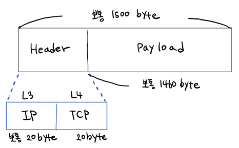
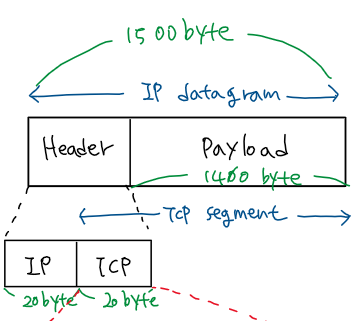

> ※  아래 내용은 스스로 공부한 내용을 정리한 글입니다.
> ※  때로 정확하지 않을 수 있으며, 참고만 부탁드립니다.
> ※  잘못된 내용이 있을시 댓글로 알려주시면 감사하겠습니다.

※ 노란 형광펜은 궁금점, 회색 형광펜과 파란 형광펜은 궁금점 해결에 대한 표시 입니다.

상황 전제 )

proccess가 소켓에 I/O (입출력)을 시도한다. 이때 memory에 저장된 stream 데이터가 생긴다.

stream이란, 소켓 수준의 데이터 단위를 말한다. 소켓은 TCP라는 요소를 user mode application이 접근할 수 있도록 추상화한 인터페이스를 말한다. 소켓의 본질은 file이다. 그리고 소켓 수준의 데이터 단위는 stream이다. stream은 시작 지점부터 길게 쭉- 늘어진 데이터다. 언제 끝날지 모른다. 개발자 맘임.

stream은 tcp와 socket이 만나는 지점에서 일정 단위로 댕겅 댕겅 잘린다. 이 댕겅은 바로 segment (stream data)다. 즉 stream이 segment로 분해가 일어나는 것이다.

낮은 계층으로 내려가면서 segment는 packet, frame 순으로 데이터 단위가 변한다. 참고로 이더넷이면 ethernet frame이다. 이때를 Incapsulation 된다고 말한다.

패킷의 최대 길이는 패킷 기준 1500 byte 가량이다. 이 단위를 MTU (Maxtimum Transport Unit)이라 한다. 패킷은 위 그림처럼 크게 Header, Payload 둘로 나뉜다. Header는 다시 IP, TCP로 나뉘고 각각 20 byte 가량이다. 그럼 나머지 Payload는 보통 1460 byte를 가져가게 된다. 이게 MSS (Maximum Segment Size)다! Stream의 "댕겅" 사이즈는 이 1460 byte씩이다.

즉, Stream 1460 byte 씩 댕겅 댕겅 잘려서 Payload에 넣고, 앞에 header를 붙이면 Packet 완성이다. 참고로 패킷을 까서 볼 때 Payload를 들여다보는 걸 DPI (Deep Packet Inspection)이라 한다.

---

[ Reference ]

중심 내용은 널널한 개발자 TV를 참고하고, 그 밖의 궁금한 것들은 리차드 스티븐스의 TCP/IP Illustreated Volume 서적, 동료 간의 질의응답을 통해 공부하고 있습니다.
