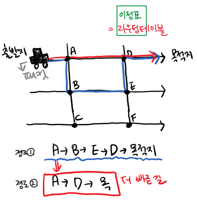

> ※  아래 내용은 스스로 공부한 내용을 정리한 글입니다.
> ※  때로 정확하지 않을 수 있으며, 참고만 부탁드립니다.
> ※  잘못된 내용이 있을시 댓글로 알려주시면 감사하겠습니다.

※ 노란 형광펜은 궁금점, 회색 형광펜과 파란 형광펜은 궁금점 해결에 대한 표시 입니다.

"switch가 하는 일은 swtiching이다"

swtich는 "교차로", swtiching은 "어떤 인터페이스의 경로 선택", 그리고 Network는 "고속도로", "고속도로 위 이정표"는 라우팅 테이블, packet은 "자동차"라고 하자.

경로 1번은 A-&gt;B-&gt;E-&gt;D-&gt;목적지

경로 2번은 A-&gt;D-&gt;목적지 라고 할 때, 경로 2번이 훨씬 빠르고 효율적이다.

A, B, C, D, E, F 같은 각 지점은 라우터라고 하자. 라우터들끼리 가장 효율적인 길이 어딘지 특정 프로토콜을 가지고 서로 통신한다. 그리고 이 경로 선택에 대한 의사결정의 근거가 되는 것은 이정표, 라우팅 테이블이다. 인터넷은 라우터의 거대한 집합체다. 출발지부터 목적지까지 많은 라우터를 거쳐 최적의 경로를 찾는 일이 바로 switching이다.

왜 라우터는 여러 개일까?

엄청 큰 단체나 지역, 국가 단위가 있을 때, ISP가 한 둘이 아니다. 게다가 한 라우터가 담당할 수 있는 지역에도 한계가 있다. 따라서 출발지부터 목적지까지 가기 위해 여러 개의 라우터를 거쳐야 한다.

---

[ Reference ]

중심 내용은 널널한 개발자 TV를 참고하고, 그 밖의 궁금한 것들은 리차드 스티븐스의 TCP/IP Illustreated Volume 서적, 동료 간의 질의응답을 통해 공부하고 있습니다.
