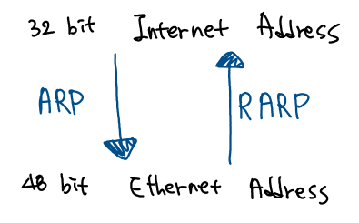
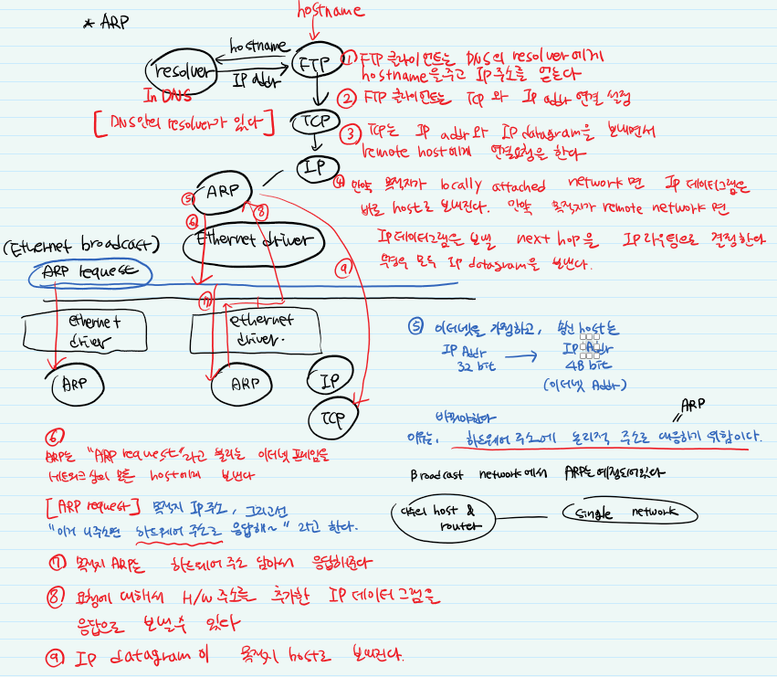

> ※  아래 내용은 스스로 공부한 내용을 정리한 글입니다.
> ※  때로 정확하지 않을 수 있으며, 참고만 부탁드립니다.
> ※  잘못된 내용이 있을시 댓글로 알려주시면 감사하겠습니다.

※ 노란 형광펜은 궁금점, 회색 형광펜과 파란 형광펜은 궁금점 해결에 대한 표시 입니다.

ARP (Address Resolution Protocol) LAN (L2) 에서 목적지를 제대로 찾을 수 있도록 돕는다.

ARP의 흐름을 알아보자.

먼저 FTP에 hostname이 들어온다. FTP 클라이언트는 DNS의 resolver에게 hostname을 주고 IP 주소를 얻는다. FTP 클라이언트는 TCP와 IP 주소를 연결하는 설정을 한다. TCP는 IP 주소와 IP datagram을 보내면서 remote host에게 연결 요청을 한다. 만약 목적지가 locally attached network (라우터를 안 거치는 내부망)이면 IP datagram은 바로 host로 보내진다. 만약 목적지가 remote network (외부망) 이면,  IP datagram을 보낼 next hop을 IP routing으로 결정한다. 이렇게 IP datagram이 보내진다. L2에서 ethernet을 쓴다고 가정하자. 송신 host는 IP 주소 32 bit를 48 bit의 ethernet 주소로 바꿔야한다. 이유는 H/W 주소에 논리적인 주소로 대응하기 위해서다. H/W 주소인 물리적인 주소는 ehthernet 또는 NIC 주소를 말한다.

ARP는 "ARP request"라고 불리는 ethernet frame을 네트워크 상의 모든 host에게 보낸다. "ARP request"는 "이거, 목적지 IP 주손데 네 주소면 H/W 주소로 응답줘~" 라고 한다. 목적지 ARP는 IP datagram에 H/W 주소를 담아서 응답해준다. ARP가 응답하고, 응답 IP datagram이 같이 보내진다. IP datagram은 목적지 host로 보내져서 IP, TCP를 차근차근 올라간다.

*순서를 따라가보자.*

영어를 해석해서 적는 바람에 내용이 매끄럽지 못하다. ^.^ 양 해 부 탁

ARP는 어디에 있는 프로토콜이지? 어디에 들어있지???

IP 내에 위치해서 IP라는 logical address가 ARP로 가며 physical address가 된다.

MAC 주소를 왜 받으려는 거지?

IP 주소는 행정적 주소다. 도로명 주소로 따지면 행정 제도에 따라 얼마든지 바뀔 수 있는 주소란 뜻이다. 하지만 "공원 왼편 세 번째 집"이란 위치 정보는 물리적인 주소다. 이 주소는 결코 변하지 않는다. 이게 MAC 주소다.

IP 주소는 끊임없이 변한다. 목적지에 정확하게 전달하기 위해서는 마지막에 꼭 MAC 주소로 목적지를 찾아야 한다.

---

[ Reference ]

중심 내용은 리차드 스티븐스의 TCP/IP Illustreated Volume 서적을 참고하고, 그 밖의 궁금한 것들은 동료 간의 질의응답을 통해 공부했습니다.
