### VM으로 사내 웹 서버 구축하기

**TLS 복호화 방법 중** **RSA 키를 이용한** **복호화 기능**의 테스트를 위해, 사내에 HTTPS 웹 서버와 RSA 키를 만드는 환경을 임시로 구축해야 했다. 사내 웹 서버 구축 과정은 [리눅스 웹 서버 https 설정하기](https://jdh5202.tistory.com/601 "리눅스 웹 서버 https 설정하기")를 참고했다.

### 테스트 환경

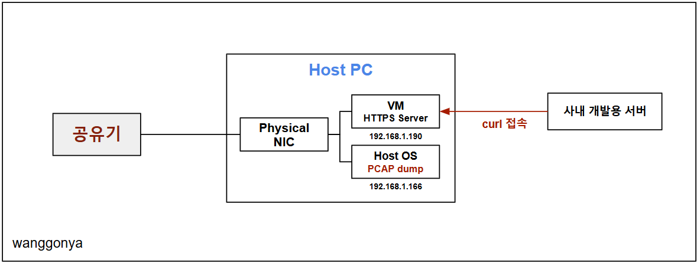

*웹 서버 구축을 위한 네트워크 구성도*

**VM**

- HTTPS Web Server 용

- Linux CentOS 8 운영체제의 VM을 이용했고, 네트워크는 어댑터에 브릿지 방식을 이용했다. 공유기에서 IP를 할당받아 Host OS와 동일한 Class IP 대역을 할당하기 위해서다.

**사내 개발용 서버**

- 사내 다른 대역의 개발 서버에서 curl을 통해 HTTPS Web Server에 접근한다.

- curl을 이용해 TLS 1.2 버전으로 통신하도록 강제한다.

**Host OS**

**-** Wireshark 이더넷에서 PCAP dump를 한다.

- 사내 개발용 서버가 curl을 통해 VM에 접근할 때 발생하는 트래픽을 캡처한다.

### VM 환경 세팅

Virtual Box 네트워크에서 **어댑터에 브리지**로 설정을 한다.

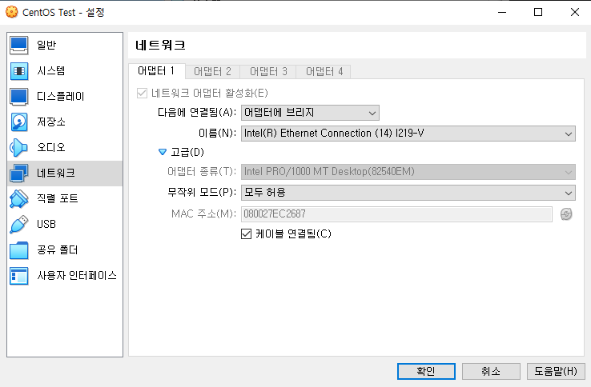

*Virtual Box 네트워크 설정*

현재 IP 설정을 확인하고, IP 할당이 되어 있지 않으면 수동으로 할당한다.

```bash
ifconfig
```

```bash
vi /etc/sysconfig/network-scripts/ifcfg-enp0s3
```

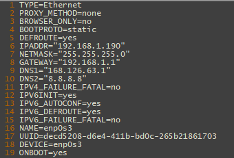

*IP 할당*

위와 같이 IPADDR / NETMASK / GATEWAY 를 설정한다.

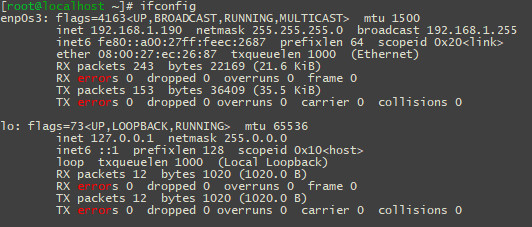

*IP 할당 후 ifconfig 모습*

호스트 PC와 테스트 할 사내 개발용 서버에서 ping을 통해 네트워크 연결을 확인한다.

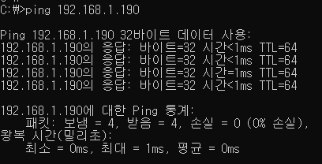

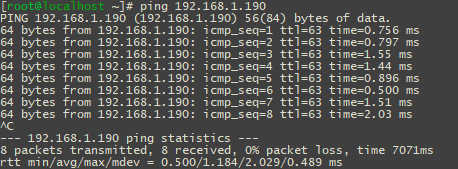

*ping 명령어를 통한 네트워크 연결 확인*

여기까지 완료되면 네트워크 구성은 끝난 것이다.

본격적으로 HTTPS 웹 서버를 구축해보자.

### HTTPS 웹 서버 구축

1. openssl 패키지 설치

```bash
 yum install openssl
```

참고. 아래와 같은 문제 발생 시 [CentOS-8-yum-오류-Error](https://junsuyoun.tistory.com/entry/CentOS-8-yum-%EC%98%A4%EB%A5%98-Error-Failed-to-download-metadata-for-repo-appstream-Cannot-prepare-internal-mirrorlist-No-URLs-in-mirrorlist "CentOS-8-yum-오류-Error") 글을 참고해 해결하자.

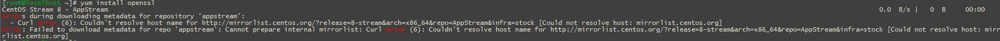

```bash
sed -i -e "s|#baseurl=http://mirror.centos.org|baseurl=http://vault.centos.org|g" /etc/yum.repos.d/CentOS-*
sed -i -e "s|mirrorlist=|#mirrorlist=|g" /etc/yum.repos.d/CentOS-*
```

2. 키 생성

```bash
cd /etc/pki/tls/certs/
```

```bash
# openssl genrsa -out http.key 2048

Generating RSA private key, 2048 bit long modulus (2 primes)
.................................+++++
...+++++
e is 65537 (0x010001)
```

또는 아래와 같이 password를 설정할 수도 있다.

```bash
# openssl genrsa -aes256 -out http.key 2048
Generating RSA private key, 2048 bit long modulus (2 primes)
Enter pass phrase for http.key:
Verifying - Enter pass phrase for http.key:
```

```groovy
cp http.key /etc/pki/tls/private/
```

3. 인증서 생성

아래와 같이 정보를 입력한다.

단, 맨 아래 2개인 passwod와 company name은 생략한다.

두 정보가 입력될 경우 잘못된 csr이 생성될 수 있다.

```bash
# openssl req -new -key http.key -out http.csr

You are about to be asked to enter information that will be incorporated
into your certificate request.
What you are about to enter is what is called a Distinguished Name or a DN.
There are quite a few fields but you can leave some blank
For some fields there will be a default value,
If you enter '.', the field will be left blank.
-----
Country Name (2 letter code) [XX]:kr
State or Province Name (full name) []:Seoul
Locality Name (eg, city) [Default City]:Gangnam
Organization Name (eg, company) [Default Company Ltd]:Company
Organizational Unit Name (eg, section) []:rnd
Common Name (eg, your name or your server's hostname) []:www.wanggonyarnd.com
Email Address []:sykim7@secudaim.com

Please enter the following 'extra' attributes
to be sent with your certificate request
A challenge password []: # 그냥 엔터
An optional company name []: # 그냥 엔터
```

4. crt 파일 생성

```bash
# openssl x509 -req -days 365 -in http.csr -signkey http.key -out http.crt

Signature ok
subject=C = kr, ST = Seoul, L = Gangnam, O = secudaim, OU = rnd, CN = www.secudaim.com, emailAddress = sykim7@secudaim.com
Getting Private key
```

5. ssl 모듈 패키지 설치

```bash
yum -y install mod_ssl
```

6. ssl 설정

```bash
vi /etc/httpd/conf.d/ssl.conf
```

아래 내용을 찾아 주석 해제한다.

```apache
DocumentRoot "/var/www/html"
```

아래 내용을 찾아 http로 수정한다.

```bash
SSLCertificateFile /etc/pki/tls/certs/localhost.crt

#   Server Private Key:
#   If the key is not combined with the certificate, use this
#   directive to point at the key file.  Keep in mind that if
#   you've both a RSA and a DSA private key you can configure
#   both in parallel (to also allow the use of DSA ciphers, etc.)
#   ECC keys, when in use, can also be configured in parallel
SSLCertificateKeyFile /etc/pki/tls/private/localhost.key
```

```bash
SSLCertificateFile /etc/pki/tls/certs/http.crt

#   Server Private Key:
#   If the key is not combined with the certificate, use this
#   directive to point at the key file.  Keep in mind that if
#   you've both a RSA and a DSA private key you can configure
#   both in parallel (to also allow the use of DSA ciphers, etc.)
#   ECC keys, when in use, can also be configured in parallel
SSLCertificateKeyFile /etc/pki/tls/private/http.key
```

7. 웹 서버 데몬 재시작

```ebnf
systemctl restart httpd
```

### HTTPS 웹 서버 상태 체크

확인 1. 열려있는 포트 확인

```routeros
# netstat -natlp | grep httpd

tcp6       0      0 :::80                   :::*                    LISTEN      29786/httpd         
tcp6       0      0 :::443                  :::*                    LISTEN      29786/httpd         

# lsof -i tcp:443

COMMAND   PID   USER   FD   TYPE DEVICE SIZE/OFF NODE NAME
httpd   29786   root    8u  IPv6  59968      0t0  TCP *:https (LISTEN)
httpd   29789 apache    8u  IPv6  59968      0t0  TCP *:https (LISTEN)
httpd   29790 apache    8u  IPv6  59968      0t0  TCP *:https (LISTEN)
httpd   29791 apache    8u  IPv6  59968      0t0  TCP *:https (LISTEN)
```

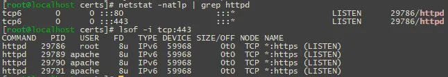

현재 결과를 보면, 443 port가 IPv4(*)에서 정상적으로 LISTEN 하고 있는 것을 확인할 수 있다.

웹 서버가 HTTPS 요청을 받을 준비가 완료된 상태라는 의미다.

확인 2. /var/www/html 권한

```yaml
# ls /var/www/html/ -ld
drwxr-xr-x 2 root root 6 Feb 16  2024 /var/www/html/
```

현재 /var/www/html/ 디렉터리의 소유자가 **root:root** 로 설정되어 있다.

Apache (httpd)는 기본적으로 apache 사용자의 권한으로 실행되므로, **웹 문서를 읽을 수 없는 상태일 가능성이 높다.**

접근이 가능하도록 아래와 같이 html 권한을 허용해준다.

```bash
sudo chown -R apache:apache /var/www/html
sudo chmod -R 755 /var/www/html
sudo systemctl restart httpd
```

확인 3. index.html 생성

```awk
echo "<h1>Apache is working</h1>" | sudo tee /var/www/html/index.html
```

또는

```bash
# cat index.html 
<!DOCTYPE html>
<html lang="ko">
<head>
    <meta charset="UTF-8">
    <title>WG's Web Server</title>
</head>
<body>
    <h1>WG's Apache Web Server is Running!</h1>
    <p>이 페이지는 정상적으로 제공되고 있습니다.</p>
    
</body>
</html>
```

마찬가지로 권한을 허용해준다.

```bash
chmod 777 /var/www/html/index.html
```

확인 4. 방화벽 설정

외부에서 접근이 가능하도록 방화벽 상태를 확인한다.

```bash
sudo firewall-cmd --list-all
```

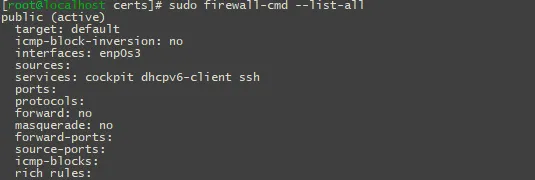

*위와 같이 방화벽이 활성화되면 접근이 불가능할 것이다.*

아래와 같이 방화벽 설정을 변경해준다.

```yaml
# sudo firewall-cmd --add-service=https --permanent
sudo firewall-cmd --reloadsuccess

# sudo firewall-cmd --reload
success

# sudo firewall-cmd --list-all
public (active)
  target: default
  icmp-block-inversion: no
  interfaces: enp0s3
  sources: 
  services: cockpit dhcpv6-client **https** ssh
  ports: 
  protocols: 
  forward: no
  masquerade: no
  forward-ports: 
  source-ports: 
  icmp-blocks: 
  rich rules:
```

#### HTTPS 웹 서버 접근

설정이 완료 되었으면 웹 서버 주소로 접속해보자.

https://192.168.1.190/

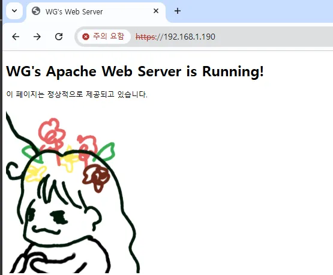

#### curl을 통한 TLS v1.2 확인

아래 명령어를 통해 curl로 다운로드가 완료되면 웹 서버 구축이 완료된 것이다.

```bash
# curl -k -l --tlsv1.1 --tls-max 1.2 --ciphers AES256-SHA256 -O https://192.168.1.190/index.html
  % Total    % Received % Xferd  Average Speed   Time    Time     Time  Current
                                 Dload  Upload   Total   Spent    Left  Speed
100   323  100   323    0     0  35888      0 --:--:-- --:--:-- --:--:-- 35888
```

### Wireshark를 통한 PCAP dump

호스트 PC에서 Wireshark를 통해 PCAP을 캡처해보자.

Wireshark를 실행하고 이더넷을 선택한다.

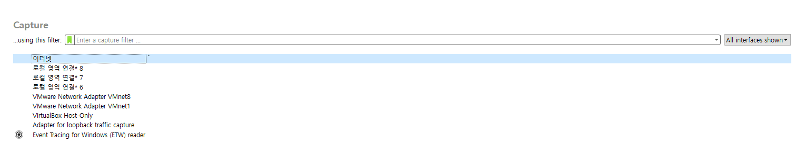

다음과 같이 필터링 설정을 한다.

```bash
ip.addr == 192.168.1.190
```

이제 사내 개발용 서버에서 아래 명령어를 통해 트래픽을 발생시켜 보자.

```bash
# curl -k -l --tlsv1.1 --tls-max 1.2 --ciphers AES256-SHA256 -O https://192.168.1.190/index.html
  % Total    % Received % Xferd  Average Speed   Time    Time     Time  Current
                                 Dload  Upload   Total   Spent    Left  Speed
100   323  100   323    0     0  35888      0 --:--:-- --:--:-- --:--:-- 35888
```

아래와 같이 TLS 1.2 트래픽이 캡쳐된다면 테스트에 성공한 것이다.

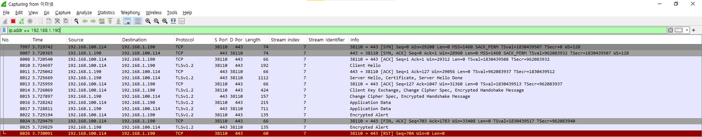

캡쳐를 중단하고 상단 좌측 File -&gt; Export Specified Packets... 를 선택해 PCAP을 저장하자.

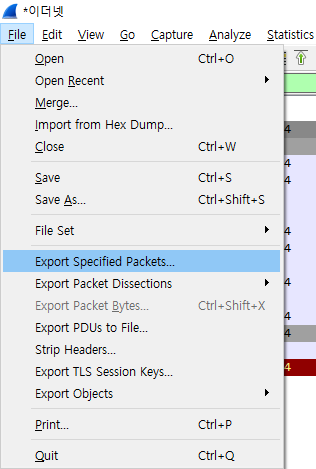

### Wireshark UI에서 복호화

이제 key를 가지고 Wireshark에서 TLS 1.2를 복호화 해보자.

우측 상단 Edit - Preferences - Protocol 에서 TLS 탭으로 들어간다.

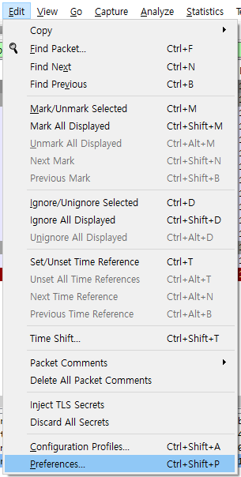

TLS 탭에서 RSA keys list 옆 Edit 버튼을 눌러 key를 등록한다.

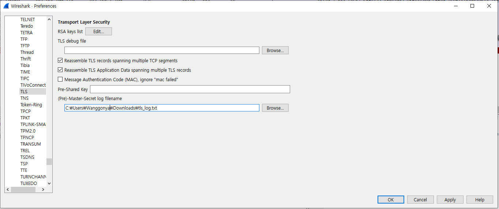


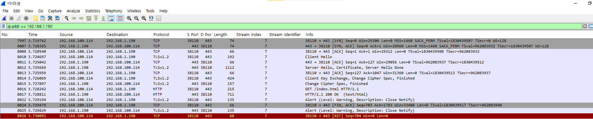

*HTTP로 복호화 된 모습*

단, http.key에 password를 추가한 경우 key 파일이 아닌 p12 파일을 만들어야 Wireshark에서 설정해줄 수 있다.

웹 서버에서 다음과 같은 과정으로 p12 파일을 만들어 주자.

```bash
# ^C
[root@localhost certs]# openssl pkcs12 -export -inkey http.key -in http.crt -out http.p12

Enter pass phrase for http.key:
Enter Export Password:
Verifying - Enter Export Password:
```

위와 같이 입력하면 아래 3가지에 대해 입력을 요구한다.

1. Enter pass phrase for http.key:

&gt; **http.key 파일 자체에 암호가 걸려 있다면**, 그 암호를 입력하라는 뜻이다.

위에서 개인 키를 생성할 때 -aes256 같은 옵션을 사용해 암호를 걸었다면 해당 암호를 그대로 입력해주면 된다.

만약 암호가 없는 키라면 이 단계는 **건너뛰거나 자동 통과**된다.

2. Enter Export Password:

&gt; 지금 만드는 **.p12 파일 자체에 걸 비밀번호를 입력한다.**

위 Wireshark에서 RSA key list 설정시 .p12를 불러오며, 이 비밀번호를 입력해야 한다.

3. Verifying - Enter Export Password:

&gt; 위에서 입력한 .p12 비밀번호를 **다시 한 번 확인 입력**하는 과정이다.

이렇게 설정한 후에는 Key File에 http.key 대신 새로 생성한 http.p12를 넣고,

Password에는 **Enter Export Password:** 에 입력한 암호를 입력하면 된다.

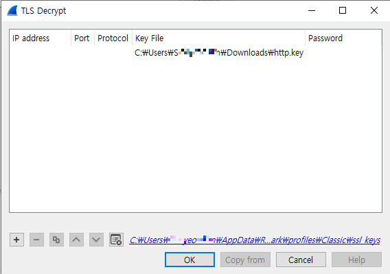

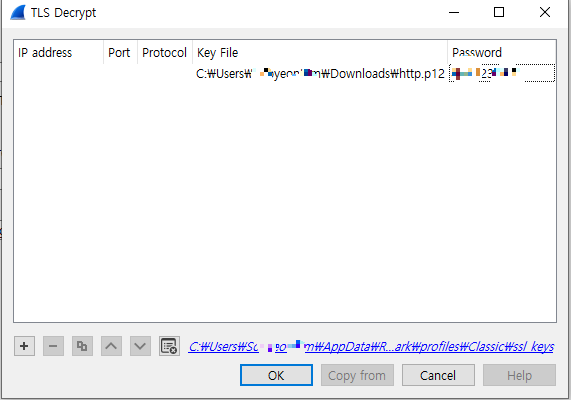

*좌 - http.key 등록 / 우 - http.p12 등록*

이로써 웹 서버 구축 및 RSA 키를 통한 TLS 1.2 복호화 기능을 확인해보았다.

### RSA 키를 이용한 TLS 복호화

TLS 1.2 버전과 그 이전 버전(TLS 1.1, TLS 1.0, SSL 3.0 등)의 Cipher Suite는 **암호화 방식, 키 교환 방식, 메시지 인증 코드(MAC) 알고리즘의 조합**으로 이루어져 있다.

특히, TLS 1.2에서는 여러 키 교환 방식이 사용될 수 있으며, 이중에는 RSA 키를 이용한 복호화 방식이 존재한다.

#### 1. TLS Cipher Suite 구조

TLS Cipher Suite의 명명 규칙은 다음과 같다.

```bash
TLS_<키 교환 방식>_WITH_<대칭키 암호화 알고리즘>_<MAC 알고리즘>
```

**예시**

- **TLS_RSA_WITH_AES_256_CBC_SHA**
	- 키 교환 방식: **RSA**
	- 대칭 암호화: **AES-256-CBC**
	- 메시지 인증: **SHA-1**
	- **RSA 키로 복호화 가능**
- **TLS_ECDHE_RSA_WITH_AES_128_GCM_SHA256**
	- 키 교환 방식: **ECDHE (Ephemeral Diffie-Hellman)**
	- 대칭 암호화: **AES-128-GCM**
	- 메시지 인증: **SHA-256**
	- **RSA 키로 복호화 불가능 (PFS, Perfect Forward Secrecy)**

#### 2. 주요 Cipher Suites 정리

**RSA 기반 키 교환 방식 (복호화 가능)**

| Cipher Suite | 키 교환 방식 | 암호화 방식 | MAC 알고리즘 | 비고 |
| --- | --- | --- | --- | --- |
| TLS_RSA_WITH_RC4_128_MD5 | RSA | RC4 (128-bit) | MD5 | 보안 취약 (RC4, MD5 취약점) |
| TLS_RSA_WITH_RC4_128_SHA | RSA | RC4 (128-bit) | SHA-1 | 보안 취약 (RC4 취약점) |
| TLS_RSA_WITH_3DES_EDE_CBC_SHA | RSA | 3DES | SHA-1 | 보안 취약 (Sweet32 공격) |
| TLS_RSA_WITH_AES_128_CBC_SHA | RSA | AES-128-CBC | SHA-1 | 보안 취약 (SHA-1 취약점) |
| TLS_RSA_WITH_AES_256_CBC_SHA | RSA | AES-256-CBC | SHA-1 | 보안 취약 (SHA-1 취약점) |
| TLS_RSA_WITH_AES_128_CBC_SHA256 | RSA | AES-128-CBC | SHA-256 | RSA 기반, TLS 1.2 지원 |
| TLS_RSA_WITH_AES_256_CBC_SHA256 | RSA | AES-256-CBC | SHA-256 | RSA 기반, TLS 1.2 지원 |

**특징**

- RSA 기반 키 교환 방식은 서버의 RSA Private Key로 복호화 가능
- 하지만 보안성이 취약하여 대부분의 최신 웹사이트에서는 사용되지 않음
- TLS 1.2에서도 사용 가능하지만, 비추천
- TLS 1.3에서는 이 방식이 완전히 제거됨

### 글을 마치며

TLS 1.2 복호화를 위해 임시로 웹 서버를 구축하여 테스트를 했으나, 아쉽게도 RSA Private Key를 이용한 복호화는 현재 웹 보안 환경에서는 의미가 없어진 기능이다. 현대 웹사이트는 대부분 ECDHE를 사용하므로 Wireshark에서 RSA 키로 복호화가 불가능해졌고, TLS 1.3에서는 RSA 키 교환 방식이 완전히 제거되었기 때문이다.

다만 네트워크 보안 장비에서는 RSA 키를 통한 TLS 1.2 복호화 기능을 기본적으로 제공하는 경우가 있어, 기능 검증을 위해 간단하게 나마 HTTPS 웹 서버를 구축해보았다. 웹 서버를 구축하기 위해 네트워크 구성을 고민하고, TLS 버전 별 차이에 대해 리서치를 한 점에서 꽤 흥미로운 실습이었다.

---

[ Reference ]

[리눅스 웹 서버 https 설정하기](https://jdh5202.tistory.com/601 "리눅스 웹 서버 https 설정하기")
