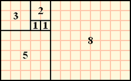
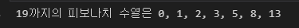

**피보나치 수**는 첫째 및 둘째 항이 1이며 그 모든 항은 바로 앞 두 항의 합인 수열이다. 따라서 처음 여섯 항은 각각 1, 1, 2, 3, 5, 8이다.



*피보나치 수를 이용한 사각형 채우기*

즉, 이후의 항들이 이전의 두 항을 더한 값으로 이루어지는 수열을 말한다.
파이썬으로 정수 n을 입력받아 n 이하까지의 피보나치수열을 출력해보자.
첫 번째 항은 편의상 0이라고 정의했다.

&lt; 코드 전문 &gt;

```python
n = int(input("num? : ")) # n 입력
li = [0, 1] # 최초 li 정의
print('0',end='') # 최초 0부터 프린트
while (li[0]+li[1]) <= n: # 마지막 숫자가 n을 넘지 않을때까지 반복
    li = [li[1], (li[0]+li[1])] #리스트 안에 숫자 2개를 피보나치 수열의 규칙에 맞게 정의해줌
    print(f', {li[-1]}', end='') # 연결해서 출력
```

한 줄씩 뜯어보자.

```python
n = int(input("num? : ")) # n 입력
```

먼저 input을 이용해 변수 n에 사용자에게 입력받은 문자를 저장한다.
이때 int( )를 해주어 정수로 지정해준다.

```python
li = [0, 1] # 최초 li 정의
```

우리는 피보나치수열을 단 두 개의 항으로 계속 나열해줄 것이다.
그러기 위해 li라는 리스트 변수에 가장 먼저 0과 1을 지정해주자.
초기 값을 알려주는 이유는 그다음 항부터 이전의 두항을 더해야 한다는 피보나치수열의 규칙을 따르기 위해서이다.

```python
print(f'{n}까지의 피보나치 수열은 0',end='') # 최초 0부터 프린트
```

조건에 0부터 프린트하라는 내용이 있었으므로 0을 프린트해준다.
사용자가 입력한 값도 보여줄 수 있도록 f스트링을 이용하여 n을 함께 출력한다.
단, 다음 수열도 줄 바꿈 없이 출력될 수 있도록 end=' '를 추가해주자

```python
while (li[0]+li[1]) <= n: # 마지막 숫자가 n을 넘지 않을때까지 반복
```

반복문을 사용해서 마지막 숫자가 입력받았던 n을 넘지 않을 때까지 반복시킨다.

```python
	li = [li[1], (li[0]+li[1])] #리스트 안에 숫자 2개를 피보나치 수열의 규칙에 맞게 정의해줌
```

li의 첫 번째 항과 두 번째 항을 계속 교체해주는 코드다.
인덱스는 첫째 항부터 0, 1, 2,...으로 진행된다.
따라서 li = [둘째항, 첫째항+둘째항]으로 바꾸어주면 피보나치수열의 규칙을 따르게 된다.

```python
	print(f', {li[-1]}', end='') # 연결해서 출력
```

계속 생겨나는 항들을 줄 바꿈 없이 프린트하면 n직전의 수까지 피보나치 수열이 나열된다.
f스트링을 이용하였으나 더 좋은 방법이 있다면 생략해도 된다. 나는 공백과 쉼표를 넣기 위해 사용했다.

결과를 확인해보자.



*output*

---

파이썬을 배운지 보름쯤 후의 과제 문제였다.
배운 것 내에서 풀자니 참 어렵고 복잡했지만 피보나치 원리를 생각해서 최대한 단순하게 풀려고 했다.
결국 제일 단순해보이는 리스트와 인덱싱을 이용했다. ^^

이 문제를 풀려고 한 시간을 고민했다. 앞에 쉼표를 어떻게 붙일지도 꽤 오래 고민했다.
언제나 해결방법은 단순하다.
하지만 해결과정은 절대 단순하지 않았다. 한 시간의 값진 노력을 얻고 갔으니 그걸로 됐다.
지금 배우는 자바도 화이팅~
