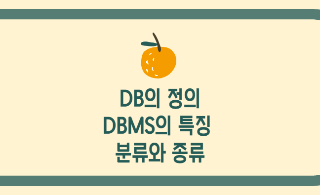
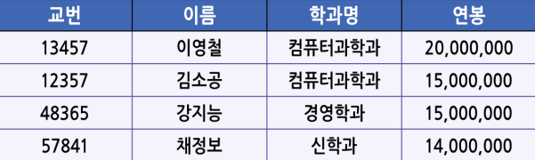

목차

1. 데이터베이스의 정의

2. DBMS의 특징

3. DBMS의 분류와 종류

---

### 데이터베이스의 정의

**데이터베이스, DB란?**

컴퓨터 기억 장치 내에 체계적으로 분류하고 정리하여 모아놓은 데이터의 집합이다.

조직에서 여러 업무에 사용된다.

| **통합된 데이터의 집합** | **데이터의 중복을 최소화**하여 **효율성**을 증진 |
| --- | --- |
| **저장된 데이터의 집합** | 컴퓨터에 의해 **접근 가능한 매체**에 저장 |
| **운영 데이터의 집합** | **고유 기능 수행**을 위해 필요한 데이터의 집합 |
| **공용 데이터의 집합** | 사용자와 시스템이 **공동으로 소유하고 사용**하는 데이터의 집합 |

**파일 처리 시스템과의 차이?**

파일 처리 시스템은 DB 사용 이전의 데이터 처리, 관리 기법이다. 데이터 처리를 위한 애플리케이션 프로그램이 파일에 직접 접근하여 데이터를 저장하고 읽는 방식이다.

파일 처리 시스템을 사용할 경우 조직에서의 개별적 업무에 개별적 파일을 유지해야 한다.

이는

업무마다 생기는 다양한 파일의 유사성으로, 부분적으로 동일한 데이터가 저장될 수 있다.

따라서 다양한 문제가 발생한다.

- **데이터 종속 문제**
논리적 데이터 종속 : 다른 애플리케이션에서 작성된 파일을 사용할 수 없는 문제점! 데이터 중복을 야기한다!!!
물리적 데이터 종속 : 물리적인 시스템 구조가 변경되면 접근 경로나 파일을 읽는 방법이 달라진다. 결국 데이터의 접근이 불가능해짐!!
- **데이터 중복 문제**
"일관성" 하나의 사실에 대해 하나의 데이터 값만을 유지하는 상태다.
"보안성" 같은 데이터에 같은 수준의 보안을 유지하는 상태다.
"경제성" 동일한 정보량에 대해 최소한의 데이터만으로 구성하는 상태다.
데이터 중복 문제로 일관성, 보안성, 경제성이 무너진다.
- **데이터 무결성 문제**
이는 관리되는 데이터의 정확성을 보장하는 것으로, 하나의 사실에 대해 두 개 이상의 데이터가 서로 일치하지 않은 경우나 또는 업무 규칙상 생성되는 다양한 형식의 제약 조건을 만족하지 않을 경우 데이터 무결성 훼손이 발생한다.
특히 무결성을 애플리케이션 수준에서 관리하기 때문에 업무 처리 작업 이외에 데이터 무결성에 대한 작업이 추가되어 애플리케이션의 규모가 방대해지고 개발에 많은 비용이 소모된다.
새로운 제약조건이 추가되거나 수정될 때마다 관련 프로그램을 일일이 변경해야해서 번거롭고 복잡해진다.
- **데이터 동시 접근 문제**
시스템의 성능을 전체적으로 향상시키고 사용자에게 빠른 응답을 주기 위해서는 여러 사용자의 요청 작업을 동시에 처리해야 한다. 이때 데이터의 일관성이 훼손된다!

슬슬 DBMS가 나온다.

**데이터베이스 관리 시스템 (DBMS) 의 역할**

바로 파일 처리 시스템의 문제를 보완하는 것! (파일 처리 시스템의 문제점은 데이터를 사용하는 사용자나 프로그램이 데이터 파일에 직접적으로 접근하기 때문에 발생한다.)

DBMS는 "종속성" "중복성" "무결성" "동시 접근"의 네 가지 역할을 수행한다!!!

그래서 사용자나 프로그램이 필요한 데이터만 요청하고, DBMS는 데이터의 사용 영역과 관리 영역을 분리해주면서 파일 처리 시스템의 문제점을 보완해주는 것이다.

잠깐, **DB의 용어** 보고 가자.

**데이터?**

사실을 나타내는 수지다. 양적 데이터와 질적 데이터로 구성된다. 정량적, 정성적 특징을 나타낼 수 있는 값과, 값에 대한 설명인 메타데이터로 구성된다.

**데이터베이스?**

사용 목적에 따라 구성된 데이터의 집합이다. 특정 조직의 업무 처리를 위해서 애플리케이션 시스템에서 사용되는 데이터의 집합이다. ~~굉장히 정의스러운 정의다.~~

**데이터베이스 관리 시스템?**

데이터 문제가 발생하지 않도록 여러 가지 관리 기능을 수행하는 소프트웨어 패키지....

---

### 2. DBMS의 구조와 특징

데이터베이스에도 언어가 있나요?

SQL과 DBMS의 역할은 뭐죠?

일단 SQL... 넌 누구냐

**SQL (Structured Query Language)**은 가장 대표적인 데이터 베이스 언어다.

**DBMS의 역할은?**

데이터를 사용하는 것과 데이터를 관리하는 것을 분리시키는 장치다.

데이터에 대한 명령을 처리해야 하기 때문에 명령어 체계를 제공한다. 즉, 언어 형태의 인터페이스를 제공한다.

여기서

**데이터베이스 언어의 세 가지 영역?**

| **데이터 정의 언어** | 데이터 모델에 따라 애플리케이션 프로그램이 요구하는 데이터의 논리, 물리적 구성과 조건을 정의한다. |
| --- | --- |
| **데이터 조작 언어** | 구조화된 데이터에 사용자가 정확하고 완전하게 접근하고 조작할 수 있도록 지원한다. |
| **데이터 제어 언어** | DBMS 내부의 규칙이나 기능을 기술하고 사용자 접근 제어, 백업과 복원 설정 등 전체적인 DBMS를 관리하는 방법을 지원한다. |

다음으로 넘어가보자.

---

### 3. DBMS의 분류와 종류

**데이터 모델에 따라 DBMS를 분류**할 수 있다.

**데이터 모델**은 뭘까?

데이터베이스 내에 존재하는 데이터-데이터 간의 관계를 정의한다.

또 데이터의 의미와 데이터에 존재하는 조건을 나타내는 방식을 말한다.

데이터모델에 따른 DBMS는

**관계형, 객체지향형, 객체관계형, 계층형**이 있다.

| **관계형 DBMS**Relational DBMS | 모든 데이터와 데이터 간의 관계를 2차원의 Relation의 표 형태로 기술하는 모델이다. |
| --- | --- |
| **객체지향형 DBMS**Object Oriented DBMS | 데이터를 객체로 표현하고 객체지향 패러다임의 특징을 적용한 모델이다. |
| **객체관계형 DBMS**Object Relational DBMS | 관계형 + 객체지향형 모델 결합하여 모델의 장접을 취합한 모델이다. |
| **계층형 DBMS**Hierarchical DBMS | 데이터베이스의 논리적 구조가 트리 형태의 반복적인 부모-자식 관계로 표현되는 모델이다. |

*관계형 DBMS 예시*

(MySQL은 관계형 DBMS에 속한다.)

관계형 DBMS의 종류에는

MSSQL Server, DB2, INFORMIX, 알티베이스, 티베로 등이 있다.

---
