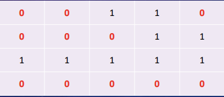

## 문제

N * M 크기의 얼음 틀이 있다. 구멍이 뚫려 있는 부분은 0, 칸막이가 존재하는 부분은 1로 표시된다. 구멍이 뚫려 있는 부분끼리 상, 하, 좌, 우로 붙어 있는 경우 서로 연결되어 있는 것으로 간주한다. 이 때 얼음 틀의 모양이 주어졌을 때 생성되는 총 아이스크림의 개수를 구하는 프로그램을 작성하시오.

### 입력 예시

&gt;4 5

&gt;00110

&gt;00011

&gt;11111

&gt;00000

### 출력 예시

&gt;3



*0이면 구멍이 뚫려있고, 1이면 칸막이가 존재*

---

### DFS(Depth-first Search)란?

깊이 우선 탐색이라는 알고리즘이다.

"더 나아갈 길이 보이지 않을 때까지 깊이 들어간다"를 원칙으로 한다.

그래프 내의 정점을 방문한다. 마치 미로찾기 처럼.

특징은?

자기 자신을 호출하는 순환 알고리즘이다.

트리 순회(전위, 중위, 후위 순회)는 모두 DFS의 한 종류이다.

그래프 탐색의 경우, 어떤 노드를 방문 했었는지 여부를 반드시 검사해야 한다.

즉,

1단계 &gt; 1번 노드(시작 노드)를 방문하면, 방문한 노드는 방문했다고 표시한다.

2단계 &gt; 1번 노드와 인접한 노드를 차례로 순회한다. 인접한 노드가 없다면 종료한다.

3단계 &gt; 1번 노드와 인접한 2번 노드를 방문했다면, 1번과 인접한 또 다른 노드를 방문하기 전에

2번의 이웃 노드를 전부 방문해야 한다.

2번을 시작 정점으로 DFS를 다시 시작한다. 2번의 이웃 노드들을 방문한다. (1단계를 다시 함)

4단계 &gt; 2번 분기를 전부 탐색했다면 다시 1번에 인접한 정점들 중 아직 방문이 안 된 정점을 찾는다.

2번 분기를 완벽히 탐색한 뒤에 1번의 다른 이웃 노드를 방문할 수 있다는 뜻.

정점에 모두 방문했으면 종료, 있으면 다시 그 정점을 시작 정점으로 DFS를 시작한다.

---

### 코드

```java
public class 음료수얼려먹기 {
    
    public static int N,M;
    public static int [][] graph = new int [1000][1000];
    
    public static void main(String[] args){
        Scanner scanner = new Scanner(System.in);
        
        // N, M 입력
        N = scanner.nextInt();
        M = scanner.nextInt();
        scanner.nextLine(); //버퍼 지우
        
        
        // 2차원 리스트의 맵 정보 입력 받기
        for(int i=0; i <N; i++){
            String str = scanner.nextLine();
            for(int j=0; j<M; j++){
                graph[i][j] = str.charAt(j) - '0';
            }
            }
            scanner.close();
            
            //현재 노드(위치)에 대하여 음료수 채우기
            int result = 0;
            // 2차원 리스트의 맵 정보 입력 받기
            for(int i=0; i <N; i++){
                for(int j=0; j<M; j++){
                    //현재 위치에서 DFS 수행
                    if(dfs(i, j)){
                        result+=1;
                    }
                }
                }
                
                System.out.println(result);
                
                
                }
                
                // DFS로 특정 노드를 방문하고 상하좌우로 연결된 모든 노드들도 방문
                public static boolean dfs(int x, int y){
                    // 주어진 범위를 벗어나는 경우에는 종료
                    if(x <= -1 || x>= N || y <= -1 || y >= M)
                        return false;
                    
                    //현재 노드를 아직 방문하지 않았다면
                    if(graph[x][y] == 0){
                        //해당 노드 방문 처리
                        graph[x][y] = 1;
                        dfs(x -1, y);
                        dfs(x, y -1);
                        dfs(x + 1, y );
                        dfs(x, y + 1);
                        return true;
                    }
                    return false;
                }
                }
```

---

### 궁금한 점

public static이 필요한 이유
