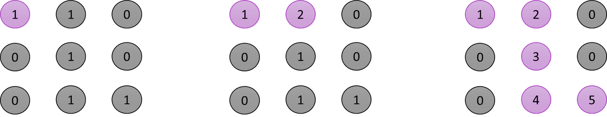

## 문제

스틴이는 N*M 크기의 직사각형 형태의 미로에 갇혀있다. 미로에는 여러 마리의 괴물이 있어 이를 피해 탈출해야 한다. 스틴이의 위치는 (1,1)이고 미로의 출구는 (N,M)의 위치에 존재하며 한번에 한칸씩 이동할 수 있다.

이때 괴물이 있는 부분은 0으로 괴물이 없는 부분은 1로 표시되어 있다. 미로는 반드시 탈출할 수 있는 형태로 제시된다. 이때 스틴이가 탈출하기 위해 움직여야 하는 최소 칸의 개수를 구하시오. (처음과 끝 칸 포함)

**입력조건**

첫째 줄에 두 정수 N,M(4&lt;=N,M&lt;=200)이 주어진다.

다음 N개의 줄에는 각각  M개의 정수(0 또는 1)로 미로의 정보가 주어진다.

각각의 수들은 공백 없이 붙어서 입력으로 제시된다. 또한 시작 칸과 마지막 칸은 항상 1이다.

**출력조건**

첫째 줄에 최소 이동 칸의 개수를 출력한다.



**입력 예시**

&gt;5 6
&gt;101010
&gt;111111
&gt;000001
&gt;111111
&gt;111111

**출력 예시**

&gt;10

### 힌트

1.맨 처음에 (1,1)의 위치에서 시작, 시작 값은 항상 1
2. (1,1)좌표에서 상,하,좌,우로 탐색을 진행 (1,2)위치의 값을 2로 변경
3. BFS를 계속 수행하여 최단 경로의 값들이 1씩 증가하는 형태로 변경

---

## 정답 코드전문

```java
package day24_HW26;
import java.util.*;

class Node {

    private int index;
    private int distance;

    public Node(int index, int distance) {
        this.index = index;
        this.distance = distance;
    }

    public int getIndex() {
        return this.index;
    }
    
    public int getDistance() {
        return this.distance;
    }
}

public class Answer_45 {

    public static int n, m;
    public static int[][] graph = new int[201][201];

    // 이동할 네 가지 방향 정의 (상, 하, 좌, 우) 
    public static int dx[] = {-1, 1, 0, 0};
    public static int dy[] = {0, 0, -1, 1};

    public static int bfs(int x, int y) {
        // 큐(Queue) 구현을 위해 queue 라이브러리 사용 
        Queue<Node> q = new LinkedList<>();
        q.offer(new Node(x, y));
        // 큐가 빌 때까지 반복하기 
        while(!q.isEmpty()) {
            Node node = q.poll();
            x = node.getIndex();
            y = node.getDistance();
            // 현재 위치에서 4가지 방향으로의 위치 확인
            for (int i = 0; i < 4; i++) {
                int nx = x + dx[i];
                int ny = y + dy[i];
                // 미로 찾기 공간을 벗어난 경우 무시
                if (nx < 0 || nx >= n || ny < 0 || ny >= m) continue;
                // 벽인 경우 무시
                if (graph[nx][ny] == 0) continue;
                // 해당 노드를 처음 방문하는 경우에만 최단 거리 기록
                if (graph[nx][ny] == 1) {
                    graph[nx][ny] = graph[x][y] + 1;
                    q.offer(new Node(nx, ny));
                } 
            } 
        }
        // 가장 오른쪽 아래까지의 최단 거리 반환
        return graph[n - 1][m - 1];
    }

    public static void main(String[] args) {
        Scanner sc = new Scanner(System.in);

        // N, M을 공백을 기준으로 구분하여 입력 받기
        n = sc.nextInt();
        m = sc.nextInt();
        sc.nextLine(); // 버퍼 지우기

        // 2차원 리스트의 맵 정보 입력 받기
        for (int i = 0; i < n; i++) {
            String str = sc.nextLine();
            for (int j = 0; j < m; j++) {
                graph[i][j] = str.charAt(j) - '0';
            }
        }

        // BFS를 수행한 결과 출력
        System.out.println(bfs(0, 0));
    }
}
```
